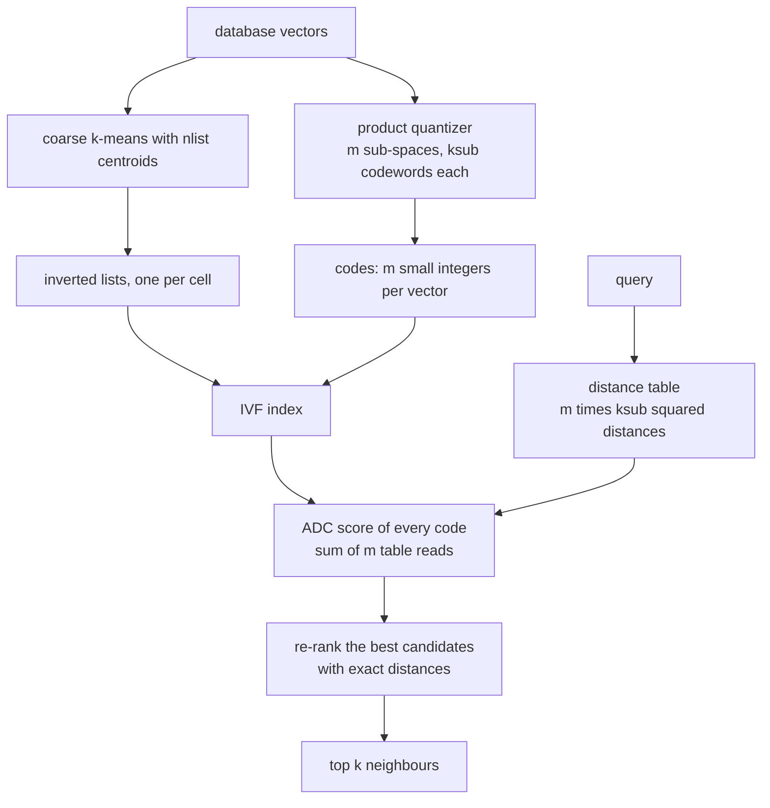
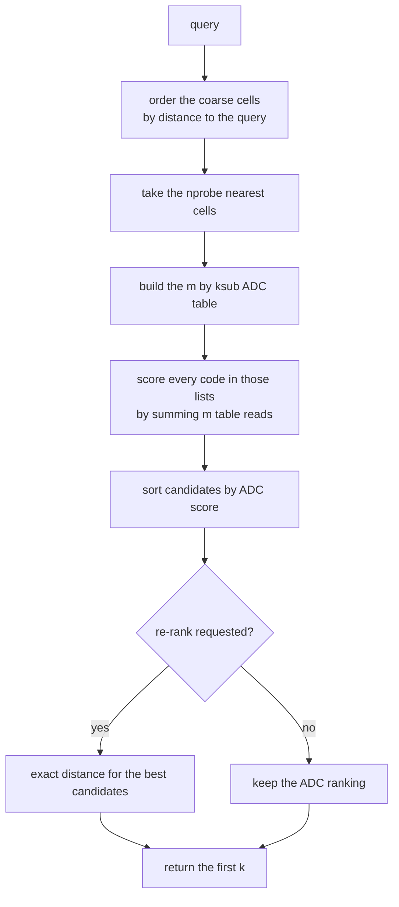
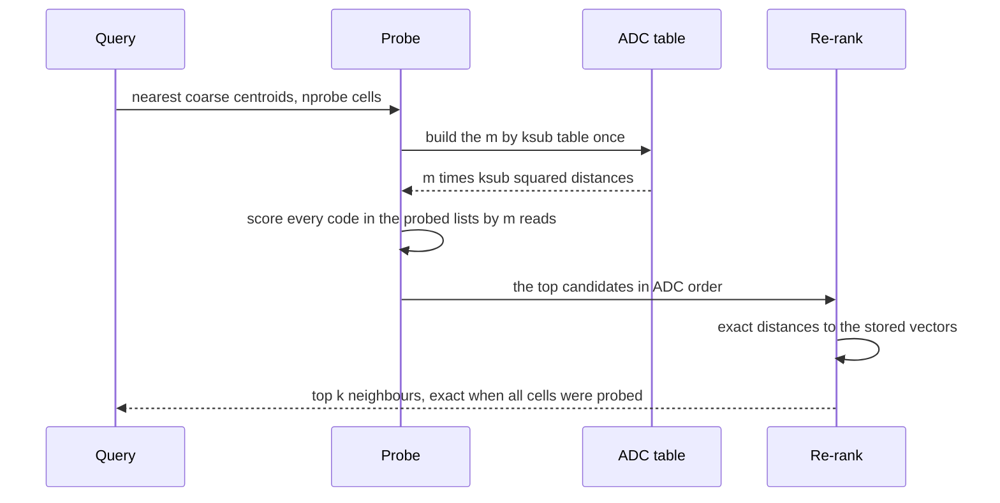

# 779 — Implement approximate nearest neighbor with quantization for billion-scale

> **Tier:** Expert · **CTCI chapter:** Beyond — Advanced Data Structures & Algorithms
> **Task spec:** [779-implement-approximate-nearest-neighbor-with-quantization-for-bil.md](../../../tasks/expert/779-implement-approximate-nearest-neighbor-with-quantization-for-bil.md)
> **Solutions:** [Python](../../../solutions/python/expert/779-implement-approximate-nearest-neighbor-with-quantization-for-bil/solution.py) ·
> [Java](../../../solutions/java/expert/779-implement-approximate-nearest-neighbor-with-quantization-for-bil/Solution.java) ·
> [JavaScript](../../../solutions/javascript/expert/779-implement-approximate-nearest-neighbor-with-quantization-for-bil/solution.js) ·
> [C#](../../../solutions/csharp/expert/779-implement-approximate-nearest-neighbor-with-quantization-for-bil/Solution.cs)

## 1. Problem restatement

Build the classic billion-scale index — **IVF + PQ** — in a scaled-down but fully real form, and
measure how much accuracy the compression costs.

- **Coarse quantizer (IVF).** k-means with `nlist` centroids partitions the vectors into inverted lists.
- **Product quantizer (PQ).** The `d` dimensions are cut into `m` sub-spaces; each sub-space is
  clustered into `ksub` codewords by k-means, and a vector becomes a tuple of `m` small integers.
- **Query.** Probe the `nprobe` nearest coarse centroids, score the codes of those lists with
  **asymmetric distance computation** (ADC, the query is *not* quantized), then optionally **re-rank**
  the candidates against the exact stored vectors.

Inputs: the database vectors, the parameters `nlist`, `m`, `ksub`, `nprobe`, `k`. Outputs: the
`(distance, index)` neighbours, plus the diagnostics `reconstruction_error(vectors)` and
`recall@k` against brute force. Concrete results the checks assert:

- k-means invariants on 300 vectors of dimension 16: the reported objective equals
  `kmeans_objective(points, centroids, assignments)`, every point is assigned to its nearest centroid,
  a centroid equals the mean of its cluster within `1e-18`, and 40 Lloyd iterations never raise the
  objective above what 2 iterations give;
- a PQ code for `dims = 16`, `m = 4`, `ksub = 8` is four integers in `[0, 8)`, and each one is the
  nearest codeword of its sub-space;
- **ADC is an identity, not an approximation**: `adc(table, code)` equals
  `squared_distance(query, decode(code))` within `1e-12` for every query/vector pair;
- growing the codebook from 2 to 8 codewords never increases the reconstruction error;
- probing **all** 12 cells with re-ranking reproduces brute-force 10-NN *exactly*: all
  `10 · len(queries)` neighbours match, distance for distance (`queries = vectors[::20]`, so 15 queries);
- probing must return exactly the `nprobe` nearest coarse centroids, ordered by `(distance, cell)`;
- recall@10 grows with `nprobe`: `1.0` when every cell is probed, at least `0.5` when only one is;
- a single-cell probe with `rerank=False` returns only ids of that cell, ordered by ADC distance;
- degeneracies: `nlist = 50` over 3 points yields 3 centroids, one vector with `k = 5` returns one
  neighbour, identical vectors work, and `k` larger than the database returns what exists.

## 2. Intuition

Exact search costs one distance per database vector: at a billion 128-dimensional vectors that is
`10^9 · 128` multiplications per query, and the index itself is 512 GB of floats. Both costs have to
go down, and *both* reductions come from the same trick — replace a distance computation by a table
lookup.

1. **Search less of the data (IVF).** Coarse k-means partitions the space; if the query's nearest
   neighbour is in one of the `nprobe` nearest cells with high probability, only a small fraction of the
   database is touched. This is a *recall* knob: more cells, more recall, more work.
2. **Store less per vector (PQ).** Cutting the dimensions into `m` independent sub-spaces and
   quantizing each one means a vector is stored as `m` codeword indices — `m · log2(ksub)` bits instead
   of `32 d` bits. The Python outline uses `ksub = 8` so the codes stay tiny; the Java variant documents
   the same trade in bits: `12` bits per vector in its 8-dimensional example against `256` bits for
   floats.
3. **Compute distances without floats (ADC).** Because the code distance is a *sum of per-sub-space
   terms*, the query can precompute one table of `m · ksub` squared distances and score every database
   code by `m` additions. That is the identity the checks assert.



Re-ranking is what makes the full-probe case exact: ADC scores the *reconstruction*, so ties and small
errors are possible; sorting the candidate pool by the exact distance to the stored vector removes that
error, and probing every cell then visits every vector exactly once — brute force with the same answers.

## 3. Algorithm

1. **Deterministic randomness.** `splitmix64` supplies every draw; `random_vectors(count, dims, seed)`
   produces coordinates in `[0, 1)` from `(r % 2**20) / 2**20`. Nothing is seeded from the clock.
2. **k-means** (`kmeans(points, k, iterations = 40, seed = 1)`): cap `k` at the number of points; seed
   the first centroid with `points[0]` and every following one farthest-first, using a `splitmix64` draw
   to break ties among distant candidates; then Lloyd iterations — assign every point to its nearest
   centroid, recompute each centroid as its cluster's mean (an empty cluster keeps its old centroid),
   stop early when the assignment vector stops changing. Finally recompute the assignments and return
   `(centroids, assignments, objective)`.
3. **Product quantizer** (`ProductQuantizer(dims, m, ksub, seed)`): `width = dims / m` (asserted to
   divide); `train` clusters each projected sub-space into `ksub` codewords with k-means; `encode`
   returns the nearest codeword index per sub-space; `decode` concatenates the codewords;
   `distance_table(query)` holds `table[space][codeword] = squared_distance(query slice, codeword)`;
   `adc(table, code)` sums `m` table reads; `reconstruction_error` averages
   `squared_distance(vector, decode(encode(vector)))`.
4. **IVF** (`IVFIndex(nlist, dims, m, ksub, seed)`): coarse k-means over the whole vectors, a list per
   cell holding `(index, code)` pairs, and a product quantizer trained on the same sample.
5. **Probe.** `probe_cells(query, nprobe)` sorts the cells by `(squared_distance(query, centroid), cell)`
   and takes the first `max(1, min(nprobe, len(cells)))`; the cell index breaks distance ties, which is
   what makes the result reproducible.
6. **Search.** Score every code in the probed lists by ADC, sort, optionally re-rank the best
   `rerank_limit` (or all) candidates by the exact squared distance to the stored vectors, and return the
   first `k`.
7. **Diagnostics.** `brute_force_knn(query, vectors, k)` is the ground truth; `recall@k` is the size of
   the intersection with the approximate answer, averaged over the query set.

```text
procedure train(vectors)
    centroids, assignments ← kmeans(vectors, nlist)
    lists ← one empty list per centroid
    quantizer ← ProductQuantizer(dims, m, ksub).train(vectors)
    for index, vector in enumerate(vectors) do
        lists[assignments[index]].append((index, quantizer.encode(vector)))

procedure search(query, k, nprobe, rerank)
    table ← quantizer.distanceTable(query)
    candidates ← empty list
    for cell in probeCells(query, nprobe) do
        for index, code in lists[cell] do
            candidates.append((adc(table, code), index))
    sort candidates by score ascending
    if rerank then
        ranked ← sort candidates by squaredDistance(query, vectors[index])
    else
        ranked ← candidates
    return the first k entries of ranked

procedure probeCells(query, nprobe)
    scored ← every cell ordered by (squaredDistance(query, centroid), cell)
    return the first max(1, min(nprobe, length(scored))) cells

procedure kmeans(points, k, iterations)
    k ← min(k, length(points))
    centroids ← [points[0]]
    while length(centroids) < k do
        farthest ← the point maximizing its distance to the nearest centroid
        pick ← a seeded random point
        centroids.append(pick if its distance to the nearest centroid is positive else farthest)
    assignments ← empty
    for iteration in 1..iterations do
        newAssignments ← nearest centroid of every point
        clusters ← points grouped by newAssignments
        centroids ← mean of each cluster, or the old centroid when the cluster is empty
        if newAssignments = assignments then break
        assignments ← newAssignments
    return centroids, nearestCentroidOfEveryPoint, objective
```



## 4. Worked example

A four-dimensional example with `m = 2` sub-spaces, `ksub = 2` codewords each, so a code is two bits.
Suppose the trained codebooks are

- sub-space 0 over `(x0, x1)`: `c00 = (0, 0)`, `c01 = (1, 1)`;
- sub-space 1 over `(x2, x3)`: `c10 = (0, 0)`, `c11 = (2, 0)`.

Database vectors `d0 = (0, 0, 0, 1)` and `d1 = (1, 1, 2, 0)`, query `q = (0, 0, 0, 1)`.

| Object | Sub-space 0 slice | Nearest codeword | Sub-space 1 slice | Nearest codeword | Code | Decoded vector | Squared error |
| --- | --- | --- | --- | --- | --- | --- | --- |
| `d0` | `(0, 0)` | `c00` = code `0` | `(0, 1)` | `c10` (1) beats `c11` (5) → `0` | `(0, 0)` | `(0, 0, 0, 0)` | `1` |
| `d1` | `(1, 1)` | `c01` = code `1` | `(2, 0)` | `c11` = code `1` | `(1, 1)` | `(1, 1, 2, 0)` | `0` |

The query's distance table is built once for the whole index:

| Table entry | Slices | Value |
| --- | --- | --- |
| `table[0][c00]` | `(0, 0)` vs `(0, 0)` | `0` |
| `table[0][c01]` | `(0, 0)` vs `(1, 1)` | `1 + 1 = 2` |
| `table[1][c10]` | `(0, 1)` vs `(0, 0)` | `0 + 1 = 1` |
| `table[1][c11]` | `(0, 1)` vs `(2, 0)` | `4 + 1 = 5` |

Scoring is then two table reads per vector:

| Vector | Code | ADC = sum of table reads | Exact distance to the decoded vector | Exact distance to the stored vector |
| --- | --- | --- | --- | --- |
| `d0` | `(0, 0)` | `0 + 1 = 1` | `1` | `1` |
| `d1` | `(1, 1)` | `2 + 5 = 7` | `7` | `7` |

The middle and right columns are the identity the checks assert (`1e-12` tolerance): ADC measures the
distance to the *reconstruction*, not to the original vector, which is why `d0`'s exact distance and its
ADC score differ by precisely its reconstruction error. With `rerank=True` the ranking uses the right
column, so the returned order is `d0` then `d1`. Note the cost model: two additions replace `4`
multiplications and `4` subtractions per database vector, and each vector occupies `2` bits instead of
`4 · 32 = 128`.

The same example without re-ranking would rank the codes by the middle column, which is why the Python
checks separate the two claims — `rerank=False` may only return ids of the probed cells ordered by ADC,
and only `rerank` over a full probe must equal brute force:



## 5. Complexity

Let `N` be the database size, `d` the dimension, `m` the number of sub-spaces, `ksub` the codewords per
sub-space, `C = nlist` the number of coarse cells and `nprobe` the number of probed cells. A cell holds
about `N / C` vectors.

| Operation | Best | Average | Worst | Why the bound holds |
| --- | --- | --- | --- | --- |
| `kmeans` training | O(N k) per iteration | O(N k · iterations) | O(N k · iterations) | each iteration assigns every point to the nearest of `k` centroids and recomputes the means |
| PQ training | O(N ksub · d / m) | `m` independent k-means runs | same | every sub-space is clustered separately on the projected points |
| `encode` | O(d / m) | O(ksub · d / m) | O(ksub · d / m) | a linear scan of the codebook per sub-space |
| `distance_table` | O(m · ksub · d / m) | same | same | one table of `m · ksub` values, each a squared distance on `d / m` coordinates |
| `adc` | O(m) | O(m) | O(m) | one table read per sub-space, no floating-point distance |
| `probe_cells` | O(C) | O(C log C) | O(C log C) | a full sort of the cells by `(distance, cell)` |
| `search` | O(nprobe · N/C · m) | same | O(N · m) when `nprobe = C` | ADC scoring of the probed lists, then a sort of the candidates |
| `search` with re-ranking | adds O(candidates · d) | same | O(N · d) | the exact distance needs every coordinate; capping the pool keeps this bounded |
| Space | O(N · m · log2(ksub) / 8) bytes | same | plus the exact vectors when re-ranking | codes replace floats; the outline keeps the originals aside for re-ranking |
| Brute force comparison | O(N · d) | O(N · d) | O(N · d) | one exact distance per vector, and `N · d` floats of storage |

Compression, concretely: `m = 4`, `ksub = 8` gives `4 · 3 = 12` bits per vector in the flow that the
Python checks exercise, and the Java variant documents the same figure for its 8-dimensional example
against `256` bits of floats. The price is quantization error — the Java implementation reports the mean
error falling from `0.081` to `0.030` as the codebook grows from 32 to 64 centroids per sub-space, with
recall@10 rising from `0.57` to `0.79`.

## 6. Pitfalls and edge cases

- **`dims % m != 0`** — the product quantizer asserts divisibility; a ragged split would make sub-space
  slices different widths.
- **`nlist > N`.** k-means caps `k` at the number of points, so 3 points with `nlist = 50` produce 3
  centroids and three lists, never empty phantom cells.
- **Empty clusters.** A Lloyd iteration that empties a cluster keeps the previous centroid
  (`mean(cluster) if cluster else centroids[index]`), so a centroid is never `NaN`.
- **Ties.** `probe_cells` sorts by `(distance, cell)` and the candidate sort is by score then index, so
  equal distances never make the answer depend on dictionary order.
- **ADC is not the distance to the original vector.** It is exactly the distance to the *decoded*
  vector; the checks assert that identity, and the re-ranking step exists precisely because the two
  differ.
- **`nprobe = 0`** is clamped to at least one cell, so a search never returns nothing for that reason.
- **`k` larger than the database** returns whatever exists (one vector with `k = 5` returns one).
- **Identical points** collapse into one cell and one code; recall there is trivially 1.
- **`rerank_limit` interacts with `k`.** `max(rerank_limit, k)` guarantees that the re-ranked pool is
  large enough to fill the answer, and `None` re-ranks everything, which is what makes a full probe
  exact.
- **Determinism.** Seeding is `farthest-first` plus a `splitmix64` tie-break, so the same input yields
  the same centroids; the checks assert that the 40-iteration fixed point is reproducible and that more
  iterations never make the objective worse.
- **Documented simplification.** The outline uses a few hundred 16-dimensional vectors, `ksub = 8`
  instead of 256, flat inverted lists with an exact rescoring pass, and trains and queries on the same
  small sample — the quantization, the probed-cell logic and the ADC identity are real, only the scale
  is not. The Java variant additionally drops the inverted lists and re-ranks against the entire data
  set.

## 7. Variants and follow-ups

- **OPQ / rotation learning** before the split, which decorrelates the sub-spaces and reduces
  reconstruction error at the same bit budget — named as a simplification in the C# and Java docstrings.
- **Bits per code as the tuning knob**: the Java variant sweeps 32 versus 64 centroids per sub-space and
  measures recall@10 rising from `0.57` to `0.79` while the mean error falls from `0.081` to `0.030`,
  which is the recall/compression curve a real index is tuned on.
- **Better candidate sets** — HNSW or IVFPQ with a bounded re-ranking pool instead of the outline's
  exact rescoring over all candidates.
- **Related tasks.** [795 — advanced LSH parameter tuning](../../../tasks/expert/795-implement-advanced-lsh-parameter-tuning-for-recall-precision.md)
  is the hashing-based answer to the same recall/precision question, and
  [794 — 3D point cloud voxelization and octree building](../../../tasks/expert/794-implement-3d-point-cloud-voxelization-and-octree-building.md)
  uses the same quantization idea on geometry instead of vectors;
  [777 — write-optimized LSM tuning](../../../tasks/expert/777-implement-write-optimized-lsm-tuning-simulation-for-read-write-t.md)
  shows the complementary storage-side view of read amplification.

## 8. Check yourself

<details><summary>Show answer</summary>
**Why is ADC called "asymmetric"?** Because the query is left in full precision while the database
vectors are quantized: the table stores exact query-to-codeword distances, and the score is the sum of
those. Quantizing the query too ("symmetric" distance computation) would shrink the table to one value
per code pair but add the query's own quantization error, which is why ADC is the standard choice when
the query is cheap and the database is huge.
</details>

<details><summary>Show answer</summary>
**What exactly does probing every cell with re-ranking prove?** That the approximation pipeline has no
structural bug: every vector is in exactly one list, so probing all cells with an unlimited re-ranking
pool enumerates the whole database and scores it with the exact distance, which must reproduce
brute-force k-NN distance for distance. It does not prove that a *small* `nprobe` is accurate — that is
what the recall sweep checks.
</details>

<details><summary>Show answer</summary>
**Why can the ADC ranking differ from the exact ranking, and when does it?** Because ADC measures the
distance to the decoded vector, which differs from the stored one by the quantization error. When two
vectors are closer to each other than the error of their codes, their ADC order can flip. Re-ranking the
candidate pool with exact distances removes exactly this effect.
</details>

<details><summary>Show answer</summary>
**The coarse quantizer partitions the space, but the product quantizer is trained on all vectors rather
than on the residuals. What is the consequence?** The codebook learns the global data distribution, so
sub-spaces with a wide spread need more codewords to reach the same error; residual PQ (encode
`vector - coarse centroid`) concentrates the variance and usually improves recall at the same bit
budget. The outline documents this choice — it trains on the same small sample it queries with.
</details>

<details><summary>Show answer</summary>
**`nlist = 50` over 3 points returns 3 centroids. Why is that the correct behaviour rather than an
error?** Extra centroids would be empty: every point is assigned to its nearest centroid, so a fourth
centroid would have no members and k-means could not compute its mean. Capping `k` at the number of
points keeps the invariants (nearest assignment, mean centroids) true for every returned cluster, which
is what the checks verify.
</details>
