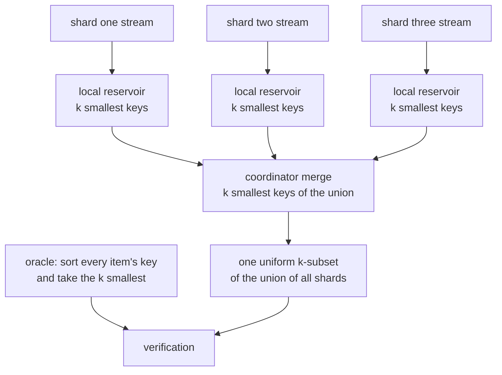
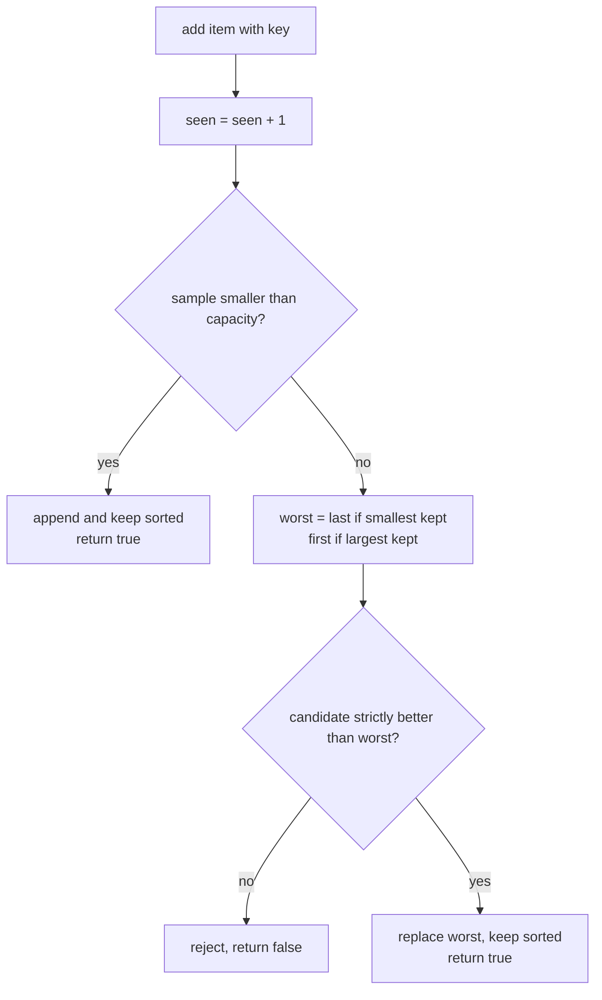
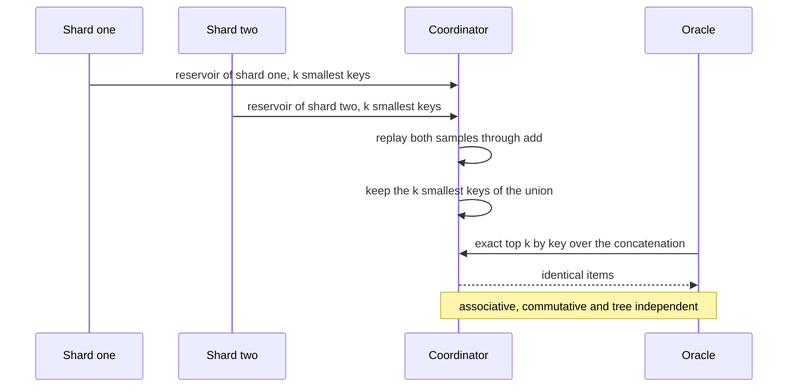

# 780 — Implement distributed sampling reservoir with merge operation

> **Tier:** Expert · **CTCI chapter:** Ch 9 — System Design and Scalability
> **Task spec:** [780-implement-distributed-sampling-reservoir-with-merge-operation.md](../../../tasks/expert/780-implement-distributed-sampling-reservoir-with-merge-operation.md)
> **Solutions:** [Python](../../../solutions/python/expert/780-implement-distributed-sampling-reservoir-with-merge-operation/solution.py) ·
> [Java](../../../solutions/java/expert/780-implement-distributed-sampling-reservoir-with-merge-operation/Solution.java) ·
> [JavaScript](../../../solutions/javascript/expert/780-implement-distributed-sampling-reservoir-with-merge-operation/solution.js) ·
> [C#](../../../solutions/csharp/expert/780-implement-distributed-sampling-reservoir-with-merge-operation/Solution.cs)

## 1. Problem restatement

Keep a uniform sample of `k` items from a stream whose length is unknown — but in a **distributed**
setting: every worker sees a disjoint shard, keeps its own reservoir, and a coordinator merges the
reservoirs. The merged sample must be distributed exactly like a single reservoir over the
concatenation of all shards.

The interface: `Reservoir(capacity, keep_largest=False)` with `add(item, key)`, `items()`, `seen`, and
`merge(other)`; plus the helpers `uniform_unit(item, trial)`, `key_for(item, trial, weight)`,
`shard_reservoir(...)`, and `oracle_sample(...)` — the exact top-`k`-by-key over a whole stream, used as
the independent oracle.

Concrete results the checks assert:

- **capacity 1**: `add(5, 0.5)` keeps `5`; `add(7, 0.25)` replaces it (`items() == [7]`, `seen == 2`);
  `add(9, 0.75)` returns `False` and changes nothing.
- **capacity above the stream length**: four items in a capacity-10 reservoir are all kept.
- **an empty shard is a no-op in both directions**, and merging reservoirs of different capacities (or
  different sampling directions) raises an assertion.
- **a single shard equals the oracle** for `stream = [7, 3, 11, 3, 5, 2, 13, 8, 1, 9, 4, 6]` and
  `capacity ∈ {1, 3, 5}`, with the reservoir exactly `min(capacity, len(stream))` full.
- **the shard split does not matter**: the four shards `stream[:3]`, `stream[3:4]`, `stream[4:9]`,
  `stream[9:]` merged at capacity 4 equal `oracle_sample(4, stream)` and `merged.seen == 12`.
- **merge is associative and commutative**: three capacity-3 pieces give the same sample for
  `((p0 ∘ p1) ∘ p2)`, `(p0 ∘ (p1 ∘ p2))`, the swapped order and a re-bracketed tree — and that sample
  still equals the oracle.
- **uniformity**: with `trials = 800`, `capacity = 3`, `items = 12`, every item's inclusion frequency is
  within `0.08` of `3 / 12 = 0.25` and every item is sampled at least once; the same bound holds for a
  four-shard merge (the per-shard chunks are `range(0, 3)`, `range(3, 6)`, `range(6, 9)`,
  `range(9, 12)`).
- **the weighted variant (A-Res)** with `items = 12`, `capacity = 2` picks the item whose weight is
  `6.0` at more than double its uniform rate (`> 2 · (2 / 12)`), while all-equal weights stay within
  `0.08` of `2 / 12`; the weighted merge still equals the weighted oracle.
- **determinism**: the same `trial` gives the same sample, a different `trial` a different one, and a
  sample of distinct items never repeats an item.

## 2. Intuition

**Algorithm R** (fill the reservoir with the first `k` items, then replace a random resident with
probability `k / i` at position `i`) produces a correct uniform sample of one stream, but it is
**unmergeable**: its state depends on the arrival order and on `i`, so a coordinator that has two
reservoirs of the *same* stream prefix cannot combine them without knowing the interleaving.

The **priority form** removes that dependency:

1. Every item gets a fixed pseudorandom key `u_i` drawn uniformly from `(0, 1)` — keyed by the item and
   the trial, so it never changes once assigned.
2. The reservoir keeps the `k` **smallest** keys seen so far. This is exactly Algorithm R in disguise
   (an item's key is smaller than the current worst with probability `k / i`), and the `k` smallest keys
   of the stream are a uniform random `k`-subset of it.
3. **Merge is therefore trivial and exact**: take the `k` smallest keys of the union of the two samples.
   Nothing is rescanned, and the operation is associative and commutative — so any merge tree (chain,
   star, re-bracketed tree) produces the identical sample.



For the **weighted** case (A-Res) the same machinery draws `k` items *with replacement* proportional to
the weights: use the key `u_i ** (1 / w_i)` and keep the `k` **largest**. A heavier item's key is pulled
toward `1`, so it survives more often — a weight of `6` against uniform weights of `1` more than doubles
its inclusion rate in the checks.

## 3. Algorithm

1. **Keys.** `uniform_unit(item, trial)` mixes `(item, trial)` into `splitmix64`, takes the top 53 bits
   and returns `(top + 0.5) / 2**53` — a value strictly inside `(0, 1)`, so no item can ever have the
   degenerate key `0` or `1`. `key_for(item, trial, weight)` returns that value for weight `1`, and
   `u ** (1 / w)` otherwise.
2. **`add(item, key)`**: count the item in `seen`; while the reservoir is not full, append and keep the
   sample sorted by key; once full, compare the key with the current *worst* resident — `sample[-1]` for
   the `k`-smallest policy, `sample[0]` for the `k`-largest one — and replace it only when the candidate
   is strictly better.
3. **`merge(other)`**: assert both reservoirs share capacity and direction, then feed **all** `(key,
   item)` pairs of both samples through `add` in the same direction; set
   `seen = self.seen + other.seen` afterwards so the `add` calls do not inflate the count.
4. **Correctness oracle.** `oracle_sample(capacity, stream, trial, weights, keep_largest)` computes every
   item's key, sorts, and returns the first `capacity` items — the exact top-`k`-by-key over the whole
   stream. Every merge claim is checked against it.
5. **Uniformity test.** Run the sampler `trials` times with different `trial` values and compare each
   item's inclusion frequency with `capacity / items`.
6. **Weighted verification.** `key_for(..., weight=w)` with `keep_largest=True` and a statistical check,
   because the exact inclusion law of A-Res is not a simple subset probability.

```text
procedure add(item, key)
    seen ← seen + 1
    if length(sample) < capacity then
        sample.append((key, item))
        sort sample by key ascending
        return true
    worst ← sample[last] if not keep_largest else sample[first]
    better ← key < worst.key if not keep_largest else key > worst.key
    if not better then return false
    replace sample[last] with (key, item) if not keep_largest else sample[first]
    sort sample by key ascending
    return true

procedure merge(other)
    require self.capacity = other.capacity
    require self.keep_largest = other.keep_largest
    merged ← new Reservoir(self.capacity, self.keep_largest)
    for (key, item) in self.sample plus other.sample do
        merged.add(item, key)
    merged.seen ← self.seen + other.seen        // add() must not double count
    return merged

procedure shardReservoir(capacity, stream, trial, weights, keep_largest)
    reservoir ← new Reservoir(capacity, keep_largest)
    for item in stream do
        weight ← 1.0 if weights is absent else weights[item]
        reservoir.add(item, keyFor(item, trial, weight))
    return reservoir

procedure oracleSample(capacity, stream, trial, weights, keep_largest)
    entries ← [(keyFor(item, trial, weights[item]), item) for item in stream]
    sort entries by key, descending when keep_largest
    return the items of the first capacity entries
```



## 4. Worked example

**(a) Priority reservoir, capacity 2.** Three items with the priorities shown (a hand-set example using
the same rule as `uniform_unit`).

| Step | `add(item, key)` | Full? | Comparison | Sample after (key, item) | Return |
| --- | --- | --- | --- | --- | --- |
| 1 | `add(5, 0.62)` | no | — | `[(0.62, 5)]` | `True` |
| 2 | `add(7, 0.31)` | no | — | `[(0.31, 7), (0.62, 5)]` | `True` |
| 3 | `add(2, 0.85)` | yes | `0.85 < 0.62`? no | `[(0.31, 7), (0.62, 5)]` | `False` |

The reservoir keeps the two **smallest** keys, so item `2` is rejected although it arrived last — the
decision depends on its key, not on its position. This is exactly what makes the next step possible.

**(b) Merging four shards.** Let two shards hold `X = [(0.31, 7), (0.62, 5)]` and
`Y = [(0.15, 1), (0.95, 9)]`. `X.merge(Y)` replays all four pairs through `add` and keeps the two
smallest keys of `{0.31, 0.62, 0.15, 0.95}`: `0.15 → item 1` and `0.31 → item 7`. The result is
`[(0.15, 1), (0.31, 7)]`, and `Y.merge(X)` returns the same sample in the same order because `add`
maintains a total order by key. No shard is revisited, and no shard length appears anywhere in the
computation — the merged sample is uniform over the union by construction.

The checks exercise exactly this structure: the four shards of
`[7, 3, 11, 3, 5, 2, 13, 8, 1, 9, 4, 6]` merged at capacity 4 equal `oracle_sample(4, stream)`, and the
merge is verified associative (two different bracketings), commutative (reversed operand order) and
tree-independent (a third parenthesisation), while the three recovered pieces still match the oracle.

**(c) Weighted variant.** Weight `6` against weight `1`, capacity 2 over 12 items:

| Weight `w` | `u` | `key = u ** (1 / w)` | Effect |
| --- | --- | --- | --- |
| `1` | `0.50` | `0.500` | unchanged |
| `6` | `0.50` | `0.891` | pulled toward 1 by the sixth root |
| `6` | `0.10` | `0.681` | even a low draw lands high |
| `1` | `0.90` | `0.900` | still competitive |

Because the largest keys are kept, the heavy item's keys dominate: over the 800 trials of the check it
enters a capacity-2 sample at more than twice its uniform rate `2 / 12`, while with all-equal weights the
frequency stays within `0.08` of `2 / 12`. That is the sampling-with-replacement law of A-Res, which is
why the docstring says the weighted variant is verified statistically rather than exactly.



## 5. Complexity

Let `k` be the capacity, `n` the stream length, `s` the number of shards and `T` the number of trials.

| Operation | Best | Average | Worst | Why the bound holds |
| --- | --- | --- | --- | --- |
| `add` | O(1) | O(k) | O(k) | the Python solution keeps a sorted list and re-sorts after a replacement; a heap would give O(log k) |
| `items` | O(1) | O(k) | O(k) | copy of the sample contents |
| `merge` | O(k) | O(k²) | O(k²) | at most `2k` inserts, each O(k) |
| `shard_reservoir` | O(n) | O(n · k) | O(n · k) | one `add` per item |
| distributed sample | O(n) | O(n · k) | O(n · k) | every item is processed once, locally; the coordinator only sees `s · k` items |
| `oracle_sample` | O(n log n) | O(n log n) | O(n log n) | computes every key and sorts — the independent check, never used on the query path |
| Space | O(k) | O(k) | O(k) per shard, O(s · k) at the coordinator | only the sample is retained |

Comparison with Algorithm R:

| Property | Algorithm R | Priority reservoir (this task) |
| --- | --- | --- |
| Single-stream uniformity | yes | yes |
| Stream length needed up front | no | no |
| Partial replacement probability | `k / i` on arrival `i` | `key < worst key of k sampled keys` |
| Mergeable | **no** — state depends on arrival order | **yes** — `k` smallest keys of the union |
| Merge cost | — | O(k²) locally, no shard rescan |
| Weighted variant | requires A-ExpJ | `u ** (1 / w)`, keep the largest |

## 6. Pitfalls and edge cases

- **Merging incomparable reservoirs.** Different capacities or directions are rejected with an
  assertion; a merge of a smallest-key reservoir with a largest-key one would silently return nonsense.
- **`seen` after a merge.** Replaying the samples through `add` increments `seen` for every pair, so it
  must be overwritten with `self.seen + other.seen`; the check asserts `merged.seen == 12` for the
  four-shard merge.
- **Empty shard.** `Reservoir(k)` with no items has an empty sample and `seen == 0`; merging it (in
  either direction) must return the other sample unchanged.
- **Capacity 1.** The worst resident is the only resident, so every better key replaces it and every
  worse key is rejected — both branches are asserted.
- **Capacity above the stream length.** The sample is simply the whole stream; the reservoir is full
  after `min(k, n)` items.
- **Strict comparison.** A tie must not displace a resident, otherwise `add` would report `True` while
  changing nothing and the "worse key is rejected" check would fail.
- **No degenerate keys.** `uniform_unit` maps into `(0, 1)` (`(top + 0.5) / 2**53`), so keys never hit
  `0` or `1`, where the weighted transform would be exact and ordering could tie.
- **Duplicate items.** The stream `[7, 3, 11, 3, 5, ...]` contains `3` twice; both copies carry the same
  key, and the checks compare *sorted* items, so a duplicate cannot be counted twice. A sample of
  distinct items must contain no repeats (asserted).
- **Determinism.** Keys depend only on `(item, trial)`, so the same trial reproduces the same sample and
  a different trial draws a different one — both asserted, which is also what makes the statistical
  uniformity test meaningful.
- **Documented simplification.** Priorities come from a deterministic `splitmix64` hash rather than a
  cryptographic RNG, items are small integers, shards are simulated sequentially in one process, and the
  weighted variant is verified statistically because its exact inclusion law is not a subset
  probability.

## 7. Variants and follow-ups

- **Weighted sampling with replacement** (A-Res, implemented here) versus **without replacement** weights
  (A-ExpJ / priority with distinct keys), which is what a query sampler with deduplication needs.
- **Exact uniformity for tiny streams.** The Java variant enumerates *every* `k`-subset for small `n` and
  checks that each appears with probability `1 / C(n, k)` — a stronger statement than the frequency band
  used in Python.
- **Skewed shard lengths.** A coordinator that weights shards by their `seen` counts can turn the merged
  sample into a weighted sample of the union, which is the standard trick for stratified shards.
- **Related tasks.** [781 — distributed join planning with cardinality estimation](../../../tasks/expert/781-implement-distributed-join-planning-with-cardinality-estimation.md)
  is the other Ch 9 simulation in this range, where a coordinator also assembles statistics from smaller
  pieces; [778 — cold-start heuristics](../../../tasks/expert/778-implement-cold-start-heuristics-for-cache-warming-and-prefetchin.md)
  uses the same deterministic `splitmix64` traces; and
  [795 — advanced LSH parameter tuning](../../../tasks/expert/795-implement-advanced-lsh-parameter-tuning-for-recall-precision.md)
  samples and measures recall the same way.

## 8. Check yourself

<details><summary>Show answer</summary>
**Why can't Algorithm R be merged by simply concatenating two reservoirs?** Algorithm R's state is the
result of a sequence of order-dependent decisions: at position `i` it replaced a resident with
probability `k / i`. Two reservoirs of the same stream built from different halves have no common notion
of "position", so any merge rule that combined them would bias the inclusion probabilities. The priority
form removes the order entirely — an item's fate depends only on its key compared with the keys kept.
</details>

<details><summary>Show answer</summary>
**What exactly makes the merged sample uniform over the union of the shards?** For any fixed key
realisation, "take the `k` smallest keys of a set" is a deterministic function of the keys, and each
shard's local sample only ever discards items whose keys cannot be among the globally smallest `k`. Two
discarded-key arguments are enough: an item dropped by a shard has at least `k` items with smaller keys
in that shard, hence globally too. So the union of the local samples contains the global `k` smallest
keys, and the merge always recovers exactly them.
</details>

<details><summary>Show answer</summary>
**Why does the weighted variant keep the largest keys while the uniform one keeps the smallest?** With
`key = u ** (1 / w)` a heavier item's key is pulled toward `1`, so the items that survive a
keep-the-largest policy are those with high draws *and* high weights. The two rules are mirror images:
`u` and `1 - u` are both uniform, so "largest `u ** (1 / w)`" and "smallest `(1 - u) ** (1 / w)`" select
the same items and the same distribution.
</details>

<details><summary>Show answer</summary>
**The merge replays `2k` pairs through `add`, which counts them in `seen`. Why is that a bug rather than a
detail?** Because `seen` is the shard's stream length, the quantity a coordinator uses to weight shards
and to report progress. Leaving it as the number of `add` calls would turn a merge of four shards of
three items each into `seen == 12` only by accident — with `n` much larger than `k` it would report `2k`
instead of `n`. The solution explicitly restores `seen = self.seen + other.seen`.
</details>

<details><summary>Show answer</summary>
**The uniformity test allows a deviation of `0.08` from `3 / 12` instead of testing exact equality. Why?**
Because the sample is random: over 800 independent trials each item's frequency is a binomial variable
with mean `0.25`, so requiring exact equality would fail with probability one. The band is tight enough
to catch a genuine bias (a wrong key distribution, a reservoir that keeps the largest keys, or a
non-uniform merge) while remaining comfortably above the sampling noise.
</details>
