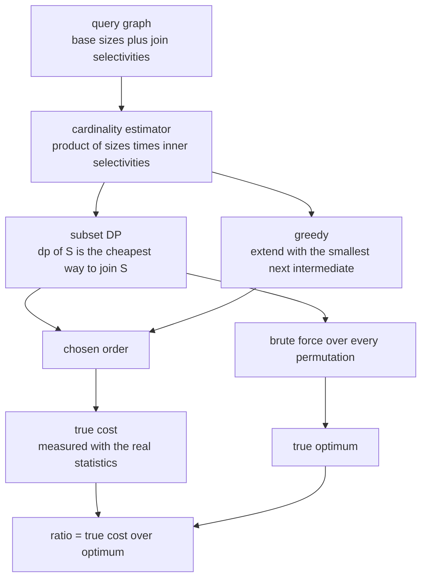
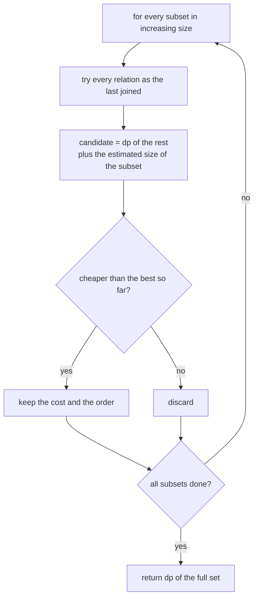
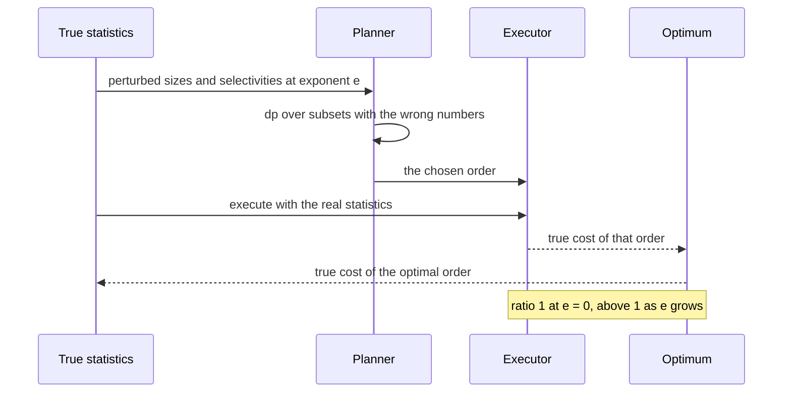

# 781 — Implement distributed join planning with cardinality estimation errors

> **Tier:** Expert · **CTCI chapter:** Ch 9 — System Design and Scalability
> **Task spec:** [781-implement-distributed-join-planning-with-cardinality-estimation.md](../../../tasks/expert/781-implement-distributed-join-planning-with-cardinality-estimation.md)
> **Solutions:** [Python](../../../solutions/python/expert/781-implement-distributed-join-planning-with-cardinality-estimation/solution.py) ·
> [Java](../../../solutions/java/expert/781-implement-distributed-join-planning-with-cardinality-estimation/Solution.java) ·
> [JavaScript](../../../solutions/javascript/expert/781-implement-distributed-join-planning-with-cardinality-estimation/solution.js) ·
> [C#](../../../solutions/csharp/expert/781-implement-distributed-join-planning-with-cardinality-estimation/Solution.cs)

## 1. Problem restatement

A query planner picks the order in which to join the relations of a query. With the classic cost model
"the cost of an order is the sum of the intermediate result sizes it materialises", the cheapest order
is the one that keeps intermediates small. The task builds that planner and then sabotages its
statistics, to measure how much cardinality-estimation error costs in real execution time.

Inputs: a query graph — relations with base cardinalities and join edges with selectivities — plus an
error exponent `e`. Outputs: the chosen order, its cost, and the *true* cost of that order measured with
the real statistics.

The cardinality model is the textbook independence/containment estimator, where `sel(i, j) = 1` when the
pair has no join edge:

```text
|R1 ⋈ ... ⋈ Rn|  =  (prod |Ri|) * (prod selectivity of every join edge inside the subset)
```

Concrete results the checks assert:

- one relation `A` with `|A| = 500`: order `[0]`, cost `500`, exactly `1` subset visited;
- two relations `A = 1000`, `B = 400`, `sel(A, B) = 0.1`: cost `400 + 1000 · 400 · 0.1 = 40400`, and the
  planner must **start from the smaller relation** (`order[0] == 1`);
- six random 5-relation graphs: the DP cost equals the brute-force permutation optimum, the DP visits
  every non-empty subset (`2**5 - 1 = 31`), both plans are executable, and the reported cost equals the
  recomputed cost;
- greedy never beats the optimum, always returns an executable order, and is strictly worse on at least
  one of the six `0xBEEF` graphs;
- the estimator: a singleton is its base size, a pair is the product times the edge selectivity, a triple
  multiplies **every** inner edge;
- the error sweep over `e ∈ {0, 1, 2, 3}` with 8 graphs each (32 samples): the mean true-cost ratio is
  exactly `1` for `e = 0` (within `1e-9`), `ratios[3] >= ratios[1]`, some error is actually paid for
  (`ratios[3] > 1.0`), and the worst observed ratio stays below `25.0`;
- a disconnected graph (`A = 100`, `B = 200`, `C = 300`, only `sel(A, B) = 0.5`) forces a cross product:
  the order `[0, 2, 1]` is rejected when a cross product is not allowed, the DP still plans all three
  relations, the reported cross-product cost is consistent and at least `sum(sizes)`;
- six relations visit `2**6 - 1 = 63` subsets, still match the oracle, and need no cross product;
- planning is deterministic, with and without perturbed statistics.

## 2. Intuition

Three ideas build the simulation, and the order in which the repository applies them is the whole
lesson.

1. **Cost is a sum of intermediate sizes.** Execution is left-deep: `((R_a ⋈ R_b) ⋈ R_c) ⋈ ...`, and each
   step materialises an intermediate. So the cost of an order is
   `card({a}) + card({a, b}) + card({a, b, c}) + ...`.
2. **The cardinality depends only on the *set*.** Under the independence/containment assumption,
   `card(S) = prod |Ri| · prod sel(i, j)` is a function of the set `S`, not of the order in which the
   relations of `S` were joined. That is what makes exact **dynamic programming over subsets** possible:
   `dp[S] = min over r ∈ S of dp[S \ r] + card(S)`, which considers `2^n` subsets instead of `n!`
   orders.
3. **The planner is fed wrong numbers.** The perturbation multiplies every base size and every
   selectivity by `2 ** k` with `k` uniform in `[-e, e]`, and only the *plan* is taken from the
   perturbed planner — its cost is always charged with the true statistics. The reported quantity is the
   ratio "true cost of the plan chosen from the wrong numbers / true cost of the optimal plan", so
   `e = 0` must give exactly `1` and larger `e` must cost more.



The comparison targets make the story concrete: the DP is validated against an independent permutation
oracle, and greedy is included as the heuristic that *usually* loses — on the `0xBEEF` graphs it must be
strictly worse on at least one, but never better on any.

## 3. Algorithm

1. **The graph.** `QueryGraph(names, sizes, edges)` stores the base cardinalities and a dictionary of
   undirected edges `(i, j)` with `i < j → selectivity`.
2. **Estimated size.** `subset_size(subset, sizes, edges)` multiplies the base sizes of the member
   relations and then, for every pair inside the subset, the selectivity of that pair's edge (or `1.0`
   when there is no edge — the cross product contributes no reduction).
3. **Validity.** `order_valid(graph, order, allow_cross=True)` requires a permutation of all relations
   and, unless cross products are explicitly allowed, that every new relation joins along a real
   predicate with the accumulated set.
4. **Exact planning.** `dp_plan(graph, sizes, edges)` fills `best_cost[frozenset()] = 0` and, for every
   subset in order of increasing size, tries every relation as the last one added:
   `candidate = best_cost[S \ {r}] + subset_size(S)`, keeping the cheapest and its reconstructed order.
   It returns `(order, cost, visited)` where `visited` counts the non-empty subsets.
5. **Baselines.** `greedy_plan` always extends the accumulated prefix with the relation that minimises
   the next intermediate size (no connectivity requirement); `brute_force_plan` enumerates every
   permutation and is the independent oracle.
6. **Deterministic graphs.** `random_graph(n, seed, density=0.7, size_high=1000)` draws sizes
   `1 + r % 1000` from `splitmix64`, always adds the chain edges with selectivities
   `0.02 + (r % 100) / 1000`, and adds the remaining pairs with probability `density` and selectivities
   `0.01 + ((r >> 7) % 90) / 1000`.
7. **Error injection.** `perturbed(exponent, seed)` multiplies each size by `2 ** k` (`k` uniform in
   `[-e, e]`, clamped to at least `1.0`) and each selectivity by the same factor, clamped into
   `[1e-6, 1.0]`.
8. **Measurement.** Plan with the perturbed statistics, execute with the true ones:
   `hash.ratio = cost_of_order(graph, estimated_order) / brute_force_plan(graph)[1]`.

```text
procedure dpPlan(graph, sizes, edges)
    bestCost[frozenset()] ← 0
    bestOrder[frozenset()] ← ()
    visited ← 0
    for size in 1 .. graph.count do
        for subset in every combination of `size` relations do
            visited ← visited + 1
            best ← (infinity, ())
            for index in subset do
                rest ← subset minus index
                candidate ← bestCost[rest] + subsetSize(graph, subset, sizes, edges)
                if candidate < best.cost then
                    best ← (candidate, bestOrder[rest] + (index,))
            bestCost[subset] ← best.cost
            bestOrder[subset] ← best.order
    full ← frozenset of every relation
    return bestOrder[full], bestCost[full], visited

procedure greedyPlan(graph, sizes, edges)
    remaining ← every relation
    accumulated ← empty list
    total ← 0
    while remaining is not empty do
        best ← the index in remaining minimising subsetSize(graph, accumulated + [index])
        accumulated.append(best.index)
        total ← total + best.cost
        remaining.remove(best.index)
    return accumulated, total

procedure measureError(graph, exponent, seed)
    trueOrder, trueCost ← bruteForcePlan(graph)
    sizes, edges ← perturbed(graph, exponent, seed)
    estimatedOrder ← dpPlan(graph, sizes, edges).order      // the planner sees the wrong numbers
    actual ← costOfOrder(graph, estimatedOrder)             // charged with the real statistics
    return actual / trueCost
```



## 4. Worked example

**A two-relation query.** `|A| = 1000`, `|B| = 400`, `sel(A, B) = 0.1`, so the join size is
`1000 · 400 · 0.1 = 40000`.

| Order | First intermediate | Second intermediate | Total cost |
| --- | --- | --- | --- |
| `[A, B]` | `1000` | `40000` | `41000` |
| `[B, A]` | `400` | `40000` | `40400` |

The DP picks `[B, A]`: starting from the smaller relation saves `600` — the check asserts both the cost
`40400` and `order[0] == 1`.

**A three-relation query.** `A = 1000`, `B = 400`, `C = 200`, with `sel(A, B) = 0.1`, `sel(B, C) = 0.1`
and **no** `A`–`C` edge (selectivity `1.0`). The estimator gives:

| Subset | Estimated size | Why |
| --- | --- | --- |
| `{A}` / `{B}` / `{C}` | `1000` / `400` / `200` | base sizes |
| `{A, B}` | `1000 · 400 · 0.1 = 40000` | one inner edge |
| `{B, C}` | `400 · 200 · 0.1 = 8000` | one inner edge |
| `{A, C}` | `1000 · 200 · 1.0 = 200000` | no edge, so the cross product survives |
| `{A, B, C}` | `1000 · 400 · 200 · 0.1 · 0.1 · 1.0 = 800000` | every inner edge multiplies |

The DP then fills the table bottom-up:

| Subset | Candidate costs | `dp` | Order |
| --- | --- | --- | --- |
| `{A}` | — | `1000` | `(A)` |
| `{B}` | — | `400` | `(B)` |
| `{C}` | — | `200` | `(C)` |
| `{A, B}` | `1000 + 40000`, `400 + 40000` | `40400` | `(B, A)` |
| `{B, C}` | `400 + 8000`, `200 + 8000` | `8200` | `(C, B)` |
| `{A, C}` | `1000 + 200000`, `200 + 200000` | `200200` | `(C, A)` |
| `{A, B, C}` | `dp{B, C} + 800000`, `dp{A, C} + 800000`, `dp{A, B} + 800000` | `808200` | `(C, B, A)` |

So the plan is `C, B, A` with cost `808200`, and the checkable identity is
`200 + 8000 + 800000 = 808200`. Note the jump: the third intermediate costs `800000` — the cross product
with `A` is unavoidable because `A` has no edge to `C`, and `order_valid` reports exactly that when
cross products are disallowed. On this instance the greedy baseline happens to find the same order
(`C`, then the cheaper extension `B`, then `A`), which is why the checks compare greedy against the
optimum over six different graphs instead of one.

**Where the error hurts.** Under `perturbed(e = 2, seed)`, each size and selectivity is multiplied by
`2 ** k` with `k ∈ {-2, -1, 0, 1, 2}`. If the `{B, C}` edge is scaled down, the perturbed planner
believes the `B`–`C` join is tiny and may join `A` second, materialising the `200000`-row cross product
before the cheap `8000`-row join. The plan is legal and the statistics were only wrong — but its true
cost jumps, which is precisely the ratio the sweep reports: `1` at `e = 0`, `> 1` at `e = 3`, worst case
below `25`.



## 5. Complexity

Let `n` be the number of relations, `m` the number of join edges and `P` the number of pairs
(`n(n-1)/2`).

| Operation | Best | Average | Worst | Why the bound holds |
| --- | --- | --- | --- | --- |
| `subset_size` | O(\|S\|) | O(\|S\| + P) | O(n + P) | products over the members and over every inner pair |
| `dp_plan` | O(2^n · n · (n + P)) | same | same | one subset per bitmask, `n` candidates each, each costing an estimator evaluation; `2**5 - 1 = 31` and `2**6 - 1 = 63` subsets are asserted |
| `greedy_plan` | O(n² · (n + P)) | same | same | `n` rounds, each testing every remaining relation |
| `brute_force_plan` | O(n!) | O(n! · n) | O(n! · n) | every permutation, and each order costs `n` intermediate sizes — the oracle only stays affordable because `n ≤ 6` here |
| `cost_of_order` | O(n · (n + P)) | same | same | sums the size of every prefix |
| `order_valid` | O(n · m) | same | O(n²) | every step scans the accumulated set for a predicate |
| `perturbed` | O(n + m) | same | same | one `splitmix64` draw per size and per edge |
| Error sweep | 4 exponents × 8 graphs | 32 samples | 32 samples | asserted explicitly (`samples == 32`) |
| Space | O(2^n) | O(2^n) | O(2^n + n!) | the DP stores a cost and an order per subset; the oracle stores one order at a time |

Comparison of the planners:

| Planner | Search space | Plan quality | Cost |
| --- | --- | --- | --- |
| Brute force over orders | `n!` | exact (for this model) | only feasible for tiny `n` |
| Selinger subset DP (this task) | `2^n` | exact for the same model, since the estimator depends only on the set | `O(2^n · n)` estimator calls |
| Greedy | `n²` | never better than the optimum, strictly worse on at least one checked graph | cheapest to run, no guarantee |
| One fixed order | 1 | arbitrary | — |

## 6. Pitfalls and edge cases

- **One relation** has no join and no choice: the cost is its own size (`500`), and exactly one subset is
  visited.
- **Two relations**: the DP must still prefer the smaller relation first, because only the first
  intermediate changes (`min(|A|, |B|)`), which the check pins to `40400`.
- **Missing edges mean selectivity `1.0`.** The estimator must not drop the pair: a cross product keeps
  the full product, which is `200000` for `{A, C}` in the worked example.
- **Disconnected graphs.** `order_valid(..., allow_cross=False)` detects the cross-product step, while
  the DP still plans all relations and its cost is at least `sum(sizes)` — both asserted.
- **Zero cardinalities** (the Java variant exercises a relation of cardinality `0`): the products
  collapse and any order ties; the planner must still return a valid order rather than dividing by zero.
- **Ties.** Identical relations make every order tie; the DP compares with `<` so the first (lowest
  index) candidate wins, which is what keeps the result deterministic.
- **Clamping.** Perturbed selectivities are clamped into `[1e-6, 1.0]` and sizes to at least `1.0`,
  because a selectivity above 1 would be physically impossible and a zero size would make every cost
  vanish.
- **The planner must not see the truth.** The cost is always charged with `cost_of_order(graph, order)`
  using the *unperturbed* graph; charging it with the perturbed statistics would make `e = 0` trivially
  the only meaningful case.
- **The `e = 0` invariant.** The perturbation still draws random factors at `e = 0`, but they are all
  `2**0 = 1`, so the ratio must be exactly `1` — the check uses a `1e-9` tolerance.
- **Bounded damage.** The worst ratio observed over the 32 samples must stay below `25`, which documents
  that the estimator is bad but not unbounded.
- **Documented simplifications.** Cost is a pure cardinality sum (no I/O, network or CPU terms), the
  estimator assumes independence and containment, perturbations are multiplicative and symmetric, and
  queries are capped at six relations so the permutation oracle stays affordable.

## 7. Variants and follow-ups

- **Bushy plans.** Allow joins between two intermediate results, which needs a different DP
  (`dp[S] = min over splits S = S1 ∪ S2`) and can beat the left-deep optimum.
- **Better statistics.** Histograms or sampled distinct counts replace the independence assumption; the
  simulation's whole point is that the *plan quality* tracks the accuracy of those numbers.
- **Cost models with I/O and network terms**, where the distributed coordinator additionally has to
  decide where each join executes — the part of the Ch 9 story this task abstracts away.
- **Related tasks.** [780 — distributed sampling reservoir with merge](../../../tasks/expert/780-implement-distributed-sampling-reservoir-with-merge-operation.md)
  is the other Ch 9 simulation, where a coordinator also merges worker state with an exactness proof;
  [777 — write-optimized LSM tuning](../../../tasks/expert/777-implement-write-optimized-lsm-tuning-simulation-for-read-write-t.md)
  shares the "estimate, then measure the cost with a deterministic workload" methodology; and
  [795 — advanced LSH parameter tuning](../../../tasks/expert/795-implement-advanced-lsh-parameter-tuning-for-recall-precision.md)
  tunes the accuracy/cost trade-off of an index the same way.

## 8. Check yourself

<details><summary>Show answer</summary>
**Why is the subset DP exact for this cost model, while greedy is not?** The cost of a left-deep order is
the sum of `card(prefix)` values, and the estimator guarantees that `card(prefix)` depends only on the
*set* of relations in the prefix. Optimal substructure therefore holds: the cheapest way to join `S` is
the cheapest way to join some `S \ {r}` plus `card(S)`. Greedy commits to the locally smallest next
intermediate and cannot undo that decision — the check asserts it is never better than the optimum and
strictly worse on at least one of the six `0xBEEF` graphs.
</details>

<details><summary>Show answer</summary>
**With `e = 0` every size and selectivity is still multiplied by a random factor. Why must the ratio be
exactly 1?** Because the random factor is `2 ** k` with `k` drawn from `{-0, ..., 0} = {0}`, so every
factor is exactly `2 ** 0 = 1` and the perturbed statistics are the true ones. The planner then sees the
real numbers and, being exact for the model, returns an optimal plan; its true cost divided by the
optimum is therefore exactly `1`, which the check verifies within `1e-9`.
</details>

<details><summary>Show answer</summary>
**In the three-relation example the plan is `C, B, A`. What would the cost be for the order `A, B, C`?**
Prefixes `{A} = 1000`, then `{A, B} = 40000`, then `{A, B, C} = 800000`: total `841000`, against
`200 + 8000 + 800000 = 808200` for the DP's order. The `33000` difference comes from the second
intermediate, and it is exactly the kind of gap a wrong selectivity estimate can flip.
</details>

<details><summary>Show answer</summary>
**The perturbation scales selectivities up as well as down. Why does overestimating a selectivity hurt
too?** A selectivity is the *fraction* of the cross product that survives the join. Scaling it up makes
the planner believe the join is bigger than it is, so it may postpone that join until it has fewer
choices and is forced into an even larger intermediate. Symmetric multiplicative noise therefore
degrades both directions of the estimator error, which is why the model uses `2 ** (±e)` rather than
"errors are always underestimates".
</details>

<details><summary>Show answer</summary>
**Why keep a `brute_force_plan` oracle at all when the DP is exact?** Because the DP's correctness is
exactly what is being claimed: `dp[S] = min over r of dp[S \ r] + card(S)` is a theorem that only holds
if the estimator really depends on the set alone. Comparing the DP against an independently written
enumeration over all permutations (`n!`, feasible for five or six relations) tests the implementation
*and* the model assumption at once, and the check also verifies that the reconstructed order really
achieves the reported cost.
</details>
