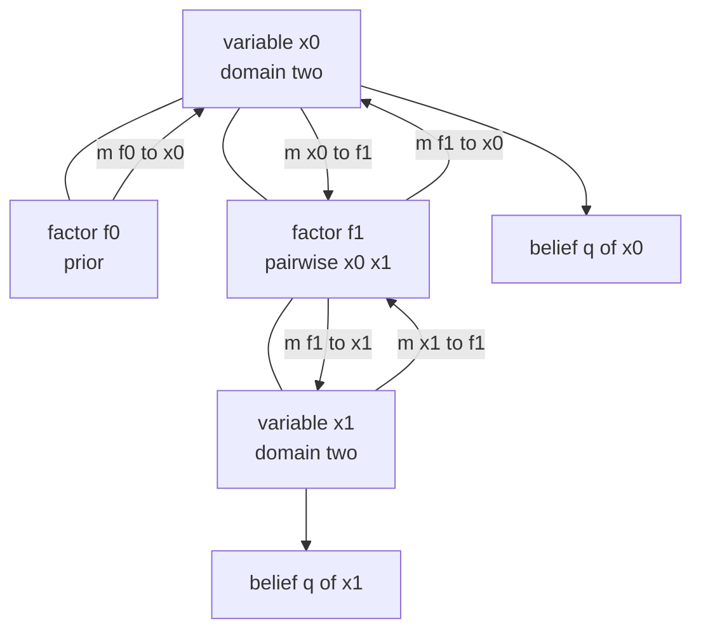
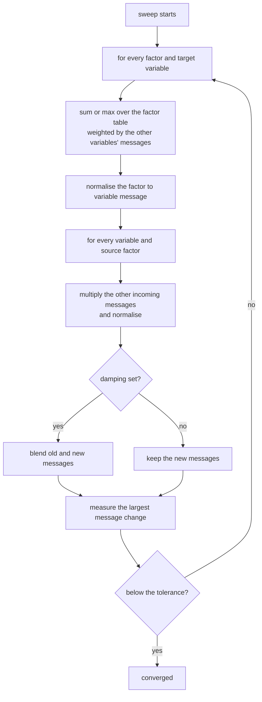
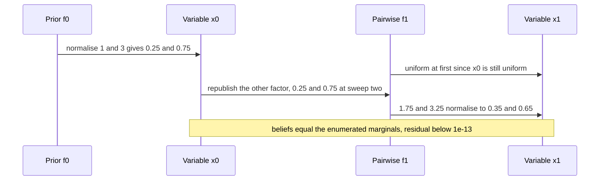
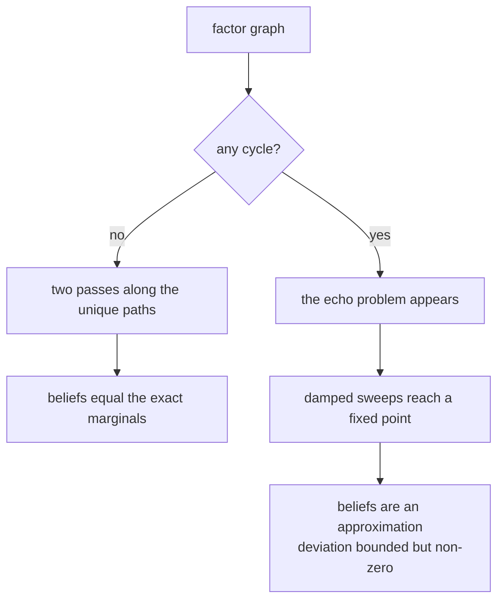

# 782 — Implement probabilistic graphical models inference (belief propagation)

> **Tier:** Expert · **CTCI chapter:** Beyond — Machine Learning & AI
> **Task spec:** [782-implement-probabilistic-graphical-models-inference-belief-propag.md](../../../tasks/expert/782-implement-probabilistic-graphical-models-inference-belief-propag.md)
> **Solutions:** [Python](../../../solutions/python/expert/782-implement-probabilistic-graphical-models-inference-belief-propag/solution.py) ·
> [Java](../../../solutions/java/expert/782-implement-probabilistic-graphical-models-inference-belief-propag/Solution.java) ·
> [JavaScript](../../../solutions/javascript/expert/782-implement-probabilistic-graphical-models-inference-belief-propag/solution.js) ·
> [C#](../../../solutions/csharp/expert/782-implement-probabilistic-graphical-models-inference-belief-propag/Solution.cs)

## 1. Problem restatement

A factor graph describes a joint distribution over finite-domain variables,

```text
p(x) = (1 / Z) * prod over factors f of f_f(x_scope(f))
```

and the task is to compute the marginals `p(x_u)` and the MAP assignment by **message passing** rather
than by enumerating assignments.

Messages flow in both directions on every edge between a variable and a factor that contains it:

```text
m_{u -> f}(x_u)  =  product of m_{g -> u}(x_u) over the other factors g at u
m_{f -> u}(x_u)  =  sum over the other variables of  f(x_scope) * product of their messages into f
```

and the variable belief is `q_u ∝ product of incoming factor messages`. Max-product replaces every sum
by a max and yields the MAP assignment.

Inputs: `domains` (one size per variable) and `factors` as `(scope, table)` with the table flattening
the scope in order. Outputs: `marginals()`, `map_assignment()`, and the fixed-point `residual()`.
Concrete results the checks assert:

- `FactorGraph([2], [((0,), [1.0, 3.0])])`: `Z == 4.0`, `marginals[0][1] == 0.75`, MAP `(1,)` with
  weight `0.75`;
- `FactorGraph([3], [])` — a variable with no factor — has the uniform belief `[1/3, 1/3, 1/3]`;
- sum-product equals the enumeration oracle on **seven** tree graphs (chains of length 2, 3, 4, 5 and
  stars with 1, 2, 3 leaves) with a worst error below `1e-9`, and a chain of length `L` converges in at
  most `L + 2` sweeps;
- the converged messages are a fixed point: `residual() < 1e-10` for `chain(4)`, `star(3)` and
  `cycle(4)` with damping `0.2`, and every belief sums to one;
- max-product returns a MAP assignment whose weight matches the oracle on `chain(5)`, `star(3)` and
  `chain(2)`;
- on `cycle_graph(4, coupling=8.0, prior=[1.0, 5.0])` with damping `0.3` the residual is below `1e-9`
  but the marginals deviate from exact by more than `1e-4` and less than `0.25` — loopy BP is a fixed
  point, not an answer;
- a hard equality factor `[1, 0, 0, 1]` leaves the fair marginal `0.5`, a zero-weight state stays at
  marginal `0` (and the other state carries all the mass), and an all-zero factor degenerates to the
  uniform belief instead of dividing by zero;
- a single factor over domains `[3, 2]` with table `[1, 0, 2, 1, 1, 3]` has `Z == 8.0` and exact
  marginals;
- the run is deterministic: the same graph gives the same sweep count and identical marginals.

## 2. Intuition

The naive answer is enumeration: loop over `D**n` assignments, accumulate the marginals and remember
the heaviest one. That is what `brute_force()` does and it is exactly why it is only used as the
oracle — with 30 binary variables it needs a billion iterations.

The key insight is that the joint factorises, so a variable's marginal depends on every *other* part of
the graph only through a **summary** — one number per value of the variable. Those summaries are the
messages:

1. **A factor→variable message is a "what the rest of the graph thinks" table.** The factor sums over
   its other variables, weighting each configuration by the messages those variables send in. For a
   pairwise attractive factor `[4, 1, 1, 4]`, a neighbour that strongly prefers value `1` makes the
   incoming message prefer `1` as well.
2. **A variable→factor message republishes the other factors' opinions.** The variable multiplies the
   messages from all the factors it belongs to except the recipient — the "except" is what prevents a
   factor from hearing its own echo, and on a tree it is what makes the computation exact.
3. **On a tree, two passes suffice.** Information only has to travel along the unique path between two
   nodes, so a synchronous sweep converges within roughly the graph's diameter, and the beliefs are the
   true marginals. **On a graph with cycles** the echo problem is real: the message equations still have
   a fixed point, but the fixed point minimises nothing and the beliefs are an approximation whose error
   the checks bound between `1e-4` and `0.25` rather than assert away.



## 3. Algorithm

1. **Validate the model.** Each factor table must have exactly `prod(domains[v] for v in scope)` entries
   and all weights must be non-negative; the flattening index is mixed radix
   (`index = index * domain + value`).
2. **Index the graph.** `variable_factors()` lists, for every variable, the factors it appears in.
3. **Initialise messages.** Every variable→factor and factor→variable message starts uniform,
   `[1/D, ..., 1/D]`.
4. **One synchronous sweep** computes *all* new factor messages and *all* new variable messages from the
   current ones, then commits them together:
   - for a factor `f` with scope `S` and target `u`, iterate over every assignment of `S`, multiply the
     table weight by the messages of the *other* variables in `S`, and accumulate (sum, or max in
     max-product mode) into the target's value;
   - for a variable `u` and target factor `f`, multiply the messages of the other factors at `u`;
   - normalise both kinds of message.
5. **Damp** if requested: `new = (1 - d) * old + d * new`. Damping is what keeps loopy BP numerically
   stable.
6. **Iterate until the messages stop moving.** `run(iterations, tolerance)` returns the number of
   sweeps; the shift is the largest absolute change over all factor messages.
7. **Read off beliefs.** `marginals()` multiplies the incoming factor messages per variable and
   normalises; a variable with no factors is uniform. `map_assignment()` takes the argmax of each
   belief (max-product messages), so the resulting assignment is a genuine MAP candidate whose weight
   can be compared with the oracle.
8. **Verify the fixed point.** `residual()` snapshots the messages, performs one extra sweep, measures
   the shift and restores the snapshot — the converged state must be a fixed point of the update
   equations.

```text
procedure sweep()
    for every factor f with scope S do
        for every target u in S do
            accumulator ← zeros of size domain(u)
            for every assignment a of the variables in S do
                weight ← tableOf(f)[index(S, a)]
                for every position p in S with variable v different from u do
                    weight ← weight * v2f[(v, f)][a[p]]        // the target's own message is excluded
                if maxProduct then
                    accumulator[a[position of u]] ← max(accumulator[a[position of u]], weight)
                else
                    accumulator[a[position of u]] ← accumulator[a[position of u]] + weight
            newF2V[(f, u)] ← normalize(accumulator)
    for every variable u do
        for every source factor f at u do
            product ← ones of size domain(u)
            for every other factor g at u with g different from f do
                product ← product * newF2V[(g, u)]
            newV2F[(u, f)] ← normalize(product)
    if damping > 0 then
        newF2V ← (1 - damping) * f2v + damping * newF2V
        newV2F ← (1 - damping) * v2f + damping * newV2F
    shift ← the largest absolute change over every factor message
    commit newF2V and newV2F
    return shift

procedure run(iterations, tolerance)
    used ← 0
    repeat up to iterations times
        used ← used + 1
        if sweep() < tolerance then break
    return used

procedure marginals()
    for every variable u do
        if u has no factor then belief ← uniform(domain(u))
        else belief ← normalize(product of f2v[(g, u)] over the factors g at u)
```



## 4. Worked example

The two-variable chain with `domains = [2, 2]`, a prior factor `f0` on `x0` with table `[1, 3]`, and a
pairwise factor `f1` on `(x0, x1)` with table `[4, 1, 1, 4]`.

**The oracle.** Enumerating the four assignments gives the weights `4, 1, 3, 12`, so `Z = 20` and

| Assignment | Weight `f0(x0) * f1(x0, x1)` | Marginal contribution |
| --- | --- | --- |
| `(0, 0)` | `1 * 4 = 4` | `x0 = 0`, `x1 = 0` |
| `(0, 1)` | `1 * 1 = 1` | `x0 = 0`, `x1 = 1` |
| `(1, 0)` | `3 * 1 = 3` | `x0 = 1`, `x1 = 0` |
| `(1, 1)` | `3 * 4 = 12` | `x0 = 1`, `x1 = 1` |

so the exact marginals are `p(x0) = [0.25, 0.75]`, `p(x1) = [(4+3)/20, (1+12)/20] = [0.35, 0.65]`, and
the MAP is `(1, 1)` with weight `12 / 20 = 0.6`.

**Belief propagation, sweep by sweep.** All messages start uniform.

| Sweep | `f0 -> x0` | `f1 -> x0` | `f1 -> x1` | `x0 -> f1` | `x1 -> f1` | Belief `x0` | Belief `x1` |
| --- | --- | --- | --- | --- | --- | --- | --- |
| 0 (init) | `[.5, .5]` | `[.5, .5]` | `[.5, .5]` | `[.5, .5]` | `[.5, .5]` | `[.5, .5]` | `[.5, .5]` |
| 1 | `[.25, .75]` | `[.5, .5]` | `[.5, .5]` | `[.5, .5]` | `[.5, .5]` | `[.25, .75]` | `[.5, .5]` |
| 2 | `[.25, .75]` | `[.5, .5]` | `[.35, .65]` | `[.5, .5]` | `[.5, .5]` | `[.25, .75]` | `[.35, .65]` |

The arithmetic of sweep 1: `f0 -> x0` is just `normalize([1, 3]) = [0.25, 0.75]`. `f1 -> x0` sums over
`x1` while `x1`'s message into `f1` is still uniform, so both target values receive
`4 * 0.5 + 1 * 0.5 = 2.5` and the message is `[0.5, 0.5]`. `x0 -> f1` republishes the *other* factor at
`x0`, namely `f0`, so it is `[0.5, 0.5]` in sweep 1 because `f0 -> x0` was still uniform when the sweep
started — synchronous updates read the previous round.

Sweep 2 then does the real work: `x0 -> f1` becomes `f0 -> x0 = [0.25, 0.75]`, so
`f1 -> x1` computes `x1 = 0: 4 * 0.25 + 1 * 0.75 = 1.75` and `x1 = 1: 1 * 0.25 + 4 * 0.75 = 3.25`,
normalised to `[0.35, 0.65]`. Both beliefs now equal the exact marginals; a third sweep changes nothing,
the message shift falls below `1e-13` and `run()` stops. The chain of length `L` converges in at most
`L + 2` sweeps — the information has to travel the graph's diameter, which is the price of synchronous
sweeps instead of a schedule.



**A cycle behaves differently.** On `cycle_graph(4, coupling=8.0, prior=[1.0, 5.0])` with damping `0.3`,
`run(iterations=300)` still reaches a message fixed point (`residual() < 1e-9`), but the beliefs differ
from the enumerated marginals by more than `1e-4` and less than `0.25`. Stronger coupling makes the
deviation larger, which is why the Java solution documents the grid experiments as "converges and stays
within tolerance" versus "degrades measurably" rather than as exactness claims.



## 5. Complexity

Let `n` be the number of variables, `D` the largest domain size, `E` the number of variable-factor
edges, `m` the number of factors and `S` the largest scope size.

| Operation | Best | Average | Worst | Why the bound holds |
| --- | --- | --- | --- | --- |
| One sweep | O(E) | O(sum over factors of S·D^S) | O(m · S · D^S) | every factor enumerates all assignments of its scope; pairwise and unary factors dominate, so in practice it is O(E · D²) |
| `run` | 1 sweep | diameter + 1 | the sweep budget (60 by default, 200–300 for loopy runs) | the checks require a chain of length `L` to converge in at most `L + 2` sweeps |
| `marginals` | O(E) | O(E · D) | O(E · D) | one product of incoming messages per variable |
| `map_assignment` | O(n · D) | O(n · D) | O(n · D) | argmax of each belief under max-product messages |
| `residual` | O(sweep) | O(sweep) | O(sweep) | one extra sweep plus a snapshot copy of the messages |
| `brute_force` (oracle) | O(D^n · m) | same | same | every assignment, and the weight of each is the product of all factor tables |
| Space | O(E · D) | O(E · D) | O(E · D + D^n) | two messages per edge; the oracle additionally stores the marginal accumulators |

Comparison with the alternatives:

| Method | Tree | With cycles | Cost |
| --- | --- | --- | --- |
| Enumeration (oracle) | exact | exact | `O(D^n · m)` — only feasible for the tiny graphs here |
| Sum-product BP (this task) | exact | approximate, fixed point only | `O(iterations · m · S · D^S)` |
| Max-product BP | exact MAP on trees | approximate MAP | same per-sweep cost |
| Variable elimination / junction tree | exact | exact but exponential in treewidth | `O(D^{treewidth})` |

## 6. Pitfalls and edge cases

- **Table length.** A factor whose table length does not match the product of its scope's domain sizes
  fails an assertion immediately — this is the most common modelling mistake, and it also catches a
  scope listed in the wrong order.
- **Negative or zero weights.** Weights must be non-negative (`all(entry >= 0.0)`); an all-zero factor is
  allowed and degenerates to the uniform belief, because `normalize` maps an all-zero message to
  `1 / D` instead of dividing by zero.
- **A zero-probability configuration must stay at zero.** With factor `[0.0, 2.0]`, the oracle gives
  marginal `0.0` for the forbidden state and BP must reproduce exactly `0.0` and `1.0` — an epsilon
  added for numerical safety would silently leak mass into an impossible state.
- **Damping.** Without it, loopy runs on a strongly coupled cycle can oscillate instead of settling; the
  checks use `0.2` for the fixed-point cases and `0.3` for the coupled four-cycle.
- **Synchronous semantics.** All new messages are computed from the previous round's values. Reusing a
  message within the same sweep changes the whole convergence picture, and the sweep count assertions
  (`L + 2` for a chain) only hold for the synchronous schedule.
- **`residual` must restore the snapshot.** It runs a sweep to measure the movement and then puts the
  messages back, otherwise the reported residual would describe a state that has already moved on.
- **A variable with no factors.** Its belief is uniform and there is nothing to pass; the checks include
  `FactorGraph([3], [])` explicitly.
- **Degenerate graphs.** A single variable with a single factor (`Z == 4.0`, marginal `0.75`) and a
  single factor over a ternary and a binary variable (`Z == 8.0`) are both checked; a chain of length 2
  is the smallest graph with a message that has to travel.
- **Deterministic (0/1) factors.** An equality factor `[1, 0, 0, 1]` forbids mismatches, so the beliefs
  become `0.5`; the checks compare both the oracle weight (`1.0` for `(0, 0)` and `(1, 1)`) and the BP
  marginal.
- **Loopy results are documented approximations.** The deviation must be *measurably non-zero*
  (`> 1e-4`) as well as small (`< 0.25`); reporting loopy BP as exact would be the real failure.
- **Determinism.** No random initialisation and no set iteration order: the same graph must produce the
  same sweep count and bit-identical marginals.

## 7. Variants and follow-ups

- **Different schedules.** The Java solution verifies that on a tree the message order does not matter —
  a different schedule reaches the same fixed point.
- **Conditioning.** Clamping a unary potential to a one-hot gives the conditional marginal, which the
  Java checks compare against the enumerated conditional — the graphical-model way to answer a query.
- **Exact inference with cycles.** Variable elimination or a junction tree is exact but exponential in treewidth.
- **Related tasks.** [783 — mean-field variational inference for mixture models](../../../tasks/expert/783-implement-variational-inference-simple-mean-field-for-mixture-mo.md)
  is the deterministic-optimisation alternative to message passing;
  [784 — Gibbs sampling for LDA](../../../tasks/expert/784-implement-gibbs-sampling-for-topic-models-lda-small-dataset.md)
  and [785 — collapsed Gibbs with perplexity](../../../tasks/expert/785-implement-collapsed-gibbs-for-lda-and-perplexity-evaluation.md)
  approximate the same kind of marginals by sampling instead of by fixed-point iteration.

## 8. Check yourself

<details><summary>Show answer</summary>
**Why is a variable→factor message a product instead of a sum?** Because the factors at a variable
multiply into the joint: `p(x) ∝ prod_f f_f(x_scope(f))`, so once the rest of the graph is summarised by
its messages, the variable multiplies all its incoming evidence. The sum only appears when a factor
marginalises out its *other* variables, which is where the factor→variable message gets its sum.
</details>

<details><summary>Show answer</summary>
**Why must a factor→variable message exclude the target's own message?** Otherwise the variable would
send its belief to the factor and receive it back amplified, which is the message-passing version of
double counting evidence. On a tree, excluding it guarantees that the message contains exactly the
information from the subtree "behind" the target, which is what makes the beliefs exact.
</details>

<details><summary>Show answer</summary>
**On the four-cycle with coupling 8 and prior `[1, 5]`, the messages are a fixed point yet the answers are
wrong. What does that tell you about fixed-point and correctness?** A fixed point is a property of the
*iteration*; correctness is a property of the *model*. On a tree the fixed point satisfies the exact
marginal equations because the graph has no loops to circulate the same evidence twice. On a cycle the
same equations are solved by a distribution that double counts information, so the deviation is bounded
but non-zero — precisely the `1e-4 < deviation < 0.25` band the check asserts.
</details>

<details><summary>Show answer</summary>
**Why does `normalize` return a uniform message when the total is zero?** Because an all-zero factor
means the model assigns probability zero everywhere in that factor's scope; the arithmetic then has
nothing to normalise and a naive division would produce `NaN`, which would poison every later message.
Returning the uniform message keeps the belief well-defined and the checks assert the resulting belief is
`[0.5, 0.5]`.
</details>

<details><summary>Show answer</summary>
**The chain of length `L` converges in at most `L + 2` sweeps. Why is the diameter the relevant quantity,
and what breaks it?** A message can only move one edge per sweep, so information at one end needs the
diameter of the graph in sweeps to reach the other end — after that nothing changes and the shift falls
below the tolerance. On a graph with a long cycle the same reasoning gives no bound at all: messages
keep circulating, which is why cycles need damping and a sweep budget instead of a convergence proof.
</details>
