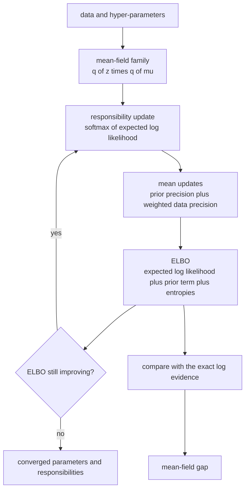
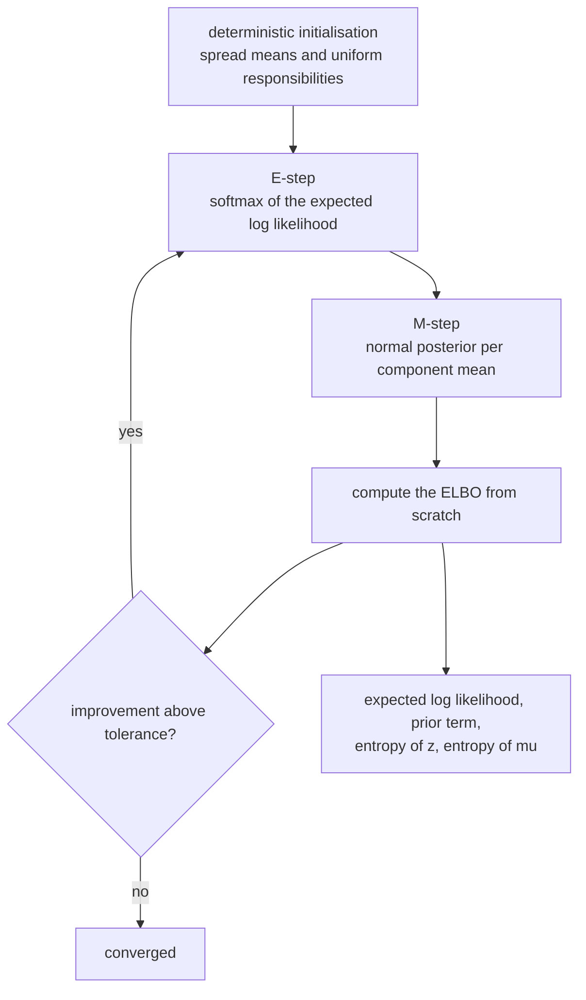
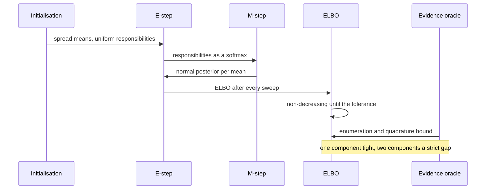

# 783 — Implement variational inference simple mean-field for mixture models

> **Tier:** Expert · **CTCI chapter:** Beyond — Machine Learning & AI
> **Task spec:** [783-implement-variational-inference-simple-mean-field-for-mixture-mo.md](../../../tasks/expert/783-implement-variational-inference-simple-mean-field-for-mixture-mo.md)
> **Solutions:** [Python](../../../solutions/python/expert/783-implement-variational-inference-simple-mean-field-for-mixture-mo/solution.py) ·
> [Java](../../../solutions/java/expert/783-implement-variational-inference-simple-mean-field-for-mixture-mo/Solution.java) ·
> [JavaScript](../../../solutions/javascript/expert/783-implement-variational-inference-simple-mean-field-for-mixture-mo/solution.js) ·
> [C#](../../../solutions/csharp/expert/783-implement-variational-inference-simple-mean-field-for-mixture-mo/Solution.cs)

## 1. Problem restatement

Fit a Bayesian mixture of `K` Gaussians by **mean-field variational inference**. The observation variance
`sigma²` is known, the mixture weights are fixed and equal, and each component mean carries a normal
prior `mu_k ~ N(m0, s0²)`. The variational family factorises,

```text
q(z, mu) = prod over points i of q(z_i) * prod over components k of q(mu_k)
q(z_i = k) = r_ik        q(mu_k) = N(m_k, v_k)
```

and coordinate ascent (CAVI) alternates the two closed-form updates until the **ELBO** — the evidence
lower bound — stops improving:

```text
r_ik  ∝  exp( -((x_i - m_k)^2 + v_k) / (2 sigma^2) )
v_k   =  1 / (1/s0^2 + sum_i r_ik / sigma^2)
m_k   =  v_k * (m0/s0^2 + sum_i r_ik x_i / sigma^2)
```

Inputs: the data, `K`, `sigma²`, `m0`, `s0²`. Outputs: the responsibilities, the posterior means and
variances, and the ELBO trajectory. Concrete results the checks assert:

- an empty dataset yields no spurious objective (`elbo` is `-inf` or the recomputed ELBO is `0.0`);
- one component on `[2.0]`: exactly one mean, with posterior variance
  `1 / (1/prior_var + 1/sigma2)`;
- `K = 5` on two points still produces five finite means;
- for `data = [-0.3, 0.1, 0.4, 0.9, 1.2, 0.6]`, `sigma² = 0.8`, `prior_var = 100`: the posterior mean
  equals the conjugate formula within `1e-9` **and** sits within `0.01` of the sample mean, the ELBO is
  non-decreasing over 200 sweeps, it never exceeds the quadrature log evidence (`+1e-6` tolerance), and
  the gap is below `0.5` — with one component the mean-field bound is tight;
- the closed-form evidence and the Simpson quadrature agree within `1e-4`, and a coarse 1001-point
  quadrature agrees within `1e-4` as well (the oracle is grid-converged);
- on the two well-separated clusters `[-3.2, -2.8, -3.5, -2.9, 3.1, 2.7, 3.4, 2.8]`: both means are
  recovered within `0.4`, **all eight** responsibilities are hard (`max(row) > 0.999`), a new point at
  `-3.0` is assigned to the left component and one at `3.0` to the right, all with probability above
  `0.999`;
- the ELBO recomputed from scratch at the converged parameters equals the accumulated value within
  `1e-9`, and five more sweeps never lower it;
- on that data the ELBO stays strictly **below** the exact two-component evidence, which a 2-D Simpson
  quadrature independently confirms within `0.5`;
- identical points `[1.5] * 5` with `sigma² = 0.5`, `prior_var = 4` shrink the posterior variance to
  exactly `1 / (1/4 + 5/0.5)`.

## 2. Intuition

The exact posterior of a mixture is a `K^N`-term sum, so EM-style point estimates were the classic
compromise — but a point estimate pretends to know the cluster means exactly, which is exactly what a
Bayesian should not do. Variational inference keeps a *distribution*, restricted to a family simple
enough to be tractable.

**Mean field** is the simplest restriction: assume the latent variables are independent under `q`, so
`q` factorises into one factor per point and one per component. That assumption buys two things:

1. **Closed-form coordinate updates.** With all other factors fixed, the optimal `q(z_i)` is the softmax
   of the expected log likelihood, and the optimal `q(mu_k)` is a normal whose precision is the prior
   precision plus the responsibility-weighted data precision. The mean-field variant differs from plain
   EM in one visible place: the responsibility uses `(x_i - m_k)^2 + v_k`, so an uncertain mean makes a
   point look *less* likely to belong to that component.
2. **An objective that is guaranteed to go uphill.** The ELBO is a lower bound on `log p(x)`; each
   coordinate update is the exact maximiser of that bound given the others, so CAVI can never decrease
   it, and the bound can never cross the evidence.

The price is **the mean-field gap**: because the family is too restrictive, the ELBO stops strictly
below the evidence whenever the true posterior has real correlations. With one component the factorisation
is exact and the checks require the gap to vanish (below `0.5`, against a bound that is `0.5`-tight); with
two components the gap is asserted to be strictly positive.



## 3. Algorithm

1. **Initialise deterministically.** The component means are spread evenly around the data mean using the
   data range (or `±0.5` around the centre if all points are equal), the initial variances are the prior
   variance and the responsibilities are uniform — the initial rows are asserted to sum to `N`.
2. **E-step.** For every point compute the log weight `-((x_i - m_k)^2 + v_k) / (2 sigma²)`, subtract the
   maximum for numerical stability, exponentiate and normalise.
3. **M-step.** For every component accumulate the mass `sum_i r_ik`, set
   `precision = 1/s0² + mass/sigma²`, `v_k = 1/precision` and
   `m_k = v_k * (m0/s0² + sum_i r_ik x_i / sigma²)`; return the masses for diagnostics.
4. **Objective.** `compute_elbo()` sums the expected log likelihood (including the `-0.5 log(2 pi sigma²)`
   constant and the `v_k` correction), `-N log K` for the fixed equal weights, the expected log prior
   `log N(m_k; m0, s0²)` with the variational variance, the entropy of `q(z)` (`-sum r log r`) and the
   entropy of `q(mu)` (`0.5 log(2 pi e v_k)`). It can be called on *any* parameter triple, which is how
   the bookkeeping is verified independently.
5. **Fit.** `fit(iterations, tolerance)` runs `e_step`, then alternates `m_step`/`e_step`, recording the
   ELBO after each sweep and stopping when the improvement falls below `tolerance`; the trajectory is
   returned, and the non-decreasing property is asserted on it.
6. **Prediction for new points.** `responsibilities_of(value)` reuses the converged parameters.
7. **Two independent evidence oracles.** `log_evidence_exact` enumerates the `K^N` assignments (each
   component's subset is integrated analytically against the normal prior) and combines them with a
   log-sum-exp; `log_evidence_single` and `log_evidence_two` run Simpson quadrature over one or two means
   (the point count is bumped to an odd number, as Simpson requires).

```text
procedure eStep()
    for every point i do
        for every component k do
            logWeight[k] ← -((x_i - m_k)^2 + v_k) / (2 * sigma2)
        shift ← max over k of logWeight[k]
        weights ← exp(logWeight[k] - shift) for every k
        responsibilities[i] ← weights / sum(weights)

procedure mStep()
    for every component k do
        mass ← sum over i of responsibilities[i][k]
        precision ← 1/priorVar + mass / sigma2
        v_k ← 1 / precision
        weightedSum ← sum over i of responsibilities[i][k] * x_i
        m_k ← v_k * (priorMean/priorVar + weightedSum / sigma2)
    return the component masses

procedure fit(iterations, tolerance)
    eStep()
    trajectory ← empty list
    repeat up to iterations times
        mStep()
        eStep()
        value ← computeElbo()
        trajectory.append(value)
        if the improvement over the previous entry is below tolerance then break
    return trajectory

procedure computeElbo(means, variances, responsibilities)
    total ← expectedLogLikelihood + expectedLogPrior + entropies
    total ← total - N * log(K)                      // the fixed equal mixture weights
    return total
```



## 4. Worked example

**One component, wide prior.** `data = [-0.3, 0.1, 0.4, 0.9, 1.2, 0.6]`, `sigma² = 0.8`,
`m0 = 0`, `s0² = 100`, `K = 1`. With one component every responsibility is `1`, so the M-step is the
conjugate normal update and the E-step changes nothing.

| Quantity | Formula | Value |
| --- | --- | --- |
| `sum x_i` | — | `2.9` |
| sample mean | `2.9 / 6` | `0.483333...` |
| precision | `1/100 + 6/0.8` | `0.01 + 7.5 = 7.51` |
| posterior variance `v` | `1 / 7.51` | `0.133155...` |
| posterior mean `m` | `v * (0/100 + 2.9/0.8) = v * 3.625` | `0.482690...` |

The check asserts `abs(m - conjugate_mean) < 1e-9` and `abs(m - sample_mean) < 0.01` — the observed
difference is `0.00064`, which is the shrinkage a prior with variance 100 and six observations with
variance 0.8 is supposed to produce: almost nothing.

After the first sweep the ELBO is already at its fixed point and stays there; the trajectory is
non-decreasing (trivially, since the updates are idempotent here). The evidence oracle confirms the
tightness: `log_evidence_single` (Simpson with 4000 points and the closed form agree within `1e-4`)
satisfies `elbo <= evidence + 1e-6` *and* `evidence - elbo < 0.5`.

**Two separated clusters.** `data = [-3.2, -2.8, -3.5, -2.9, 3.1, 2.7, 3.4, 2.8]`, `sigma² = 0.6`,
`s0² = 25`, `K = 2`. The initialisation spreads the two means evenly around `0`, one clearly closer to
each cluster, and the first E-step therefore makes the responsibilities almost binary; from then on the
M-step averages each cluster:

| Stage | Component 0 mean | Component 1 mean | Responsibilities | ELBO |
| --- | --- | --- | --- | --- |
| initialisation | `centre + 6.9 * (0 - 0.5) / 2 = -1.775` | `-0.05 + 1.725 = 1.675` | uniform `0.5` per row | not evaluated yet |
| after the first M-step | pulled toward the left cluster | pulled toward the right cluster | already nearly binary | increases |
| converged | within `0.4` of `-3.1` | within `0.4` of `3.0` | all eight rows above `0.999` | flat within the tolerance |

The initialisation is deterministic and worth reading off by hand: the data mean is `-0.05`, the range is
`6.9`, and the two means are placed at `k - (K-1)/2` units of `range / K`, giving `-1.775` and `1.675`.
Because the clusters are `±3`, component 0 starts closer to the left cluster and component 1 to the
right, which is why the first E-step is already almost hard and the identities of the components never
swap.

The check counts `hard == len(separated)` responsibilities above `0.999`, and asks
`responsibilities_of(-3.0)[0] > 0.999` and `responsibilities_of(3.0)[1] > 0.999` for new points. It also
verifies that `compute_elbo(means, variances, responsibilities)` recomputed from the converged state
matches the value accumulated by `fit` within `1e-9` — a separate implementation path of the same
quantity, which is what catches bookkeeping bugs in the entropy and mixture terms.

**The gap.** On the same data the exact evidence enumerates the `2^8 = 256` label assignments (each
integrated analytically), and the ELBO must be strictly below it; the 2-D Simpson quadrature agrees with
the exact value within `0.5`. The gap is the price of the factorised family and it does not vanish —
unlike the one-component case, where the family is exact.



## 5. Complexity

Let `N` be the number of points, `K` the components, `T` the number of sweeps and `M` the quadrature
grid size.

| Operation | Best | Average | Worst | Why the bound holds |
| --- | --- | --- | --- | --- |
| `e_step` | O(N K) | O(N K) | O(N K) | one log weight per point and component, plus the max-subtracted softmax |
| `m_step` | O(N K) | O(N K) | O(N K) | one mass and one weighted sum per component |
| `compute_elbo` | O(N K) | O(N K) | O(N K) | the likelihood term dominates; the prior, mixture and entropy terms are `O(K)` |
| `fit` | O(N K) | O(T N K) | O(iterations · N K) | sweeps stop when the ELBO improvement falls below the tolerance; the checks allow 200–300 sweeps |
| `responsibilities_of` | O(K) | O(K) | O(K) | a softmax over the converged parameters |
| `log_evidence_exact` (oracle) | O(K^N · N) | O(K^N · N) | O(K^N · N + N log N) | every assignment is enumerated and each component subset is evaluated — hence `K <= 4` and `N` in the tens |
| `log_evidence_single` | O(M N) | O(M N) | O(M N) | Simpson over a 1-D grid with `M = 4000` points |
| `log_evidence_two` | O(M² N) | O(M² N) | O(M² N) | a 2-D grid with `M = 160` per axis, so about `25600 · N` likelihood evaluations |
| Space | O(N K + K) | same | O(N K + K + K^N) | responsibilities dominate; the enumeration oracle stores the assignment log weights |

Comparison with the alternatives:

| Method | Assumption | Objective | Gap |
| --- | --- | --- | --- |
| Hard EM / k-means | point estimates of the means | none | no bound at all |
| EM with known variance | maximum likelihood (a point estimate) | data likelihood | biased (overfits) with small `N` |
| Mean-field CAVI (this task) | independence of `q(z)` and `q(mu)` | the ELBO, maximised monotonically | tight for `K = 1`, strictly positive for `K = 2` |
| Exact posterior | none | `log p(x)` | zero, computed here by enumeration |

## 6. Pitfalls and edge cases

- **Empty data** must not produce a spurious objective: `initialise([])` clears the parameters and
  `compute_elbo()` returns `0.0`, so nothing divides by `N`.
- **`N = 1`** with one component is the smallest conjugate update: `v = 1 / (1/s0² + 1/sigma²)`,
  asserted to `1e-12`.
- **`K > N`.** Five components over two points still yield five finite means because the prior keeps
  every precision positive — the update is `1/(1/s0² + mass/sigma²)` and never divides by the cluster
  mass.
- **Identical points.** With `[1.5] * 5`, `sigma² = 0.5` and `s0² = 4` every responsibility is `1`, so the
  variance must shrink to exactly `1 / (1/4 + 5/0.5) = 0.09756`; the check asserts this to `1e-9` rather
  than merely "small".
- **Numerical stability.** The E-step subtracts the maximum log weight before exponentiating; without
  it, well-separated data would underflow to all-zero weights and the normalisation would be undefined.
- **Simpson needs an odd number of points.** Both quadrature helpers bump an even count, because an even
  grid silently produces a wrong (but plausible-looking) integral.
- **The ELBO must be recomputable from scratch.** `compute_elbo` accepts an explicit parameter triple, so
  the accumulated value can be re-derived independently — the check requires agreement within `1e-9`,
  which catches an off-by-one in the trajectory bookkeeping or a missing entropy term.
- **Monotonicity is a property, not a hope.** The checks compare every consecutive pair of the trajectory
  and also verify that continuing a converged fit does not lower the ELBO.
- **Deterministic initialisation.** The means are spread around the observed centre with no randomness, so
  the trajectory, the converged means and the hard-responsibility count all reproduce exactly.
- **The mean-field correction.** The responsibilities use `(x_i - m_k)^2 + v_k`; dropping `v_k` would
  turn the algorithm into EM with the prior bolted on and break the tightness assertion for `K = 1`.
- **Documented simplifications.** Known observation variance, fixed equal weights (no Dirichlet factor
  and no beta/nu/m updates), one-dimensional data, batch (not stochastic) CAVI, and an enumeration-based
  evidence oracle that only stays affordable because `K <= 4` and `N` is small.

## 7. Variants and follow-ups

- **Full Bayesian Gaussian mixture.** Add a Dirichlet prior on the weights and a Gamma/Wishart prior on
  the precision so the responsibilities also carry weight terms (this is where the file's `digamma`
  helper becomes useful); the CAVI structure is unchanged, the update formulas grow.
- **Stochastic / subsampled VI.** Replace the full-data sums by mini-batch estimates with importance
  weights, which makes the method scale but adds variance to a bound that was monotone in the batch case.
- **Better variational families.** Structured or flow-based `q` shrinks the gap at the cost of the
  closed-form updates; the gap is the quantity to watch, and this task measures it against two
  independent evidence oracles.
- **Related tasks.** [782 — belief propagation inference](../../../tasks/expert/782-implement-probabilistic-graphical-models-inference-belief-propag.md)
  computes exact marginals where the graph is a tree and documents the approximation elsewhere;
  [784 — Gibbs sampling for LDA](../../../tasks/expert/784-implement-gibbs-sampling-for-topic-models-lda-small-dataset.md)
  and [785 — collapsed Gibbs with perplexity](../../../tasks/expert/785-implement-collapsed-gibbs-for-lda-and-perplexity-evaluation.md)
  attack the same intractable-posterior problem with sampling, where the objective is replaced by
  asymptotics rather than by a bound.

## 8. Check yourself

<details><summary>Show answer</summary>
**Why is the ELBO guaranteed to increase at every CAVI sweep?** The ELBO can be written as
`log p(x) - KL(q || p(z, mu | x))`. Each coordinate update sets one factor of `q` to the closed-form
optimum that minimises the KL divergence from the true posterior *given the other factors fixed*, so the
KL can only shrink and the bound can only grow. The checks turn this theorem into a test: every
consecutive pair of the returned trajectory must be non-decreasing up to `1e-9`.
</details>

<details><summary>Show answer</summary>
**With `K = 1` the gap is below `0.5`; with `K = 2` it is strictly positive. Why?** With one component the
mean-field factorisation `q(z) q(mu)` is the exact posterior's own structure — there is no correlation left
to drop, so the bound is tight up to the quadrature error. With two components the true posterior couples
the label of each point to both means (a point that is probably in the left cluster changes what we
believe about the right mean), and a factorised `q` cannot represent that coupling, so the KL stays
positive.
</details>

<details><summary>Show answer</summary>
**The responsibilities contain `(x_i - m_k)^2 + v_k`. What happens if `v_k` is dropped?** The update becomes
plain EM with a point estimate of the mean: a component whose mean is highly uncertain is scored as if it
were certain, so points are assigned too confidently and the bound is no longer the ELBO of the stated
model. The `K = 1` tightness check would also fail, since the expected log likelihood term would no longer
match the posterior variance the M-step computes.
</details>

<details><summary>Show answer</summary>
**The evidence is verified with two independent oracles (enumeration and Simpson quadrature). Why bother
with the quadrature when the enumeration is exact?** Because the enumeration is exact *for the model as
implemented*, including any modelling mistake the author made. The quadrature is a second, structurally
different derivation of `log p(x)` from the prior and likelihood alone; when both agree (within `1e-4` for
`K = 1`, `0.5` for the 2-D case) the model itself has been checked, not just the arithmetic.
</details>

<details><summary>Show answer</summary>
**Identical points shrink the posterior variance to `1 / (1/4 + 5/0.5)`; why is the third of those numbers
larger than the prior precision?** Because the likelihood precision of `N` identical observations with
variance `sigma²` is `N / sigma²`: five observations at variance `0.5` contribute `10`, far more than the
prior's `1/4`. The posterior variance therefore collapses toward the data, which is the conjugate normal
behaviour the check pins to `1e-9` instead of describing loosely.
</details>
