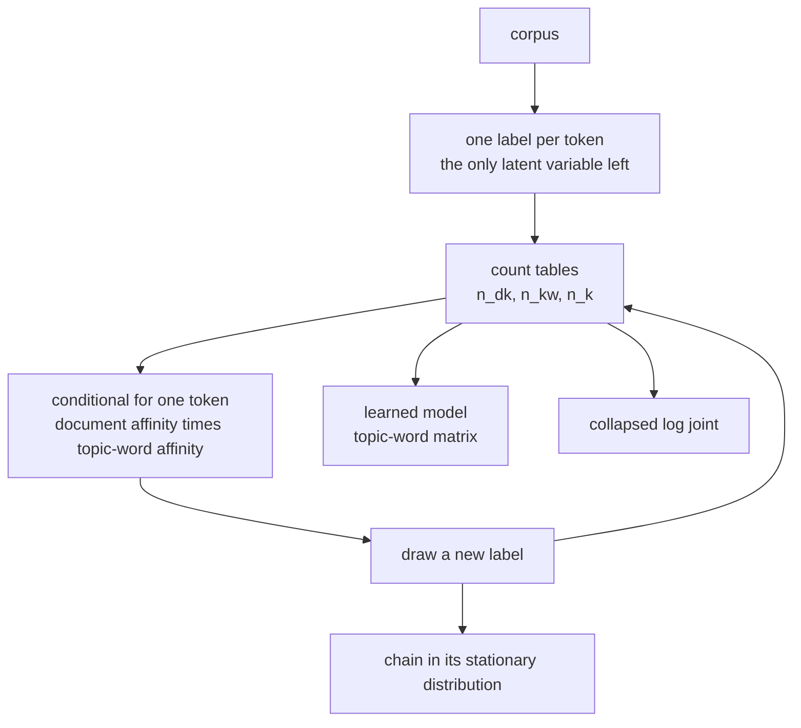
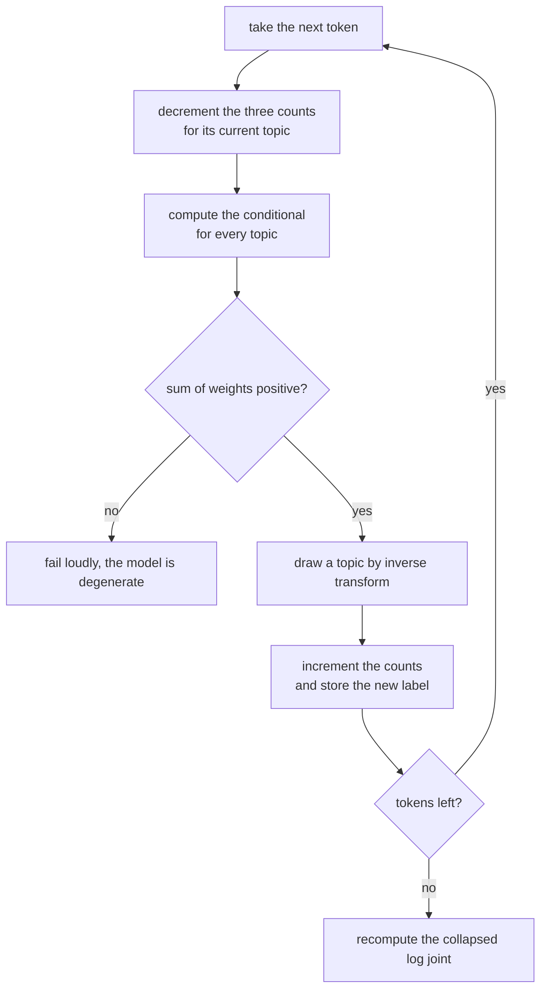
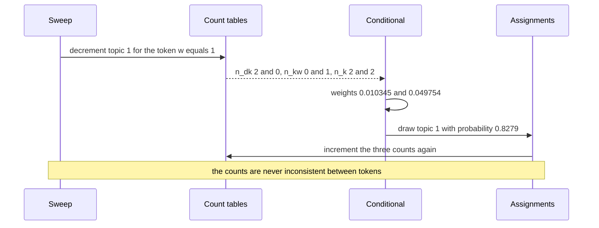

# 784 — Implement Gibbs sampling for topic models (LDA) small dataset

> **Tier:** Expert · **CTCI chapter:** Beyond — Machine Learning & AI
> **Task spec:** [784-implement-gibbs-sampling-for-topic-models-lda-small-dataset.md](../../../tasks/expert/784-implement-gibbs-sampling-for-topic-models-lda-small-dataset.md)
> **Solutions:** [Python](../../../solutions/python/expert/784-implement-gibbs-sampling-for-topic-models-lda-small-dataset/solution.py) ·
> [Java](../../../solutions/java/expert/784-implement-gibbs-sampling-for-topic-models-lda-small-dataset/Solution.java) ·
> [JavaScript](../../../solutions/javascript/expert/784-implement-gibbs-sampling-for-topic-models-lda-small-dataset/solution.js) ·
> [C#](../../../solutions/csharp/expert/784-implement-gibbs-sampling-for-topic-models-lda-small-dataset/Solution.cs)

## 1. Problem restatement

Latent Dirichlet allocation describes every document as a mixture of `K` topics and every topic as a
distribution over a vocabulary of `V` words, with a `Dirichlet(alpha)` document-topic prior and a
`Dirichlet(beta)` topic-word prior. **Collapsed** Gibbs sampling integrates both multinomials out
analytically, so the only state is the topic assignment `z` of every token, and one token is resampled
from the exact conditional

```text
p(z_i = k | z_-i, w)  proportional to  (n_dk + alpha) * (n_kw_i + beta) / (n_k + V * beta)
```

where `n_dk`, `n_kw` and `n_k` are the counts **excluding the token being resampled**.

Inputs: a corpus (a list of documents, each a list of word ids), `K`, `V`, `alpha`, `beta`, a seed.
Outputs: the assignment matrix, the three count tables, the collapsed log joint, the topic-word matrix,
the held-out completion log-likelihood and an alignment score against a known partition. Concrete
results the checks assert:

- an empty corpus has zero counts, a finite log joint that depends only on the hyper-parameters, and no
  tokens to conserve;
- a single word type over `[[0, 0, 0], [0]]` conserves all four tokens; `K = 1` puts every token in
  topic 0 (`topic_total == [5]`, each document's row is its length); a one-token document works;
- the conditional used for sampling equals an independently recomputed leave-one-out formula (from the
  raw assignments) within `1e-9` for the tokens `(0, 1)`, `(1, 2)`, `(0, 3)` of a `K = 3, V = 6` model,
  every weight is strictly positive, and the counts are restored afterwards (7 tokens);
- `random_corpus(2, 4, 6, 20, 0xBEEF)` is 8 documents and 48 tokens, and after 60 sweeps the learned
  topics align with the two disjoint vocabulary halves at `>= 0.9`, never below the initial alignment;
- the held-out **document completion** log-likelihood strictly improves from the random initialisation;
- rebuilding the count tables from the assignment matrix reproduces them exactly, and the topic-word
  matrix rows each sum to 1;
- the collapsed log joint stays finite along the whole chain.

## 2. Intuition

A direct sampler over `(theta, phi, z)` would have to resample two continuous distributions at every
step. The **collapse** removes them: because the Dirichlet is conjugate to the multinomial, the
integrals over `theta` and `phi` have closed forms, and the joint of the assignments alone is

```text
p(w, z) ∝ prod_d  [ (Gamma(K alpha) / Gamma(N_d + K alpha)) * prod_k Gamma(n_dk + alpha) / Gamma(alpha) ]
         * prod_k  [ (Gamma(V beta) / Gamma(n_k + V beta)) * prod_w Gamma(n_kw + beta) / Gamma(beta) ]
```

so the only thing left to sample is one discrete label per token — and its conditional is the product of
two smoothed relative frequencies:

1. **`(n_dk + alpha)`** is the document's own affinity for the topic ("this document already talks about
   topic `k`").
2. **`(n_kw + beta) / (n_k + V beta)`** is the topic's affinity for the word ("topic `k` already uses
   this word"), normalised by how much the topic says overall.



Two details separate a correct implementation from a plausible one. First, the token must be **removed
from all three counts before** its conditional is formed — otherwise it votes for its own current topic,
which biases the chain (the worked example below measures the bias). Second, the chain has to be
*checked*: the count tables must always equal the aggregates of the assignment matrix, and the
conditional must agree with a brute-force recomputation from the raw assignments. Both are asserted here,
which is why the sampler earns the right to report a learned model.

## 3. Algorithm

1. **Initialise.** Assign every token a topic with the deterministic `splitmix64` generator
   (`topic = r % K`) and build `n_dk`, `n_kw`, `n_k` together with a parallel assignment matrix.
2. **One sweep.** For each document in order, for each token in position order:
   1. `previous` = current label; decrement all three count tables for `previous`.
   2. Compute the `K` unnormalised weights `(n_dk + alpha) * (n_kw + beta) / (n_k + V beta)`.
   3. Draw a topic by cumulative inverse-transform sampling with the deterministic uniform draw
      `(r % 2**30) / 2**30` scaled by the weight sum.
   4. Increment the three tables for the drawn topic and store the label.
3. **Objective.** `log_joint()` evaluates the collapsed joint with `lgamma` terms
   (`log Gamma(n + a) - log Gamma(a)` per cell plus the normalising `log Gamma(N + K alpha)` terms).
4. **Invariant.** `check_counts()` rebuilds the tables from the assignment matrix (including a
   brute-force recount of `n_kw` by scanning the corpus) and compares; it returns the token count.
5. **Fit.** `fit(sweeps)` runs the fixed number of sweeps of this simplified sampler and returns the
   model; `restore(assignments)` rebuilds the tables from any assignment matrix.
6. **Diagnostics.** `topic_word_matrix()` gives the plug-in `phi`, `document_completion()` scores each
   document's held-out second half given its first half, and `alignment(...)` matches learned topics to
   the ground-truth vocabulary halves by majority mass.

```text
procedure sweep()
    for each document d and position i do
        word ← corpus[d][i]
        previous ← assignments[d][i]
        docTopic[d][previous] ← docTopic[d][previous] - 1        // leave one out
        topicWord[previous][word] ← topicWord[previous][word] - 1
        topicTotal[previous] ← topicTotal[previous] - 1
        weights ← empty list
        for topic in 0 .. topics - 1 do
            weights.append((docTopic[d][topic] + alpha)
                           * (topicWord[topic][word] + beta)
                           / (topicTotal[topic] + vocab * beta))
        topic ← sampleTopic(weights)
        assignments[d][i] ← topic
        docTopic[d][topic] ← docTopic[d][topic] + 1
        topicWord[topic][word] ← topicWord[topic][word] + 1
        topicTotal[topic] ← topicTotal[topic] + 1
    sweeps ← sweeps + 1
    return logJoint()

procedure sampleTopic(weights)
    total ← sum of weights
    require total > 0
    state, r ← splitmix64(state)
    threshold ← (r modulo 2^30) / 2^30 * total
    cumulative ← 0
    for topic, weight in enumerate(weights) do
        cumulative ← cumulative + weight
        if threshold < cumulative then return topic
    return last index

procedure conditionalVector(document, position)            // brute-force view used by the checks
    word ← corpus[document][position]
    rebuild topicWord, docTopic and topicTotal from the assignments, skipping that one token
    return (docTopic[topic] + alpha) * (topicWord[topic][word] + beta)
           / (topicTotal[topic] + vocab * beta) for every topic
```



## 4. Worked example

`K = 2`, `V = 3`, `alpha = 0.1`, `beta = 0.01`, and a corpus `[[0, 1, 0], [1]]` currently labelled
`[[0, 1, 0], [1]]`. The counts are `n_d0 = [2, 1]`, `n_d1 = [0, 1]`, `n_kw` = topic 0 `[2, 0, 0]`,
topic 1 `[0, 2, 0]`, and `n_k = [2, 3]`.

Now resample the token `w = 1` at document 0, position 1 (currently topic 1).

| Step | Topic 0 weight | Topic 1 weight | Unnormalised sum | `p(k = 0)` | `p(k = 1)` |
| --- | --- | --- | --- | --- | --- |
| after removal: `(2.1 * 0.01) / 2.03` and `(0.1 * 1.01) / 2.03` | `0.010345` | `0.049754` | `0.060099` | `0.1721` | `0.8279` |

The token is very likely to stay in topic 1 because topic 1 is the only topic that has ever emitted the
word `1` — the `(n_kw + beta)` factor is doing the work, and `beta = 0.01` is small enough that topic 0's
zero count really hurts.

**The leave-one-out matters.** If the token were not removed first, its own count would inflate the
numerator of its current topic: `n_kw[1][1]` would be `2` and `n_k = [2, 3]`, giving weights
`0.010345` and `0.066337`, so `p(k = 1) = 0.8651`. The ratio `p(k = 1) / p(k = 0)` moves from `4.81` (the
correct, unbiased value) to `6.41` (the self-reinforcing value). That is the whole reason the sweep
decrements the counts before computing the conditional — and why the checks compare the sampler's
conditional against `conditional_vector`, which rebuilds the leave-one-out state from the raw
assignments.

**The synthetic corpus.** `random_corpus(2, 4, 6, 20, 0xBEEF)` builds 8 documents of 6 tokens from two
disjoint halves of a 20-word vocabulary, so the ground truth is known: `word < 10` came from the first
half. After 60 sweeps the `alignment` score — the fraction of tokens whose learned topic matches the
majority mapping to their true half — must be at least `0.9`, and it must not decrease from the random
initialisation. The held-out completion log-likelihood, which scores each document's second half from
its first half, must strictly improve over the same quantity at initialisation:

```text
completion(document) = sum over the second-half tokens of log( sum over topics of
                          ( (docCounts[topic] + alpha) / (split + K alpha) )
                        * ( (n_kw[topic][word] + beta) / (n_k + V beta) ) )
```



## 5. Complexity

Let `N` be the number of tokens, `D` the documents, `K` the topics, `V` the vocabulary and `S` the
number of sweeps.

| Operation | Best | Average | Worst | Why the bound holds |
| --- | --- | --- | --- | --- |
| `sweep` | O(N K) | O(N K) | O(N K) | one `K`-term conditional and one `K`-step cumulative draw per token; count updates are O(1) |
| `fit` | O(N K) | O(S N K) | O(S N K) | the checks use a fixed sweep count (`60` for the synthetic corpus, `5` for the degenerate cases) |
| `log_joint` | O(D K + K V) | same | same | `lgamma` terms over the document-topic and topic-word cells |
| `check_counts` | O(N + K V) | O(N + K V) | O(N + K V) | the brute-force `n_kw` recount scans the corpus once per topic and word |
| `conditional_vector` | O(N) | O(N) | O(N) | rebuilds the leave-one-out tables from scratch — deliberately naive, it is the oracle |
| `document_completion` | O(D K) | O(D K) | O(D K) | one softmax over topics per second-half token |
| Space | O(N + D K + K V) | same | same | the assignment matrix is `N` labels, plus the two count tables and the topic totals |

Comparison with the alternatives:

| Method | Latent state | Cost per pass | Notes |
| --- | --- | --- | --- |
| Uncollapsed Gibbs | `z`, `theta`, `phi` | O(N K + D K + K V) per sweep | slower mixing, but no collapse algebra |
| Collapsed Gibbs (this task) | `z` only | O(N K) | the sampled state is a sample of `p(z | w)` |
| Variational (mean-field) LDA | responsibilities | O(N K) per iteration | a bound, not a sample |
| Exact posterior | `K^N` states | exponential | only feasible for a handful of tokens |

## 6. Pitfalls and edge cases

- **The leave-one-out.** Every count must exclude the token before the conditional is formed; the worked
  example shows the bias (`0.8279` becomes `0.8651` for the same token) and the checks pin the sampler's
  conditional to an independently recomputed one.
- **Count/token conservation.** `check_counts()` asserts `sum(topic_total) == tokens`, that each row equals
  the aggregate of the assignment matrix, that a topic's word counts sum to its own total, and that every
  label is in range. It also reassembles `n_kw` by scanning the corpus, so a stale table cannot hide.
- **`K = 1`.** Every token belongs to the single topic: `topic_total == [5]` for `[[0, 1, 2], [3, 4]]`
  and each document's row is just its length — a common place for an off-by-one in the conditional.
- **A single word type.** `[[0, 0, 0], [0]]` with `V = 1` tests that `V * beta` and the empty vocabulary
  dimensions do not divide by zero.
- **A one-token document** and an **empty corpus** are both checked; the empty corpus must still produce a
  finite objective that depends only on the hyper-parameters.
- **Every conditional weight must be positive.** With `alpha, beta > 0` the weight `(n_dk + alpha) *
  (n_kw + beta) / (n_k + V beta)` is strictly positive for every topic, so no topic can become
  unreachable — the check asserts `all(value > 0)`.
- **Sampling must be robust.** `sample_topic` asserts a positive weight sum and falls back to the last
  index when the cumulative sum ends exactly at the threshold, so floating-point accumulation cannot drop
  a draw.
- **Deterministic seeds.** The generator is `splitmix64`; the checks require the same seed to reproduce
  the chain and different seeds to still recover the same structure (alignment `>= 0.9`).
- **Restoring the counts.** `restore(assignments)` must reproduce the tables exactly; this is the same
  invariant as `check_counts()` and it is asserted as an equality of nested lists.
- **Normalisation.** Each row of the topic-word matrix must sum to 1 within `1e-9`, and the learned topics
  must concentrate on opposite vocabulary halves rather than both drifting to the global word frequency.
- **Documented simplifications.** A small corpus (a few dozen tokens) keeps the brute-force checks cheap,
  the number of sweeps is fixed instead of diagnosed, there is no hyper-parameter resampling and no
  held-out perplexity in this task — the reported metric is the collapsed log joint and the completion
  likelihood.

## 7. Variants and follow-ups

- **Hold-out perplexity and convergence diagnostics.** The companion task
  [785 — collapsed Gibbs with perplexity evaluation](../../../tasks/expert/785-implement-collapsed-gibbs-for-lda-and-perplexity-evaluation.md)
  adds `phi`/`theta` plug-in estimates, a training and a held-out perplexity, a hand-derived closed form
  for `K = 1`, and an exhaustive collapsed posterior as an independent oracle for the sampler kernel.
- **Resample `alpha` and `beta`.** Both are fixed here; a full Bayesian treatment puts Gamma priors on
  them and adds two more conditional updates.
- **Better initialisation and longer chains.** The deterministic random initialisation is what makes the
  alignment improve; a smarter start (e.g. seeding topics from frequent words) shortens the burn-in that
  this simplified sampler skips.
- **Related tasks.** [782 — belief propagation](../../../tasks/expert/782-implement-probabilistic-graphical-models-inference-belief-propag.md)
  and [783 — mean-field variational inference](../../../tasks/expert/783-implement-variational-inference-simple-mean-field-for-mixture-mo.md)
  are the deterministic-approximation routes to the same intractable posteriors that Gibbs sampling
  attacks by simulation.

## 8. Check yourself

<details><summary>Show answer</summary>
**Why is the conditional `(n_dk + alpha) * (n_kw + beta) / (n_k + V beta)` and not just a product of two
frequencies?** Because the two Dirichlet priors add pseudo-counts (`alpha` per topic per document, `beta`
per word per topic), and the denominator normalises the topic over the whole vocabulary. Dropping the
denominator would make topics with more tokens systematically more attractive, which is a different
distribution and no longer the collapse of LDA. The check that the sampler's conditional matches a
brute-force recomputation is precisely a guard against this class of error.
</details>

<details><summary>Show answer</summary>
**Why must the token be removed from `n_kw` before the conditional is computed?** Because the conditional
is `p(z_i = k | z_-i, w)`, i.e. *given every other token*. Keeping the token's own count lets a token
support its own current assignment, which biases the chain towards its starting state. The worked example
shows the effect on one token: `p(k = 1)` rises from `0.8279` (correct) to `0.8651` (self-reinforced).
</details>

<details><summary>Show answer</summary>
**The alignment score is at least `0.9`, not `1.0`. Why can it not be exact?** Because `alpha` and `beta`
are strictly positive, so every topic has non-zero probability for every word, and the synthetic corpus is
drawn from a probabilistic generator rather than from two hard rules. A few tokens legitimately land in
the "wrong" topic, and the check only requires the learned mass to match the true partition on 90% of the
tokens (majority mapping per topic, so the score is also robust to topic relabelling).
</details>

<details><summary>Show answer</summary>
**Why does the sampler need `K` weights per token rather than a single accept/reject test?** Because the
draw is from a categorical distribution over `K` topics, and collapse means the transition is exact: any
rejection scheme would need a proposal distribution and would only be asymptotically correct, whereas the
cumulative inverse-transform draw reproduces the exact conditional with one uniform number per token.
</details>

<details><summary>Show answer</summary>
**`check_counts()` reassembles `n_kw` by scanning the whole corpus. Isn't that redundant with the
incremental updates?** Redundant is exactly the point: one implementation updates counts incrementally, the
other recomputes them from the ground truth (the assignment matrix). If the two ever disagree, the sweep
decrement/increment logic is wrong, and every downstream quantity — log joint, `phi`, alignment — would
be built on corrupt state. The check runs after every sweep, not only at the end.
</details>
