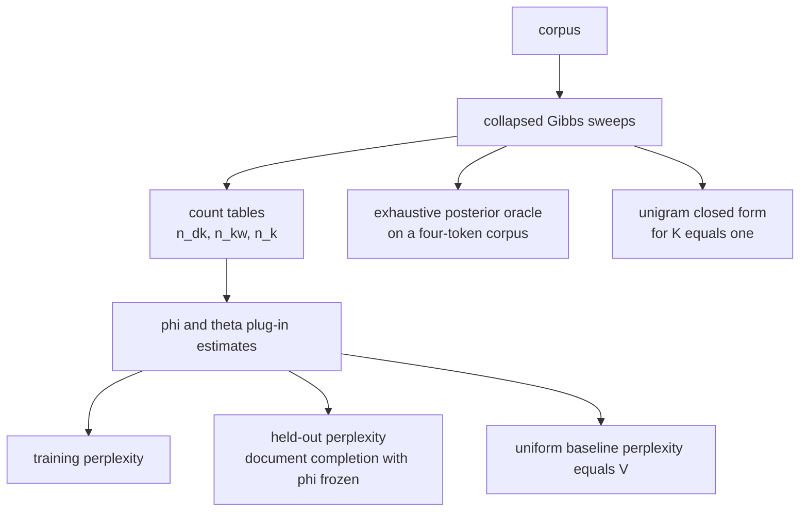
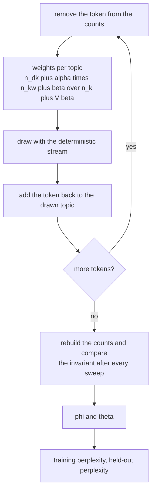
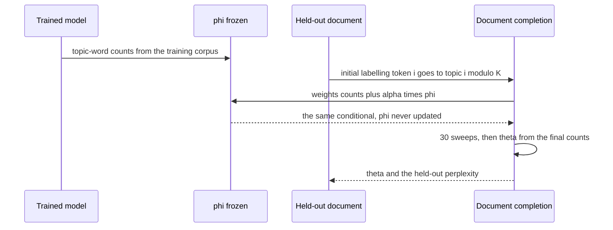

# 785 — Implement collapsed Gibbs for LDA and perplexity evaluation

> **Tier:** Expert · **CTCI chapter:** Beyond — Machine Learning & AI
> **Task spec:** [785-implement-collapsed-gibbs-for-lda-and-perplexity-evaluation.md](../../../tasks/expert/785-implement-collapsed-gibbs-for-lda-and-perplexity-evaluation.md)
> **Solutions:** [Python](../../../solutions/python/expert/785-implement-collapsed-gibbs-for-lda-and-perplexity-evaluation/solution.py) ·
> [Java](../../../solutions/java/expert/785-implement-collapsed-gibbs-for-lda-and-perplexity-evaluation/Solution.java) ·
> [JavaScript](../../../solutions/javascript/expert/785-implement-collapsed-gibbs-for-lda-and-perplexity-evaluation/solution.js) ·
> [C#](../../../solutions/csharp/expert/785-implement-collapsed-gibbs-for-lda-and-perplexity-evaluation/Solution.cs)

## 1. Problem restatement

Implement collapsed Gibbs sampling for LDA **and** the machinery that judges a topic model: the plug-in
topic-word and document-topic distributions, training and held-out **perplexity**, and a sampler oracle
strong enough to check the chain itself.

The sampler resamples each token's topic from the collapsed conditional (the token is removed from all
three counts first):

```text
p(z = k | rest)  proportional to  (n_dk + alpha) * (n_kw + beta) / (n_k + V * beta)
```

and the sufficient statistics give the plug-in estimates and the perplexity of a token stream:

```text
phi[k][w]   = (n_kw + beta)  / (n_k + V * beta)
theta[d][k] = (n_dk + alpha) / (N_d + K * alpha)
perplexity  = exp( -sum over tokens of log( sum over k of theta[d][k] * phi[k][w] ) / tokens )
```

Concrete results the checks assert, for `V = 24`, `K = 2`, `alpha = 0.1`, `beta = 0.05`, 40 documents of
20 tokens drawn with purity `0.9` from two vocabulary groups of 12 words each:

- the count tables are rebuilt from the assignment and compared **after every one of the 150 sweeps**;
- every `phi` row and every `theta` row sums to 1 within `1e-12`;
- the two topics specialise on **different** word groups and each concentrates more than `0.8` of its mass
  on one group;
- the trained perplexity beats the unigram `K = 1` model, stays below `0.8 * V = 19.2`, and is lower than
  the perplexity at initialisation;
- the `K = 1` perplexity equals a hand-derived closed form
  `exp(-sum_w n_w log((n_w + beta) / (tokens + V beta)) / tokens)` to `1e-9`;
- held-out perplexity (8 unseen documents, `theta` re-inferred by document completion with `phi` frozen)
  lies strictly between `0` and the uniform baseline `V = 24`; an empty held-out document falls back to
  the uniform topic prior, and a token-free corpus reports infinity;
- two runs with the same seed reproduce the assignment **and** the perplexity bit for bit, a different
  seed gives a different chain;
- invalid hyper-parameters (`alpha = 0`, `beta = -1`, `K = 0`) and out-of-vocabulary word ids are rejected
  with a `ValueError`;
- on the 4-token corpus `[[0, 1], [1, 0]]` with `V = 2`, `K = 2`, `alpha = beta = 0.5`, the occupancy of
  20000 chain states matches the **exhaustively enumerated** collapsed posterior with a total-variation
  distance below `0.05`.

## 2. Intuition

Fitting a topic model is easy to do and hard to trust, so this task pairs the sampler with three
independent yardsticks:

1. **An exact oracle for the kernel.** On a four-token corpus the collapsed posterior `p(z | w)` has only
   `K^4 = 16` states, so it can be enumerated exactly. Running the chain for 20000 sweeps and comparing the
   empirical occupancy of the *states* with the enumerated distribution tests the transition kernel
   itself, not just its output: an implementation with a subtly wrong conditional would converge to the
   wrong stationary distribution and fail the comparison.
2. **A closed form for a simpler model.** With `K = 1` the model is a single unigram distribution, and the
   plug-in perplexity has a hand-derivable value. If the general perplexity code agrees with it, the
   normalisation of `phi` and `theta` is right.
3. **A predictive metric that is not fitted on itself.** Training perplexity uses the same corpus that
   produced the counts, so it is optimistic. **Document completion** re-infers `theta` for an unseen
   document by running the same conditional with `phi` frozen, and scores the document with the frozen
   model — the standard held-out protocol, and the reason the task's held-out number is meaningful.



Perplexity is the exponential of the average negative log-probability per token, so "lower is better" and
the uniform model gives exactly `V`. Every comparison in the checks is against one of those anchors
rather than against an arbitrary constant.

## 3. Algorithm

1. **Validate.** `vocab_size`, `num_topics`, `alpha` and `beta` must be positive, and every word id must
   be inside the vocabulary; violations raise `ValueError` (the task's documented negative checks).
2. **Initialise deterministically.** Token `i` of a document starts in topic `i % K`, and the three count
   tables are built in the same pass. Note this is a different initialisation from task 784's
   generator-driven one; both are deterministic, which is what the reproducibility checks need.
3. **Sweep.** For each document and token: decrement the three counts for the current topic, form the
   `K` unnormalised weights, draw with the deterministic `SplitMix64` stream scaled by `math.fsum` of the
   weights, then increment the counts for the drawn topic and store the label.
4. **Invariants.** `counts_consistent()` rebuilds `n_kw`, `n_dk` and `n_k` from `z` and compares all
   three, so the invariant is checked after every sweep rather than at the end.
5. **Estimates.** `phi()` and `theta(d)` apply the plug-in formulas above.
6. **Training perplexity.** Score every corpus token under `theta[d] · phi[:, w]`, average the log
   probabilities and exponentiate; a token-free corpus reports `inf`.
7. **Document completion.** `infer_theta(doc, phi, sweeps=30)` samples the held-out document's topics with
   `phi` **frozen**, using `(counts[k] + alpha) * phi[k][w]` as the conditional, then forms
   `(counts[k] + alpha) / (N_d + K alpha)`; an empty document returns the uniform prior.
8. **Held-out perplexity.** Score unseen documents with their re-inferred `theta` and the frozen `phi`.
9. **Oracles.** `log_collapsed_joint(state, ...)` evaluates the collapsed joint with `lgamma` terms,
   `exact_posterior_over_states(...)` enumerates all `K^tokens` states and normalises, and
   `state_histogram(...)` records one chain state per sweep for the comparison.

```text
procedure sweep()
    for each document d and position i with word w do
        k ← z[d][i]
        n_dk[d][k] ← n_dk[d][k] - 1
        n_kw[k][w] ← n_kw[k][w] - 1
        n_k[k] ← n_k[k] - 1
        newK ← draw([(n_dk[d][j] + alpha) * (n_kw[j][w] + beta) / (n_k[j] + V * beta)
                     for j in 0 .. K - 1])
        n_dk[d][newK] ← n_dk[d][newK] + 1
        n_kw[newK][w] ← n_kw[newK][w] + 1
        n_k[newK] ← n_k[newK] + 1
        z[d][i] ← newK
    sweeps ← sweeps + 1

procedure perplexity()
    phi ← phiFromCounts()
    totalLog ← 0
    tokens ← 0
    for each document d and word w in it do
        theta ← (n_dk[d][k] + alpha) / (N_d + K * alpha) for every k
        totalLog ← totalLog + log(sum over k of theta[k] * phi[k][w])
        tokens ← tokens + 1
    return exp(-totalLog / tokens) if tokens > 0 else infinity

procedure inferTheta(doc, phi, sweeps)
    if doc is empty then return uniform(K)
    counts ← counts of the initial labelling i modulo K
    repeat sweeps times
        for each position i with word w do
            counts[z[i]] ← counts[z[i]] - 1
            pick ← draw([(counts[k] + alpha) * phi[k][w] for k in 0 .. K - 1])
            counts[pick] ← counts[pick] + 1
            z[i] ← pick
    return [(counts[k] + alpha) / (length(doc) + K * alpha) for k in 0 .. K - 1]
```



## 4. Worked example

**(a) The unigram closed form.** With `K = 1` every token has topic 0, so `theta = [1]` and the only
parameter is `phi[0][w] = (n_w + beta) / (tokens + V beta)`. Take the two-word corpus with word counts
`n_0 = 2`, `n_1 = 1`, `beta = 0.5` and `V = 2`:

| Quantity | Value |
| --- | --- |
| `phi[0][0]` | `(2 + 0.5) / (3 + 1) = 0.625` |
| `phi[0][1]` | `(1 + 0.5) / (3 + 1) = 0.375` |
| average log probability | `(2 log 0.625 + 1 log 0.375) / 3 = -0.640279` |
| perplexity | `exp(0.640279) = 1.897010` |

The uniform baseline would be `V = 2`, so the unigram model already beats it, and the check asserts this
equality to `1e-9` for the real 24-word vocabulary — a genuine derivation, not a tolerance to hide an
error.

**(b) Training versus held-out perplexity.** On the synthetic corpus the checks require
`init_perplexity > trained_perplexity`, `trained_perplexity < unigram_perplexity` and
`trained_perplexity < 0.8 * 24 = 19.2`. The held-out number comes from eight *unseen* documents, each
scored after `theta` is re-inferred by 30 document-completion sweeps with `phi` frozen — so the model
cannot peek at the held-out counts, and the only quantity that improves with a better model is the
predictive likelihood of words the model has never seen in that mixture.

**(c) The kernel oracle.** `tiny_docs = [[0, 1], [1, 0]]` with `V = 2`, `K = 2`, `alpha = beta = 0.5`
gives `K^4 = 16` possible assignments. `exact_posterior_over_states` evaluates the collapsed joint for
each one (via the `lgamma` formula, normalised by log-sum-exp to avoid underflow), and
`state_histogram(tiny, 20000)` records the chain's state after each of 20000 sweeps. The checks require
the two distributions to be within a total-variation distance of `0.05` and the enumerated posterior to
sum to 1. This is the strongest test in the file: it does not compare a *function* against another
implementation of the same formula, it compares the chain's long-run behaviour against the exact
distribution it is supposed to sample from.



## 5. Complexity

Let `N` be the training tokens, `H` the held-out tokens, `D` the documents, `K` the topics, `V` the
vocabulary and `S` the sweeps.

| Operation | Best | Average | Worst | Why the bound holds |
| --- | --- | --- | --- | --- |
| `sweep` | O(N K) | O(N K) | O(N K) | one `K`-term conditional plus a `K`-step cumulative draw per token |
| `counts_consistent` | O(N + K V) | O(N + K V) | O(N + K V) | rebuilds the three tables from `z`; run after every sweep in the checks |
| `phi` / `theta` | O(K V) / O(K) | same | same | the plug-in formulas |
| `perplexity` | O(N K) | O(N K) | O(N K) | a softmax over topics per token |
| `infer_theta` | O(H K) | O(30 H K) | O(sweeps · H K) | document completion runs the sampler on one document with `phi` frozen |
| `heldout_perplexity` | O(H K) | O(sweeps · H K) | same | inference plus one scoring pass |
| `exact_posterior_over_states` (oracle) | O(K^tokens) | O(K^tokens · (V + K)) | same | the enumeration is feasible only because the corpus has four tokens |
| `state_histogram` | O(sweeps · N K) | same | same | 20000 sweeps for the TV comparison |
| Space | O(N + D K + K V) | same | O(N + D K + K V + K^tokens) | dense count tables; the oracle stores one probability per state |

Comparison of the metrics: the uniform model's perplexity is exactly `V`, the unigram model's is
`exp(-sum_w n_w log((n_w + beta) / (tokens + V beta)) / tokens)`, and the trained model must be below both
— with the held-out number measured on documents whose `theta` is re-inferred rather than taken from the
training pass.

## 6. Pitfalls and edge cases

- **Invalid hyper-parameters.** `alpha = 0`, `beta = -1`, `K = 0` and out-of-vocabulary word ids must all
  raise `ValueError`; the checks call each one and require the exception.
- **Count conservation after every sweep.** The invariant is rebuilt from `z` (not compared with a
  delta), so a decrement applied to the wrong cell or a forgotten increment is caught immediately rather
  than 150 sweeps later.
- **`K = 1` and the closed form.** The general perplexity code must reproduce the unigram formula to
  `1e-9`; a missing `V beta` in the denominator or an unnormalised row would break this identity first.
- **Empty inputs.** An empty held-out document returns the uniform topic prior; a corpus with no tokens
  reports `inf` rather than raising a division-by-zero; the training perplexity is only evaluated when
  tokens exist.
- **Token-free and single-token shapes.** A one-token held-out document, a document-completion run with
  `sweeps = 5`, and a corpus whose documents have different lengths are all handled by the same code path
  because `infer_theta` counts tokens per document.
- **Determinism.** `SplitMix64` is the only randomness; the checks require the same seed to reproduce the
  assignment matrix *and* the perplexity bit for bit, and a different seed to produce a different chain.
- **Sampling stability.** The weights are summed with `math.fsum` before the draw, so a long tail of small
  probabilities cannot lose mass through naive accumulation.
- **Mode collapse, honestly documented.** The Java variant deliberately uses a large `alpha` (5.0): with a
  peaked document prior the collapsed posterior has a second, far worse mode in which every document stays
  topic-pure and the minority words contaminate `phi`, and one short chain never escapes it. A low
  training perplexity is therefore not by itself evidence of a good fit — which is exactly why the
  held-out protocol and the exact kernel oracle are part of the task.
- **The held-out protocol must freeze `phi`.** Re-estimating `phi` on the held-out document would leak
  information and turn the predictive metric into a training metric.
- **Documented simplifications.** A single-threaded chain, dense count tables, no burn-in/restart
  diagnostics, and plug-in parameters instead of averaging over the posterior.

## 7. Variants and follow-ups

- **Multiple chains and burn-in.** Averaging `phi` over several chains after discarding a burn-in period
  is what production topic models do; the reproducibility machinery here makes such a change testable.
- **Different inference.** Replace the sampler by mean-field variational inference
  ([783](../../../tasks/expert/783-implement-variational-inference-simple-mean-field-for-mixture-mo.md))
  or by a message-passing approximation
  ([782](../../../tasks/expert/782-implement-probabilistic-graphical-models-inference-belief-propag.md));
  the perplexity harness is unchanged, only the estimator of `phi`/`theta` is.
- **Better held-out scoring.** Use the leave-one-out counts of the held-out document (as the Java variant
  describes) or average the predictive probability over posterior samples instead of using plug-in
  parameters.
- **Related tasks.** [784 — Gibbs sampling for LDA on a small dataset](../../../tasks/expert/784-implement-gibbs-sampling-for-topic-models-lda-small-dataset.md)
  builds the same kernel with a different emphasis (leave-one-out conditional verification, alignment
  against a known partition, and a held-out completion likelihood instead of perplexity); together the two
  tasks cover the sampler and the evaluation side of the same model.

## 8. Check yourself

<details><summary>Show answer</summary>
**Why is the collapse what makes the conditional closed form?** Because the multinomial parameters `theta`
and `phi` are conjugate to the Dirichlet priors: integrating them out turns the joint into a product of
Gamma ratios that depends only on counts of the discrete labels. Without the collapse the sampler would
have to move in a `D·K + K·V` dimensional continuous space with a much larger state and far slower mixing.
</details>

<details><summary>Show answer</summary>
**The tiny corpus has four tokens and `K = 2`, so there are 16 states. What does matching the chain's
occupancy against them actually test?** It tests the transition kernel itself. A wrong conditional — a
missing leave-one-out, the wrong denominator, a mis-indexed count — still produces a valid random walk,
but it has a different stationary distribution. Comparing 20000 chain states with the enumerated posterior
under a `0.05` total-variation bound can only pass if the kernel samples from the right distribution.
</details>

<details><summary>Show answer</summary>
**Training perplexity improves as `K` grows; why is the held-out number the one to trust?** Because the
plug-in parameters are computed from the same corpus that is scored, so extra topics let the model
memorise the training token counts. Held-out perplexity re-infers `theta` for unseen documents with `phi`
frozen, so an increase in `K` only helps if the topics generalise; the checks therefore also require the
trained number to beat the unigram limit rather than merely improve in-sample.
</details>

<details><summary>Show answer</summary>
**Why does the `K = 1` closed form start from `(n_w + beta) / (tokens + V beta)`?** With one topic the
topic-word distribution is the only parameter and its posterior mean under a `Dirichlet(beta)` prior is
exactly that ratio — the observed count plus the prior pseudo-count over the total plus all `V` pseudo
counts. The perplexity then exponentiates the token-averaged negative log of that probability, which is
the identity the check verifies to `1e-9`.
</details>

<details><summary>Show answer</summary>
**What goes wrong if document completion updates `phi` while inferring `theta` for the held-out
document?** The held-out words would contribute to the model that scores them: the metric stops measuring
generalisation and starts measuring fit, and it would systematically look better for models that overfit.
Freezing `phi` and only resampling that document's topic indicators keeps the held-out likelihood
predictive, which is the standard document-completion protocol.
</details>
