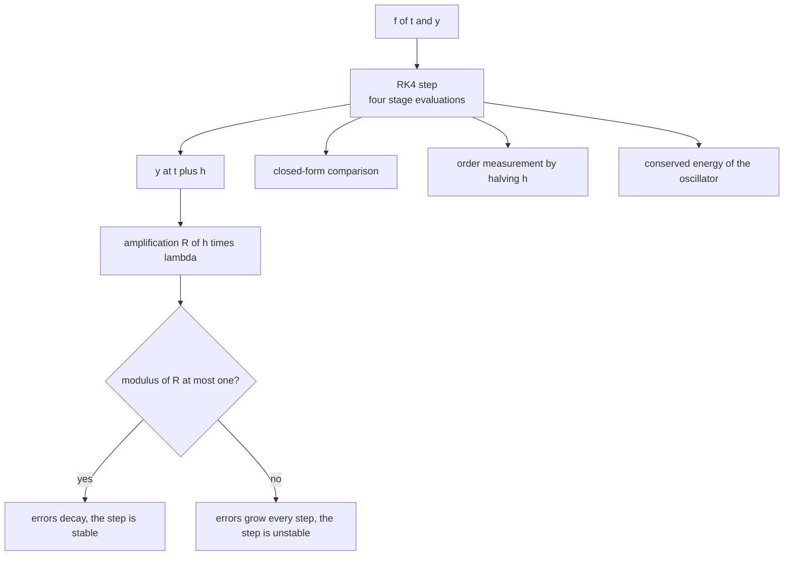
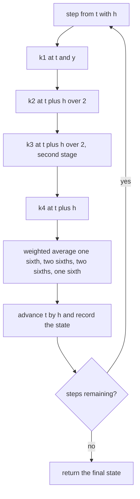
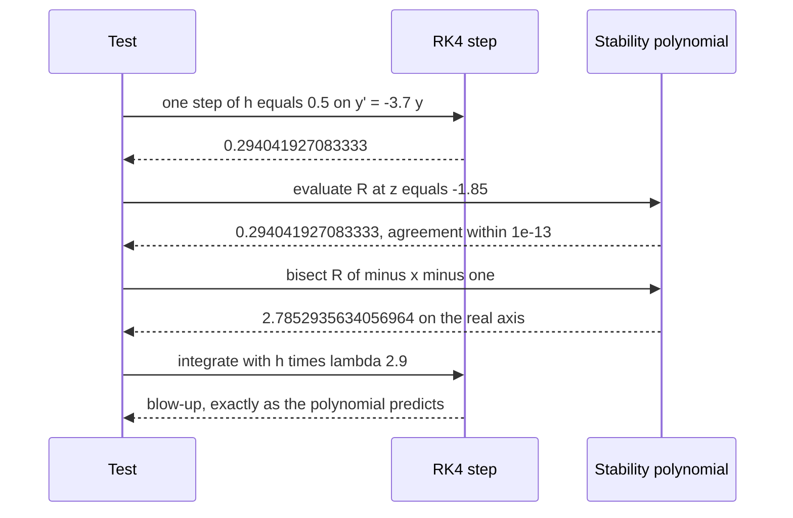

# 786 — Implement advanced numerical integrator (Runge-Kutta 4) and stability tests

> **Tier:** Expert · **CTCI chapter:** Beyond — Numerical & Scientific Computing
> **Task spec:** [786-implement-advanced-numerical-integrator-runge-kutta-4-and-stabil.md](../../../tasks/expert/786-implement-advanced-numerical-integrator-runge-kutta-4-and-stabil.md)
> **Solutions:** [Python](../../../solutions/python/expert/786-implement-advanced-numerical-integrator-runge-kutta-4-and-stabil/solution.py) ·
> [Java](../../../solutions/java/expert/786-implement-advanced-numerical-integrator-runge-kutta-4-and-stabil/Solution.java) ·
> [JavaScript](../../../solutions/javascript/expert/786-implement-advanced-numerical-integrator-runge-kutta-4-and-stabil/solution.js) ·
> [C#](../../../solutions/csharp/expert/786-implement-advanced-numerical-integrator-runge-kutta-4-and-stabil/Solution.cs)

## 1. Problem restatement

Implement classical fourth-order Runge-Kutta for `dy/dt = f(t, y)` with a vector state, and then test it
the way a numerical library would: against closed-form solutions, against the *observed order* of
convergence, and against the method's own **linear stability polynomial**.

```text
k1 = f(t, y)                    k2 = f(t + h/2, y + h/2 k1)
k3 = f(t + h/2, y + h/2 k2)     k4 = f(t + h,   y + h   k3)
y(t + h) = y + h/6 (k1 + 2 k2 + 2 k3 + k4)
```

One step applied to the test equation `y' = lambda y` multiplies the solution by exactly

```text
R(z) = 1 + z + z^2/2 + z^3/6 + z^4/24,     z = h * lambda
```

so the *linear stability region* is `{z : |R(z)| <= 1}`. Two reference values pin that region down:
`|R(-x)| = 1` on the negative real axis at `x* = 2.7852935634056964`, and the region reaches the
imaginary axis exactly up to `2*sqrt(2) = 2.8284271247461903`.

Inputs: an `f(t, y)`, an initial state, an interval and a step count. Outputs: the final state and the
trajectory, plus the stability function and the bisected limits. Measured results from the solution's own
summary line:

| Measurement | Value |
| --- | --- |
| errors on `y' = -y` over `[0, 1]` for `n = 10, 20, 40` | `3.33e-07`, `2.00e-08`, `1.22e-09` → observed orders `4.06`, `4.03` |
| bisected real-axis limit | `2.7852935634053` against the reference `2.7852935634057` |
| bisected imaginary-axis limit | `2.8284271247462`, the constant `2*sqrt(2)` |
| textbook problem `y' = y - t^2 + 1` error at `n = 40` | `4.421e-07` |
| oscillator energy drift after `t = 20` (2000 steps) | RK4 `1.778e-09`, explicit Euler `1.225e+00` |

Further assertions: `y' = 2t` is integrated **exactly** (`|y(3) - 9| < 1e-13`, an order-4 method is exact
for polynomials up to degree 4), the truncation coefficient satisfies
`R(z) - exp(z) = -z^5/120 + O(z^6)` (the Richardson-checked value agrees within `2e-6`), explicit Euler
and the midpoint rule show observed orders near 1 and 2, `h*lambda = 2.7` decays to below `1e-3` while
`h*lambda = 2.9` explodes above `1e3`, and negative step counts or a reversed interval raise
`ValueError`.

## 2. Intuition

Runge-Kutta methods replace the unknown derivatives in a Taylor expansion by *evaluations of `f`* at
carefully chosen intermediate points. RK4 is the sweet spot: four evaluations buy `O(h^5)` local error and
`O(h^4)` global error, which is why it was the default integrator for decades.

Stability is a separate question from accuracy, and it is the one that bites in practice. On
`y' = lambda y` with `lambda = -1000`, accuracy alone would allow a large step because the solution is
smooth, but the *recurrence* `y_{n+1} = R(h lambda) y_n` amplifies any error by `|R|` per step. So the
step is limited by `|R| <= 1`, not by the error estimate — `h < 2.7853 / |lambda|` for RK4.

Three observations make the tests possible without a reference implementation:

1. **The stability polynomial is a closed form.** `R(z)` can be evaluated directly, so the *measured*
   amplification of one numerical step can be compared with the polynomial to machine precision — that
   ties the code to the theory.
2. **Orders can be measured by halving `h`.** Each halving of the step must cut the global error by
   `2^p`; for RK4 that is roughly 16, as the printed errors above show.
3. **Some problems are exactly solvable by the method.** RK4 integrates polynomials up to degree 4
   exactly, and the harmonic oscillator's *energy* is a conserved quantity that turns a stability
   analysis into a measured number.



## 3. Algorithm

1. **One step.** `rk4_step(f, t, y, h)` computes the four stages with vector arithmetic and returns
   `y + h/6 (k1 + 2 k2 + 2 k3 + k4)`.
2. **Drivers for comparison.** `euler_step` and `midpoint_step` implement the order-1 and order-2 methods
   that the tests use to show that the measured order really discriminates.
3. **Fixed-step driver.** `integrate(step, f, t0, y0, t_end, steps)` validates its input (negative step
   counts and a reversed interval raise `ValueError`), computes `h = (t_end - t0) / steps`, steps exactly
   `steps` times and returns the final state plus every intermediate `(t, y)`.
4. **Stability function.** `rk4_amplification(z)` evaluates `R` for complex `z`;
   `rk4_real_amplification(x)` evaluates `R(-x)` in pure real arithmetic on the negative real axis.
5. **Boundary search.** `bisect_limit(lo, hi, f, tol=1e-13)` performs up to 200 bisection iterations on a
   function that straddles zero — used for `R(-x) - 1` and `|R(i x)| - 1`.
6. **Order measurement.** `observed_order(errors, ratio)` computes `log(e_i / e_{i+1}) / log(ratio)` for
   successive refinements, which is the standard empirical order estimate without knowing the exact
   constant.
7. **Test problems.** `f_decay(lam)`, `f_poly` (exact `t^2`), `f_textbook` (exact `(t+1)^2 - 0.5 e^t`) and
   `f_oscillator(omega)` with `oscillator_energy(y, omega) = 0.5 (y^2 + (y'/omega)^2)`.

```text
procedure rk4Step(f, t, y, h)
    k1 ← f(t, y)
    k2 ← f(t + h/2, y + h/2 * k1)
    k3 ← f(t + h/2, y + h/2 * k2)
    k4 ← f(t + h,   y + h   * k3)
    return y + h/6 * (k1 + 2*k2 + 2*k3 + k4)

procedure integrate(step, f, t0, y0, tEnd, steps)
    require steps >= 0
    require tEnd >= t0
    y ← copy of y0
    t ← t0
    trajectory ← [(t, copy of y)]
    if steps = 0 then return y, trajectory
    h ← (tEnd - t0) / steps
    repeat steps times
        y ← step(f, t, y, h)
        t ← t + h
        trajectory.append((t, copy of y))
    return y, trajectory

procedure amplification(z)                       // the exact one-step factor on y' = lambda y
    return 1 + z + z^2/2 + z^3/6 + z^4/24

procedure realLimit()
    return bisectLimit(2.6, 3.0, x ↦ amplification(-x) - 1)      // 2.7852935634056964

procedure imaginaryLimit()
    return bisectLimit(2.7, 2.9, x ↦ modulus(amplification(i*x)) - 1)   // 2*sqrt(2)
```



## 4. Worked example

**(a) One step against the stability polynomial.** On `y' = -lambda y` with `lambda = 3.7`, `y(0) = 1` and
`h = 0.5`, so `z = -1.85`:

| Quantity | Value |
| --- | --- |
| `R(-1.85) = 1 - 1.85 + 1.85^2/2 - 1.85^3/6 + 1.85^4/24` | `0.294041927083333` |
| exact solution `exp(-1.85)` | `0.157237166313628` |
| one RK4 step (asserted equal to `R` within `1e-13`) | `0.294041927083333` |

The numerical step is stable (`|R| < 1`, the state decays) but it is *not accurate*: it decays only to
`0.294` where the truth is `0.157`. That gap is the truncation error, and the very next row of the table
is the fifth-order term that causes it: `R(z) - exp(z) = -z^5/120 + O(z^6)`, which the check verifies to a
`2e-6` tolerance after Richardson-extrapolating `z` and `z/2`.

**(b) Where the real-axis region ends.** `R(-x) - 1 = 0` has its first positive root at
`2.7852935634056964`:

| `x` | `R(-x)` | Behaviour over many steps |
| --- | --- | --- |
| `2.7` | `0.878837500000000` | decays: the check requires `|y(0.5)| < 1e-3` for `lambda = 1000` |
| `2.7852935634056964` | `1.0` | the boundary, asserted to `1e-12` |
| `2.9` | `1.187170833333333` | grows by that factor per step: the check requires `|y(0.5)| > 1e3` |

With `lambda = 1000` and `0.5 / (2.9 / 1000) = 172` steps, the unstable run is amplified by
`1.1871^172`, which is far beyond the `1e3` the check demands — and the polynomial predicts it, so the
blow-up is explained rather than merely observed. Bisection recovers the constant to better than `1e-9`
(`2.7852935634053` versus `2.7852935634057`).

**(c) The imaginary axis and the oscillator.** On `y'' = -omega^2 y` the eigenvalues are `±i omega`, so
stability is decided by `|R(i x)|` with `x = h omega`, and the region ends at `2*sqrt(2)`:

| `h omega` | `|R(i x)|` | Expected behaviour |
| --- | --- | --- |
| `280 / 100 = 2.8` (inside) | below 1 | energy must **decay**: `ratio_below < 1` |
| `280 / 98 = 2.8571...` (outside) | above 1 | energy must **blow up**: `ratio_above > 1e5` |

The oscillation is the point: the solution amplitude stays bounded for all time, yet the *numerical*
energy grows. A stability test on the real axis alone would have missed it, which is why the imaginary
limit is bisected separately and then confirmed by two integrations that differ only in the step count.

**(d) Energy drift.** On `y'' = -4y` over `t = 20` with 2000 steps, the drift of
`0.5 (y^2 + (y'/omega)^2)` is measured, not assumed: RK4 drifts by `1.778e-09` while explicit Euler gains
`1.225e+00` — a factor of roughly `7 * 10^8` apart. The check requires RK4's drift to be below `1e-6` and
Euler's to exceed `0.1`, so the comparison cannot pass by accident.



## 5. Complexity

Let `steps` be the number of steps and `d` the state dimension.

| Operation | Best | Average | Worst | Why the bound holds |
| --- | --- | --- | --- | --- |
| `rk4_step` | O(d) | O(d) | O(d) | four evaluations of `f` and a constant number of vector operations |
| `integrate` | O(steps · d) | O(steps · d) | O(steps · d) | `steps` calls of `rk4_step`; the trajectory stores `steps + 1` states, so memory is `O(steps · d)` |
| `rk4_amplification` | O(1) | O(1) | O(1) | a degree-4 polynomial in a complex number |
| `bisect_limit` | O(log(1/tol)) | 200 iterations worst case | 200 iterations | the loop is capped and each iteration halves the bracket |
| `observed_order` | O(k) | O(k) | O(k) | one logarithm per error pair |
| `oscillator_energy` | O(1) | O(1) | O(1) | two squares |

Comparison of the methods on `y' = -y` over `[0, 1]`, as measured by the solution:

| Method | Evaluations per step | Observed order | Stability limit on the real axis |
| --- | --- | --- | --- |
| Explicit Euler | 1 | about 1 | `2.0` |
| Midpoint | 2 | about 2 | `2.0` |
| Classical RK4 (this task) | 4 | `4.06`, `4.03` measured | `2.7852935634056964`, `2*sqrt(2)` on the imaginary axis |

The stability limit, not the accuracy, is what forbids a large explicit step on a stiff problem: with
`lambda = 1000` the step may not exceed `0.002785...` no matter how smooth the solution is. Implicit,
`L`-stable methods for exactly this situation are the subject of
[788 — stiff ODE solver with an L-stable method](../../../tasks/expert/788-implement-stiff-ode-solver-l-stable-method-concept.md),
and step-size control that tracks the error instead of a fixed `h` is
[787 — adaptive Dormand-Prince integrator](../../../tasks/expert/787-implement-adaptive-step-size-ode-integrator-dormand-prince-outli.md).

## 6. Pitfalls and edge cases

- **Reversed or empty intervals.** `t_end < t0` raises `ValueError`; `steps == 0` returns the initial state
  and a single-entry trajectory, both asserted.
- **A single step must land exactly on `t_end`.** The trajectory of a one-step run has two entries and the
  last time is `t_end` within `1e-15`; accumulating `t` and multiplying by `n` differences would drift.
- **Copy the state, do not alias it.** The trajectory stores copies; returning the same list object would
  make every recorded state equal to the final one.
- **Stability is not accuracy.** The worked example shows a stable step that is 87% off the truth; a test
  that only checks for blow-up would pass on a badly inaccurate integrator.
- **The polynomial must be evaluated on the negative real axis.** `|R(-x)| <= 1` and `R(-x) <= 1` are
  different statements for `x` past the boundary, which is why the real-axis helper is separate and the
  bisection target is `R(-x) - 1`.
- **The imaginary limit is not a real-axis problem.** `2*sqrt(2)` differs from `2.7852935634056964`, and
  the oscillator experiments are what make the distinction observable.
- **Order measurement needs refinement.** Two error values are not enough to establish an order; the
  checks use three step counts and require every observed order to be within a tolerance of the expected
  one (0.25 for RK4, 0.15 for Euler, 0.2 for the midpoint).
- **Polynomial exactness is a strong check.** RK4 integrates `y' = 2t` exactly, so an error above `1e-13`
  means a wrong coefficient in the stage weights rather than accumulated rounding.
- **Energy instead of amplitude.** For the oscillator the amplitude oscillates, so only the energy is
  monotone; the checks therefore compare the energy ratio, and use the *same* initial state for both runs.
- **Documented simplifications.** Scalar-or-vector first-order ODEs only — no implicit or stiff handling,
  no dense output, no error control (those live in tasks 787 and 788) — and the stability limits are found
  by bisection on `R` itself rather than by tracing the region's boundary in the complex plane.

## 7. Variants and follow-ups

- **Adaptive step size.** Estimate the local error with an embedded lower-order formula and grow or shrink
  `h` to meet a tolerance, which removes the need to know `lambda` in advance — the Dormand-Prince pair in
  [787](../../../tasks/expert/787-implement-adaptive-step-size-ode-integrator-dormand-prince-outli.md)
  also reaches fifth order with only six evaluations per accepted step.
- **Higher order explicit methods.** Six-stage pairs (RK6, Verner) or extrapolation methods buy more
  accuracy per step at the cost of a smaller stability region.
- **Symplectic integrators.** For Hamiltonian systems, a symplectic method keeps the energy bounded where
  RK4 drifts; the energy-drift measurement in this task is exactly the metric that distinguishes them.
- **Implicit and stiff methods.** When the Jacobian's eigenvalues force `h` far below what accuracy needs,
  the L-stable implicit methods of
  [788](../../../tasks/expert/788-implement-stiff-ode-solver-l-stable-method-concept.md) are the standard
  answer.
- **Root finding as a tool.** `bisect_limit` is reused as a general-purpose bracket solver, the same
  primitive that appears in
  [793 — RANSAC-based robust model fitting](../../../tasks/expert/793-implement-ransac-based-robust-model-fitting-for-line-circle-dete.md).

## 8. Check yourself

<details><summary>Show answer</summary>
**Why does the linear stability function decide the fate of a nonlinear solver?** Because near a solution
the error propagates through the Jacobian: writing the local error as a perturbation `delta`, one step
maps it to approximately `R(h * lambda_J) delta` for each eigenvalue `lambda_J` of the Jacobian. If any
eigenvalue has `|R(h lambda)| > 1`, that error component grows geometrically regardless of how accurate the
method is locally. Linearisation is a heuristic for large perturbations but the standard and correct test
for stiffness.
</details>

<details><summary>Show answer</summary>
**RK4 integrates `y' = 2t` exactly. Why is that expected?** The local error of an order-4 method is
`O(h^5)` and involves the fifth derivative of the exact solution; a polynomial of degree at most 4 has a
zero fifth derivative, so the truncation error vanishes identically and only floating-point rounding
remains. The check therefore asserts `|y(3) - 9| < 1e-13`, which is a test of the coefficient set rather
than of the step size.
</details>

<details><summary>Show answer</summary>
**The imaginary-axis limit is `2*sqrt(2) ~ 2.8284`, larger than the real-axis limit `2.7853`. Does that mean
oscillatory problems can take bigger steps?** Not in general. The two numbers describe different
directions of the same region: a purely imaginary `z` corresponds to a conservative oscillation, a
negative real `z` to a decaying mode. Real problems mix the two, and the effective limit is the boundary
in the direction the eigenvalues point — which is why both limits are bisected separately.
</details>

<details><summary>Show answer</summary>
**Why measure the order of explicit Euler and the midpoint rule as well?** As a control. If the harness
reported "order 4" for every method, the test would be measuring nothing; requiring Euler to show order
near 1 and the midpoint near 2 proves that the refinement-based order estimate actually discriminates
between integrators, so the `4.06` and `4.03` reported for RK4 are meaningful.
</details>

<details><summary>Show answer</summary>
**Why is energy a better observable than amplitude for the oscillator?** The exact solution's amplitude
oscillates between extrema and returns periodically, so comparing endpoint amplitudes can accidentally
agree even when the scheme is drifting. `0.5 (y^2 + (y'/omega)^2)` is constant for the exact solution, so
any deviation at `t = 20` is pure numerical error — and it separates RK4 (`1.778e-09`) from explicit Euler
(`1.225e+00`) by orders of magnitude.
</details>
