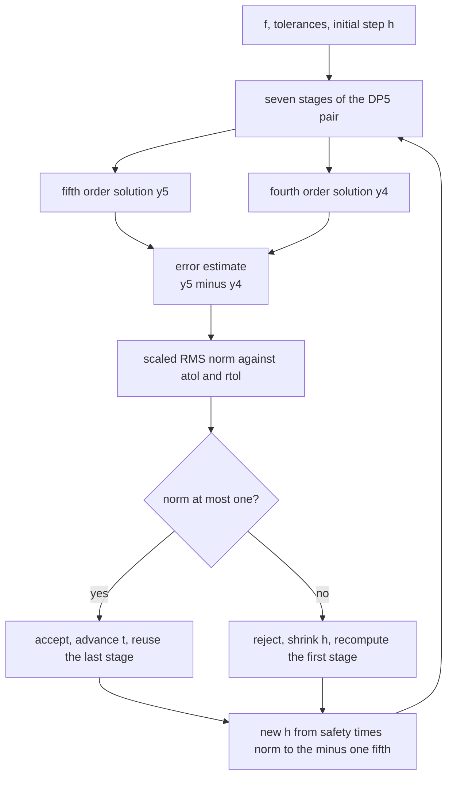
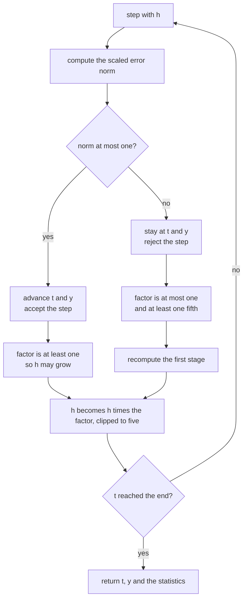
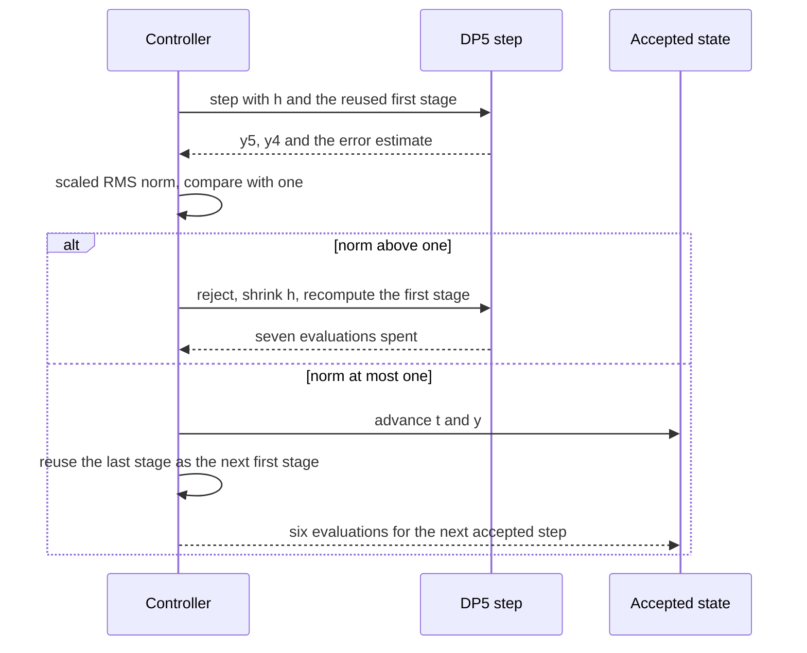

# 787 — Implement adaptive step-size ODE integrator (Dormand-Prince outline)

> **Tier:** Expert · **CTCI chapter:** Beyond — Numerical & Scientific Computing
> **Task spec:** [787-implement-adaptive-step-size-ode-integrator-dormand-prince-outli.md](../../../tasks/expert/787-implement-adaptive-step-size-ode-integrator-dormand-prince-outli.md)
> **Solutions:** [Python](../../../solutions/python/expert/787-implement-adaptive-step-size-ode-integrator-dormand-prince-outli/solution.py) ·
> [Java](../../../solutions/java/expert/787-implement-adaptive-step-size-ode-integrator-dormand-prince-outli/Solution.java) ·
> [JavaScript](../../../solutions/javascript/expert/787-implement-adaptive-step-size-ode-integrator-dormand-prince-outli/solution.js) ·
> [C#](../../../solutions/csharp/expert/787-implement-adaptive-step-size-ode-integrator-dormand-prince-outli/Solution.cs)

## 1. Problem restatement

Implement the **Dormand-Prince DP5(4)** embedded pair with adaptive step size: seven stage evaluations
produce a fifth-order solution `y5`, a fourth-order solution `y4` and a local error estimate
`err = h * sum_i (b5_i - b4_i) k_i`, and a controller converts that estimate into a new step size.

```text
err_norm = sqrt( mean_i ( err_i / (atol + rtol * max(|y_i|, |y5_i|)) )^2 )
h_new    = h * clip( safety * err_norm^(-1/5), 1/5, 5 )      accept if err_norm <= 1
```

Because `b5` is exactly the seventh tableau row, the seventh stage is evaluated at `(t + h, y5)` — the
*First Same As Last* property — so an accepted step costs six evaluations, not seven, if that stage is
reused as the next `k1`. A rejected step must recompute `k1`, since the reuse is only valid for the `h`
that produced it; the solution accounts for this exactly.

Inputs: `f`, tolerances `rtol`/`atol`, a safety factor, step-size bounds and an optional fixed `h`.
Outputs: the final `(t, y)` and a statistics record with `accepted`, `rejected`, `evaluations`, the step
sequence and the error norms. Measured results from the solution's own summary:

| Measurement | Value |
| --- | --- |
| textbook problem errors for `rtol = 1e-4, 1e-6, 1e-8, 1e-10` | `6.87e-05`, `1.25e-06`, `1.68e-08`, `1.84e-10` |
| fixed-step DP5 errors for 10, 20, 40 steps | `4.44e-07`, `1.45e-08`, `4.61e-10` → orders `4.937`, `4.975` |
| FSAL accounting run (`rtol = 1e-7`, over `[0, 4]`) | `accepted = 26`, `rejected = 10`, `evaluations = 227` |
| decay `y' = -300 y`: first and last accepted step | `7.5085e-04` → `1.1472e-02` (a 15.3× growth) |
| stiff problem `y' = -1000 (y - cos t) - sin t` | error `1.162e-07`, `accepted = 352`, `rejected = 3`, first `h*lambda = 2.1073` |
| two-body orbit over one period against an `rtol = 1e-13` reference | error `2.700e-09` |

Further assertions: the achieved error shrinks monotonically with the tolerance and stays below `60 * rtol`
for every rung of the ladder, looser tolerances need strictly fewer accepted steps, the fixed-step limit
shows order `~5` (within `0.4`), `evaluations == 7 + 6 * (accepted - 1) + 7 * rejected`, the first accepted
step on the stiff problem satisfies `h * lambda <= 3.4` (the real-axis limit of DP5 is
`DP5_REAL_STABILITY_LIMIT = 3.306`), the orbit stays on the unit circle within `1e-8` and returns to its
initial state after exactly one period, a zero-length interval is a no-op, an interval shorter than `h_init`
is covered by one step, and invalid tolerances, safety factors, step bounds or intervals raise
`ValueError`.

## 2. Intuition

A fixed step is a guess made before seeing the solution: it is too small in the smooth regions and too
large, catastrophically, in the fast ones. The adaptive answer is to *measure* the local error and let the
step find its own size.

1. **Two solutions for the price of one.** The seven-stage tableau can be weighted twice — once with the
   fifth-order weights and once with a fourth-order row — so the difference between the two results is a
   by-product of the same evaluations, an `O(h^5)` estimate of the error the fifth-order solution made.
2. **The exponent tells the controller what to do.** Since the error scales as `h^5`, a step that produced
   `err_norm` should produce about `1` when multiplied by `err_norm^(-1/5)`. The `0.9` safety factor keeps
   the estimate from overshooting to the boundary, and the clip to `[1/5, 5]` prevents wild swings after a
   single noisy rejection.
3. **One evaluation per step is free.** The seventh stage is evaluated exactly where the next step starts,
   so reusing it as the next `k1` means an accepted step costs six evaluations. The bookkeeping identity
   `evaluations = 7 + 6 (accepted - 1) + 7 rejected` is then true — and testable.



The trade the task documents honestly is that this controller is *elementary*: it reacts to the current
error only. A PI controller (or Gustafsson's) also remembers the previous error, which damps the
oscillation that a pure proportional controller shows when the solution changes character. Dense output is
omitted too, so the integrator produces states at its own step times rather than at requested times.

## 3. Algorithm

1. **Tableau.** `C`, `A`, `B5` (with the seventh weight zero, since that stage only exists for FSAL) and
   `B4` are the standard Dormand-Prince coefficient rows; `E = B5 - B4` is the error row.
2. **One step.** `dopri5_step(f, t, y, h, k1)` takes `k1` from the caller, evaluates stages 2..7 at
   `t + C_i h` with the accumulated `A[i][m] * k_m` terms (summed with `math.fsum` to control rounding),
   then forms `y5`, `y4`, `err` and returns the last stage together with the evaluation count.
3. **Error norm.** `scaled_error_norm` computes the RMS of `err / (atol + rtol * max(|y|, |y_new|))`, so a
   component near zero is judged by `atol` and a large component mostly by its relative error.
4. **Controller.** `DormandPrince` validates its parameters (`rtol > 0`, `atol >= 0`,
   `0 < safety < 1`, `h_min <= h_max`), then in `integrate`:
   - clamp `h` so it never steps past `t_end`;
   - evaluate the step and the norm;
   - **accept** when `norm <= 1` (or when `fixed_h` is given, which disables the controller), set
     `factor = min(max_factor, max(1, safety * norm^(-1/5)))`, advance `t` and `y`, reuse the last stage as
     `k1`;
   - **reject** otherwise with `factor = max(0.2, safety * norm^(-1/5))`, keep `t` and `y`, and recompute
     `k1 = f(t, y)`;
   - raise `RuntimeError` when `h` falls below `h_min` or the step budget is exhausted.
5. **Statistics.** Every accepted step appends `(t, h)` and its error norm to `stats`; accepted and
   rejected counts and the evaluation total are returned for the FSAL identity check.
6. **Reference and test problems.** `rk4_reference(f, t0, y0, t_end, steps)` is an independently written
   fixed-step RK4 used as high-resolution truth; the problems are `f_textbook`, `f_decay(lam)`,
   `f_stiff` and `f_orbit`.

```text
procedure dopri5Step(f, t, y, h, k1)
    stages ← [k1]
    for i in 1 .. 6 do
        yi ← y + h * sum over m of A[i][m] * stages[m]
        stages.append(f(t + C[i] * h, yi))
    y5 ← y + h * sum over i of B5[i] * stages[i]
    y4 ← y + h * sum over i of B4[i] * stages[i]
    err ← h * sum over i of (B5[i] - B4[i]) * stages[i]
    return y5, y4, err, stages[6], 6 evaluations

procedure integrate(t0, y0, tEnd, fixedH)
    y ← copy of y0
    t ← t0
    h ← min(first step, tEnd - t0)
    k1 ← f(t, y)
    evaluations ← 1
    while t < tEnd do
        h ← min(h, tEnd - t)
        y5, unused, err, last, cost ← dopri5Step(f, t, y, h, k1)
        evaluations ← evaluations + cost
        norm ← scaledErrorNorm(err, y, y5, rtol, atol)
        if norm <= 1 or fixedH is given then
            factor ← 1 if fixedH is given
                     else min(5, max(1, safety * norm^(-1/5)))
            y ← y5
            t ← t + h
            k1 ← last                                  // First Same As Last
            accepted ← accepted + 1
            record (t, h) and norm
            h ← h * factor
        else
            h ← h * max(0.2, safety * norm^(-1/5))
            k1 ← f(t, y)                               // the rejected step invalidates the reuse
            evaluations ← evaluations + 1
            rejected ← rejected + 1
            require h >= hMin
        require accepted + rejected <= maxSteps
    return t, y, statistics
```



## 4. Worked example

**(a) The tolerance ladder.** The same textbook problem `y' = y - t^2 + 1` from `y(0) = 0.5` to `t = 2`,
with `rtol = tol` and `atol = tol * 1e-4`:

| `rtol` | achieved error | `60 * rtol` bound | accepted steps |
| --- | --- | --- | --- |
| `1e-4` | `6.87e-05` | `6e-03` | fewest |
| `1e-6` | `1.25e-06` | `6e-05` | more |
| `1e-8` | `1.68e-08` | `6e-07` | more still |
| `1e-10` | `1.84e-10` | `6e-09` | most |

The checks require the errors to decrease strictly down the ladder, every error to stay below `60 * rtol`
(a controller that under-delivers would violate this), the accepted-step counts to increase strictly
(tighter tolerances must cost work), and the last error to be below `1e-8`. The measured errors fall by
about a factor of `100` for each factor of `100` in the tolerance, which is the behaviour of a controller
that actually governs the local error.

**(b) The FSAL identity.** For the run with `h_init = 0.4`, `h_max = 0.3`, `rtol = 1e-7` over `[0, 4]` the
statistics are `accepted = 26`, `rejected = 10`, `evaluations = 227` and the identity is

```text
evaluations = 7 + 6 * (accepted - 1) + 7 * rejected
            = 7 + 6 * 25 + 7 * 10
            = 7 + 150 + 70 = 227
```

The first step costs seven evaluations because there is no reusable stage yet; every later accepted step
costs six because its first stage is the previous step's seventh; and every rejected step costs a full
seven *plus* one extra evaluation to rebuild `k1` for the reduced `h`. A deliberately large initial step
(`h_init = 0.4` against `h_max = 0.3`) guarantees at least one rejection, so the identity is exercised
rather than trivially satisfied. The check asserts both the identity and `rejected > 0`.

**(c) Steps find their own size, and then hit the stability wall.** On `y' = -300 y` the solution decays
and eventually falls below `atol`, at which point the error estimate goes to zero and the step is allowed
to grow; the measured sequence starts at `7.5085e-04` and ends at `1.1472e-02`, a 15.3× growth, and the
check requires the last step to exceed ten times the first. The *first* step is limited from the other
side: `7.5085e-04 * 300 = 0.2253`, comfortably inside the explicit stability limit `h * lambda <= 3.4`
(the polynomial limit is `3.306`), and on the stiff problem the first accepted step measures
`h * lambda = 2.1073` — near the wall, as it must be, because the controller is asking for a step that
accuracy alone would happily make much larger.



## 5. Complexity

Let `d` be the state dimension, `A` the number of accepted steps, `R` the number of rejections and `p` the
interval length.

| Operation | Best | Average | Worst | Why the bound holds |
| --- | --- | --- | --- | --- |
| `dopri5_step` | O(d) | O(d) | O(d) | six `f` evaluations plus a constant number of vector operations; the tableau work is `O(d)` |
| `scaled_error_norm` | O(d) | O(d) | O(d) | one division and one square per component |
| `integrate` | O(A · 6d) | O((A + R) · 7d) | O((A + max_steps) · 7d) | accepted steps cost six evaluations, rejections seven plus one to rebuild `k1`; the budget and `h_min` are enforced |
| Fixed-step mode | O(steps · 6d) | same | same | `fixed_h` disables the controller, so nothing is ever rejected |
| Statistics memory | O(A) | O(A) | O(A) | one `(t, h)` pair and one error norm per accepted step |
| High-resolution reference | O(steps · d) | O(steps · d) | O(steps · d) | the independent RK4 reference uses 20000 fixed steps |
| Tolerance sweep | O(4 · A) | same | same | the ladder has four rungs, each solved from scratch |

Comparison with alternatives:

| Method | Order | Evaluations per step | Step-size control |
| --- | --- | --- | --- |
| Explicit Euler | 1 | 1 | none (fixed `h`) |
| Classical RK4 | 4 | 4 | none in this repository's task 786 |
| Dormand-Prince 5(4) (this task) | 5 with an embedded 4 | 6 accepted, 7 rejected | elementary `err^(-1/5)` controller |
| DP5 with a PI controller | 5 | 6 | adds memory of the previous error, fewer oscillations |

## 6. Pitfalls and edge cases

- **FSAL reuse after a rejection is wrong.** The reused stage was evaluated at the end of the *rejected*
  `h`, so the reduced step must recompute `k1`; the evaluation identity
  (`... + 7 * rejected`) is what catches the mistake.
- **Never step past `t_end`.** `h` is clamped to `t_end - t` on every iteration, which is why both orbit
  runs stop exactly at `2*pi` within `1e-15` instead of overshooting and interpolating.
- **The exponent is `-1/5`, not `-1/4`.** The error estimate is `O(h^5)`, so the controller must invert
  that scaling; using the wrong exponent makes the step sequence oscillate and the tolerance ladder loses
  its monotonicity.
- **Clip the factor on both sides.** The acceptance path never shrinks `h` (`max(1, ...)`) and both paths
  clip growth to five; without the `1/5` floor a single bad estimate could collapse the step to `h_min`.
- **`h_min` and the step budget are errors, not warnings.** Running out of either raises `RuntimeError`, so
  a tolerance that cannot be met fails loudly.
- **Invalid input is rejected.** `rtol = 0`, `safety = 1.5`, `h_init = -1` and a reversed interval all raise
  `ValueError` — four separate negative checks.
- **Zero-length intervals.** `t_end == t0` returns immediately with `accepted == 0` and
  `evaluations == 0`; an interval shorter than `h_init` is covered by a single step landing on `t_end`.
- **A stiff problem is not a bug.** The stiff run reports `rejected = 3` and a first accepted step near the
  explicit stability wall — that is the method correctly announcing its own limitation. Pushing the
  tolerance tighter does not remove the wall, which is why the L-stable methods of
  [788](../../../tasks/expert/788-implement-stiff-ode-solver-l-stable-method-concept.md) exist.
- **Tolerance semantics.** `atol = tol * 1e-4` in the ladder means a component near zero is judged
  absolutely; swapping the roles changes which rung of the ladder is limited by stability and breaks the
  monotone error sweep.
- **Outline-level simplifications (documented).** No dense output or interpolant, no PI or Gustafsson
  control, no implicit solvers (the methods are explicit) and no event detection. The Java variant
  additionally re-evaluates the first stage on every step instead of reusing it, which costs work but no
  accuracy.

## 7. Variants and follow-ups

- **PI control.** Remembering the previous error norm and using
  `factor = safety * norm^(-0.7) * previous_norm^(0.4)` removes the oscillation of a pure proportional
  controller, particularly on problems that change character mid-interval.
- **Dense output.** The fourth-order row `B4` is exactly the key to a quartic interpolant, so the pair
  already contains the ingredients for solutions at arbitrary times.
- **Higher-order pairs.** DOP853 (order 8) or Verner's pairs reduce the cost per tolerance decade on very
  smooth problems at the price of many more stages.
- **Stiff and implicit variants.** When the stability wall dominates, use the L-stable methods of
  [788](../../../tasks/expert/788-implement-stiff-ode-solver-l-stable-method-concept.md); the fixed-step
  stability analysis of
  [786](../../../tasks/expert/786-implement-advanced-numerical-integrator-runge-kutta-4-and-stabil.md)
  is the tool that predicts where the wall lies.

## 8. Check yourself

<details><summary>Show answer</summary>
**Why does the error estimate cost nothing?** Because the two weight rows multiply the *same* seven stage
vectors: `y5` and `y4` differ only in their coefficients, so once the stages are known the difference is a
weighted sum. The only reason the embedded pair needs a seventh stage at all is to make the fifth-order
weights equal that stage's row, which is also what grants the FSAL reuse.
</details>

<details><summary>Show answer</summary>
**A step is rejected. Why is reusing the previous seventh stage invalid?** The stage was evaluated at
`t + h_old` along the trajectory of the rejected step, but the retry starts from the same `(t, y)` with a
smaller `h_new`, so the first stage must be `f(t, y)` again. Reusing the stale value would silently inject
an error of the size of the rejected step — and it would break the evaluation identity the checks assert.
</details>

<details><summary>Show answer</summary>
**On the decay problem the steps grow by 15×, but on the stiff problem the first accepted step sits at
`h*lambda = 2.1073`. Why such different behaviour?** On the decay problem the solution falls below `atol`,
so the scaled error goes to zero and the controller is free to grow `h`; on the stiff problem, a larger step
makes the *stability* of the explicit recurrence fail, the error estimate explodes and the controller is
forced back to the region where `|R(h lambda)| <= 1`. The controller cannot tell the two mechanisms apart —
that is exactly the limitation an implicit method removes.
</details>

<details><summary>Show answer</summary>
**How does `atol` interact with `rtol` in the scaled norm?** The denominator is
`atol + rtol * max(|y_i|, |y5_i|)`: the term is judged absolutely when the solution is near zero and
relatively when it is large. That is why the decay run's steps grow: once `|y| < atol / rtol`, the allowed
absolute error dominates and the step is no longer restricted by the decaying component.
</details>

<details><summary>Show answer</summary>
**Why does the checks' orbit test integrate twice, once at `rtol = 1e-13` and once at `rtol = 1e-9`?**
Because there is no closed form for the two-body problem in this form, so the tight run *is* the reference:
comparing the loose run against it to `1e-6` shows the adaptive error control works on a problem with no
analytic solution. The tight run is additionally checked against physics — it returns to its initial state
within `1e-9` after one period and stays on the unit circle within `1e-8`.
</details>
