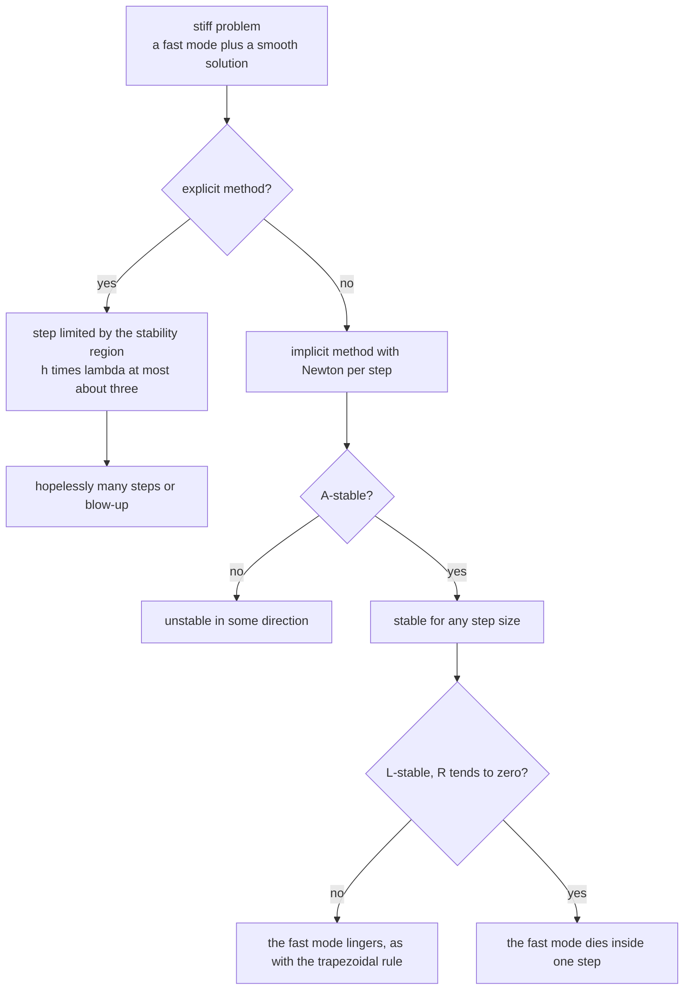
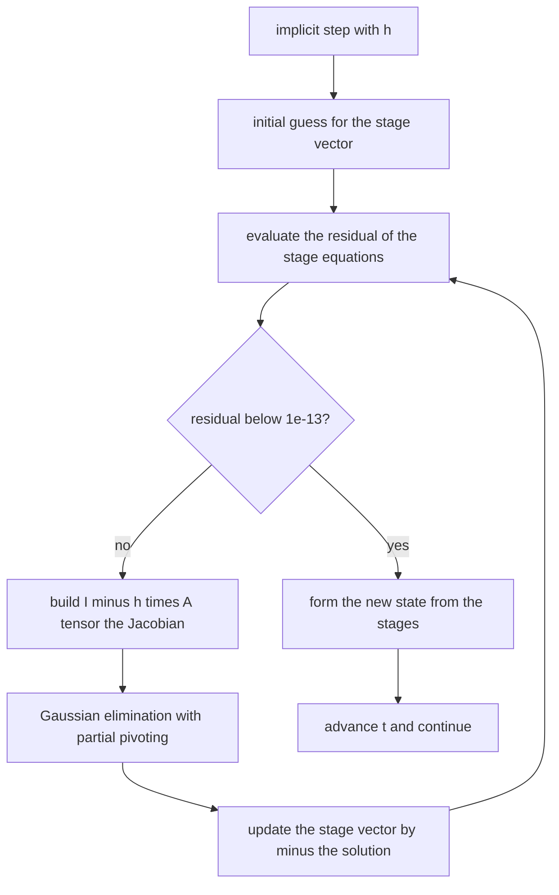
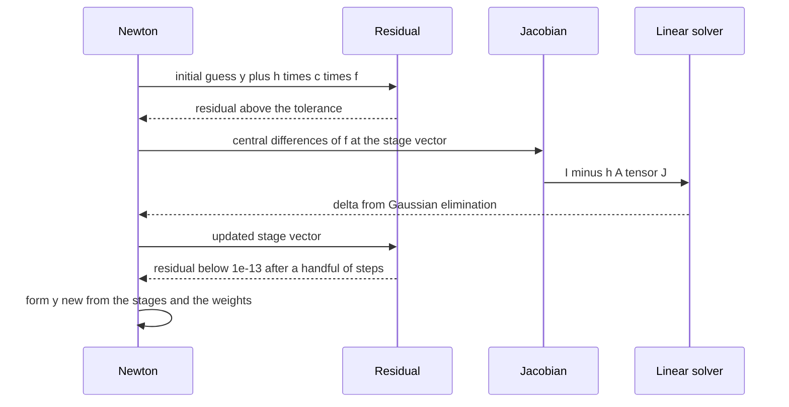

# 788 — Implement stiff ODE solver L-stable method concept

> **Tier:** Expert · **CTCI chapter:** Beyond — Numerical & Scientific Computing
> **Task spec:** [788-implement-stiff-ode-solver-l-stable-method-concept.md](../../../tasks/expert/788-implement-stiff-ode-solver-l-stable-method-concept.md)
> **Solutions:** [Python](../../../solutions/python/expert/788-implement-stiff-ode-solver-l-stable-method-concept/solution.py) ·
> [Java](../../../solutions/java/expert/788-implement-stiff-ode-solver-l-stable-method-concept/Solution.java) ·
> [JavaScript](../../../solutions/javascript/expert/788-implement-stiff-ode-solver-l-stable-method-concept/solution.js) ·
> [C#](../../../solutions/csharp/expert/788-implement-stiff-ode-solver-l-stable-method-concept/Solution.cs)

## 1. Problem restatement

Implement two **L-stable** implicit methods through one generic implicit Runge-Kutta driver and *prove*
their stability properties numerically.

A method is **A-stable** when `|R(z)| <= 1` for every `z` in the closed left half-plane, and **L-stable**
when in addition `R(z) -> 0` as `z -> -infinity`. That extra decay is what annihilates a fast decaying mode
inside a single step instead of merely keeping it bounded.

```text
implicit Euler      A = [[1]],                     b = [1],          R(z) = 1 / (1 - z)
Alexander SDIRK2    A = [[g, 0], [1 - 2g, g]],      b = [1/2, 1/2],   R(z) = 1 + z (1 - g z + (1 - 2g) z / 2) / (1 - g z)^2
                    with g = 1 - 1/sqrt(2) and 1 - 2g = 2 g (1 - g)
```

Each step solves the stage equations `Y_i = y + h sum_j a_ij f(t + c_j h, Y_j)` with a **dense Newton
iteration**: the residual and its Jacobian (central differences) are assembled for the flattened stage
vector, a Gaussian elimination with partial pivoting solves the linear system, and the residual history is
returned so quadratic convergence can be *checked* rather than assumed. The stability function is evaluated
independently by solving `(I - z A) w = e` in complex arithmetic and forming `1 + z b^T w`, and the result
is compared with the amplification the integrator actually produces. Measured results from the solution's
own summary:

| Measurement | Value |
| --- | --- |
| `R(-1e8)` | implicit Euler `1.000e-08`, SDIRK2 `4.828e-08` (both vanish: L-stable) |
| A-stability grid over the left half-plane | violations `0` for both implicit methods, `218` for explicit Euler |
| smooth stiff problem at `h = 0.001` | implicit Euler `2.71e-07`, SDIRK2 `3.46e-08` |
| smooth stiff problem at `h = 0.005` | implicit Euler `1.36e-06`, SDIRK2 `9.95e-07` |
| smooth stiff problem at `h = 0.02` | implicit Euler `5.47e-06`, SDIRK2 `1.91e-05` |
| observed ratio for `h: 0.005 -> 0.001` | implicit Euler `5.01` (order 1), SDIRK2 `28.72` (order 2) |
| explicit Euler at `h = 0.02` on the same problem | blows up to `-8.663e+58` |
| nonlinear stiff `y' = -1000 y^2`, exact `0.090909` | SDIRK2 errors `1.00e-03`, `2.37e-04`, `5.80e-05` versus implicit Euler `1.93e-02`, `9.73e-03`, `4.90e-03` |
| SDIRK2 versus an independent RK4 reference | `5.802e-05` |

Further assertions: the closed-form amplification agrees with the driver's for every tested `z` (within
`1e-13`), the grid search shows A-stability while explicit Euler violates it, the empirical one-step
amplification equals `R(h lambda)` (within `1e-11`), a real `2x2` rotation system reproduces both the
modulus and the argument of `R(h lambda)`, the Newton residual converges below `1e-13` in at most 8
iterations with quadratic ratios below `1e6`, implicit Euler's stage satisfies its own defining equation
within `1e-14`, and the tableau validation rejects a non-square matrix or inconsistent nodes.

## 2. Intuition

Stiffness means the Jacobian's eigenvalues span many decades: the solution being tracked is smooth, but
there is a fast transient nearby that has already decayed. An explicit method must still resolve that
transient, because its stability region only reaches `h lambda ~ -3` (RK4: `-2.7853`, see
[786](../../../tasks/expert/786-implement-advanced-numerical-integrator-runge-kutta-4-and-stabil.md)). The
step is then limited by *stability*, not accuracy — the measured blow-up of explicit Euler to `-8.663e+58`
at `h = 0.02` is that failure in one number.

Implicit methods move the unknown to both sides and solve for it:

1. **A-stability buys unconditional stability.** `R(z)` for implicit Euler is `1/(1-z)`, whose modulus is
   below 1 everywhere in the left half-plane, so no step is ever unstable, however stiff the problem.
2. **L-stability buys annihilation.** A-stability alone can *preserve* a decaying mode: the trapezoidal
   rule has `R(z) -> -1` as `z -> -infinity`, so a fast decaying component is carried along as a
   sign-flipping remnant instead of being killed. Implicit Euler (`R -> 0`) and Alexander's SDIRK2
   (whose `1 - 2g = 2 g (1 - g)` identity makes the `z^2` terms cancel in the limit) both send it to zero.
3. **Newton makes implicit steps practical.** Each step is a root find of `G(Y) = Y - y - h sum a_ij f(...)`;
   because the Jacobian is available (by central differences here), the iteration converges quadratically
   in a handful of steps — measured as at most 8 iterations with a residual below `1e-13`.



## 3. Algorithm

1. **Tableaux.** `IMPLICIT_EULER = ("implicit Euler", ((1.0,),), (1.0,), (1.0,))` and
   `ALEXANDER_SDIRK2 = ("Alexander SDIRK2", ((g, 0), (1 - 2g, g)), (g, 1 - g), (0.5, 0.5))` with
   `g = 1 - sqrt(0.5)`.
2. **Validate.** `ImplicitRungeKutta(tableau)` requires a square `A`, a node vector of the same length and
   row sums equal to `c` (within `1e-14`) — the last is the consistency condition of any Runge-Kutta
   method.
3. **Residual.** `_residual(f, t, y, h, stages)` flattens the stage vector, evaluates `f` at each node and
   returns `stages[i] - y - h sum_{j <= i} a_ij f_j`, using only the lower-triangular part since both
   methods are explicit in each stage (diagonally implicit with a zero/`g` diagonal).
4. **Jacobian.** `_jacobian` builds the full `(stages * m) x (stages * m)` block Jacobian, using central
   differences `(f(u + delta e_l) - f(u - delta e_l)) / (2 delta)` with `delta = 1e-7 * max(1, |u_l|)`, and
   assembles `I - h A ⊗ J`.
5. **Newton.** `step(f, t, y, h)` starts from `Y_i = y + h c_i f(t, y)`, then iterates
   `delta = solve(J, -residual)` with `solve_linear` (Gaussian elimination with partial pivoting, which
   also serves the complex stability solve); it stops at `tol = 1e-13`, records every residual norm, and
   raises `RuntimeError` after `max_iter = 40` iterations. `h < 0` raises `ValueError`.
6. **Stability function.** `amplification(z)` solves `(I - z A) w = e` in complex arithmetic and returns
   `1 + z b^T w` — an independent evaluation path from the Newton code, which is why agreement between the
   two is meaningful.
7. **Drivers and problems.** `run(method, f, t0, y0, t_end, h)` applies the step repeatedly and returns the
   final value together with the total Newton iterations; `rk4_reference` is the independent high-resolution
   solution, `run_explicit` is the explicit Euler baseline, and the test problems are the linear stiff
   `y' = -1000 (y - cos t) - sin t` (exact `cos t`), the nonlinear stiff `y' = -1000 y^2` (exact
   `1 / (1 + 1000 t)`) and the real `2x2` rotation form of `y' = (a + i b) y`.

```text
procedure step(f, t, y, h)
    require h >= 0
    derivative ← f(t, y)
    stages ← y + h * C[i] * derivative for every stage i        // initial Newton guess
    for iteration in 1 .. maxIter do
        residual, deriv ← stageResidual(f, t, y, h, stages)
        norm ← max absolute residual
        history.append(norm)
        if norm <= tol then break
        jacobian ← I - h * A tensor dFdy(stages)                // central differences
        delta ← solveLinear(jacobian, -residual)
        stages ← stages + delta
    require the iteration converged
    deriv ← f(t + C[j] * h, stages[j]) for every stage j
    yNew ← y + h * sum over j of B[j] * deriv[j]
    return yNew, history, iterations, stages

procedure amplification(z)                                       // independent of the Newton code
    matrix ← identity minus z times A
    w ← solveLinear(matrix, ones) in complex arithmetic
    return 1 + z * sum over i of B[i] * w[i]

procedure run(method, f, t0, y0, tEnd, h)
    y ← copy of y0
    t ← t0
    while t < tEnd do
        y, history, used, stages ← method.step(f, t, y, h)
        t ← t + h
    return y, total Newton iterations
```



## 4. Worked example

**(a) One step of size 1 on a fast mode.** Take `y' = -1000 y`, `y(0) = 1`, and a single step `h = 1`, so
`z = h lambda = -1000` and the exact value is `e^{-1000} ~ 0`.

| Method | `R(z)` at `z = -1000` | State after one step | Error |
| --- | --- | --- | --- |
| Implicit Euler | `1 / (1 + 1000) = 1/1001 = 0.000999001` | `0.000999001` | about `1e-3` |
| Trapezoidal rule | `(1 - 500) / (1 + 500) = -0.996008` | `-0.996008` | about `1` |

Both are A-stable — neither blows up — but the trapezoidal rule leaves a sign-flipping remnant of almost
full magnitude, while implicit Euler has already destroyed the mode. The Java variant asserts exactly this
one-step comparison (`< 1e-2` for backward Euler, `> 0.5` for the trapezoidal rule), and the same
distinction appears in the limit: `R(-1e8)` measures `1.000e-08` for implicit Euler and `4.828e-08` for
SDIRK2, both far below the `1e-7` the checks require.

**(b) The SDIRK2 coefficients.** `g = 1 - sqrt(0.5) = 0.2928932188134525`, and the identity

```text
1 - 2 g = 0.414213562373095    2 g (1 - g) = 2 * 0.2928932188134525 * 0.7071067811865476 = 0.414213562373095
```

holds numerically in the checks (within `1e-15`). That identity is the reason `R(z) -> 0`: the numerator
of the correction term vanishes as `z -> -infinity` once the `z^2` coefficients cancel, so SDIRK2 shares
implicit Euler's annihilation property while being *second* order. The measurement shows the order
difference plainly:

| `h` | Implicit Euler error | SDIRK2 error |
| --- | --- | --- |
| `0.001` | `2.71e-07` | `3.46e-08` |
| `0.005` | `1.36e-06` | `9.95e-07` |
| `0.02` | `5.47e-06` | `1.91e-05` |

Halving `h` from `0.005` to `0.001` cuts the implicit Euler error by `5.01` (order 1) and the SDIRK2 error
by `28.72` (order 2) — the check requires `4.0 < ratio < 6.5` and `20.0 < ratio < 35.0` respectively. Note
that at the coarsest step SDIRK2 is *worse* than implicit Euler on this problem: second order pays off only
once `h` is small enough for the `h^3` term to dominate, and the tutorial should not pretend otherwise.

**(c) A-stability on a grid.** Evaluating `|R(z)|` for `z = i/2` with `i` running over the non-positive
half and the imaginary part over `[-5, 5]` in half-integer steps gives `0` violations for both implicit
methods and `218` for explicit Euler — measured, not asserted. The check asserts the zeros and, importantly,
that the explicit method *does* violate the property somewhere, so the grid is proven to be discriminating.

**(d) Newton convergence.** One SDIRK2 step of `h = 0.05` on the linear stiff problem converges to a
residual below `1e-13` in at most 8 iterations, with at least three recorded residuals so the quadratic
ratios (`history[i+1] / history[i]^2`) can be checked. The stage vector itself is verified: for implicit
Euler the returned stage satisfies `Y - y - h f(t + h, Y) = 0` to within `1e-14`, which is the defining
equation of the method rather than a property of the Newton code.



## 5. Complexity

Let `m` be the state dimension, `s` the number of stages and `k` the number of steps.

| Operation | Best | Average | Worst | Why the bound holds |
| --- | --- | --- | --- | --- |
| One Newton residual | O(s² m²) | same | same | `s` evaluations of `f` plus the `s x s` weighted combination per component |
| One Jacobian | O(s m) evaluations | same | same | a central difference per stage component, each an `f` evaluation |
| One Newton iteration | O(s³ m³) | same | same | forming `I - h A ⊗ J` and solving a dense `s m` system by Gaussian elimination |
| One step | O(iterations · s³ m³) | at most 8 iterations measured | `max_iter = 40` | quadratic convergence, so the count is small in practice |
| `run` | O(k · iterations · s³ m³) | same | same | the methods are fixed-step here, so `k` is the caller's choice |
| `amplification` | O(s³) | O(s³) | O(s³) | one complex linear solve of size `s` |
| A-stability grid | O(grid) | `11 x 21 = 231` points | 231 points | one `O(s³)` solve per point |
| Space | O(s m) | same | `O(s² m²)` for the Jacobian | the stage vector plus the dense Jacobian |

For the two tableaus here `s` is 1 and 2, so the dense solve is trivial; the structure matters because a
production stiff solver uses exactly this shape with `s` of 5–8 and a *sparse* Newton iteration.

Comparison with the explicit alternatives on `y' = -1000 (y - cos t) - sin t`:

| Method | Order | Step limited by | Result at `h = 0.02` |
| --- | --- | --- | --- |
| Explicit Euler | 1 | stability, `h*1000 <= 2` | `-8.663e+58` |
| Explicit RK4 | 4 | stability, `h*1000 <= 2.785` | diverges (documented in the Java variant at `h = 0.1`) |
| Implicit Euler (this task) | 1 | accuracy only | `5.47e-06` |
| Alexander SDIRK2 (this task) | 2 | accuracy only | `1.91e-05` |

## 6. Pitfalls and edge cases

- **A-stability is not L-stability.** The checks require both: `|R| <= 1` on the grid *and*
  `|R(-1e8)| < 1e-7`. The trapezoidal rule passes the first and fails the second, which is the whole point
  of the task.
- **The consistency condition.** `row sums of A` must equal `c`; the constructor raises `ValueError`
  otherwise. A tableau that violates it produces a method of the wrong order, silently.
- **The Jacobian is a finite difference.** `delta = 1e-7 * max(1, |u_l|)` balances truncation against
  cancellation; the Newton iteration is only quadratic while that approximation is good, which is why the
  residual history is checked instead of assumed.
- **The initial Newton guess matters.** `Y_i = y + h c_i f(t, y)` is the standard explicit predictor and
  converges quickly; starting from all zeros can stall the iteration on a stiff problem.
- **Singular systems must not be hidden.** Pivots below `1e-300` raise `ValueError`, so a degenerate
  Jacobian fails loudly rather than returning garbage.
- **Vector states and the `2x2` rotation.** The real rotation system is how the complex amplification
  `R(h lambda)` is tested end to end: the checks compare both `|R|` (the modulus of the returned vector)
  and `arg R` (its angle) within `1e-12`.
- **Negative step sizes** raise `ValueError`, and a step that does not converge raises `RuntimeError`
  after `max_iter` — different failure modes for different mistakes.
- **Nonlinear stiff problems.** `y' = -1000 y^2` has an exact solution `1 / (1 + 1000 t)` and an
  independent RK4 reference agrees with it to `1e-9`; SDIRK2 lands within `5.802e-05` of that reference.
  The check also requires SDIRK2 to beat implicit Euler at *every* tested `h`, which is not automatic for
  a second-order method on a nonlinear problem.
- **Step size is not controlled here.** This is the "concept" variant: a fixed `h` and a fixed Newton
  tolerance, no error control and no order adaptation. The methods, the amplification factors and the
  stiff test problems are the real ones.
- **A bigger step is not automatically worse.** The worked example shows SDIRK2 losing to implicit Euler at
  `h = 0.02`; the honest conclusion is that order statements are asymptotic.

## 7. Variants and follow-ups

- **The trapezoidal rule as the anti-example.** It is A-stable but not L-stable, and it is the standard
  first comparison when explaining why the second property exists.
- **Adaptive implicit methods.** Combine the L-stable pair with the error control of
  [787](../../../tasks/expert/787-implement-adaptive-step-size-ode-integrator-dormand-prince-outli.md) to
  get a stiff solver that is efficient in the smooth regions and stable in the fast ones.
- **Sparse or Krylov Newton.** With a large state the dense `O(s³ m³)` solve dominates; using the Jacobian
  only through matrix-vector products is how production stiff solvers scale.
- **Analytic Jacobians.** Central differences cost `2 s m` evaluations per Newton iteration; an analytic
  Jacobian removes that cost and improves the quadratic convergence constant.
- **Related tasks.** The explicit stability limits and the oscillator energy tests that motivate all of
  this are in
  [786](../../../tasks/expert/786-implement-advanced-numerical-integrator-runge-kutta-4-and-stabil.md);
  the same Gaussian-elimination primitive appears as a general linear solver in
  [790 — bundle adjustment with Levenberg-Marquardt](../../../tasks/expert/790-implement-bundle-adjustment-sparse-solver-outline-with-levenberg.md).

## 8. Check yourself

<details><summary>Show answer</summary>
**Why is A-stability not enough for a stiff problem?** Because stability only bounds the amplification; it
does not remove the fast mode. The trapezoidal rule keeps `|R| <= 1` but `R(z) -> -1` as `z -> -infinity`,
so a mode that should have decayed to zero survives at nearly full amplitude, alternating in sign, and
pollutes the solution. L-stability adds `R(z) -> 0`, which kills it inside one step.
</details>

<details><summary>Show answer</summary>
**Implicit Euler has `R(z) = 1/(1-z)`. Show from that formula alone that it is both A-stable and L-stable.**
Write `z = x + i y` with `x <= 0`; then `|1 - z|² = (1 - x)² + y² >= 1`, since `1 - x >= 1`, so
`|R| <= 1` — A-stability. As `z -> -infinity` along the negative real axis, `|R| = 1/(1 + |z|) -> 0` —
L-stability. The measured `R(-1e8) = 1.000e-08` is exactly that limit.
</details>

<details><summary>Show answer</summary>
**What does the identity `1 - 2g = 2g(1 - g)` buy SDIRK2?** It makes the `z²` coefficients in the
stability function cancel, so the numerator of the correction term vanishes at infinity and the method
inherits `R(z) -> 0`. Without that particular `g`, Alexander's two-stage scheme would be A-stable but not
L-stable; the check verifies the identity to `1e-15` and the limit value numerically.
</details>

<details><summary>Show answer</summary>
**Why is the stability function evaluated by a separate complex linear solve instead of reusing the Newton
code?** Because a test that compares one implementation path against itself proves nothing. Solving
`(I - z A) w = e` in complex arithmetic and forming `1 + z b^T w` is an independent derivation of the same
quantity, so when the one-step amplification of the *integrator* agrees with it within `1e-11` (including
for a complex `lambda` via the `2x2` rotation), both the tableau and the driver are validated at once.
</details>

<details><summary>Show answer</summary>
**The Newton residual history is required to have at least three entries. Why?** Two residuals show that
the iteration shrank the error, but not *how fast*: quadratic convergence is the property that makes the
method practical, and it is visible only when the successive ratios `history[i+1] / history[i]²` are
constant and small. The check therefore asserts at least three recorded norms, a final residual below
`1e-13`, and quadratic ratios below `1e6`.
</details>
