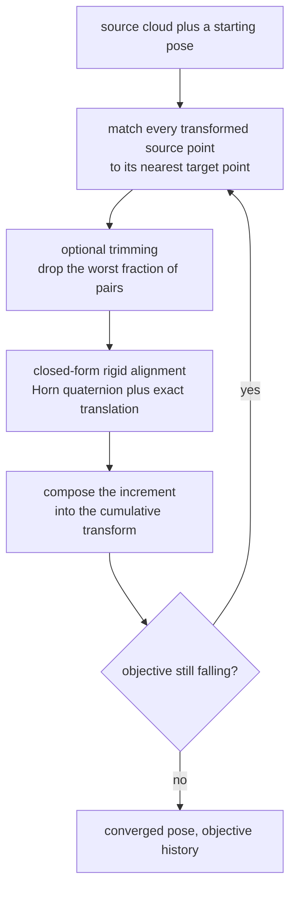
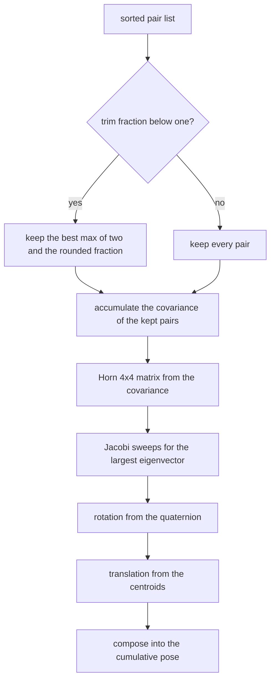
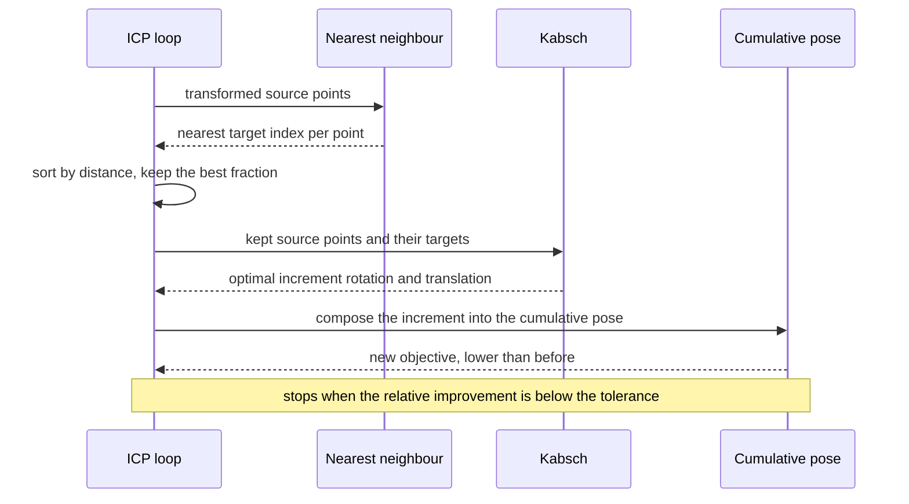

# 789 — Implement shape-matching registration (ICP) iterative closest point

> **Tier:** Expert · **CTCI chapter:** Beyond — Graphics, Geometry & Robotics
> **Task spec:** [789-implement-shape-matching-registration-icp-iterative-closest-poin.md](../../../tasks/expert/789-implement-shape-matching-registration-icp-iterative-closest-poin.md)
> **Solutions:** [Python](../../../solutions/python/expert/789-implement-shape-matching-registration-icp-iterative-closest-poin/solution.py) ·
> [Java](../../../solutions/java/expert/789-implement-shape-matching-registration-icp-iterative-closest-poin/Solution.java) ·
> [JavaScript](../../../solutions/javascript/expert/789-implement-shape-matching-registration-icp-iterative-closest-poin/solution.js) ·
> [C#](../../../solutions/csharp/expert/789-implement-shape-matching-registration-icp-iterative-closest-poin/Solution.cs)

## 1. Problem restatement

Register two point clouds — find the rigid transform that maps a *source* cloud onto a *target* cloud —
by alternating two exact subproblems:

1. **correspondence**: for every transformed source point, find the nearest target point (a brute-force
   `O(n_s * n_t)` scan here), optionally dropping the worst fraction of the pairs (trimmed ICP) so
   outliers cannot pull the transform away;
2. **transform**: solve `min over R, t of sum_i |R p_i + t - q_i|^2` with `R` a **proper** rotation. The
   translation is exact, `t = q_bar - R p_bar`, and the rotation comes from Horn's unit-quaternion method:
   the unit eigenvector `(w, x, y, z)` of the largest eigenvalue of the symmetric `4x4` matrix `N` built
   from the covariance `S = sum_i (p_i - p_bar)(q_i - q_bar)^T` is the optimal rotation quaternion. `N` is
   diagonalised by cyclic **Jacobi** sweeps, so no linear-algebra package is needed.

Inputs: two clouds and an optional starting pose. Outputs: the cumulative rotation and translation, the
objective history and the iteration count. Measured results from the solution's own summary:

| Measurement | Value |
| --- | --- |
| Kabsch recovery of a planted pose | rotation error `1.110e-16`, `det = 1.000000000000`, residual `6.779e-31` |
| planar case versus a dense angular search (7200 angles) | analytic residual `3.359e-31` vs refined search `4.068e-31`, grid value `7.353e-07` |
| the same planar case with added noise | analytic `0.000044508` vs planar-search `0.000044508` |
| ICP from a perturbed start | `4` iterations, objective `6.332e-06`, pose error `5.103e-04` (start objective `4.190e-02`) |
| target contaminated with 7 outliers | untrimmed pose error `0.0125`, trimmed `0.0009` (7 iterations, objective `6.020e-06`) |
| forward-then-backward composition | error `3.469e-16` |

Further assertions: the objective is **non-increasing at every iteration** and must improve by more than
10× from the perturbed start, the recovered matrix satisfies `R^T R = I` and `det R = +1`, a cloud
registered onto itself reaches an objective below `1e-18`, trimmed ICP must beat the untrimmed fit on
contaminated data, a zero-spread point set raises `ValueError` (the degenerate case) as do fewer than
three points or a trim fraction outside `(0, 1]`, and repeated runs are bit-identical.

## 2. Intuition

ICP is a chicken-and-egg loop: the optimal transform needs correct correspondences, and the correct
correspondences need the correct transform. It breaks the circle by *alternating* — and both halves are
exact for what they are given:

- the **transform step** is a closed-form least-squares problem (Horn/Kabsch), not an iterative solve;
- the **correspondence step** can only shorten distances, because each source point is matched to the
  nearest target point under the current transform.

That is why `E(T) = mean_i min_j |T(p_i) - q_j|^2` is non-increasing: the alignment minimises the sum for
the *current* pairs, and re-matching replaces each distance with the minimum over the target set. The
monotonicity is asserted for every iteration, which makes it a usable invariant rather than a slogan.

The fragility is equally central. ICP converges to the nearest local minimum, so a start that is off by
more than roughly half a point spacing can lock onto the wrong correspondences and stall; the Java variant
demonstrates exactly that (a `0.25` rad start provably stalls in a strictly worse minimum that a 48-way
multi-start escapes). And a handful of outliers can drag the whole fit, which the trimmed variant fixes by
solving for the pose from only the best fraction `eta` of the matches.



## 3. Algorithm

1. **Linear algebra on a small scale.** `jacobi_eigen(matrix, sweeps=60)` performs cyclic Jacobi rotations
   until the off-diagonal mass falls below `1e-18`; `quaternion_to_matrix(q)` normalises the quaternion
   and builds the rotation; `compose(R_a, t_a, R_b, t_b)` returns the transform equivalent to applying `B`
   first and then `A`; `determinant` supports the proper-rotation check.
2. **Kabsch/Horn.** `kabsch(points, targets)` requires at least two pairs, computes both centroids,
   rejects a degenerate source (`sum |p - p_bar|^2 < 1e-18`) or a vanishing covariance, accumulates
   `S = sum (p - p_bar)(q - q_bar)^T`, assembles Horn's symmetric `4x4` `N` from the nine entries of `S`,
   takes the eigenvector of the largest eigenvalue, converts it to a matrix, and derives
   `t = q_bar - R p_bar`; it also returns the residual `sum |R p + t - q|^2`.
3. **Correspondences.** `nearest_index(point, targets)` is the brute-force scan the task documents as a
   simplification (no k-d tree).
4. **ICP.** `ICP(max_iterations=60, tolerance=1e-13, trim_fraction=1.0)` validates the trim fraction, then
   `align(source, target, rotation, translation)`: recorded objective, then per iteration build the sorted
   `(distance, source index, target index)` list, keep the best `max(2, round(trim_fraction * n))` pairs,
   align the *currently transformed* points onto their neighbours with `kabsch`, compose the increment into
   the cumulative transform, recompute the objective and stop when the relative improvement falls below
   the tolerance.
5. **Objective.** `objective(...)` is the mean squared nearest-neighbour distance over the kept fraction —
   the same quantity for untrimmed and trimmed runs, which is what makes the two comparable.
6. **Independent oracles.** For the planar tests, `dense_planar_search(points, targets, samples=7200)` scans
   the rotation angle on a grid and `ternary_refine` narrows the bracket; `planar_rss` applies the optimal
   translation analytically for a fixed angle, so the search only has one free parameter.

```text
procedure align(source, target, rotation, translation)
    require at least three points per cloud
    keep ← max(2, round(trimFraction * length(source)))
    history ← [objective(source, target, rotation, translation)]
    repeat up to maxIterations times
        moved ← rotation * p + translation for every source point p
        pairs ← (nearestTargetDistance, sourceIndex, targetIndex) for every moved point
        sort pairs by distance ascending
        used ← the first `keep` pairs
        stepRotation, stepTranslation ← kabsch(moved of used, targets of used)
        rotation, translation ← compose(stepRotation, stepTranslation, rotation, translation)
        history.append(objective(source, target, rotation, translation))
        if the relative improvement is within the tolerance then break
    return rotation, translation, history

procedure kabsch(points, targets)
    require length(points) = length(targets) and length(points) >= 2
    pBar ← centroid(points)
    qBar ← centroid(targets)
    require the source points are not all coincident
    S ← sum over pairs of (p - pBar) outer (q - qBar)
    require S is not the zero matrix
    N ← Horn's symmetric 4x4 matrix built from the entries of S
    eigenvalues, eigenvectors ← jacobiEigen(N)
    quaternion ← the eigenvector of the largest eigenvalue
    rotation ← quaternionToMatrix(quaternion)
    translation ← qBar - rotation * pBar
    return rotation, translation, sum of squared residuals
```



## 4. Worked example

**(a) The transform step alone.** Plant a rotation of `0.4`, `-0.7`, `0.25` rad about the three axes and a
translation `(0.7, -1.3, 0.25)` on a 10-point cloud, then hand the *exact* correspondences to `kabsch`:

| Quantity | Result |
| --- | --- |
| largest element error of the recovered rotation | `1.110e-16` |
| `det R` | `1.000000000000` |
| translation error | below `1e-9` |
| residual `sum |R p + t - q|^2` | `6.779e-31` |

The residual is the point: with perfect correspondences and no noise, the least-squares problem has an
exact solution, so anything above rounding means the `N` matrix was assembled with the wrong sign
convention. That is why the check asserts `residual < 1e-18` rather than a loose tolerance.

**(b) An independent oracle for the rotation.** For a *planar* motion only the rotation angle is unknown
once the translation is taken as the centroid difference, so the task compares the analytic answer against

| Oracle | Value |
| --- | --- |
| analytic Kabsch residual | `3.359e-31` |
| dense scan over 7200 angles, then ternary refinement | `4.068e-31` |
| best value on the raw grid | `7.353e-07` |

The analytic optimum is *below* the refined search value (the search can only approach the optimum from
above), and the gap between them is under `1e-9` — which is what "exact planar motion" means. On the same
geometry with noise added, the two agree to all printed digits (`0.000044508` both), because the noisy
optimum is not degenerate and the search brackets it tightly.

**(c) Full ICP from a perturbed start.** Twenty points, a planted pose, `0.2%`-scale noise, and a start
that is already close but not right (rotation error up to `0.4` rad in one axis). The measured run:

| Iteration | Objective | Comment |
| --- | --- | --- |
| 0 | `4.190e-02` | the perturbed start |
| 1-3 | falling | correspondences lock onto the true pairing |
| 4 | `6.332e-06` | converged; pose error `5.103e-04` |

The objective fell by more than three orders of magnitude in four iterations, and the check requires both
that every step be non-increasing and that the total improvement exceed 10×. Note what the objective is
measuring: the *residual after* the transform, not the distance to the truth. The pose error `5.103e-04`
is reported separately, and the *inverse* test is the strongest evidence that the pose is right — running
ICP forward and then backward and composing the two transforms reproduces the identity to `3.469e-16`.

**(d) Outliers and trimming.** Contaminating the target with 7 of 20 points placed uniformly at random
makes plain ICP over-fit the garbage:

| Variant | Pose error | Iterations | Objective |
| --- | --- | --- | --- |
| plain ICP | `0.0125` | — | — |
| trimmed ICP (`trim_fraction = 0.6`) | `0.0009` | `7` | `6.020e-06` |

Trimming keeps only the best 60% of the correspondences, so the 7 outliers are ignored once the inliers
dominate — a 14× reduction in pose error, and the trimmed objective still decreases monotonically. The
honest caveat, documented in the source, is that the fraction is a fixed user parameter here rather than a
robust kernel with an estimated scale.



## 5. Complexity

Let `n_s` and `n_t` be the cloud sizes, `k` the number of kept pairs and `I` the number of iterations.

| Operation | Best | Average | Worst | Why the bound holds |
| --- | --- | --- | --- | --- |
| `nearest_index` | O(n_t) | O(n_t) | O(n_t) | brute-force scan (a k-d tree would give `O(log n_t)`) |
| one correspondence pass | O(n_s n_t) | O(n_s n_t) | O(n_s n_t) | one scan per source point, plus the sort of the pair list in `O(n_s log n_s)` |
| `kabsch` | O(k) | O(k) | O(k) | the covariance is an `O(k)` accumulation; the Jacobi eigen-decomposition is a fixed `4x4` cost |
| `jacobi_eigen` | O(1) | O(sweeps) | `O(sweeps)` with `sweeps = 60` | a fixed number of cyclic sweeps on a `4x4` matrix |
| one ICP iteration | O(n_s n_t) | O(n_s n_t) | O(n_s n_t) | dominated by the correspondence pass |
| `align` | O(I n_s log n_s) | O(I n_s n_t) | O(max_iterations · n_s n_t) | the measured runs converge in 4-7 iterations here |
| `dense_planar_search` (oracle) | O(samples · n) | `7200 n` | `7200 n` | one residual evaluation per grid angle |
| Space | O(n_s + n_t) | same | O(n_s log n_s) | the pair list is the largest extra structure; `kabsch` needs only the covariance |

Comparison with the alternatives:

| Approach | Needs correspondence | Handles outliers | Local minima |
| --- | --- | --- | --- |
| Plain ICP (this task) | alternating nearest neighbour | no | yes, and the Java variant demonstrates one |
| Trimmed ICP | same, best fraction only | up to the trim fraction | fewer starts needed |
| Point-to-plane ICP | normals instead of points | partial | faster convergence, needs normals |
| Global registration (RANSAC / feature based) | no | yes | none, but far more expensive |

## 6. Pitfalls and edge cases

- **A degenerate source is rejected, not silently handled.** `kabsch` raises `ValueError` when the source
  spread is below `1e-18` or the covariance vanishes; a coincident point set has no defined rotation.
- **Fewer than three points** raises `ValueError` in `align`, and fewer than two in `kabsch`.
- **The trim fraction must be in `(0, 1]`**; `ICP(trim_fraction=1.5)` raises `ValueError`. The kept count
  is at least two, so trimming can never starve the aligner.
- **The objective must be monotone.** The check compares every consecutive pair of the history; a
  regression means the increment was composed in the wrong order or applied to the untransformed points.
- **Compose, do not overwrite.** The increment maps the *currently transformed* points onto their
  neighbours, so it must be composed with the cumulative transform rather than substituted for it.
- **Proper rotation, not reflection.** Horn's quaternion method yields `det = +1` by construction; the check
  asserts both orthonormality (`R^T R = I` within `1e-12`) and `det = +1` within `1e-12`, which is what
  separates a rotation from a mirrored fit.
- **Line sign ambiguity.** `(a, b, c)` and `(-a, -b, -c)` describe the same line in the line-fitting
  helpers, so comparisons must align the sign first — the same style of ambiguity that appears in
  [793 — RANSAC model fitting](../../../tasks/expert/793-implement-ransac-based-robust-model-fitting-for-line-circle-dete.md).
- **Correspondences are only as good as the start.** The Java variant shows a `0.25` rad start stalling in
  a strictly worse local minimum that a 48-way multi-start escapes; the monotone objective does *not* mean
  the global optimum was found.
- **Degenerate scenes.** One correspondence fixes only the translation; a partial-overlap source still
  registers; a `20%` scale change leaves an irreducible residual because the model is rigid.
- **Documented simplifications.** No k-d tree (brute-force matching, so clouds stay small), no
  point-to-plane metric, no normal estimation, and outliers are handled by a fixed trim fraction rather
  than a robust kernel with a scale estimate.
- **Determinism.** The draws use `splitmix64`, all sorts are total, and the checks require the same
  rotation matrix and the same iteration count on a repeated run.

## 7. Variants and follow-ups

- **Point-to-plane and generalized ICP.** Using normals or the full covariance instead of points converges
  in far fewer iterations on smooth surfaces — the standard upgrade of this loop.
- **Robust kernels instead of hard trimming.** A Huber or Tukey weight with an estimated scale avoids
  choosing the trim fraction by hand; the fitted scale also gives a diagnostic for how many outliers the
  data really contains.
- **Global initialisation.** Feature matching, RANSAC or a coarse multi-start (as in the Java variant)
  removes the local-minimum problem at a much higher cost.
- **Rigid motion in 2D.** The planar special case has a one-line closed form,
  `theta = atan2(sum(p x q), sum(p . q))`, which the Java variant derives from its 2D Kabsch/Horn solution.
- **Related tasks.** [790 — bundle adjustment with Levenberg-Marquardt](../../../tasks/expert/790-implement-bundle-adjustment-sparse-solver-outline-with-levenberg.md)
  generalises the same least-squares pose estimation to cameras and structure;
  [791 — EKF-SLAM](../../../tasks/expert/791-implement-slam-small-demo-with-extended-kalman-filter-ekf-slam.md)
  estimates the same kind of geometry incrementally in a filter; and
  [793 — RANSAC line/circle fitting](../../../tasks/expert/793-implement-ransac-based-robust-model-fitting-for-line-circle-dete.md)
  is the robust-estimation alternative when the correspondences are unknown.

## 8. Check yourself

<details><summary>Show answer</summary>
**Why is Kabsch's rotation given by the largest eigenvector of a 4x4 matrix?** The rotation that minimises
`sum |R p_i - q_i|^2` also maximises `trace(R S)` for the covariance `S = sum p_i q_i^T`. Writing the
rotation as a unit quaternion turns that trace into a quadratic form whose matrix is Horn's symmetric
`N`, so maximising it is exactly "take the eigenvector of the largest eigenvalue". The matrix is `4x4`
regardless of the number of points, which is why the method is cheap and why a hand-written Jacobi
sweep is enough.
</details>

<details><summary>Show answer</summary>
**What exactly makes the ICP objective non-increasing?** Two independent arguments. The alignment step
minimises the sum of squared distances *for the current pairs*, so it cannot increase the objective; and the
re-matching step replaces each source point's distance with the minimum over all target points, which also
cannot increase it. The composition of the two steps is therefore monotone, and the check verifies every
consecutive pair of the history rather than just the endpoints.
</details>

<details><summary>Show answer</summary>
**ICP converges to a small residual, so is the recovered pose correct?** Not necessarily — a residual can be
small while the pose is wrong, for instance when trimming has removed the pairs that would have revealed
the error, or when the clouds are symmetric. That is why the task measures the pose error against the
planted truth, why the inverse-consistency test exists (forward then backward must compose to the
identity), and why the noisy planar run is compared with an independent angular search rather than only
with its own residual.
</details>

<details><summary>Show answer</summary>
**Trimming stopped the outliers from pulling the fit. What does the trim fraction trade off?** It trades
robustness against usable data: a fraction that is too high leaves outliers in the estimate, a fraction
that is too low discards genuine pairs and increases the variance of the pose. On the contaminated target
here `0.6` reduced the pose error from `0.0125` to `0.0009`; the docstrings note that a production system
estimates the fraction (or a robust scale) from the residual distribution instead.
</details>

<details><summary>Show answer</summary>
**Why can the Jacobi sweep be written in a few dozen lines while the rest of the task is about geometry?**
Because the eigenproblem is only `4x4`: cyclic Jacobi rotations annihilate off-diagonal entries one pair
at a time and converge in a handful of sweeps, and the checks assert the resulting rotation is orthonormal
and proper. A production implementation would call LAPACK, but writing it out makes the tutorial
self-contained and makes the `det = +1` guarantee explicit.
</details>
