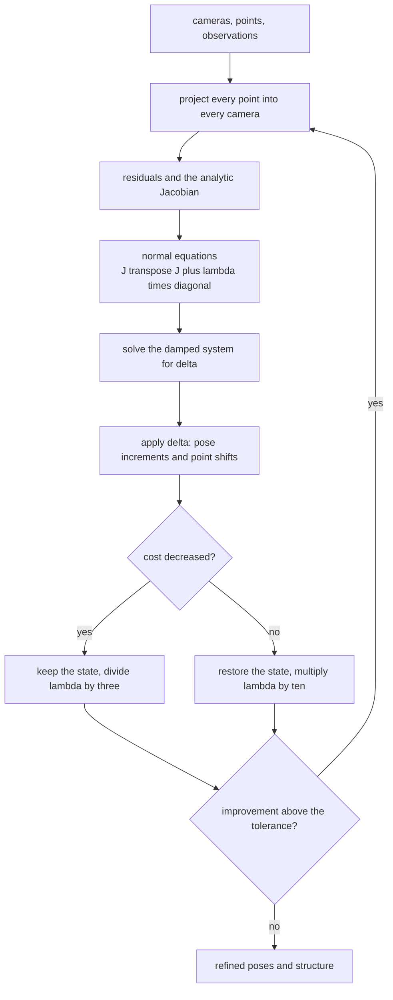
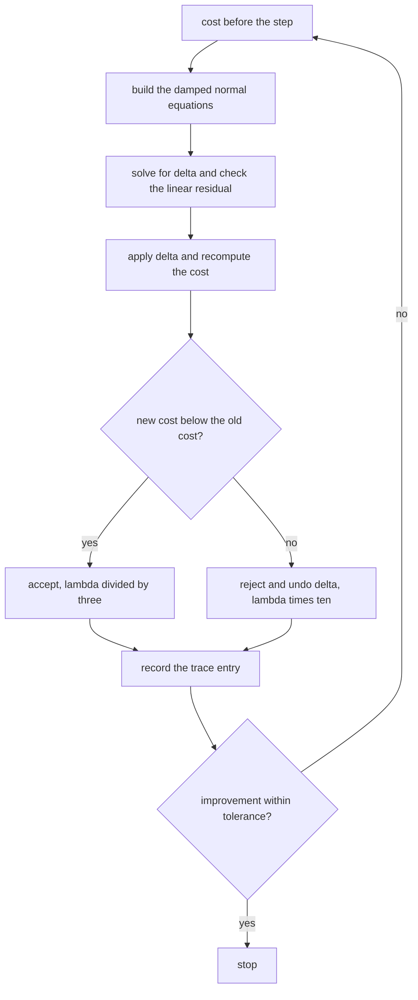
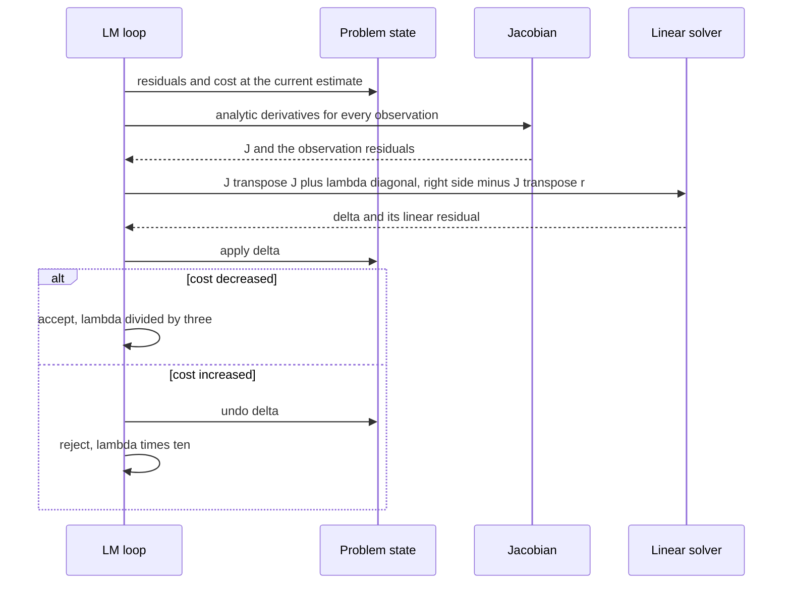

# 790 — Implement bundle adjustment sparse solver outline with Levenberg-Marquardt

> **Tier:** Expert · **CTCI chapter:** Beyond — Graphics, Geometry & Robotics
> **Task spec:** [790-implement-bundle-adjustment-sparse-solver-outline-with-levenberg.md](../../../tasks/expert/790-implement-bundle-adjustment-sparse-solver-outline-with-levenberg.md)
> **Solutions:** [Python](../../../solutions/python/expert/790-implement-bundle-adjustment-sparse-solver-outline-with-levenberg/solution.py) ·
> [Java](../../../solutions/java/expert/790-implement-bundle-adjustment-sparse-solver-outline-with-levenberg/Solution.java) ·
> [JavaScript](../../../solutions/javascript/expert/790-implement-bundle-adjustment-sparse-solver-outline-with-levenberg/solution.js) ·
> [C#](../../../solutions/csharp/expert/790-implement-bundle-adjustment-sparse-solver-outline-with-levenberg/Solution.cs)

## 1. Problem restatement

**Bundle adjustment** is the joint nonlinear least-squares refinement of camera poses and 3D structure
from image observations. With a pinhole camera of focal length `f` and principal point `(cu, cv)`, camera
`i` described by a world-frame rotation `R_i` and centre `C_i`, and world point `X_j`:

```text
q_i = R_i^T (X_j - C_i)        u = f q_x / q_z + cu        v = f q_y / q_z + cv
residual of the observation of point j in camera i = (u, v) predicted - (u, v) observed
```

The damped step solves the normal equations with a Levenberg-Marquardt rule:

```text
(J^T J + lambda * diag(J^T J)) delta = -J^T r
lambda <- lambda / 3 when the step lowers the cost, lambda <- lambda * 10 when it does not
```

Inputs: cameras (camera 0 fixed at the origin with identity rotation), 3D points and a set of 2D
observations. Outputs: the refined poses and points, a trace of `(cost, damping, accepted, step residual,
improvement)` and the reprojection error. Measured results from the solution's own summary:

| Measurement | Value |
| --- | --- |
| analytic versus central-difference Jacobian | worst `|analytic - numeric| = 1.074e-07` against a column scale of `1.051e+03` |
| LM on the noisy scene | RMS `26.9254 -> 0.1781` px in `9` iterations, `8` accepted |
| structure after normalising the scale gauge (`1.005377`) | centre error `0.0049`, point error `0.0271` |
| noiseless scene | RMS `1.692e+01 -> 5.165e-13` px, structure error `6.759e-13` |

Further assertions: the Jacobian has two rows per observation and
`6 * (cameras - 1) + 3 * points` columns, the cost strictly decreases on **every accepted** step, the
residual of the linear system that produced each step is below `1e-6`, the damping follows the
divide-by-3 / times-10 rule exactly, at least three steps are accepted, the noiseless fit reaches machine
precision, the recovered structure matches the truth within `0.05` after dividing out the monocular scale
gauge (which stays within `0.98-1.02`), and a single-observation problem, an observation-free problem, a
point behind the camera (`ValueError`) and the parameter count are all handled.

## 2. Intuition

Pose estimation from matched points (task 789) is a small, mostly convex problem. Bundle adjustment is the
same idea scaled up: thousands of points seen by a handful of cameras, with every observation coupling one
camera and one point. Three ideas make it tractable.

1. **Linearise and repeat.** The projection is nonlinear, so each iteration linearises around the current
   estimate and solves a linear least-squares problem. With the state `(omega_i, C_i, X_j)` the rotation
   increment enters as `R_i <- exp([delta_omega_i]_x) R_i`, which makes the orientation block of the
   Jacobian the exact first-order expression `-R_i^T (e_k x d)` at `delta = 0`.
2. **Damp.** A pure Gauss-Newton step can be huge or divergent when the linearisation is poor.
   Levenberg-Marquardt adds `lambda * diag(J^T J)` to the normal matrix, interpolating between
   Gauss-Newton (`lambda -> 0`) and a short gradient-descent step (`lambda -> infinity`), and adapts
   `lambda` by whether the step actually lowered the cost. Because a rejected step is restored, the
   *accepted* cost sequence is strictly decreasing by construction — the check asserts exactly that.
3. **Fix the gauge.** A monocular system determines the scene only up to a similarity: 7 degrees of
   freedom (6 rigid + 1 scale). Camera 0 is therefore fixed at the origin with identity rotation, which
   removes the 6 rigid ones; the 1-parameter **scale gauge is deliberately left in place**, so convergence
   is checked after normalising by the recovered baseline.



## 3. Algorithm

1. **Rotations.** `matrix_from_vector(v)` implements Rodrigues' formula for `exp([v]_x)`, with the
   small-angle branch returning the identity so a zero increment is exact.
2. **Projection and its derivatives.** `project` returns the pixel and the camera-frame point and raises
   `ValueError` for `q_z <= 1e-6` (a point behind the camera). `projection_derivatives` returns the six
   analytic blocks: `du/dX`, `dv/dX`, `du/dC = -du/dX`, `dv/dC`, and `du/domega`, `dv/domega` built as
   `-R^T (e_k x d)` contracted with the image gradients.
3. **The problem.** `BundleProblem(cameras, points, observations)` stores everything by reference and
   exposes `parameter_offsets()` (3 rotation + 3 centre columns per **free** camera, then 3 per point),
   `apply_delta(delta)`, `residuals()`, `cost()`, `analytic_jacobian()` and `numeric_jacobian()` — the last
   being the independent oracle for the first.
4. **Normal equations.** `normal_equations(jacobian, residuals, damping)` accumulates `J^T J` and `J^T r`,
   mirrors the upper triangle, scales the diagonal by `(1 + damping)` and adds `1e-12` for numerical
   safety; `solve_linear` is Gaussian elimination with partial pivoting that raises on a singular system.
5. **LM loop.** `levenberg_marquardt` computes the residuals, the analytic Jacobian and the damped step,
   records the linear-system residual `max |A delta + g|`, applies the step, accepts if the cost fell
   (dividing `lambda` by 3, floored at `1e-12`) and otherwise restores the snapshot and multiplies
   `lambda` by 10 (capped at `1e12`); it stops when the improvement is within `tolerance * max(1, cost)`.
6. **Scene and gauge.** `build_scene` places four cameras around eight points looking down `+z`, projects
   the truth with optional pixel noise and perturbs the initial guess; `normalised_comparison` divides the
   estimate by the recovered baseline-to-baseline ratio, which is exactly the scale gauge, before comparing
   camera centres and points with the truth.

```text
procedure levenbergMarquardt(problem, iterations, damping, tolerance)
    cost ← problem.cost()
    for iteration in 1 .. iterations do
        residuals ← problem.residuals()
        jacobian ← problem.analyticJacobian()
        A, g ← normalEquations(jacobian, residuals, damping)
        delta ← solveLinear(A, -g)
        stepResidual ← max absolute value of A * delta + g
        problem.applyDelta(delta)
        newCost ← problem.cost()
        if newCost < cost then
            accepted ← true
            improvement ← cost - newCost
            cost ← newCost
            damping ← max(damping / 3, 1e-12)
        else
            accepted ← false
            improvement ← 0
            problem.applyDelta(-delta)                 // restore the rejected state
            damping ← min(damping * 10, 1e12)
        record (cost, damping, accepted, stepResidual, improvement)
        if improvement <= tolerance * max(1, cost) then break
    return the trace

procedure analyticJacobian(problem)
    offsets, columns ← problem.parameterOffsets()      // free camera blocks first, then points
    for every observation (i, j) in sorted order do
        du_dX, dv_dX, du_dC, dv_dC, du_dw, dv_dw ← projectionDerivatives(rotation_i, center_i, point_j)
        rowU ← zeros(columns)
        rowV ← zeros(columns)
        if camera i is free then
            place du_dw and dv_dw in the rotation block of camera i
            place du_dC and dv_dC in the centre block of camera i
        place du_dX and dv_dX in the point block of point j
        append rowU then rowV
```



## 4. Worked example

**(a) The parameter vector and the gauge.** Four cameras and eight points give

| Block | Size | Columns in the Python solution |
| --- | --- | --- |
| free camera rotations `omega_i` (`i = 1..3`) | 3 each | `0-2`, `6-8`, `12-14` |
| free camera centres `C_i` | 3 each | `3-5`, `9-11`, `15-17` |
| points `X_j` | 3 each | `18` onwards |

so `columns = 6 * 3 + 3 * 8 = 42` and the Jacobian has `2 * observations` rows. Camera 0 has **no**
columns: it is the gauge, held at the origin with identity rotation, and the checks assert both block
sizes and the total column count.

**(b) The analytic Jacobian is checked, not trusted.** The first thing the solution does is compare the
analytic blocks with central differences of the *increment map* (`apply_delta` followed by `residuals`,
positive and negative perturbation, restore in between):

| Quantity | Value |
| --- | --- |
| worst absolute difference | `1.074e-07` |
| column scale (largest numeric entry) | `1.051e+03` |
| tolerance | `1e-4 * max(1, scale)` |

The scale matters: entries of the image Jacobian are of order `f / q_z ~ 10^2-10^3` pixels per metre, so
an absolute tolerance of `1e-7` would be far too strict for a forward difference and far too lax for a
wrong sign. A sign error in `du/dC = -du/dX` or in the `-R^T (e_k x d)` orientation block would show up as
differences of order `10^2`, not `10^-7`.

**(c) LM on a noisy scene.** Four cameras, eight points, `0.3` px pixel noise, a perturbed start:

| Iteration | RMS reprojection error | Action |
| --- | --- | --- |
| start | `26.9254` px | the perturbed guess, with rotation errors of `0.03` rad |
| 1 | lower | accepted, `lambda` divided by 3 |
| ... | ... | `8` accepted steps in total |
| 9 | `0.1781` px | converged, improvement below the tolerance |

The checks require the final RMS to be below `0.6` px (sub-pixel, i.e. at the noise level) and to have
improved by at least 5× from `26.9254`; the measured `0.1781` satisfies both comfortably. Every accepted
step's cost is asserted to be strictly lower than the previous *accepted* cost — this is the property that
the accept/restore logic guarantees and that a missing `apply_delta(-delta)` on rejection would break
immediately, because a rejected step would silently corrupt the state.

**(d) The scale gauge and the noiseless limit.** The recovered baseline `|C_1|` is `1.005377` times the
truth, so the structure must be compared *after* dividing by it:

| Scene | Centre error | Point error | Comment |
| --- | --- | --- | --- |
| noisy (`0.3` px) | `0.0049` | `0.0271` | both below the `0.05` threshold |
| noiseless | — | `6.759e-13` | RMS `5.165e-13` px, machine precision |

The scale sitting at `1.0054` rather than exactly 1 is not an error: with camera 0 fixed at the origin, the
whole configuration can be scaled and the pinhole projection stays consistent when all depths scale along
with it. That is why the check requires `0.98 < scale < 1.02` *and* gauge-normalised accuracy, instead of
demanding absolute agreement — a subtlety the docstring calls out explicitly.



## 5. Complexity

Let `m` be the number of observations, `n = 6 (cameras - 1) + 3 * points` the number of parameters and `I`
the number of iterations.

| Operation | Best | Average | Worst | Why the bound holds |
| --- | --- | --- | --- | --- |
| `residuals` / `cost` | O(m) | O(m) | O(m) | one projection per observation and a sum of squares |
| `analytic_jacobian` | O(m) | O(m) | O(m) | each observation fills at most twelve entries; the rest is zero |
| `numeric_jacobian` (oracle) | O(n m) | O(n m) | O(n m) | two full residual passes per parameter column |
| `normal_equations` | O(m n²) | O(m n²) | O(m n²) | each observation adds an outer product of a sparse row into `J^T J` |
| `solve_linear` | O(n³) | O(n³) | O(n³) | dense Gaussian elimination with partial pivoting |
| one LM iteration | O(m n² + n³) | same | same | dominated by the normal equations and the dense solve |
| `levenberg_marquardt` | O(I (m n² + n³)) | `I = 9` measured | `iterations` | the noise-free run reaches machine precision within 80 iterations |
| Space | O(m + n² + m n) | same | `O(m n)` for the dense Jacobian | the dense Jacobian is the memory hog the sparse variants remove |

Comparison with the real algorithms this task abstracts:

| Variant | Solve size | Notes |
| --- | --- | --- |
| Dense normal equations (Python solution) | `n` | simplest; fine for four cameras and eight points |
| Schur complement / reduced camera system (Java solution) | `6 (cameras - 1)` | eliminates each point block in closed form, so the solve is `3 * cameras` square instead of `3 * cameras + 2 * points`; the Java variant verifies the Schur step against a dense solve to `1e-10` and reports a Jacobian that is only about a third dense |
| Sparse Cholesky with fill-reducing ordering | `n`, sparse | what production bundle adjusters use |
| Gauss-Newton without damping | `n` | cheaper per iteration, but can diverge — the Java variant needs an undamped run to expose the difference |

## 6. Pitfalls and edge cases

- **A rejected step must be undone.** `apply_delta(-delta)` restores the state; without it the estimate drifts.
- **The damping rule is two-sided.** Acceptance divides by 3 with a floor of `1e-12`; rejection multiplies
  by 10 with a ceiling of `1e12`. The check recomputes the expected `lambda` sequence and requires exact
  agreement.
- **The linear system must actually be solved.** The step residual `max |A delta + g|` is asserted below
  `1e-6`; a sloppy or inconsistent solver would produce a step that does not correspond to the recorded
  `lambda`.
- **A point behind the camera** (`q_z <= 1e-6`) raises `ValueError` rather than producing an infinite
  projection; `normal_equations` also adds `1e-12` to the diagonal so a rank-deficient direction cannot
  make the matrix singular.
- **The gauge must be fixed or the system is singular.** Camera 0's six parameters are excluded; a
  monocular system additionally has a scale gauge, so accuracy is measured after normalising by the
  recovered baseline. Expecting the absolute scale to converge to the truth exactly would be a modelling
  error, not a solver bug.
- **The scale stays near one only for well-conditioned scenes.** The check asserts `0.98 < scale < 1.02`
  here, and the worked example shows `1.005377`.
- **Two rows per observation, in a fixed order.** Row order is `(i, j)` sorted, `u` before `v`; the numeric
  Jacobian uses the same order, so a mismatch in ordering shows up as a large difference rather than a
  subtle bias.
- **Degenerate scenes.** A single-observation problem must still take steps, an observation-free problem
  has cost `0.0`, and the parameter count is checked explicitly against the free-camera and point blocks.
- **The noise floor limits the fit.** On the noisy scene the RMS stalls at `0.1781` px, which is the
  irreducible measurement noise, not a solver failure — comparing it against the noiseless `5.165e-13` in
  the same code makes the distinction obvious.
- **Documented simplifications.** The normal equations are dense — no Schur complement, no sparse
  Cholesky, no variable ordering — there is no robust loss or outlier rejection, no lens distortion model,
  and the Java variant instead demonstrates the Schur elimination on a 2D problem where the block structure
  is easy to inspect.

## 7. Variants and follow-ups

- **Schur complement.** Eliminate the point blocks analytically and solve the reduced camera system; the Java
  variant does exactly this and validates the sparse step against a dense solve.
- **Robust losses.** A Huber or Cauchy weight on the residuals removes the gross outliers a plain fit swallows.
- **Fixed versus free cameras and points.** Gauge freedom, partially observed points and shared intrinsics
  are all handled by simply not allocating columns for the fixed parameters.
- **Covariance estimation.** The inverse of `J^T J` gives the parameter uncertainties.
- **Related tasks.** [789 — ICP registration](../../../tasks/expert/789-implement-shape-matching-registration-icp-iterative-closest-poin.md)
  is the same rigid-pose least-squares problem in closed form;
  [791 — EKF-SLAM](../../../tasks/expert/791-implement-slam-small-demo-with-extended-kalman-filter-ekf-slam.md)
  solves the same structure-from-observations problem incrementally; and
  [788 — L-stable stiff solver](../../../tasks/expert/788-implement-stiff-ode-solver-l-stable-method-concept.md)
  uses the same Gaussian-elimination primitive.

## 8. Check yourself

<details><summary>Show answer</summary>
**Why does fixing camera 0 remove six degrees of freedom but not the scale?** The world-frame origin and
orientation are a gauge: applying any rigid transform to *all* cameras and points leaves every projection
unchanged, so the cost is flat along those six directions and the normal equations are singular. Fixing one
camera's pose (both rotation and centre) pins the origin and orientation. Scale is different: scaling the
whole configuration by `s` scales the depths too, and the pinhole projection is invariant, so one more
direction stays flat — and it can only be removed by fixing an absolute distance, which a monocular system
does not observe.
</details>

<details><summary>Show answer</summary>
**What does Levenberg-Marquardt's damping actually interpolate between?** As `lambda -> 0` the step is the
Gauss-Newton step, which converges quadratically near the optimum. As `lambda -> infinity` the step tends
to a scaled gradient-descent direction with a small magnitude, which is slow but reliable far from the
optimum. The controller walks between the two by measuring whether steps lower the cost, which is why the
accepted cost sequence is monotone no matter how bad the initialisation is.
</details>

<details><summary>Show answer</summary>
**The linear-system residual is asserted below `1e-6`. What would a failure reveal?** It would show that the
step applied to the state is not the solution of the system the iteration claims to have solved — for
example a wrong right-hand side (`+J^T r` instead of `-J^T r`), a mis-assembled diagonal, or a solver bug.
Since the normal-equation matrix is exactly what the damping rule describes, this single number ties the
step, the damping and the cost together.
</details>

<details><summary>Show answer</summary>
**Why compare the analytic Jacobian against the *increment map* rather than against the projection
directly?** Because the parameterisation is what the solver actually uses: a rotation is updated by
`R <- exp([delta_omega]_x) R`, so the derivative of the residuals with respect to the *increment* is the
quantity the normal equations need. Differencing the projection with respect to raw Euler angles would
check a different function and could pass while the increment Jacobian has the wrong sign convention.
</details>

<details><summary>Show answer</summary>
**On the noisy scene the fit stalls at `0.1781` px while the noiseless scene reaches `5.165e-13` px. Which
number should a practitioner quote?** The noisy one — it is the fit to the data that exists, and it sits at
the injected noise level (`0.3` px uniform, so an RMS around `0.17` px is expected). The noiseless number
is a correctness proof for the solver: it shows that with consistent data the least-squares problem is
solved to machine precision, so the gap on real data is the noise and not the algorithm.
</details>
