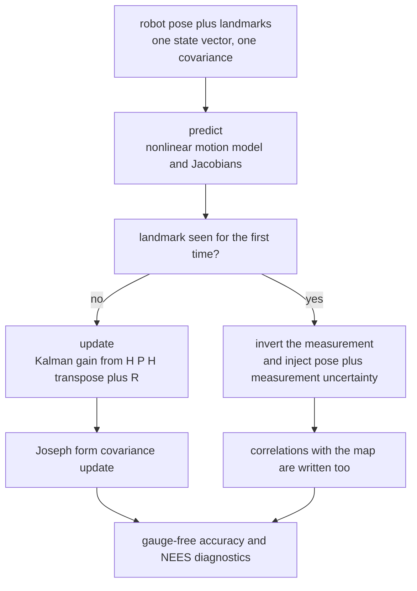
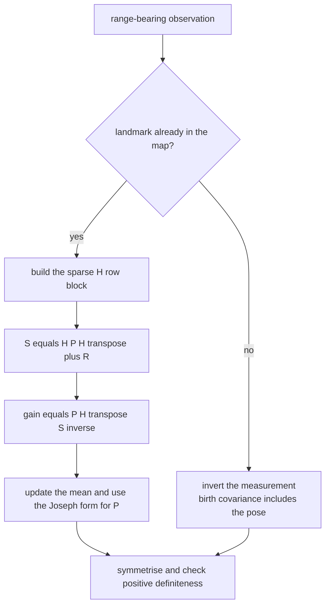
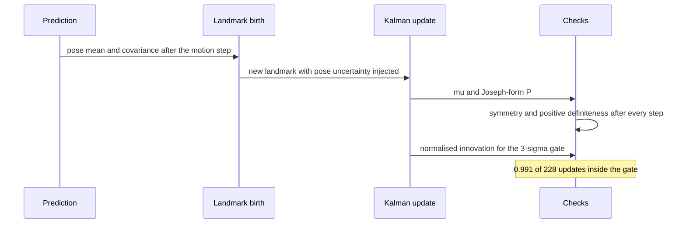

# 791 — Implement SLAM small demo with extended Kalman filter (EKF-SLAM)

> **Tier:** Expert · **CTCI chapter:** Beyond — Graphics, Geometry & Robotics
> **Task spec:** [791-implement-slam-small-demo-with-extended-kalman-filter-ekf-slam.md](../../../tasks/expert/791-implement-slam-small-demo-with-extended-kalman-filter-ekf-slam.md)
> **Solutions:** [Python](../../../solutions/python/expert/791-implement-slam-small-demo-with-extended-kalman-filter-ekf-slam/solution.py) ·
> [Java](../../../solutions/java/expert/791-implement-slam-small-demo-with-extended-kalman-filter-ekf-slam/Solution.java) ·
> [JavaScript](../../../solutions/javascript/expert/791-implement-slam-small-demo-with-extended-kalman-filter-ekf-slam/solution.js) ·
> [C#](../../../solutions/csharp/expert/791-implement-slam-small-demo-with-extended-kalman-filter-ekf-slam/Solution.cs)

## 1. Problem restatement

**Full SLAM** keeps the robot pose *and* every landmark in one state vector with one covariance,

```text
mu = (x, y, theta, l_1x, l_1y, ..., l_Mx, l_My)          P is (3 + 2M) square
```

using the standard 2D velocity motion model and range-bearing observations:

```text
x' = x + v dt cos(theta)      r   = |l - p|
y' = y + v dt sin(theta)      phi = atan2(l_y - y, l_x - x) - theta
theta' = theta + w dt
```

Prediction propagates `mu` through the nonlinear model and `P` through the Jacobians
(`P <- F P F^T + G Q G^T`). An observation of landmark `j` uses the `2 x 3` robot block and the `2 x 2`
landmark block of `H`, then `S = H P H^T + R`, `K = P H^T S^{-1}`, `mu <- mu + K nu`, and the **Joseph
form** `P <- (I - K H) P (I - K H)^T + K R K^T` for the covariance update.

Measured results from the solution's own summary:

| Measurement | Value |
| --- | --- |
| gauge-free landmark distance error | `0.0303` m |
| gauge-free robot-to-landmark range error | `0.0200` m |
| absolute (gauge-dependent) worst pose error | `0.3353` m over the run |
| innovations inside the 3-sigma gate | `0.991` of `228` |
| pose-known EKF versus a batch Gauss-Newton fit | worst landmark gap `2.357e-04` m |
| average NEES per dimension over 12 runs | `0.8637` |

Further assertions: the state layout is `3 + 2 * landmarks`, every landmark is eventually seen, the
robot-landmark **cross-covariance stays non-trivial** (that correlation is what distinguishes SLAM from
plain localisation), `P` stays symmetric and positive definite after **every** predict and update, every
landmark's variance at the end is below its birth variance and their sum is below `0.1`, landmarks closer
than `1e-6` to the robot are skipped rather than dividing by zero, and repeated runs are identical.

## 2. Intuition

Plain localisation assumes the map is known; mapping assumes the pose is known. SLAM has neither, and the
naive fix — alternate between the two — loses the information that couples them: *the uncertainty of a
landmark is dominated by the pose uncertainty at the moment it was first seen*.

The EKF solution is to carry one joint Gaussian over everything:

1. **One covariance, all correlations.** `P` has a `2x2` block per landmark and, crucially, off-diagonal
   blocks linking the robot to every landmark and each landmark to every other. When the pose improves, the
   whole map improves through those blocks — the effect is measurable, and the check asserts
   `P[0][3]` and `P[0][9]` are non-zero.
2. **Landmark birth is an injection, not an assignment.** The first observation of landmark `j` is
   inverted to place it (`l = p + r (cos(phi + theta), sin(phi + theta))`), and its covariance is
   `J_pose P_rr J_pose^T + J_meas R J_meas^T` — deliberately **including the robot pose uncertainty**
   through `J_pose`. Forgetting that term is the classic way to build an over-confident SLAM map. The
   cross-covariances with the existing landmarks are filled in the same way.
3. **The gauge.** Nothing anchors the world frame, so the estimate is only determined up to a rigid
   transform; the first pose is therefore seeded from the truth (the standard gauge choice) and the
   accuracy checks are **gauge free** — pairwise landmark distances and robot-to-landmark ranges, which
   are invariant under that ambiguity. The absolute drift is reported separately, `0.3353` m.



## 3. Algorithm

1. **State and layout.** `EKFSLAM(num_landmarks, dt, noise, initial_pose, initial_cov)` allocates
   `n = 3 + 2M`, sets `mu[0:3]` from the initial pose, puts the initial covariance on the pose diagonal
   and keeps a `seen` flag per landmark.
2. **Predict.** `predict(velocity, turn_rate)` advances the pose with the velocity model, wraps the
   heading, builds `F = I` with `F[0][2] = -v dt sin(theta)` and `F[1][2] = v dt cos(theta)`, forms the
   `3x3` control covariance `Q = G diag(sigma_v^2, sigma_w^2) G^T` explicitly, computes
   `F P F^T + Q` and symmetrises.
3. **Landmark injection.** `_initialise_landmark(index, (r, phi))` inverts the measurement (with the
   wrapped angle `a = wrap(phi + theta)`), writes the landmark into `mu`, computes
   `J_pose P_rr J_pose^T + J_meas R J_meas^T` into its `2x2` diagonal block and `J_pose P_rr` into the
   robot-landmark cross block, and then fills the cross-covariances with every landmark already in the map
   (`J_pose * P_robot,other`).
4. **Update.** `update(index, measurement)` predicts `(rho, wrap(atan2(dy, dx) - theta))`, builds the
   `2 x n` `H` with the robot block and the observed landmark's block, forms `S = H P H^T + R` and solves
   `S X = (H P)^T` with an explicit `2x2` solver so that `gain = X^T = P H^T S^{-1}`; it applies
   `mu += K nu` (re-wrapping the heading), applies the **Joseph form**
   `(I - K H) P (I - K H)^T + K R K^T` and symmetrises, and records the normalised innovation ratio.
5. **Robustness.** A landmark within `1e-6` of the robot returns `False` (the measurement is skipped), a
   singular `S` also returns `False`, and the innovation ratios are collected so the 3-sigma gate can be
   measured.
6. **Diagnostics and oracles.** `nees(truth_state)` solves `P x = diff` and returns `diff . x` — the
   normalised estimation error squared; `batch_landmark_fit` is an independent weighted Gauss-Newton fit of
   one landmark from the same range-bearing history with the poses held at the filter's estimate, which is
   closed form because range-bearing is linear in the landmark given the pose; `pairwise_distance_error`
   and `relative_range_error` are the gauge-free accuracy measures; `run_filter` drives the whole cycle and
   can check `P`'s invariants after every step.

```text
procedure predict(velocity, turnRate)
    theta ← wrap(theta + turnRate * dt)
    move the robot along the velocity model with the previous heading
    F ← identity(n)
    F[0][2] ← -velocity * dt * sin(theta)
    F[1][2] ← velocity * dt * cos(theta)
    Q ← control covariance built from G and diag(sigmaV^2, sigmaW^2)
    P ← symmetric(F P F^T + Q)

procedure update(index, (r, phi))
    if the landmark was never seen then
        initialiseLandmark(index, (r, phi))
        return
    dx, dy ← landmark minus robot
    rho ← sqrt(dx^2 + dy^2)
    if rho < 1e-6 then return false
    H ← the 2 x n Jacobian: robot block plus the observed landmark block
    S ← H P H^T + R
    gain ← P H^T S^-1
    nu ← (r - rho, wrap(phi - predicted bearing))
    mu ← mu + gain nu, then wrap the heading
    P ← symmetric((I - gain H) P (I - gain H)^T + gain R gain^T)      // Joseph form
    record the normalised innovation

procedure initialiseLandmark(index, (r, phi))
    a ← wrap(phi + robot heading)
    mu[landmark] ← robot position + r * (cos(a), sin(a))
    P[landmark block] ← J_pose P_rr J_pose^T + J_meas R J_meas^T
    P[robot, landmark] ← J_pose P_rr
    for every landmark already in the map do
        P[landmark, other] ← J_pose P[robot, other]
```



## 4. Worked example

**(a) Landmark birth with the pose uncertainty included.** A landmark first seen at range `r` and bearing
`phi` from a robot whose pose covariance is `P_rr` gets

| Term | Meaning | Size in the running demo |
| --- | --- | --- |
| `J_pose P_rr J_pose^T` | the pose error propagated through the measurement inversion | dominant at birth |
| `J_meas R J_meas^T` | the sensor noise (`sigma_r = 0.05` m, `sigma_phi = 0.02` rad) | small |
| `J_pose P_rr` | the robot-landmark cross-covariance | the SLAM link |

`init_cov` records each landmark's birth variance and the checks require the final variance to be strictly
below it in **both** coordinates, so the shrinkage is measured, not assumed. The final landmark
covariances must also sum to less than `0.1` — the map becomes much better than any single observation.

**(b) The invariants after every step.** `run_filter(..., check_invariants=True)` asserts after each
predict/update pair that the worst asymmetry of `P` is below `1e-12` and that `is_positive_definite(P)`
holds (checked by Gaussian elimination, all leading pivots positive, with no Cholesky decomposition needed).
This is why the Joseph form is used rather than the shorter `(I - K H) P`: the latter is algebraically
equivalent but drifts away from symmetry and definiteness after many updates.

**(c) Gauge-free accuracy versus absolute drift.** With `0.12` m/s velocity noise, `0.09` rad/s turn noise
and the sensor noise above, the measured accuracy is

| Measure | Value | Why it is the meaningful one |
| --- | --- | --- |
| pairwise landmark distance error | `0.0303` m | invariant to the rigid-transform gauge |
| robot-to-landmark range error | `0.0200` m | same |
| worst absolute pose error | `0.3353` m | includes the unobservable gauge drift |

Both gauge-free numbers are within a few centimetres, which is the claim the task makes; the `0.3353` m
absolute figure is reported because hiding it would be dishonest, not because the filter failed.

**(d) Two independent validations.** First, the **innovation gate**: `0.991` of the `228` updates have a
normalised innovation below 3, so the filter's own uncertainty estimate is consistent with the residuals.
Second, an oracle: rerun the filter with the poses *clamped to the truth* and a numerically negligible pose
covariance, then compare each landmark mean with a batch weighted Gauss-Newton fit of the same
range-bearing series. The worst gap is `2.357e-04` m — small enough that the recursive update is shown to
agree with an independent batch solution of the same optimisation problem. Finally, NEES over 12
independent runs averages `0.8637` per dimension, inside the asserted consistency band `0.3-3.0`, which
says the reported covariance is neither optimistic nor wildly conservative.



## 5. Complexity

Let `M` be the number of landmarks, `K` the number of observations and `n = 3 + 2M` the state size.

| Operation | Best | Average | Worst | Why the bound holds |
| --- | --- | --- | --- | --- |
| `predict` | O(n²) | O(n²) | O(n²) | `F` is the identity except for two entries, but `F P F^T` is a dense `n x n` product |
| `update` (landmark known) | O(n²) | O(n²) | O(n²) | `H` has two non-zero blocks, so `H P` costs `O(n)`, but the Joseph form is two dense `n x n` products |
| `update` (landmark birth) | O(M n) | O(M n) | O(M n) | the cross-covariances with every landmark already in the map are filled one by one |
| `_initialise_landmark` + `nees` | O(n²) | O(n²) | O(n³) | the NEES solve is a dense Gaussian elimination on `P` |
| full run over 60 steps | O(60 n²) | same | same | one predict and up to six updates per step, with `n = 15` for six landmarks |
| Space | O(n²) | O(n²) | O(n²) | the covariance dominates: `(3 + 2M)^2` doubles |
| Monte-Carlo sweep | O(12 · 60 n²) | same | same | the checks re-run the whole filter for 12 seeds |

Comparison with the alternatives:

| Approach | State | Cost per step | Notes |
| --- | --- | --- | --- |
| EKF-SLAM (this task) | pose + all landmarks | `O(n²)` | quadratic growth in the map; correlations are modelled exactly (up to linearisation) |
| Localisation with a known map | pose only | `O(1)` | no mapping, no cross-covariances |
| FastSLAM particle filter | pose particles × per-particle maps | `O(P M)` | scales better, loses the exact correlation structure |
| Graph SLAM / factor graphs | poses and landmarks as nodes | sparse solve | the modern approach; the same model, solved as a nonlinear least squares |

## 6. Pitfalls and edge cases

- **Forgetting the pose uncertainty at landmark birth** produces an over-confident map; the birth block is
  `J_pose P_rr J_pose^T + J_meas R J_meas^T` and the checks compare the birth variance with the final one.
- **The Joseph form is not optional.** It preserves symmetry and definiteness numerically, which
  `run_filter` asserts after every step (`< 1e-12` asymmetry, positive definite by elimination).
- **A landmark at the robot's own position** would make `atan2` and `1/rho` degenerate; `update` returns
  `False` for `rho < 1e-6` instead, and the check constructs exactly that case.
- **Bearing wrap-around.** The bearing innovation and the heading are both wrapped into `(-pi, pi]`;
  without it the update would fight the filter whenever the robot crosses the `-pi/pi` boundary.
- **The cross-covariances are the point.** `P[0][3]` and `P[0][9]` must stay above `1e-9`; a filter that
  only keeps the diagonal blocks is not SLAM, it is mapping with a frozen pose.
- **The gauge must be respected in the tests.** The first pose is seeded from the truth so that the
  trajectory is defined; accuracy claims use invariant quantities (pairwise distances, ranges) because the
  absolute frame is not observable.
- **A singular innovation covariance** makes the gain undefined; the explicit `2x2` solve returns `None`
  and the update is skipped rather than producing `inf`.
- **Measurement dropout is normal.** Landmarks beyond the range limit (`3.6` m) are simply not observed in
  a step, so the update loop is driven by a dict of readings rather than by a fixed array.
- **Determinism.** Every random draw is `splitmix64`-driven (Box-Muller for the Gaussians), so the entire
  trajectory, the map and the NEES sample reproduce bit for bit on a repeated run.
- **Documented simplifications.** 2D, no loop closure and no data association (landmark identities are
  given), measurements are skipped when degenerate, the first pose is anchored at the truth, and the
  Monte-Carlo consistency sweep is small (12 runs) so it is reported with a wide band rather than as a tight
  chi-square test.

## 7. Variants and follow-ups

- **Data association.** With unknown identities the update must decide which landmark a measurement belongs
  to (nearest-neighbour gating, joint compatibility), which is where most real EKF-SLAM failures live.
- **FastSLAM.** Factoring the posterior into a particle filter over trajectories and per-particle
  landmark maps removes the `O(n²)` growth at the cost of the exact correlation structure.
- **Graph SLAM.** Treat poses and landmarks as nodes and the measurements as factors, then solve a sparse
  nonlinear least-squares problem — the same objective as
  [790 — bundle adjustment](../../../tasks/expert/790-implement-bundle-adjustment-sparse-solver-outline-with-levenberg.md),
  which is the same estimation problem in a different parameterisation.
- **Related tasks.** [792 — particle filter localisation](../../../tasks/expert/792-implement-particle-filter-localization-for-robot.md)
  is the sampling-based alternative for the localisation half of the problem, and
  [789 — ICP registration](../../../tasks/expert/789-implement-shape-matching-registration-icp-iterative-closest-poin.md)
  provides the rigid-transform estimation used when the correspondences are unknown.

## 8. Check yourself

<details><summary>Show answer</summary>
**Why is the map in EKF-SLAM only determined up to a rigid transform, and what follows for testing?** The
motion model and the range-bearing measurements are all relative: putting all landmarks and the whole
trajectory through the same rigid motion leaves every measurement and every prediction unchanged. The cost
is therefore flat along six directions and the covariance is singular in those directions, so absolute
coordinates cannot be estimated. The tests must therefore be gauge free (pairwise distances, ranges) or
must anchor the gauge explicitly (the first pose is seeded from the truth), which is what this solution
does.
</details>

<details><summary>Show answer</summary>
**What exactly is lost if the landmark birth covariance ignores the robot pose uncertainty?** The new
landmark would look far more accurate than it is, so every later update would trust it too much and the
filter would become over-confident: the reported covariance would shrink faster than the true error, and
NEES would drift above its consistency band. The injection uses `J_pose P_rr J_pose^T + J_meas R J_meas^T`
precisely to carry the current pose error into the newborn landmark.
</details>

<details><summary>Show answer</summary>
**The Joseph form is algebraically identical to `(I - K H) P`. Why use the longer expression?** Because
they are only equal in exact arithmetic. `(I - K H) P` accumulates asymmetric rounding and can lose
positive definiteness after enough updates, while
`(I - K H) P (I - K H)^T + K R K^T` is symmetric by construction and, being a sum of two positive
semi-definite terms, stays positive definite. The checks assert both properties after every step.
</details>

<details><summary>Show answer</summary>
**The pose-known EKF is compared with a batch Gauss-Newton fit. Why is that a fair oracle?** With the
poses fixed, the range-bearing model is linear in the landmark coordinates (up to a linearisation
constant), so the maximum-likelihood landmark estimate could be written in closed form; the Gauss-Newton
fit approximates it iteratively. Agreement to `2.357e-04` m therefore shows the recursive filter converges
to the same optimum as an independent batch solver on the same data, which a test against the filter's own
predictions could never establish.
</details>

<details><summary>Show answer</summary>
**The measured accuracy is `0.02-0.03` m gauge-free but `0.3353` m in absolute pose error. Which number
describes the filter's quality?** Both, and they answer different questions. The gauge-free numbers measure
whether the filter built the *right map and trajectory shape*; the absolute number measures how far the
frame drifted, which no monocular/no-GPS system can prevent because the frame is unobservable. Reporting
only the first would hide a real limitation; reporting only the second would make a correct filter look
broken.
</details>
