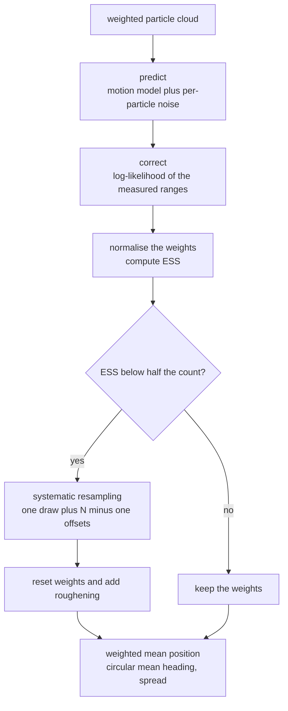
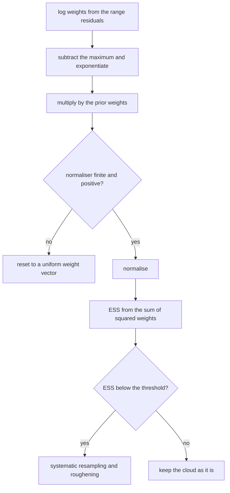
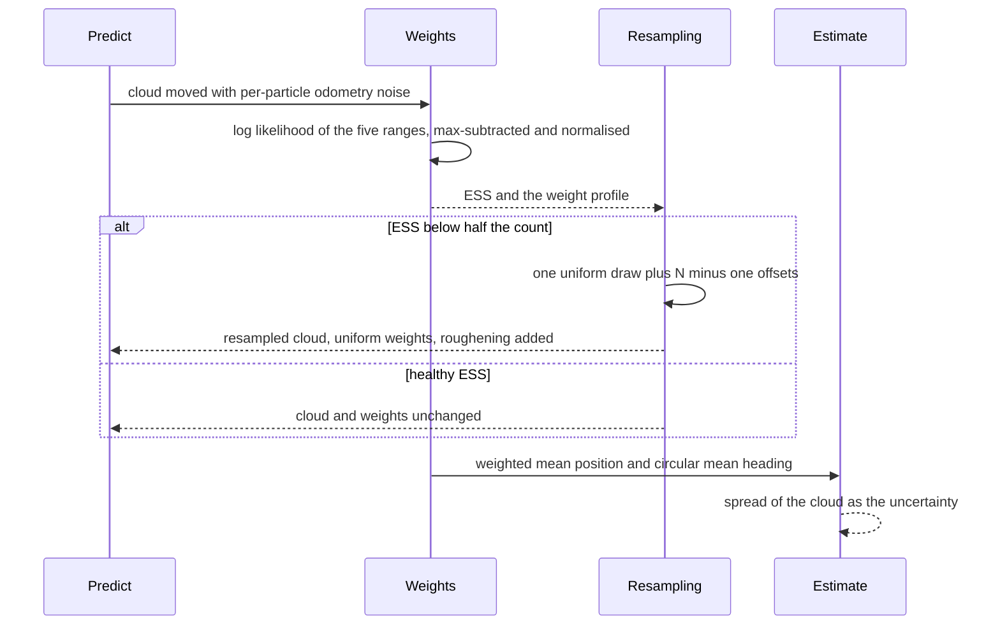

# 792 — Implement particle filter localization for robot

> **Tier:** Expert · **CTCI chapter:** Beyond — Graphics, Geometry & Robotics
> **Task spec:** [792-implement-particle-filter-localization-for-robot.md](../../../tasks/expert/792-implement-particle-filter-localization-for-robot.md)
> **Solutions:** [Python](../../../solutions/python/expert/792-implement-particle-filter-localization-for-robot/solution.py) ·
> [Java](../../../solutions/java/expert/792-implement-particle-filter-localization-for-robot/Solution.java) ·
> [JavaScript](../../../solutions/javascript/expert/792-implement-particle-filter-localization-for-robot/solution.js) ·
> [C#](../../../solutions/csharp/expert/792-implement-particle-filter-localization-for-robot/Solution.cs)

## 1. Problem restatement

**Monte-Carlo localisation** represents the belief over the pose `(x, y, theta)` with a weighted particle
set and runs one step of the classic three-stage filter:

1. **predict** — push every particle through the odometry motion model with per-particle noise;
2. **correct** — multiply each particle's weight by the Gaussian likelihood of the measured ranges,
   `w_i <- w_i * prod_k N(z_k - h_k(x_i), sigma^2)`, implemented in **log space** for stability;
3. **rescale** — normalise the weights; if the effective sample size `ESS = 1 / sum_i w_i^2` falls below half
   the particle count, resample with **systematic resampling** (one uniform draw plus `N-1` fixed offsets),
   reset the weights to `1/N` and add a little roughening noise.

The estimate is the weighted mean position and the **circular** mean heading, and the spread of the cloud is
reported as a scalar uncertainty. Measured results from the solution's own summary:

| Measurement | Value |
| --- | --- |
| from a broad uniform prior: mean error, spread | `1.159` m, `1.643` m |
| after the run: final error, spread | `0.052` m, `0.051` m |
| worst error over the uniform-prior run | `0.133` m, with `26` resamplings |
| tracking RMSE (`400` particles) | particle filter `0.0279` m, EKF `0.0237` m, worst disagreement `0.0200` m |
| systematic resampling versus the weights | total-variation distance `0.1345`, ESS after the update `1500.0` |
| final spread of the 400-particle cloud | `0.0395` m |

Further assertions: ESS equals `N` for a uniform cloud and exactly `1` for a point mass, weights stay
normalised and inside `[0, 1]` after every update, systematic resampling realises every weight to within
**one particle** (histogram deviation below `1`), it keeps the particle count and does not move the cloud
mean appreciably (within `0.1` m), a single range update from a flat prior already localises the robot to
`0.5` m, the filter tracks within `0.3` m of an independently written EKF, an impossible measurement stream
(`40` m ranges) leaves finite normalised weights, and an identical seed reproduces every estimate bit for
bit.

## 2. Intuition

The Kalman filter of task 791 assumes a Gaussian belief and a locally linear model. Monte-Carlo
localisation makes no such assumption: it represents *any* belief by a set of samples and lets the
measurements do the shaping.

1. **Particles are hypotheses.** Each is a full pose; the cloud's *density* is the belief. A broad uniform
   prior is just a uniformly scattered cloud, and a converged belief is a tight cluster — the same code
   handles both, which is why MCL recovers from global uncertainty where an EKF cannot even be initialised.
2. **Weights multiply likelihoods, in log space.** The weight of a particle is the product of the range
   likelihoods; multiplying dozens of small probabilities underflows, so the sum of squared differences is
   accumulated and exponentiated once, after subtracting the maximum.
3. **Resampling is what moves the belief.** Weights concentrate probability mass on good hypotheses but do
   not remove bad ones; resampling draws a new set from the weighted distribution, which is what makes the
   cloud converge. **Systematic** resampling does it with one uniform draw and `N-1` evenly spaced offsets,
   which is low-variance and bias-free — and the checks measure that directly: each weight is realised to
   within one particle, and the total-variation distance to the ideal weighted distribution is `0.1345`.
4. **Roughening prevents impoverishment.** After a resample the cloud contains many duplicates; adding a
   little Gaussian noise keeps it able to explore.



## 3. Algorithm

1. **Model.** `motion_model(pose, velocity, turn_rate, dt, noise_v, noise_w)` advances the differential-drive
   pose with noise applied to the controls; `range_vector(pose, landmarks)` predicts the five ranges.
2. **Construction.** `ParticleFilter(count, landmarks, sigma_r, dt, noise_v, noise_w, seed)` can be
   initialised either `initialise_uniform(x_range, y_range)` (heading uniform over the circle) or
   `initialise_at(pose, sigma_xy, sigma_theta)` (Gaussian around a nominal pose, used for the EKF
   comparison run).
3. **Predict.** Every particle is moved; noise is drawn per particle and per step, so the cloud spreads
   according to the odometry uncertainty.
4. **Correct.** For each particle, accumulate `sum_k (z_k - h_k)^2`, scale by `-1 / (2 sigma_r^2)`, subtract
   the maximum, exponentiate, multiply by the prior weight and normalise with `math.fsum`. If the normaliser
   is not finite and positive (all weights underflowed), the weights are reset to uniform — this is the
   "impossible measurement" safety path. `ESS = 1 / sum w^2` is recomputed from the normalised weights.
5. **Resample.** `systematic_resample()` draws one uniform `start`, builds the cumulative weight array, and
   walks `N` evenly spaced targets, appending the particle whose cumulative weight first exceeds each target.
   `resample(roughening)` wraps it: it records the weighted mean before, replaces the set, resets weights to
   `1/N`, restores `ESS = N`, counts the event and (if roughening is positive) perturbs every particle
   position and heading.
6. **Estimate.** `weighted_mean()` returns the mean `x`, `y` and the circular mean heading
   (`atan2(sum w sin theta, sum w cos theta)`); `spread()` returns the weighted RMS distance from the mean.
7. **Step.** `step(velocity, turn_rate, measurement, threshold=0.5, roughening=0.0)` chains predict, correct
   and conditional resample.
8. **Comparison filter.** `RangeEKF` is an independently written range-only EKF with the same prior, used as
   the baseline the particle filter must match.

```text
procedure update(measurement)
    for every particle do
        total ← sum over landmarks of (measured range minus predicted range)^2
        logWeight ← -total / (2 * sigmaR^2)
    top ← the largest logWeight
    weights ← exp(logWeight - top) * priorWeight for every particle
    normaliser ← sum of weights
    if normaliser is not positive or not finite then
        weights ← uniform 1/N                                  // impossible measurement
    else
        weights ← weights / normaliser
    ess ← 1 / sum over particles of weight^2

procedure systematicResample()
    state, start ← uniform(state)
    start ← start / count
    cumulative ← running sums of the weights
    index ← 0
    positions ← empty
    for k in 0 .. count - 1 do
        target ← start + k / count
        while cumulative[index] < target and index < count - 1 do
            index ← index + 1
        positions.append(particles[index])
    return positions

procedure resample(roughening)
    before ← weightedMean()
    particles ← systematicResample()
    weights ← uniform 1/N
    ess ← count
    resamplings ← resamplings + 1
    if roughening > 0 then
        perturb every particle with a Gaussian of that scale in x, y and heading

procedure step(velocity, turnRate, measurement, threshold, roughening)
    predict(velocity, turnRate)
    update(measurement)
    if ess < threshold * count then resample(roughening)
    return weightedMean()
```



## 4. Worked example

**(a) One update from a flat prior already localises.** `ParticleFilter(200, ...)` initialised uniformly
over `[-1, 1]^2` is updated with the *exact* range vector of the pose `(0, 0, 0)`:

| Check | Requirement | Reason |
| --- | --- | --- |
| weights normalised | sum `= 1` within `1e-12` | the update always renormalises |
| ESS | below `0.5 * 200 = 100` | a sharp measurement is expected to collapse the ESS |
| highest-weight particle | within `0.2` m of `(0, 0, 0)` | the best hypothesis must be the right one |

Five ranges from a known map over-determine the planar pose, so a single measurement concentrates the mass
strongly — which is precisely why the resampling branch exists.

**(b) Convergence from a broad prior.** With 1500 particles over `[-2, 2]^2` the initial state is hopeless:
mean error `1.159` m and spread `1.643` m. After the 40-step run:

| Stage | Mean error | Spread |
| --- | --- | --- |
| uniform prior | `1.159` m | `1.643` m |
| after one range update | below `0.5` m (asserted) | collapsing |
| final | `0.052` m | `0.051` m |

The worst error over the whole run is `0.133` m, the cloud stays within `0.35` m of its own mean, and `26`
resamplings were triggered by the ESS rule — so the convergence is not the result of one lucky update.

**(c) Systematic resampling, measured.** The check builds a smooth weight profile over the 200-particle
cloud, resamples once and histogram-counts how many times each particle was drawn:

| Quantity | Value |
| --- | --- |
| histogram deviation from `N * w_i` | below `1` particle, always |
| total-variation distance to the weights | `0.1345` |
| particle count after resampling | unchanged (`200`) |
| shift of the weighted mean | below `0.1` m in both coordinates |

The sub-one-particle bound is the signature of systematic resampling: because the targets are evenly
spaced, each weight is realised with error strictly less than one copy, whereas multinomial resampling
would give a `sqrt(N p (1-p))` spread. The residual TV distance of `0.1345` is the mass in weights smaller
than `1/N`, which no integer histogram can represent.

**(d) Against an independent EKF on the same measurement stream.** From the same prior `(1.0, 0.6, 0.0)`:

| Filter | Position RMSE | Comment |
| --- | --- | --- |
| particle filter (400 particles) | `0.0279` m | no linearisation, no Gaussian assumption |
| independent EKF | `0.0237` m | linearises the range model |
| worst disagreement after the transient | `0.0200` m | the two agree, so neither is diverging |

The check requires the particle filter's RMSE to be below `1.6 ×` the EKF's — the sampling filter is
allowed to be slightly worse, because it pays Monte-Carlo noise instead of linearisation error, but it must
not be in a different regime. The final spread of `0.0395` m is reported alongside, since a filter that
claimed the right answer with a huge cloud would be suspicious in the other direction.



## 5. Complexity

Let `N` be the particle count, `K` the number of landmarks (5 here), `T` the number of steps and `R` the
number of resamplings.

| Operation | Best | Average | Worst | Why the bound holds |
| --- | --- | --- | --- | --- |
| `predict` | O(N) | O(N) | O(N) | one motion-model evaluation and two Gaussian draws per particle |
| `update` | O(N K) | O(N K) | O(N K) | one range vector and one likelihood per particle; the max-subtraction adds an `O(N)` pass |
| `systematic_resample` | O(N) | O(N) | O(N) | one cumulative pass and one monotone index walk that never goes backwards |
| `resample` with roughening | O(N) | O(N) | O(N) | three Gaussian draws per particle |
| `weighted_mean` / `spread` | O(N) | O(N) | O(N) | weighted sums including the circular mean |
| one `step` | O(N K) | O(N K) | O(N K + N) | dominated by the likelihood evaluation; resampling is triggered by the ESS rule |
| full run | O(T N K) | O(T N K + R N) | same | 40 steps with 400–1500 particles in the checks |
| EKF baseline | O(T K) | same | same | `3x3` covariance arithmetic; this is the cost the particles buy their generality with |
| Space | O(N) | O(N) | O(N) | the cloud and the weight vector; the EKF needs `O(1)` state |

Comparison with the alternatives:

| Approach | Belief | Global initialisation | Cost per step |
| --- | --- | --- | --- |
| Particle filter (this task) | arbitrary, sampled | yes, from a uniform cloud | `O(N K)` |
| EKF | single Gaussian | no (needs a unimodal prior) | `O(K)` |
| Histogram filter | fixed grid | yes | exponential in the pose dimension |
| EKF-SLAM ([791](../../../tasks/expert/791-implement-slam-small-demo-with-extended-kalman-filter-ekf-slam.md)) | joint Gaussian over pose and map | no | `O((3 + 2M)^2)` |

## 6. Pitfalls and edge cases

- **Weights must be normalised after every update.** The checks assert the sum is `1` within `1e-12` and that
  every weight lies in `[0, 1]`; a stale normalisation silently biases the estimate.
- **ESS boundaries.** A uniform cloud has `ESS = N` exactly, a point mass has `ESS = 1` exactly, and `ESS`
  can never exceed `N`; the point-mass case is constructed directly by hand in the checks.
- **Impossible measurements must not produce `NaN`.** With ranges of `40` m every likelihood underflows, so
  the code resets to uniform weights (or skips the update) and renormalises; the check asserts finiteness
  and normalisation afterwards.
- **Log-space arithmetic is required.** Subtracting the maximum log weight before exponentiating is what
  keeps `exp` in range; a direct product of five Gaussian densities over dozens of steps underflows.
- **The heading is a circle.** The estimate uses the circular mean, and the motion model wraps into
  `(-pi, pi]`; an arithmetic mean of headings fails at the `±pi` boundary, which is exactly where a robot
  driving a loop spends its time.
- **Resampling must not move the mean.** The check requires the weighted mean before and after resampling
  to agree within `0.1` m; a broken cumulative-index walk (for example, not resetting the index or using
  strict inequalities inconsistently) shows up here immediately.
- **Sub-`1/N` weights cannot be represented.** The histogram deviation must stay below one particle and the
  TV distance below `0.25`; the measured `0.1345` is the tail mass that integer counts inevitably lose, so
  the bound is deliberate rather than tight.
- **Roughening is only applied after a resample.** Adding noise on every step would inflate the cloud
  permanently; the parameter is passed into `resample` for that reason.
- **Degenerate clouds.** A single particle tuple, a 40-particle cloud that is resampled immediately, and a
  zero-length run are all exercised; `initialise_at` with `sigma_xy = 0.05` gives a nearly point-mass cloud.
- **Determinism.** Every draw comes from `splitmix64` (Box-Muller for Gaussians), so the run is
  bit-reproducible including the number of resampling events — asserted explicitly.
- **Documented simplifications.** Range-only sensing to four/five point landmarks with no ray casting, no
  field-of-view model, no adaptive particle count, and a fixed count of a few hundred particles.

## 7. Variants and follow-ups

- **Adaptive particle counts** (KLD sampling) allocate particles in proportion to the belief's complexity,
  which matters when the cloud must first cover a whole building and then track a corridor.
- **Better proposals.** Sampling from the measurement likelihood (or a mixture) rather than the motion
  model reduces the number of particles needed by orders of magnitude.
- **Beam models and field of view.** Real range sensors see walls, not point landmarks, so the likelihood
  becomes a beam or likelihood-field model over a map — the same filter with a different `h`.
- **FastSLAM.** Use the particles for the trajectory and a small EKF per landmark, which is how the particle
  idea scales to mapping as well as localisation.
- **Related tasks.** [791 — EKF-SLAM](../../../tasks/expert/791-implement-slam-small-demo-with-extended-kalman-filter-ekf-slam.md)
  is the Gaussian counterpart; [783 — mean-field variational inference](../../../tasks/expert/783-implement-variational-inference-simple-mean-field-for-mixture-mo.md)
  and [784 — Gibbs sampling](../../../tasks/expert/784-implement-gibbs-sampling-for-topic-models-lda-small-dataset.md)
  approximate posteriors by optimisation and by sampling respectively, which are the same two philosophies
  as here.

## 8. Check yourself

<details><summary>Show answer</summary>
**Why does the ESS threshold trigger resampling at half the particle count?** The effective sample size
`1 / sum w_i^2` estimates how many particles actually carry the belief. When it falls below `N/2`, so much
mass sits on a few particles that the rest contribute nothing, and continuing to propagate them wastes
computation while the cloud loses diversity. Resampling concentrates the cloud on the surviving hypotheses;
doing it too often causes sample impoverishment, hence the hysteresis of a `0.5` threshold.
</details>

<details><summary>Show answer</summary>
**What is the advantage of systematic over multinomial resampling?** Both are unbiased, but systematic
resampling uses one random number and evenly spaced targets, so the number of copies of a particle differs
from `N w_i` by less than one — the check measures exactly that bound. Multinomial resampling draws `N`
independent indices, so each count has variance `N w_i (1 - w_i)` and the cloud mean wanders more for the
same number of particles.
</details>

<details><summary>Show answer</summary>
**The measurement is range-only to known landmarks. Why does one update already localise the robot to within
`0.5` m?** Five ranges to five landmarks over-determine a planar pose (three unknowns, five constraints), and
the *simultaneous* comparison rejects hypotheses that satisfy any single range. A flat prior still has many
particles in the right place, and the likelihood concentrates on them; a range-only system with a single
landmark would leave a whole circle of equally good hypotheses.
</details>

<details><summary>Show answer</summary>
**An impossible measurement (all ranges `40` m) arrives. What should the filter do, and what does
"impossible" mean here?** Every particle is so unlikely that the log weights underflow, so the code detects a
non-finite or zero normaliser and falls back to a uniform weight vector, keeping the cloud intact for the
next step. In a real system the same situation is usually a sensor fault or a data-association error, and
the correct response is to treat the measurement as an outlier rather than to reject the whole hypothesis
set — which is why the weights are reset instead of the run being aborted.
</details>

<details><summary>Show answer</summary>
**The particle filter's RMSE (`0.0279` m) is slightly worse than the EKF's (`0.0237` m) here. When would the
particle filter win?** When the belief is not Gaussian or the initial uncertainty is large: an EKF cannot
represent a bimodal belief (a symmetric corridor) or recover from a global prior, while a particle cloud can
hold several hypotheses at once and let the measurements eliminate them. The test therefore only requires
the particle filter to stay within `1.6 ×` the EKF on a well-behaved problem, and separately requires it to
converge from a uniform prior where the EKF is not even initialisable.
</details>
