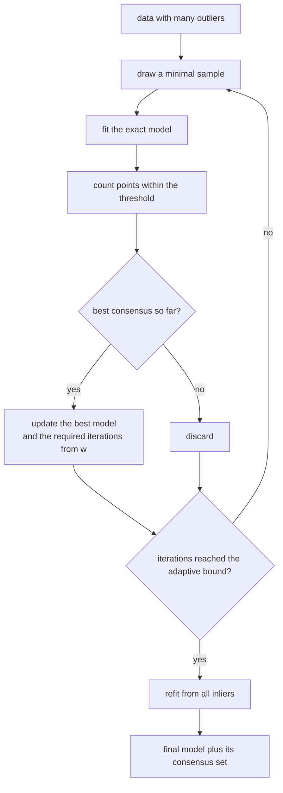
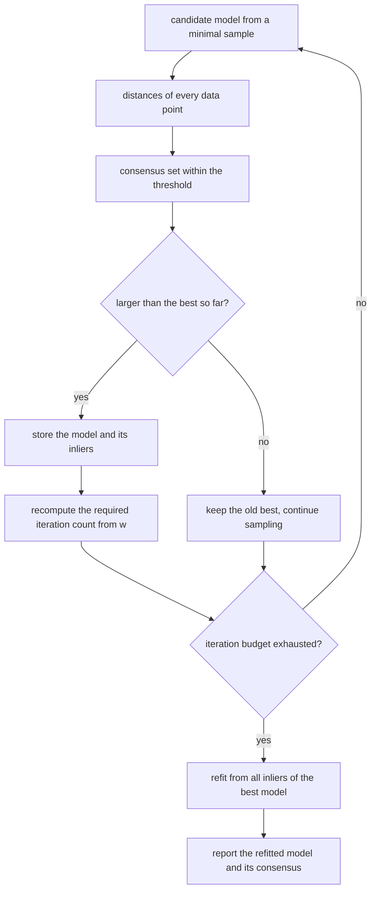
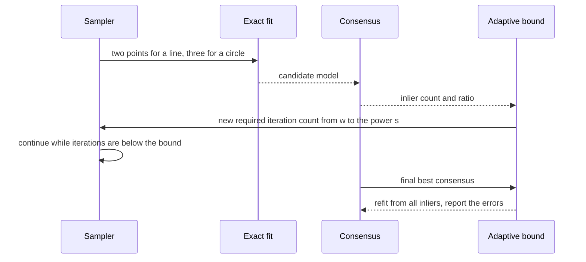

# 793 — Implement RANSAC-based robust model fitting for line/circle detection

> **Tier:** Expert · **CTCI chapter:** Beyond — Graphics, Geometry & Robotics
> **Task spec:** [793-implement-ransac-based-robust-model-fitting-for-line-circle-dete.md](../../../tasks/expert/793-implement-ransac-based-robust-model-fitting-for-line-circle-dete.md)
> **Solutions:** [Python](../../../solutions/python/expert/793-implement-ransac-based-robust-model-fitting-for-line-circle-dete/solution.py) ·
> [Java](../../../solutions/java/expert/793-implement-ransac-based-robust-model-fitting-for-line-circle-dete/Solution.java) ·
> [JavaScript](../../../solutions/javascript/expert/793-implement-ransac-based-robust-model-fitting-for-line-circle-dete/solution.js) ·
> [C#](../../../solutions/csharp/expert/793-implement-ransac-based-robust-model-fitting-for-line-circle-dete/Solution.cs)

## 1. Problem restatement

Fit a line or a circle to data in which **most of the points are gross outliers**, by repeating
hypothesise-and-verify:

1. draw a **minimal sample** (2 points for a line, 3 for a circle);
2. fit the exact model through it (closed form);
3. count how many points agree within a threshold — the **consensus set**;
4. keep the best consensus, and re-estimate the model from **all** its inliers.

The number of iterations is not fixed. After a model with inlier ratio `w` is found, a minimal sample of
size `s` is all-inlier with probability `w^s`, so

```text
N = ceil( log(1 - confidence) / log(1 - w^s) )
```

iterations suffice for the requested confidence; the loop recomputes `N` whenever the best consensus
improves. Measured results from the solution's own summary:

| Measurement | Value |
| --- | --- |
| line with 60% outliers | `24` iterations (the closed form is also `24`), consensus `42 / 100`, angle error `9.81e-04` rad, offset error `3.50e-03` |
| circle with 60% outliers | `56` iterations, consensus `43 / 100`, centre error `3.81e-03`, radius error `1.19e-03` |
| exhaustive oracle on a small instance | RANSAC consensus `6` versus the brute-force optimum `6` |
| required iterations at `w = 0.2` and `w = 0.8` | `113` and `5` |

Further assertions: the recovered line's **angle** error is below `0.01` rad and its offset below `0.05`; the
consensus set matches the true inliers with a Jaccard index above `0.9` and contains at least `38` of the
`40` true inliers; the circle's centre and radius are recovered to better than `0.02`; **refitting on the
inliers never increases** the inlier error; collinear triples and coincident pairs return `None` rather than
a nonsense model; three collinear points, a single-point refit, a noiseless circle (refit to `1e-9`) and the
`ValueError` cases all behave; and repeated runs with the same seed are identical.

## 2. Intuition

Least squares minimises a sum of squares, which makes a single gross outlier able to drag the fit
arbitrarily far — the failure mode is unbounded, not merely degraded. RANSAC inverts the logic: instead of
optimising against all the data, it *guesses* a model from the smallest possible sample and then asks how
much of the data agrees.

Three ideas make it work:

1. **Small samples are cheap to be wrong about.** For a line, two points determine a model exactly, so a
   wrong guess costs nothing — and if `w` is the inlier fraction, a random pair is clean with probability
   `w^2`. With `60%` outliers (`w = 0.4`) that is `0.16`, and the closed form says `24` iterations buy `99%`
   confidence; with `80%` inliers (`w = 0.8`) five iterations suffice. That dependence is what the checks
   measure (`113` versus `5`).
2. **The consensus set is where the statistics come from.** Once a model has been found, its inlier ratio is
   a *measurement*, and the adaptive loop uses it to stop instead of running a fixed budget.
3. **Refit last.** The minimal-sample fit is exact through two or three noisy points, which is a poor
   estimate. After the consensus is known, fitting to **all** inliers (total least squares for the line,
   Kasa's algebraic fit for the circle) turns the guess into a maximum-likelihood estimate — and the check
   requires the inlier error to *decrease*, never increase.



## 3. Algorithm

1. **Line from two points.** `fit_line(points)` returns `(a, b, c)` with `a^2 + b^2 = 1` and
   `a x + b y + c = 0`, using the unit normal of `q - p`; it returns `None` when the points coincide
   (`|q - p| < 1e-12`). `line_distance` is then just `|a x + b y + c|`.
2. **Circle from three points.** `fit_circle(points)` solves the circumcircle through the three points with
   a `2x2` Cramer determinant; the guard `|d| < 1e-10` rejects collinear triples instead of returning an
   infinite radius. `circle_distance` is `| |p - c| - r |`.
3. **Refits.** `refit_line(points)` is total least squares: centroid plus the minor principal axis of the
   `2x2` covariance (a closed-form eigenvalue). `refit_circle(points)` is the Kasa algebraic fit, solving a
   `3x3` system (`solve3`, Gaussian elimination with partial pivoting) for `(cx, cy, r^2 - c^2)` and
   rejecting a radius below `1e-9`.
4. **Adaptive RANSAC.** `ransac(points, sample_size, fit, distance, threshold, confidence=0.99,
   max_iterations=400, seed=1, refit=None)`: validate (`ValueError` for too few points or a non-positive
   threshold), then loop while `iterations < min(required, max_iterations)`, drawing **distinct** indices
   from `splitmix64`, fitting, counting inliers, and — on an improvement — recording the model, the inlier
   list, the inlier sum of squares, and recomputing `required` from the new ratio.
5. **Refit phase.** If a `refit` callable was supplied and at least `sample_size` inliers exist, refit on
   them, recount the consensus for the refitted model, and report `refit`, `refit_inliers` and
   `refit_error` alongside the sample-based values.
6. **Oracles and metrics.** `required_iterations(ratio, sample_size, confidence=0.99)` is the closed form the
   loop must match; `exhaustive_best(points, ...)` enumerates **every** minimal subset (tiny instances only)
   as the ground-truth consensus size; `jaccard` compares consensus sets.

```text
procedure ransac(points, sampleSize, fit, distance, threshold, confidence, maxIterations, seed, refit)
    require length(points) >= sampleSize and threshold > 0
    bestInliers ← empty
    bestModel ← none
    required ← maxIterations
    iterations ← 0
    while iterations < min(required, maxIterations) do
        indices ← sampleSize distinct indices drawn from the deterministic generator
        model ← fit(points of indices)
        iterations ← iterations + 1
        if model is none then continue
        inliers ← every index whose distance(model, point) <= threshold
        if length(inliers) > length(bestInliers) then
            bestInliers ← inliers
            bestModel ← model
            ratio ← length(inliers) / length(points)
            required ← 1 if ratio >= 1
                       else ceil(log(1 - confidence) / log(max(1e-15, 1 - ratio^sampleSize)))
    require a model was found
    if refit is supplied and length(bestInliers) >= sampleSize then
        candidate ← refit(points of bestInliers)
        if candidate is not none then
            report candidate, its consensus and its inlier error
    return bestModel, bestInliers, iterations, required

procedure requiredIterations(ratio, sampleSize, confidence)
    if ratio >= 1 then return 1
    return ceil(log(1 - confidence) / log(max(1e-15, 1 - ratio^sampleSize)))
```



## 4. Worked example

**(a) A line behind 60% outliers.** `make_line_data(793001)` builds `40` points near `y = 0.4 x + 0.7`
(Gaussian noise `0.01`, `x` spread over `[-2, 2]`) and `60` points uniform in `[-3, 3]^2`. With
`threshold = 0.05` the measured run is

| Quantity | Value |
| --- | --- |
| iterations used | `24` |
| required by the closed form | `24` |
| consensus size | `42` (of which `38+` must be true inliers) |
| angle error of the refitted line | `9.81e-04` rad |
| offset error (after aligning the sign) | `3.50e-03` |

The consensus of `42` is larger than the `40` planted inliers: a few outliers happen to lie within `0.05` of
the line, and that is expected — RANSAC's contract is a consensus *count*, not a label. The sign alignment
matters: `(a, b, c)` and `(-a, -b, -c)` describe the same line, so `align_line_sign` picks the branch before
the offset is compared.

**(b) The adaptive bound, and why `w` is the whole story.** The number of iterations is not a constant:
`required_iterations(0.2, 2) = 113` while `required_iterations(0.8, 2) = 5`, and for a fixed ratio a larger
minimal sample needs more iterations (`required_iterations(0.5, 3) > required_iterations(0.5, 2)`), because
`w^s` shrinks. The loop recomputes this number from the *best consensus found so far*, so it starts with the
full budget and shortens as evidence accumulates — which is why the measured `24` equals the closed form for
the ratio the algorithm actually achieved.

**(c) A circle behind the same outliers.** `make_circle_data(793002)` plants `40` points on a circle of
radius `1.2` centred at `(0.5, -0.3)` (points spread evenly in angle, radial noise `0.01`) plus `60` outliers:

| Quantity | Value |
| --- | --- |
| iterations | `56` |
| consensus | `43 / 100` |
| centre error after the Kasa refit | `3.81e-03` |
| radius error | `1.19e-03` |

Both errors are far below the `0.02` the checks require. The Kasa refit is doing the work here: a
three-point circumcircle through noisy points has a much larger error, and the refit uses all `43` inliers.
For a *noiseless* circle the same refit reaches machine precision (radius error below `1e-9`), which shows
the algebraic fit itself is consistent.

**(d) An exhaustive oracle for the consensus.** On a small instance (6 inliers, 6 outliers) the solution
enumerates **all** `C(12, 3) = 220` triples, fits each, and records the best consensus:

| Quantity | Value |
| --- | --- |
| brute-force best consensus | `6` |
| RANSAC consensus | `6` |
| error of the exhaustive best circle | below `0.05` |

This is the strongest check in the file: it establishes that the random sampling reached the *provably
optimal* consensus on that instance, rather than merely producing a small residual. It is also why the
instance must be tiny — the oracle costs `O(C(n, s))` fits, which grows fast.



## 5. Complexity

Let `n` be the number of points, `s` the minimal sample size, `I` the number of iterations and `k` the
consensus size.

| Operation | Best | Average | Worst | Why the bound holds |
| --- | --- | --- | --- | --- |
| `fit_line` / `fit_circle` | O(1) | O(1) | O(1) | fixed-size closed forms (a `2x2` or `3x3` solve) |
| one iteration | O(n) | O(n) | O(n) | every point is tested against the candidate model |
| `ransac` | O(I n) | O(I n) | `O(max_iterations · n)` | the adaptive bound shrinks `I` as soon as a good consensus appears; measured `24` and `56` iterations |
| `refit_line` | O(k) | O(k) | O(k) | one pass for the covariance, then a closed-form `2x2` eigenproblem |
| `refit_circle` | O(k) | O(k) | O(k) | accumulate the `3x3` normal matrix and solve it |
| `exhaustive_best` (oracle) | O(C(n, s) n) | same | same | all minimal subsets, each scored against all points — hence the tiny instance |
| `required_iterations` | O(1) | O(1) | O(1) | a closed-form logarithm |
| Space | O(n) | O(n) | O(n) | the points plus the inlier list |

Comparison with the alternatives:

| Method | Robust to outliers | Cost | Notes |
| --- | --- | --- | --- |
| Least squares | no (unbounded breakdown) | O(n) | a single outlier can move the fit arbitrarily |
| RANSAC (this task) | yes, up to a large outlier fraction | O(I n) | needs a threshold and a confidence; the docstrings note the threshold is a fixed user parameter here rather than estimated from the residuals |
| Least median of squares | yes | much larger | minimises a median instead of counting inliers |
| Hough transform | yes | grid-dependent | needs quantisation of the parameter space |

## 6. Pitfalls and edge cases

- **Degenerate minimal samples.** Three collinear points have no circle (`fit_circle` returns `None` when
  `|d| < 1e-10`) and two coincident points have no line; the loop simply skips a `None` model and tries
  again, which the checks exercise directly.
- **Distinct sample indices.** The sampler tracks a `seen` set, so a "minimal sample" can never contain the
  same point twice — a duplicate would produce a degenerate model and, worse, bias the sampling.
- **The threshold is a parameter, not an estimate.** `ransac` raises `ValueError` for a non-positive
  threshold, and the docstrings record that automatic scale estimation is deliberately out of scope.
- **`max_iterations` caps the adaptive bound.** The loop runs `min(required, max_iterations)` iterations, so
  a pathological ratio cannot make the run unbounded; if no model is ever found, the function raises.
- **Sign and orientation ambiguity.** A line `(a, b, c)` equals `(-a, -b, -c)`, and the angle comparison
  folds via the absolute dot product into `[0, pi/2]`; comparisons must handle both or the reported error
  can be `pi` instead of `0`.
- **Refitting must not make things worse.** The check requires `refit_error <= sample_error + 1e-12`; a refit
  that increases the inlier error would mean the consensus and the refit are computed with different
  thresholds or different distance functions.
- **A tight threshold shrinks the consensus.** The Java variant notes that a wrong threshold is reported
  honestly (the result carries its own inlier count and support) rather than papered over with a fabricated
  fit — the consensus count is the diagnostic.
- **Confidence semantics.** `confidence = 0.99` is the probability of drawing at least one all-inlier
  sample, not a guarantee about the *accuracy* of the resulting model; the accuracy comes from the refit.
- **Determinism.** Sampling uses `splitmix64`, so the same seed gives the same sample sequence, the same
  consensus and the same iteration count — asserted on a repeat run.
- **Documented simplifications.** A fixed user threshold rather than an automatic scale estimate, no
  LO-RANSAC or PROSAC local optimisation, and the brute-force oracle is confined to a tiny instance because
  it enumerates all subsets.

## 7. Variants and follow-ups

- **Lo-RANSAC.** After a good model is found, run a local optimisation (a few inner iterations on the
  current consensus) to improve the model before recounting inliers; it accelerates the search markedly on
  hard instances.
- **PROSAC / guided sampling.** Order the samples by a quality score and draw preferentially from promising
  points instead of uniformly.
- **Robust loss instead of a hard threshold.** A soft weight (Huber, Cauchy, or MSAC's truncated quadratic)
  removes the cliff at the threshold, at the cost of extra parameters.
- **Multiple models.** Sequential RANSAC (fit, remove inliers, repeat) detects several lines or circles in
  one image; the sign ambiguity and the residual threshold both need care across iterations.
- **Related tasks.** [789 — ICP registration](../../../tasks/expert/789-implement-shape-matching-registration-icp-iterative-closest-poin.md)
  uses the same robust-estimation mindset for uncertain correspondences;
  [794 — point cloud voxelization and octree](../../../tasks/expert/794-implement-3d-point-cloud-voxelization-and-octree-building.md)
  is the spatial structure that makes the nearest-neighbour counterpart fast; and
  [795 — LSH parameter tuning](../../../tasks/expert/795-implement-advanced-lsh-parameter-tuning-for-recall-precision.md)
  trades recall against verification cost the same way the iteration bound here trades confidence against
  work.

## 8. Check yourself

<details><summary>Show answer</summary>
**Where does the formula `N = log(1 - confidence) / log(1 - w^s)` come from?** A single sample is all-inlier
with probability `w^s`, so it fails with probability `1 - w^s`; `N` independent samples all fail with
probability `(1 - w^s)^N`. Setting that below `1 - confidence` and taking logarithms gives the expression.
The identity is also why the loop can *shorten* its budget: the `w` it uses is the best ratio observed so
far, which can only be an underestimate of the truth early on.
</details>

<details><summary>Show answer</summary>
**Why does the consensus have `42` members when only `40` points are true inliers?** Because the consensus
counts every point within the threshold of the fitted line, and unrelated points can be that close. The
checks handle this by requiring a *Jaccard index above `0.9`* against the true inlier labels and at least
`38` of the `40` true inliers, rather than demanding an exact match; the extra points are a property of the
threshold, not a bug.
</details>

<details><summary>Show answer</summary>
**What does the refit buy, and how is it proven?** The minimal-sample model is exact through two or three
noisy points, so it can be far from the truth even when the consensus is correct. Refitting on all inliers
averages the noise down, and the check requires the inlier sum of squares to be no larger after the refit —
so the improvement is measured rather than asserted in prose. The worked example shows the payoff: centre
and radius errors of a few thousandths on data where 60% of the points are garbage.
</details>

<details><summary>Show answer</summary>
**The exhaustive oracle enumerates every minimal subset. Why is that a stronger check than comparing the
residual with a tolerance?** Because it establishes optimality of the *consensus*, which is the objective
RANSAC actually optimises: a small residual can be produced by a model that agrees with only a handful of
points, while a large consensus is what the algorithm claims to find. On the small instance RANSAC reaches
the brute-force optimum `6`, so the sampling plus the adaptive bound are shown to explore enough of the
hypothesis space.
</details>

<details><summary>Show answer</summary>
**Why can three collinear points not define a circle, and what should the code do?** The circumcircle
determinant vanishes because the three points are affinely dependent, so the radius would be infinite. The
fit returns `None`, and the RANSAC loop simply discards that sample — an important detail, because a naive
implementation would divide by a near-zero determinant and produce a huge bogus radius that could still
collect inliers along the collinear structure.
</details>
