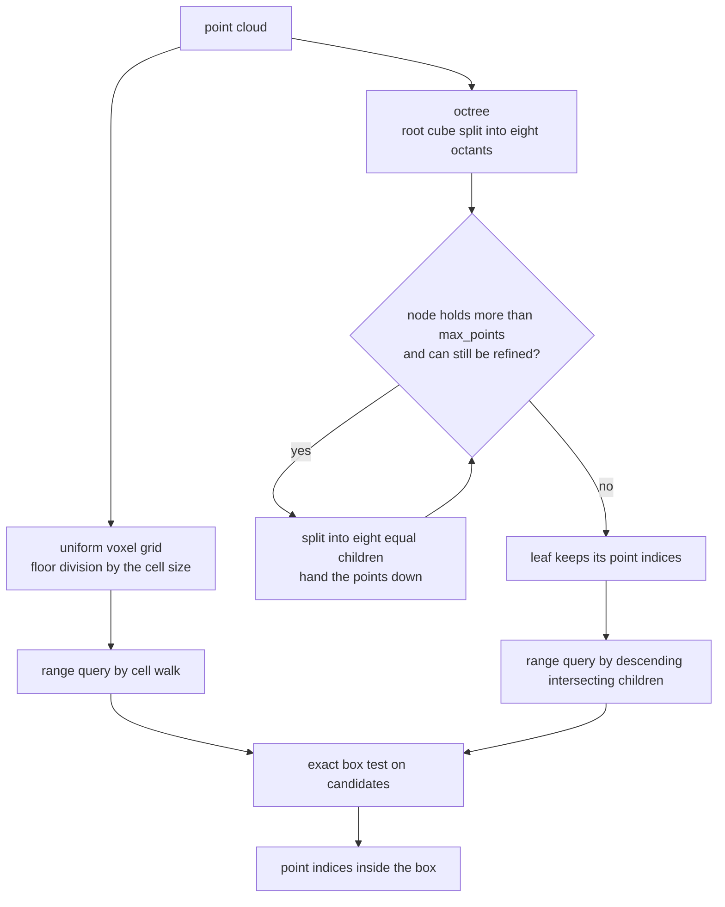
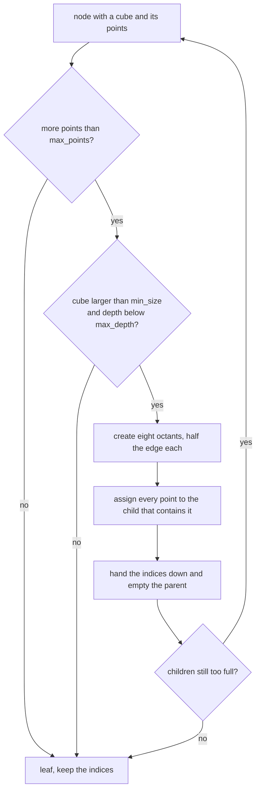
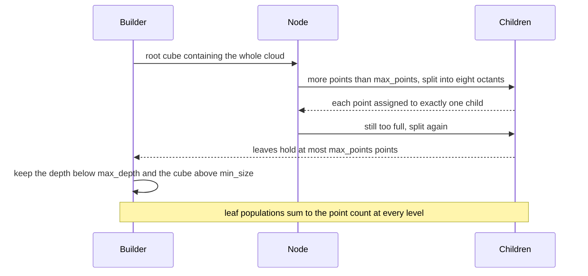

# 794 — Implement 3D point cloud voxelization and octree building

> **Tier:** Expert · **CTCI chapter:** Beyond — Graphics, Geometry & Robotics
> **Task spec:** [794-implement-3d-point-cloud-voxelization-and-octree-building.md](../../../tasks/expert/794-implement-3d-point-cloud-voxelization-and-octree-building.md)
> **Solutions:** [Python](../../../solutions/python/expert/794-implement-3d-point-cloud-voxelization-and-octree-building/solution.py) ·
> [Java](../../../solutions/java/expert/794-implement-3d-point-cloud-voxelization-and-octree-building/Solution.java) ·
> [JavaScript](../../../solutions/javascript/expert/794-implement-3d-point-cloud-voxelization-and-octree-building/solution.js) ·
> [C#](../../../solutions/csharp/expert/794-implement-3d-point-cloud-voxelization-and-octree-building/Solution.cs)

## 1. Problem restatement

Build the two classic spatial structures over a 3D point cloud and make both answer the same query —
"which points lie inside this box?":

- **voxel grid**: map each point to the integer cell
  `(floor(x/s), floor(y/s), floor(z/s))` of a uniform grid of size `s`, giving `O(1)` neighbourhood
  lookups, deduplication and a fixed memory footprint per cell;
- **octree**: the adaptive version — a node owns an axis-aligned cube and the points inside it, and splits
  into eight octants whenever it holds more than `max_points` points and is still larger than `min_size`, so
  dense regions are refined while empty space costs a single node.

Measured results from the solution's own summary for 64 points at voxel size `0.25`:

| Measurement | Value |
| --- | --- |
| voxel grid | `61` occupied cells, worst half-cell offset `0.1241` |
| octree | `73` nodes, `64` leaves, maximum depth `2`, largest leaf `3` points |
| range queries | `12` random boxes, `0` mismatches against brute force |
| refinement | `9` nodes at `max_points = 16` versus `105` nodes at `max_points = 2` |

Further assertions: every point is found in the cell its floor index names and lies within **half a cell** of
that cell's centre; the voxel counts and the octree **leaf populations both sum to the point count**; every
point stored in a node lies inside that node's cube; the eight children of a split node **partition the
parent exactly** (half the edge length, child volumes summing to the parent's); leaf capacity is respected
wherever refinement was still allowed; boundary assignment is deterministic for points exactly on a border
and for negative coordinates; and empty, single-point and all-coincident clouds degenerate gracefully.

## 2. Intuition

A point cloud is a list; almost every spatial question — collision, radius search, downsampling, surface
reconstruction — needs neighbourhoods, and a linear scan per query is too slow. Two structures solve this at
opposite ends.

1. **The uniform grid is exact and trivial.** `floor` division maps a point to a cell, so a point's
   neighbours are in its own cell or one of the 26 adjacent ones, and a range query becomes a walk over an
   integer cell range. The price is that the grid is *not* adaptive: a cloud concentrated in one corner wastes
   the resolution elsewhere, and the memory is set by the extent divided by `s`, not by the data.
2. **The octree is adaptive.** Every split halves the edge length and produces eight children that exactly
   tile the parent's cube — that tiling is the structural invariant, and it is asserted (child volumes sum
   to the parent's volume, every child lies inside the parent's bounds). Dense regions refine until a node
   holds `max_points` or fewer, while an empty region costs exactly one node. The build stops on
   `max_points`, `min_size` or `max_depth`, so the structure is bounded in both resolution and depth.
3. **Range queries prune.** The voxel query visits the integer cells overlapping the box and then applies the
   exact box test; the octree query descends only into children whose bounds intersect the box and applies the
   exact test at the leaves. Both are verified against a brute-force scan over twelve random boxes — a
   structure that is fast but subtly wrong would show up immediately.



## 3. Algorithm

1. **Cell arithmetic.** `voxel_key(point, size)` is `math.floor` per coordinate — floor, not round, so a point
   exactly on a border belongs to the higher cell and negative coordinates floor towards minus infinity.
   `voxel_centre(key, size) = (key + 0.5) * size`.
2. **Grid build.** `voxelize(points, size)` raises `ValueError` for a non-positive size and returns a dict
   from cell to the **list of point indices in point order**, so identical points share a cell and every
   index survives.
3. **Cube search.** `containing_cube(points, pad=1e-9)` returns the smallest axis-aligned cube containing all
   points (the pad keeps border points inside the root), with a fallback `(0,0,0,1,1,1)` for an empty cloud
   and a unit edge when all points coincide.
4. **Octree build.** `build_octree(points, max_points=4, min_size=0.05, max_depth=12)` validates
   `max_points >= 1`, creates the root leaf with every index, then processes nodes on an explicit stack: a
   node splits while `len(indices) > max_points` **and** `size > min_size` **and** `depth < max_depth`;
   splitting creates the eight children from the `OCTANTS` list, assigns each point to the first child whose
   bounds contain it, hands the indices to the children and empties the parent.
5. **Traversal.** `walk(root)` is an iterative stack traversal (no recursion, so depth cannot overflow the
   Python stack); `leaves(root)`, `node_count(root)` and `max_depth(root)` are derived from it;
   `leaf_population(root)` lists the leaf sizes.
6. **Range queries.** `query_box(root, points, box)` prunes any node whose bounds do not intersect the query
   box, tests points exactly at the leaves and returns sorted indices; `voxel_range_query(points, size, grid,
   box)` walks the integer cell range covering the box (applying the exact test to the candidates);
   `brute_force_box_query` is the oracle.

```text
procedure voxelize(points, size)
    require size > 0
    grid ← empty dictionary
    for index, point in enumerate(points) do
        key ← (floor(point.x / size), floor(point.y / size), floor(point.z / size))
        grid[key].append(index)
    return grid

procedure buildOctree(points, maxPoints, minSize, maxDepth)
    require maxPoints >= 1
    root ← new Node(containingCube(points), every index, depth 0)
    stack ← [root]
    while stack is not empty do
        node ← stack.pop()
        if length(node.indices) <= maxPoints or node.size() <= minSize
           or node.depth >= maxDepth then continue
        children ← the eight octants of node bounds, each half the edge length
        for index in node.indices do
            point ← points[index]
            for child in children do
                if point is inside child.bounds then
                    child.indices.append(index)
                    break
        node.children ← children
        node.indices ← empty
        stack.extend(children)
    return root

procedure queryBox(node, points, box)
    found ← empty
    stack ← [node]
    while stack is not empty do
        current ← stack.pop()
        if current.bounds does not intersect box then continue
        if current is a leaf then
            found.extend(index in current.indices with points[index] inside box)
        else
            stack.extend(current.children)
    return sorted(found)
```



## 4. Worked example

**(a) Voxel assignment and the half-cell bound.** 64 points drawn from `splitmix64` in `[-1.2, 1.2]^3` with
`size = 0.25`:

| Quantity | Value |
| --- | --- |
| occupied cells | `61` |
| worst offset of a point from its cell centre | `0.1241` |
| half-cell bound | `0.125` |

The offset bound is the arithmetic of `floor`: inside cell `(i, j, k)` a coordinate lies in
`[i * s, (i + 1) * s)`, hence within `s / 2` of the centre `(i + 0.5) * s`. The measured `0.1241` is just
below `0.125`, and the check asserts the inequality rather than a tolerance. `61` cells for `64` points also
shows the compression: coincident or near points collapse into one cell, and the sum of the index lists is
still exactly `64`.

**(b) The octree invariants.** For the same cloud with `max_points = 4`, `min_size = 0.05`:

| Quantity | Value |
| --- | --- |
| nodes | `73` |
| leaves | `64` |
| maximum depth | `2` |
| largest leaf | `3` points |

Sixty-four leaves for sixty-four points is not a coincidence in this instance — the refinement is fine enough
that almost every point ends in its own leaf — but the *invariant* is what matters: the leaf populations sum
to `64` (no point is lost or duplicated), every stored point lies inside its node's cube, and for every split
node the eight children have exactly half the edge length and their volumes sum to the parent's. The
capacity check is qualified: a leaf that is still larger than `min_size` and below `max_depth` may not hold
more than `4` points, but a leaf that hit the pivot is allowed to.

**(c) Range queries.** Twelve random boxes inside `[-1.4, 1.4]^3` are answered three ways:

| Path | Result |
| --- | --- |
| brute-force scan | the oracle |
| octree descent | identical index list |
| voxel cell walk | identical index list |

`0` mismatches over the twelve boxes plus the whole-cube query (which must return every point). The two
structures fail differently — the voxel walk can miss a point if the cell range is computed with rounding
instead of floor, the octree can miss one if the intersection test uses a strict inequality on the wrong
side — which is why both are compared with the same oracle.

**(d) Refinement responds to the leaf capacity.** The same cloud built twice:

| `max_points` | Nodes | Comment |
| --- | --- | --- |
| `16` | `9` | a shallow tree, few splits |
| `2` | `105` | a deep, fine tree |

The check requires more nodes and no smaller maximum depth for the finer setting, so the refinement knobs are
shown to act in the documented direction instead of merely producing *a* tree.



## 5. Complexity

Let `n` be the number of points, `m` the number of occupied voxels or nodes, `q` the number of points
returned by a query and `d` the octree depth.

| Operation | Best | Average | Worst | Why the bound holds |
| --- | --- | --- | --- | --- |
| `voxel_key` | O(1) | O(1) | O(1) | three floor divisions |
| `voxelize` | O(n) | O(n) | O(n) | one hash insert per point |
| `voxel_range_query` | O(cells + q) | same | O(cells + q) | walks the integer cell range and applies the exact test only to candidates |
| `containing_cube` | O(n) | O(n) | O(n) | one min/max pass per axis |
| `build_octree` | O(n) | O(n d) | O(n d) | each point descends at most `d` levels; every node is visited once |
| `walk` / `node_count` / `max_depth` | O(m) | O(m) | O(m) | one stack traversal, no recursion |
| `query_box` | O(q) | O(log m + q) | O(m + q) | children are skipped unless their cube intersects the box; a box covering everything visits every node |
| Space (grid) | O(m + n) | same | O(m + n) | the cell table plus one index per point |
| Space (octree) | O(n) | O(n) | O(n d) for the node records | nodes hold index lists; the measured tree has `73` nodes for `64` points |

Comparison of the two structures:

| Structure | Build | Query | Adaptive | Memory |
| --- | --- | --- | --- | --- |
| Voxel grid (this task) | O(n) | `O(cells + q)` | no — resolution is global | fixed by the extent and cell size |
| Octree (this task) | O(n d) | `O(log m + q)` | yes — refines where the data is | one node per refined region |
| Sorted list + binary search | `O(n log n)` | `O(log n + q)` per axis | no | O(n) |
| k-d tree | `O(n log n)` | `O(log n + q)` | yes | O(n) but more splitting choices |
| Morton-sorted array | `O(n log n)` | `O(log n + q)` | implicit in the key | O(n), cache friendly |

## 6. Pitfalls and edge cases

- **Floor, not round.** A point exactly on a border must go to the higher cell: `voxel_key((0.5, -0.5, -1.0),
  0.5) == (1, -1, -2)` and negative coordinates floor towards minus infinity
  (`(-0.1, -0.6, -1.1) -> (-1, -2, -3)`). Both are asserted, because `int()` truncation would be wrong for
  negative coordinates.
- **Half-cell bound.** Every point must be within `size / 2` of its cell centre; a violation means the key and
  the centre use different conventions.
- **Non-positive cell size or leaf capacity** raises `ValueError` rather than dividing by zero.
- **No point may be lost or duplicated.** The grid's index lists and the octree's leaf populations must each
  sum to `n`; a split that forgets to hand the indices down (or copies them) breaks this immediately.
- **The parent must be emptied when it splits.** `node.indices = []` after distributing them, asserted by the
  check `len(root.indices) == 0` for a split root; keeping stale indices double-counts points in any query.
- **Children must partition the parent.** Half the edge length, within the parent's bounds, volumes summing to
  the parent's — three separate assertions, because an octant enumeration error (a wrong `dx`, `dy`, `dz`
  combination) is easy to make and would otherwise only show as slightly wrong query results.
- **Coincident points survive.** Six identical points land in one voxel cell (all six indices) and the octree
  with `max_points = 2` must still keep all six after splitting — refinement can never discard duplicates.
- **Empty and single-point clouds.** An empty cloud gives a single empty root leaf and a query on it returns
  nothing; a single point stays in an unsplit root. Both are checked, and the empty case is the one that
  divides by zero if the cube helper is written carelessly.
- **Iterative traversal.** `walk` and `build_octree` use explicit stacks: a deep or degenerate cloud cannot
  overflow the interpreter stack, and the traversal order is deterministic.
- **Documented simplifications.** The tree is built once in memory (no incremental insertion or deletion, no
  Morton-code ordering, no serialisation), the root cube is the smallest cube containing the cloud, and range
  queries return point indices rather than reorganising memory into a cache-friendly leaf order. The Java
  variant additionally verifies the classic cross-check that on a dense uniform cloud the leaf count at a
  depth limit equals the occupied voxel count at the matching resolution.

## 7. Variants and follow-ups

- **Radius search instead of box search.** The same pruning works with a sphere test; the voxel version must
  visit the 26 neighbouring cells, the octree version descends by cube-sphere distance.
- **Morton codes and a flat array.** Interleaving the bits of the cell indices gives a key that sorts into a
  cache-friendly order, which is how production octrees store millions of nodes without pointers.
- **Downsampling and feature extraction.** Keeping one representative point (or the centroid) per voxel is
  the standard first step of registration pipelines such as
  [789 — ICP](../../../tasks/expert/789-implement-shape-matching-registration-icp-iterative-closest-poin.md).
- **Nearest-neighbour search.** A radius-`r` neighbourhood is what a k-d tree or an LSH index answers
  approximately; the approximate version, with its recall/cost trade-off, is
  [795 — advanced LSH parameter tuning](../../../tasks/expert/795-implement-advanced-lsh-parameter-tuning-for-recall-precision.md).
- **Related tasks.** [779 — ANN with quantization](../../../tasks/expert/779-implement-approximate-nearest-neighbor-with-quantization-for-bil.md)
  quantizes vectors instead of space, and
  [793 — RANSAC model fitting](../../../tasks/expert/793-implement-ransac-based-robust-model-fitting-for-line-circle-dete.md)
  consumes the neighbourhoods this structure provides.

## 8. Check yourself

<details><summary>Show answer</summary>
**Why must `voxel_key` use floor rather than integer truncation?** Because a cast to `int` truncates towards
zero, so `-0.1 / 0.5` would give `0` instead of `-1`, and a point just left of the origin would be placed in
the cell to its right. Floor keeps the assignment monotone and the half-cell bound valid for negative
coordinates, which the checks assert with a negative-coordinate example.
</details>

<details><summary>Show answer</summary>
**What exactly is proved by requiring the child volumes to sum to the parent's volume and the edge length to
halve?** That the eight octants tile the parent cube without overlap or gaps — an enumeration where one
`(dx, dy, dz)` combination is wrong or duplicated would break either the volume sum or the contained-in-parent
bound. Partitioning the *space* correctly is a precondition for the point distribution to be a partition of
the point *set*, which is the invariant every query relies on.
</details>

<details><summary>Show answer</summary>
**When is the voxel grid a better choice than the octree?** When the data is roughly uniform and the queries
are local: the grid's build is a single hash pass (`O(n)`), its queries are cheap integer walks, and it has no
pointer chasing or depth limits. The octree wins when the data is clustered or the query scale varies, because
it spends nodes only where the points are — the measured difference in this task is `61` occupied cells
globally versus a tree that refines to `73` nodes and depth `2` for the same `64` points.
</details>

<details><summary>Show answer</summary>
**A leaf holds more than `max_points` points. Is that a bug?** Not necessarily: the build stops refining when
the node's cube reaches `min_size` or the depth limit is reached, so a leaf that hit a stop condition may
exceed `max_points`. The check therefore only enforces the capacity for leaves that were *still refinable*
(`size > min_size and depth < max_depth`), and a client that needs a hard bound must instead raise
`max_depth` or lower `min_size`.
</details>

<details><summary>Show answer</summary>
**Why compare both structures against a brute-force scan instead of against each other?** Because they can
share a conceptual mistake: if the box test in the worked example used the same swapped comparison in both
implementations, agreeing with each other would prove nothing. The brute-force scan applies the definition
directly to every point, so it is an independent oracle — and the twelve boxes plus the whole-cube query
cover both the pruning logic and the degenerate "everything" case.
</details>
