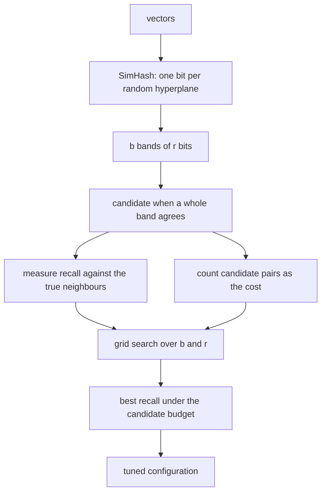
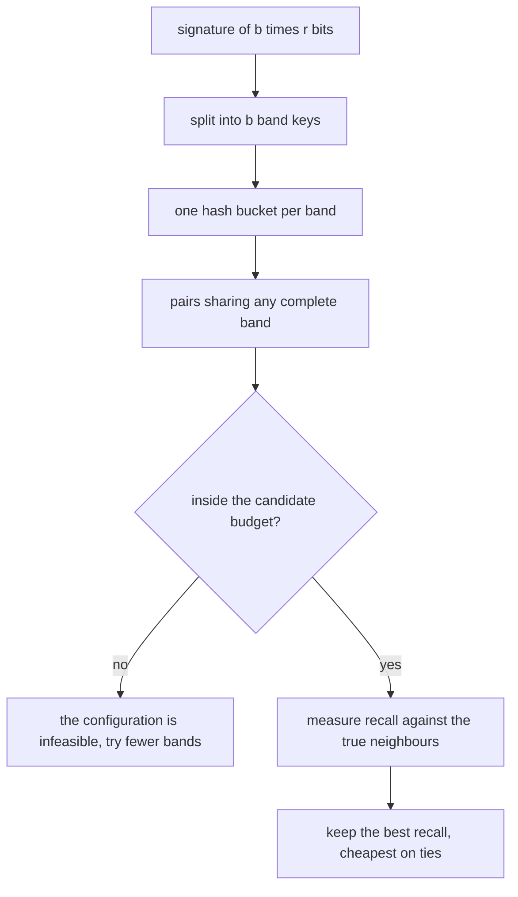
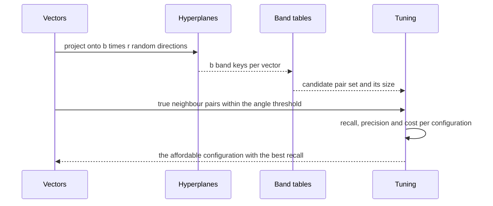

# 795 — Implement advanced LSH parameter tuning for recall/precision

> **Tier:** Expert · **CTCI chapter:** Beyond — Advanced Data Structures & Algorithms
> **Task spec:** [795-implement-advanced-lsh-parameter-tuning-for-recall-precision.md](../../../tasks/expert/795-implement-advanced-lsh-parameter-tuning-for-recall-precision.md)
> **Solutions:** [Python](../../../solutions/python/expert/795-implement-advanced-lsh-parameter-tuning-for-recall-precision/solution.py) ·
> [Java](../../../solutions/java/expert/795-implement-advanced-lsh-parameter-tuning-for-recall-precision/Solution.java) ·
> [JavaScript](../../../solutions/javascript/expert/795-implement-advanced-lsh-parameter-tuning-for-recall-precision/solution.js) ·
> [C#](../../../solutions/csharp/expert/795-implement-advanced-lsh-parameter-tuning-for-recall-precision/Solution.cs)

## 1. Problem restatement

Build a **SimHash** (random-hyperplane) locality-sensitive index and *tune* its two parameters — `b` bands
of `r` bits each — so that recall is maximised while the number of candidate pairs stays inside a budget.

The theory is exact and drives the search. For two vectors separated by the angle `theta`, one hyperplane
separates them on the same side with probability

```text
p(theta) = 1 - theta / pi
```

and with `b` bands of `r` bits, two vectors become candidates as soon as **one** band agrees completely:

```text
P_candidate(theta) = 1 - (1 - p(theta)^r)^b
```

Inputs: vectors, the neighbour angle threshold, a bit budget and a candidate budget. Outputs: the index, the
candidate pair set, recall/precision/candidate count per configuration and the tuned `(b, r)`. Measured
results from the solution's own summary:

| Measurement | Value |
| --- | --- |
| deviation of measured bit agreement from `1 - theta/pi` over four angles | `[0.0041, 0.0022, 0.0026, 0.0041]` |
| candidate rate, measured versus the closed form | `0.5125` vs `0.4968` over `160` pairs |
| tuned configuration `b = 4, r = 8` | recall `0.6967`, precision `0.6049`, `243` candidates (budget `400`) |
| default configuration `b = 2, r = 8` | recall `0.3886`, `145` candidates |
| `16 x 1` configuration | recall `1.0000` with `P_candidate = 1.000000` |

Further assertions: the measured bit-agreement frequency matches `1 - theta/pi` within `0.03` at every
probed angle, the measured candidate rate tracks the closed form within `0.15`, the band tables reproduce an
exhaustive pairwise comparison of band keys **exactly**, the tuned configuration respects both budgets and no
affordable configuration beats its recall, tuning improves recall by at least `1.5x` over the default, a
configuration whose theoretical candidate probability exceeds `0.999` reaches recall exactly `1.0`,
near-orthogonal pairs stay out of the candidate set, and zero vectors, dimension mismatches, a zero band
count and a single-item index are all handled.

## 2. Intuition

An approximate index is a *bet*: it discards work by ignoring data that is probably far away, and the
interesting question is which bet to make. LSH gives an unusually clean answer because the collision
probability is known in closed form.

1. **One hyperplane gives one bit, and the bit agreement is the angle.** A random hyperplane separates two
   vectors with probability proportional to the angle between them, so two vectors at angle `theta` agree on
   a single bit with probability `1 - theta/pi`. That is a *measurable* claim — the checks probe four
   controlled angles and measure the agreement over 4000 hyperplanes.
2. **Bands amplify the gap.** A single `r`-bit band matches only if all `r` bits agree, which is
   `p(theta)^r` — small for far pairs, moderate for near ones. Requiring *any* of `b` bands to match turns
   that into `1 - (1 - p^r)^b`, which is what makes the index a filter with a tunable step: more bands raise
   recall and the candidate count; more bits per band sharpen the filter but need more bands to keep recall.
3. **The budgets make it a real optimisation.** Total bits per item is `b * r`, and the verification cost is
   the number of candidate pairs. The `tune` helper therefore sorts the affordable configurations by
   `(-recall, candidates, cost)` and keeps the best under the candidate budget — the same
   recall-versus-cost trade-off that any ANN system faces.



## 3. Algorithm

1. **Hyperplanes.** `random_hyperplanes(dim, count, seed)` draws isotropic unit vectors with the
   deterministic Gaussian sampler and normalises each one.
2. **Signature.** `signature(vector, planes)` raises `ValueError` on a dimension mismatch and returns one
   bit per hyperplane, `1` when the projection `sum_i a_i b_i` is non-negative.
3. **Bands.** `band_keys(bits, bands, rows)` splits the signature into `bands` tuples of `rows` bits,
   raising if `len(bits) != bands * rows`.
4. **Index.** `LSHIndex(dim, bands, rows, seed)` validates the parameters, draws `bands * rows` hyperplanes
   and keeps one hash table per band. `add(item)` computes the signature, appends the item and its bits, and
   inserts its index into every band bucket. `candidate_pairs()` unions all within-bucket pairs;
   `brute_force_candidate_pairs()` computes the same set by comparing signatures directly — an independent
   path used as the oracle.
5. **Ground truth.** `true_neighbour_pairs(vectors, threshold_angle)` marks every pair whose angle is at
   most the threshold, using `cosine` and `angle_between` (which raise for a zero vector).
6. **Evaluation.** `evaluate(bands, rows, vectors, seed, threshold_angle)` builds an index, computes the
   candidate set, intersects it with the truth and returns recall, precision, the candidate count, the hits
   and the bit cost `bands * rows`.
7. **Tuning.** `tune(...)` filters the grid to configurations inside the bit budget, evaluates them, filters
   to those inside the candidate budget, and sorts by `(-recall, candidates, cost)` so that ties prefer the
   cheaper configuration. The closed forms `bit_agreement_probability(theta)` and
   `candidate_probability(theta, bands, rows)` are the theoretical counterparts the measurements are
   compared against.

```text
procedure add(item)
    bits ← signature(item, planes)                       // one bit per hyperplane
    require length(bits) = bands * rows
    keys ← split bits into `bands` tuples of `rows`
    index ← the position of this item
    append item and bits
    for band, key in enumerate(keys) do
        bandTables[band][key].append(index)

procedure candidatePairs()
    pairs ← empty set
    for table in bandTables do
        for bucket in table do
            for every two distinct indices in bucket do
                pairs.add(the sorted pair)
    return pairs

procedure tune(vectors, seed, threshold, bitBudget, candidateBudget, grid)
    affordable ← configurations in the grid with bands * rows <= bitBudget
    results ← evaluate every affordable configuration
    feasible ← results with candidates <= candidateBudget
    sort feasible by (-recall, candidates, cost)
    return the first entry, plus all results

procedure evaluate(bands, rows, vectors, seed, threshold)
    index ← LSHIndex with those parameters
    for vector in vectors do index.add(vector)
    candidates ← index.candidatePairs()
    truth ← trueNeighbourPairs(vectors, threshold)
    recall ← |candidates intersect truth| / |truth|
    precision ← |candidates intersect truth| / |candidates|
    return bands, rows, recall, precision, |candidates|, hits, |truth|, bands * rows
```



## 4. Worked example

**(a) The theory is measured, not assumed.** Four controlled unit-vector pairs at angles `0.1`, `0.5`, `1.0`
and `2.0` rad are hashed by 4000 hyperplanes and the fraction of agreeing bits is compared with `1 - theta/pi`:

| `theta` | `1 - theta/pi` | measured deviation |
| --- | --- | --- |
| `0.1` | `0.9682` | `0.0041` |
| `0.5` | `0.8408` | `0.0022` |
| `1.0` | `0.6817` | `0.0026` |
| `2.0` | `0.3634` | `0.0041` |

All four are within `0.03` of the closed form, which is what justifies using `p(theta)` for the parameter
search. The measured deviations (`0.002-0.004` with 4000 hyperplanes) are consistent with the
`sqrt(p(1-p)/4000)` sampling noise, so the theory is confirmed rather than merely not contradicted.

**(b) The band formula, measured.** With `b = 4`, `r = 3` on 60 clustered vectors, the sampled pairs give

| Quantity | Value |
| --- | --- |
| measured candidate rate | `0.5125` |
| closed form `1 - (1 - p^r)^b` averaged over the same pairs | `0.4968` |
| pairs sampled | `160` |

The check requires the gap to stay below `0.15` (this is a *frequency* estimate over 160 pairs, so it is
deliberately loose), and separately requires that the band-table candidate set equals the exhaustive
comparison of band keys **exactly** — the statistical check and the structural check are different
questions.

**(c) Tuning is the point of the task.** With `threshold_angle = 0.55`, a 32-bit budget and a candidate
budget of 400:

| Configuration | Bits | Recall | Precision | Candidates |
| --- | --- | --- | --- | --- |
| `b = 2, r = 8` (default) | `16` | `0.3886` | — | `145` |
| `b = 4, r = 8` (tuned) | `32` | `0.6967` | `0.6049` | `243` |
| `b = 16, r = 1` | `16` | `1.0000` | — | many, but `P_candidate` is `1.000000` |

Spending twice the bits buys a `1.79x` recall improvement, and the check requires at least `1.5x`, plus that
**no affordable configuration** beats the tuned recall. The `16 x 1` row is the other extreme: with a single
bit per band, a match is guaranteed for the neighbour angle by the closed form (`> 0.999`), so recall is
exactly `1.0` — and the candidate count explodes, which is why precision and cost, not recall alone, decide
the tuning.

**(d) Far pairs stay out.** `candidate_probability(pi/2, 4, 8)` is below `0.05`: nearly orthogonal pairs
almost never share a complete band. The check then builds `b = 4, r = 8`, counts how many of the actually
far pairs (angle above `1.4` rad) ended up as candidates and requires the empirical rate to stay near the
closed form — the honest version of "LSH only compares things that are probably close".



## 5. Complexity

Let `n` be the number of items, `d` the dimension, `b` bands, `r` bits per band, `c` the number of candidate
pairs and `H = b r` the bit budget.

| Operation | Best | Average | Worst | Why the bound holds |
| --- | --- | --- | --- | --- |
| `random_hyperplanes` | O(H d) | O(H d) | O(H d) | one Gaussian per component plus a normalisation |
| `signature` | O(H d) | O(H d) | O(H d) | one dot product per hyperplane |
| `add` | O(H d) | O(H d) | O(H d) | the signature plus `b` hash inserts |
| `candidate_pairs` | O(n) | O(c) | O(c + sum over buckets of bucket²) | within-bucket pair enumeration; a degenerate bucket holding everything costs `O(n²)` |
| `brute_force_candidate_pairs` (oracle) | O(n² b) | O(n² b) | O(n² b) | all pairs, all bands |
| `true_neighbour_pairs` | O(n² d) | O(n² d) | O(n² d) | the exact angle for every pair — feasible only for the few dozen vectors used here |
| `evaluate` | O(n H d + n² d) | same | `O(n² (b + d))` | the index build plus the two pair sets |
| `tune` | O(G (n H d + n² d)) | `G = 8` grid points | same | the grid is small by design; each point rebuilds the index |
| Space | O(n H) bits | O(n H) | O(c) pairs | signatures dominate; the candidate set is the largest transient |

Comparison of the design points the tuning chooses between:

| `(b, r)` | Bits | Behaviour |
| --- | --- | --- |
| `(2, 8)` | `16` | cheap, low recall — a large fraction of true neighbours never becomes a candidate |
| `(4, 8)` | `32` | the tuned point here: recall `0.6967` inside the candidate budget |
| `(16, 1)` | `16` | recall `1.0` for the neighbour angle, but almost every pair is a candidate and precision collapses |
| `(1, 16)` | `16` | a single 16-bit band: one near-miss bit kills the candidate |

## 6. Pitfalls and edge cases

- **Zero vectors.** `cosine` raises `ValueError` for a vector of norm below `1e-12`, because the angle is
  undefined; the same guard protects the ground-truth threshold.
- **Dimension mismatch.** `signature` raises when the vector length disagrees with the hyperplane length, and
  `band_keys` raises when the bit count does not equal `bands * rows` — the second catches an index built
  with inconsistent parameters.
- **A zero band count** (`bands < 1` or `rows < 1`) is rejected in the constructor.
- **A single item** produces an empty candidate set, and identical vectors always share a full signature, so
  they are always candidates — both asserted.
- **The candidate set and the exhaustive comparison must be identical.** The band tables are a *performance*
  structure; any divergence from a direct signature comparison means a bucket bookkeeping bug.
- **Statistical checks need tolerance.** The bit-agreement check uses `0.03` and the candidate-rate check
  `0.15` because both are frequency estimates; tightening them below the sampling noise would make the tests
  fail for correct code. The exact checks (index structure, ground truth, budgets) have no tolerance.
- **Recall is defined against a threshold.** A "neighbour" is a pair within `0.55` rad, so recall depends on
  that definition; reporting recall without the threshold is meaningless.
- **Precision and candidates matter as much as recall.** The `16 x 1` configuration reaches recall `1.0`, but
  at the price of verifying nearly every pair — which is exactly why `tune` filters by the candidate budget
  before sorting by recall.
- **Bit budget versus candidate budget.** Bits are a *space and compute* cost paid per item; candidates are a
  *verification* cost paid per query. Conflating them would let the tuner choose a configuration that cannot
  be run within its latency budget.
- **Determinism.** Hyperplanes come from `splitmix64`, the bucket insertion order is deterministic and the
  pair set is a set of sorted tuples, so the same seed reproduces the index and the measurements exactly;
  a different plane seed still finds true candidates.
- **Documented simplifications.** No multi-probe, no query-adaptive early termination, no buckets stored
  off-process, and the quality measures are computed by brute force on a few dozen low-dimensional vectors so
  the whole sweep finishes in well under a second.

## 7. Variants and follow-ups

- **Multi-probe LSH.** Probe several nearby buckets per band instead of only exact band matches, which raises
  recall at a fixed bit budget — the standard alternative to adding bands.
- **Different families.** Cosine LSH (SimHash here) has Euclidean and inner-product cousins; for binary data
  a bit-sampling family is exact. The tuning logic is unchanged: a closed-form collision probability plus a
  cost budget.
- **Compression instead of filtering.** Product quantisation replaces "compare fewer items" with "compare
  items more cheaply" — see
  [779 — ANN with quantization for billion scale](../../../tasks/expert/779-implement-approximate-nearest-neighbor-with-quantization-for-bil.md),
  which reaches recall `1.0` only when every cell is probed with re-ranking.
- **Verification cost in practice.** The candidate set is what a downstream exact check has to score, so the
  same tuning exercise decides the latency of the query path.
- **Related tasks.** [793 — RANSAC model fitting](../../../tasks/expert/793-implement-ransac-based-robust-model-fitting-for-line-circle-dete.md)
  trades a confidence bound against a fixed iteration budget in exactly the same spirit, and
  [794 — voxelization and octrees](../../../tasks/expert/794-implement-3d-point-cloud-voxelization-and-octree-building.md)
  prunes search space exactly rather than probabilistically.

## 8. Check yourself

<details><summary>Show answer</summary>
**Why is the collision probability of one SimHash bit `1 - theta/pi`?** A random hyperplane through the
origin separates the two vectors if and only if its normal lies in the "wedge" between the two directions
opposite them — a region of angular width `theta` on the circle of normal directions, out of the full
`pi` span that distinguishes a line's two sides. Hence the separation probability is `theta / pi` and the
agreement probability is `1 - theta/pi`.
</details>

<details><summary>Show answer</summary>
**Increasing `b` raises recall but also the candidate count. What does increasing `r` do?** `r` sharpens each
band: a band matches only if all `r` bits agree, so `p^r` falls quickly, which *reduces* both the candidate
rate and recall. That is why the two parameters must move together: to keep recall while sharpening the
filter, add bands. The bit budget `b r` is what ties them to the total space per item.
</details>

<details><summary>Show answer</summary>
**The `16 x 1` configuration has exactly the same bit cost as `2 x 8`, yet recall `1.0`. Why is it not the
tuned choice here?** Because with `r = 1` a band is a single bit, so `P_candidate` is essentially the
probability that *any* bit agrees — nearly all pairs become candidates and the verification cost explodes.
The tuner rejects it under the candidate budget, and the check on precision (`0.6049` for the tuned
configuration) shows why precision belongs in the objective alongside recall.
</details>

<details><summary>Show answer</summary>
**Why is the band-table candidate set compared with an exhaustive signature comparison rather than only with
the ground-truth neighbour set?** Because they test different things. The ground truth tests *quality* (did
we find the real neighbours?); the exhaustive comparison tests *structure* (does the bucket implementation
compute exactly the set that "shares a complete band" means?). A hash-bucket bookkeeping bug could still be
lucky on the ground truth while systematically missing some candidate pairs, and the structural check catches
it with zero tolerance.
</details>

<details><summary>Show answer</summary>
**What happens to a very distant pair as `b` grows?** Its candidate probability is
`1 - (1 - p^r)^b` with small `p`, so it grows roughly like `b p^r`: more bands do slowly admit far pairs. The
check bounds this deliberately — with `b = 4, r = 8` the theoretical probability for orthogonal pairs is
below `0.05`, and the empirical rate for pairs further than `1.4` rad must stay near that value. Raising `b`
indefinitely therefore destroys the filter no matter how much recall it buys.
</details>
