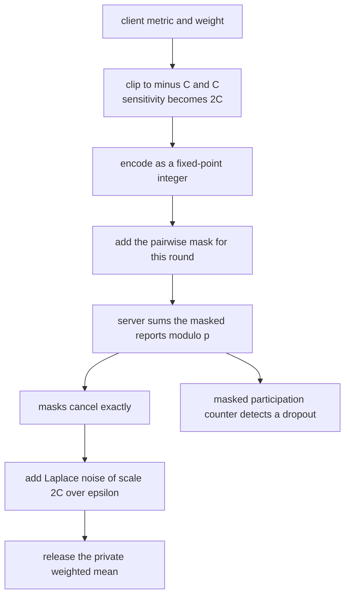
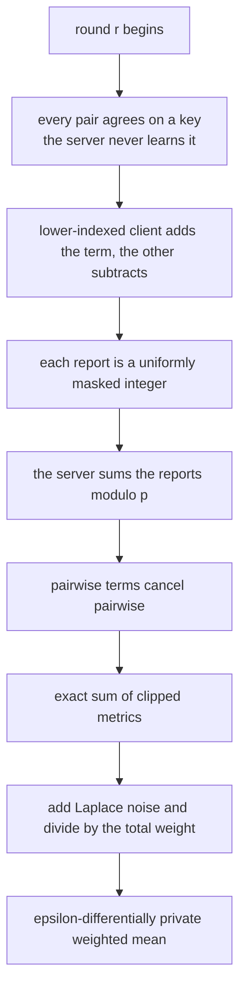
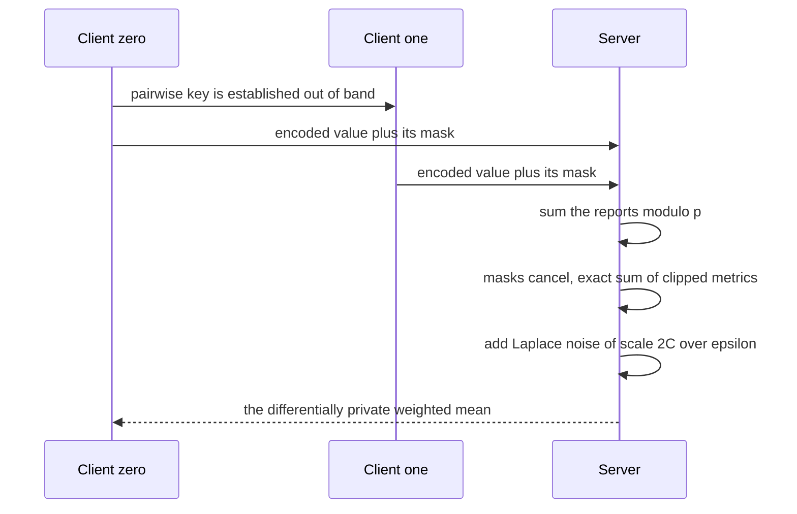

# 796 — Implement privacy-preserving federated evaluation aggregator

> **Tier:** Expert · **CTCI chapter:** Beyond — Security & Privacy
> **Task spec:** [796-implement-privacy-preserving-federated-evaluation-aggregator.md](../../../tasks/expert/796-implement-privacy-preserving-federated-evaluation-aggregator.md)
> **Solutions:** [Python](../../../solutions/python/expert/796-implement-privacy-preserving-federated-evaluation-aggregator/solution.py) ·
> [Java](../../../solutions/java/expert/796-implement-privacy-preserving-federated-evaluation-aggregator/Solution.java) ·
> [JavaScript](../../../solutions/javascript/expert/796-implement-privacy-preserving-federated-evaluation-aggregator/solution.js) ·
> [C#](../../../solutions/csharp/expert/796-implement-privacy-preserving-federated-evaluation-aggregator/Solution.cs)

## 1. Problem restatement

A federated evaluation cycle must let a server compute a weighted aggregate of client-held metrics
**without seeing any client's contribution**. Two mechanisms are combined:

- **Secure aggregation.** Clients agree on pairwise keys `K_ij` (never sent to the server). In round `r`,
  client `i` sends `x_i + mask_i` with

  ```text
  mask_i = sum over j > i of PRG(K_ij, r) - sum over j < i of PRG(K_ij, r)      (mod p, p = 2^61 - 1)
  ```

  so every pairwise term appears once with each sign and cancels in the server's sum; the server recovers
  the exact sum while each individual report is uniformly masked.
- **Differential privacy.** Each client clips its metric to `[-C, C]` (bounding its sensitivity to `2C`) and
  the server adds Laplace noise of scale `b = 2C / epsilon` before releasing the weighted mean.

Measured results from the solution's own summary for 8 clients with `bound = 1.5` and `epsilon = 1.0`:

| Measurement | Value |
| --- | --- |
| exact fixed-point sum recovered | `1331821` (the masked sum equals the exact sum modulo `p`) |
| masking | `0 / 8` reports equal the raw value; small-mask frequency `0.0021` |
| pooled mean | raw `0.428753`, clipped `0.101194` |
| DP noise | Laplace scale `3.0000`, measured variance `0.277258` against the theoretical `0.293916` |
| utility | mean absolute error `0.72605` at `epsilon = 0.5` and `0.09076` at `epsilon = 4.0` |

Further assertions: the decoded masked sum equals the decoded exact sum, **no** client report equals its raw
encoded value, the same value produces a different report in every round, masks smaller than `p / 1000`
occur in under `5%` of reports, a dropped client makes the masked participation counter inconsistent rather
than silently smaller, clipping saturates at `±C` and visibly moves the pooled mean when an outlier client is
present, the DP estimator is unbiased within four standard errors, and invalid inputs (zero total weight,
non-positive epsilon or bound, mismatched client count) raise `ValueError`.

## 2. Intuition

Federated evaluation has two separate privacy leaks, and each needs its own tool.

1. **The server must not see individual reports, but must see their sum.** That is the secure-aggregation
   trick: the masks are *constructed* to cancel. Because each client pairs with every other, the term
   `PRG(K_ij, r)` is added by the lower-indexed client and subtracted by the higher-indexed one, so any sum
   over all clients contains each term exactly twice with opposite signs. The server gets
   `sum_i x_i mod p` exactly, while a single report is `x_i + (a uniform-looking value)`.
2. **Even the exact sum leaks information about individuals.** With `n - 1` colluding clients, the sum reveals
   the last one's value. Differential privacy bounds what *changing one client's input* can change in the
   release: clipping to `[-C, C]` bounds each contribution's sensitivity to `2C`, and Laplace noise of scale
   `2C / epsilon` makes the release `epsilon`-DP. The weighted mean is then
   `(sum_i w_i x_i + noise) / sum_i w_i`, and the measured variance matches `2 b^2 / W^2` — which is how the
   check ties the *implementation* to the privacy parameter rather than just asserting that noise exists.
3. **Fixed-point arithmetic is what makes it work.** Masks are integers modulo a prime, so a value has to be
   quantised (`SCALE = 10^6`) and folded into `[0, p)`; the decode step maps a representative back to a
   signed value. Real sums must stay below `p / 2` for the signed interpretation to be unique.



## 3. Algorithm

1. **Encoding.** `encode(value)` rounds `value * 10^6` and reduces modulo `p = 2^61 - 1`; `decode(value)`
   maps a representative in `[0, p)` back to a signed float, using the `p / 2` cut.
2. **Pairwise keys.** `pairwise_key(i, j, round_index, master)` mixes the ordered pair and the round number
   into `splitmix64` with a master secret; `mask_term` exposes one PRG output, and `client_mask` sums those
   outputs with `+` for the lower index and `-` for the higher one, modulo `p`.
3. **Reports.** `masked_report(values, client, clients, round_index, master)` encodes the values and adds the
   client's mask; the second slot carries the constant `1.0`, which becomes the **masked participation
   counter**.
4. **Server aggregation.** `secure_sum(reports, num_clients)` validates the client count and a common report
   width, then adds every slot modulo `p`; `masked_participation` decodes the second slot, which equals the
   number of clients when the round is complete and becomes inconsistent when one is missing.
5. **Clipping.** `clip(value, bound)` raises for a negative bound, saturates at `±bound` and is applied to
   every metric before encoding.
6. **DP noise.** `laplace(state, scale)` draws by inverse transform
   (`-b * sign(u - 0.5) * log(1 - 2 |u - 0.5|)`) from the deterministic stream; `laplace_scale(bound,
   epsilon) = 2 bound / epsilon` raises for a non-positive `epsilon`.
7. **The cycle.** `federated_round(clients, bound, round_index, master)` returns the clipped values, the
   masked reports and the exact encoded sum; `federated_weighted_mean(clients, epsilon, bound, seed,
   trials)` runs `trials` independent rounds, checks the masked sum against the exact fixed-point sum *inside*
   the loop, adds fresh Laplace noise and returns the estimates together with the noise scale and the total
   weight.
8. **Reference.** `central_weighted_mean(clients, metrics)` is the pooled weighted mean of the raw metrics —
   the quantity the private estimates must approximate, and the oracle for the bias check.

```text
procedure clientMask(client, clients, roundIndex, master)
    total ← 0
    for other in clients with other different from client do
        term ← maskTerm(client, other, roundIndex, master)
        total ← total + term if client < other else total - term
    return total modulo p

procedure maskedReport(values, client, clients, roundIndex, master)
    mask ← clientMask(client, clients, roundIndex, master)
    return [(encode(value) + mask) modulo p for value in values]

procedure secureSum(reports, numClients)
    require length(reports) = numClients
    totals ← zeros of the report width
    for report in reports do
        require the width matches
        totals ← (totals + report) modulo p
    return totals

procedure federatedWeightedMean(clients, epsilon, bound, seed, trials)
    require at least one client and a positive total weight
    scale ← 2 * bound / epsilon
    for trial in 1 .. trials do
        metricValues, reports, exact ← federatedRound(clients, bound, trial, seed)
        summed ← secureSum(reports, length(clients))
        require decode(summed[0]) equals decode(sum(exact) modulo p)      // masks cancelled
        require decode(summed[1]) equals the client count                 // counter intact
        weighted ← sum over clients of metricValue * weight
        noise ← laplace(state, scale)
        estimate ← (weighted + noise) / totalWeight
    return estimates, scale, totalWeight
```



## 4. Worked example

**(a) Why the masks cancel.** With three clients and one round, the server's sum contains

| Pair | Term in client 0's report | Term in client 1's report | Term in client 2's report |
| --- | --- | --- | --- |
| `(0, 1)` | `+PRG(K_01, r)` | `-PRG(K_01, r)` | — |
| `(0, 2)` | `+PRG(K_02, r)` | — | `-PRG(K_02, r)` |
| `(1, 2)` | — | `+PRG(K_12, r)` | `-PRG(K_12, r)` |

Every term appears exactly twice with opposite signs, so the sum collapses to `sum_i encode(x_i) mod p`. The
measured run recovers the fixed-point sum `1331821` exactly — the check asserts bit-for-bit equality of
integers, not a tolerance. Note that the cancellation is *arithmetic*, not statistical: it holds for any
values, which is what makes the aggregate exact even though every individual report is masked.

**(b) The mask must look uniform.** Three measurements back this up:

| Check | Requirement | Measured |
| --- | --- | --- |
| no report equals its raw value | `0` of `8` | `0` |
| masks smaller than `p / 1000` | under `5%` of reports over 119 rounds | `0.0021` |
| the same value in 20 rounds | 20 distinct reports | `20` |

The third one matters most: a value replayed across rounds must not produce a correlatable report, which is
why the round number is part of the PRG input.

**(c) Clipping changes the released statistic — on purpose.** Eight synthetic clients include outlier metrics
(`index % 7 == 3` is scaled by `5`), so clipping is not cosmetic:

| Quantity | Value |
| --- | --- |
| pooled mean of the raw metrics | `0.428753` |
| pooled mean of the clipped metrics | `0.101194` |
| bound `C` | `1.5` |

The check requires the two to differ by more than `1e-6`, i.e. clipping *must* visibly move the statistic.
That is the honest trade-off of DP: bounding the sensitivity costs an outlier-driven bias, and the solution
reports both numbers rather than hiding the clipped one.

**(d) The noise scale and the utility trade-off.** With `bound = 1.5` and `epsilon = 1.0` the scale is
`2 * 1.5 / 1 = 3.0`, and the released mean's variance must match the theory:

| Quantity | Value |
| --- | --- |
| Laplace scale `b` | `3.0000` |
| total weight `W` | `7.83` |
| measured variance of the estimates over 300 trials | `0.277258` |
| theory `2 b^2 / W^2` | `0.293916` |

The measured variance is within half of the theoretical value (the check's tolerance), so the *implemented*
noise is the noise the privacy guarantee assumes — a common failure mode is drawing from the wrong
distribution and reporting a number that looks plausible. The bias check then requires the mean deviation
from the clipped pooled mean to be within four standard errors, and the utility sweep shows the expected
direction: mean absolute error `0.72605` at `epsilon = 0.5` versus `0.09076` at `epsilon = 4.0`, an eightfold
improvement for eight times the privacy budget.



## 5. Complexity

Let `n` be the number of clients, `w` the report width (two slots here), `k` the number of rounds and `T` the
number of DP trials.

| Operation | Best | Average | Worst | Why the bound holds |
| --- | --- | --- | --- | --- |
| `client_mask` | O(n) | O(n) | O(n) | one PRG output per other client |
| `masked_report` | O(n + w) | O(n + w) | O(n + w) | the mask plus one modular addition per slot |
| `secure_sum` | O(n w) | O(n w) | O(n w) | one modular addition per client and slot |
| `masked_participation` | O(n) | O(n) | O(n) | sums the second slot |
| `encode` / `decode` | O(1) | O(1) | O(1) | a scale-and-reduce and a comparison |
| `laplace` | O(1) | O(1) | O(1) | inverse-transform sampling with one uniform draw |
| one federated round | O(n²) | O(n²) | O(n²) | dominated by the all-pairs mask construction |
| `federated_weighted_mean` | O(T n²) | same | same | `T = 300` trials in the checks |
| Space | O(n w) | O(n w) | O(n²) for the pairwise keys | masks are recomputable from the keys, so no per-pair storage is required |

Comparison with the alternatives:

| Approach | Server sees | Aggregation exact | Privacy |
| --- | --- | --- | --- |
| Plain reporting | every client value | yes | none |
| Secure aggregation only (this task, first half) | only the sum | yes, bit for bit | masks hide individual reports, but the sum still reveals a value if `n - 1` collude |
| Local DP only | noisy individual values | no (biased in the naive form) | strong per-client guarantee, worse utility |
| Secure aggregation + server-side DP (this task) | the exact sum, then a noisy release | exact before noise | the release is `epsilon`-DP for the clipped query |

## 6. Pitfalls and edge cases

- **The masks must cancel *exactly*.** All arithmetic is modular over `p = 2^61 - 1` with integer
  operations, and the check compares two integers for equality — a floating-point mask would leave a residual
  and fail immediately.
- **Fixed-point range.** Values are scaled by `10^6` and folded into `[0, p)`; a sum above `p / 2` would
  decode to the wrong sign, so `p` must dwarf the plausible aggregate.
- **Clipping is not optional, it is the sensitivity bound.** `clip` raises for a negative bound, saturates at
  `±C`, and every metric is clipped *before* encoding, so a single wild client cannot blow up the released
  mean.
- **A dropout must be visible.** The masked participation counter decodes to `n` when everyone reports; with
  one client missing the value becomes inconsistent (the check requires it to be *far* from `n - 1`, because
  the missing client's mask terms no longer cancel).
- **Invalid inputs are rejected.** `laplace_scale` refuses a non-positive `epsilon`, `clip` a negative bound,
  `secure_sum` a client count that does not match, `central_weighted_mean` and `federated_weighted_mean` a
  non-positive total weight — five separate `ValueError` checks.
- **The same value must not produce the same report.** The round index is part of the PRG input, so 20 rounds
  give 20 distinct reports for an identical value; without it the server could track a client across rounds.
- **The Laplace draw must be the right distribution.** The measured variance is compared with `2 b^2 / W^2`
  within 50%; drawing a Gaussian "for safety" would fail this, as would using the wrong scale.
- **Unbiasedness has a sampling error.** The bias check uses four standard errors, because the estimator is
  random: a tighter bound would fail for correct code.
- **Utility is a curve, not a point.** The `epsilon = 0.5` versus `4.0` comparison requires a strictly smaller
  mean absolute error at the larger budget, and the scales are asserted to order accordingly.
- **Determinism.** All randomness comes from `splitmix64`; the same seed reproduces every private estimate
  bit for bit, which is what makes the statistical checks reproducible across machines.
- **Documented simplifications.** The demo is small (eight clients, a handful of rounds), the pairwise keys
  are derived from a `splitmix64` mix rather than a real key-agreement protocol (so this is a simulation of
  the arithmetic, not a deployment), and only the released aggregate is checked — no composition across many
  rounds is analysed.

## 7. Variants and follow-ups

- **Real key agreement.** Replace the `splitmix64` PRG with an actual Diffie-Hellman exchange plus a PRF, and
  add the dropout-resilience machinery that secret-sharing the pairwise seeds provides.
- **Renyi / zCDP accounting.** Composing many DP releases requires an accountant; the pure-`epsilon` guarantee
  used here is the simplest case.
- **Client-level DP instead of server-side DP.** Noise at the client shrinks the trust in the server but
  changes the estimator's bias, which has to be corrected.
- **Weighted and stratified aggregation.** Clients with different data volumes need weight-aware clipping and
  noise scaling; the `weights` slot in this implementation is exactly that hook.
- **Related tasks.** [780 — distributed sampling reservoir with merge](../../../tasks/expert/780-implement-distributed-sampling-reservoir-with-merge-operation.md)
  solves the same "combine worker state exactly" problem for samples;
  [781 — distributed join planning](../../../tasks/expert/781-implement-distributed-join-planning-with-cardinality-estimation.md)
  is the other Ch 9 coordination simulation; and
  [795 — LSH parameter tuning](../../../tasks/expert/795-implement-advanced-lsh-parameter-tuning-for-recall-precision.md)
  shows the same style of closed-form-versus-measured validation for a statistical guarantee.

## 8. Check yourself

<details><summary>Show answer</summary>
**Why do the pairwise masks cancel, and what does the server learn?** Each pair contributes `+PRG(K_ij, r)`
to the lower-indexed client's report and `-PRG(K_ij, r)` to the higher-indexed one, so summing all reports
removes every term exactly once. The server therefore learns `sum_i x_i` and nothing else — except that with
`n - 1` colluding clients the sum reveals the last one's value, which is why the DP layer exists.
</details>

<details><summary>Show answer</summary>
**Why is a fixed-point encoding with a prime modulus needed?** The masks are integers that must cancel
*exactly*, and modular arithmetic is what guarantees that (no rounding residual). Real-valued metrics are
therefore quantised (`SCALE = 10^6`) and mapped into `[0, p)`; the modulus must exceed twice the largest
plausible aggregate so that the signed decode is unambiguous.
</details>

<details><summary>Show answer</summary>
**Clipping introduces bias. Why do it?** Because differential privacy is defined in terms of *sensitivity* —
how much one client's input can change the release. Without clipping, an unbounded metric makes the
sensitivity infinite and no finite noise level provides a guarantee. Clipping bounds it to `2C`, at the price
of distorting outliers, which the measured `0.428753` versus `0.101194` pooled means show explicitly.
</details>

<details><summary>Show answer</summary>
**The measured variance (`0.277258`) differs from the theory (`0.293916`). Is that a problem?** No: the
estimator is random and the check uses 300 trials, so a `5%` discrepancy is within the sampling error of a
variance estimate. The check's 50% tolerance is far looser than that, deliberately — what it is guarding
against is the wrong *distribution* or the wrong *scale*, either of which would be off by a large factor
rather than a few percent.
</details>

<details><summary>Show answer</summary>
**What does the masked participation counter protect against, and why can it not be a plain counter?** A plain
count of received reports is trivially available without privacy concerns, but a plain *sum* of a constant
slot would break the mask cancellation argument for the other slots — the server would see structure it can
correlate. By carrying the constant `1.0` in its own masked slot, the counter inherits the same exact
cancellation, so a complete round decodes to `n` and a dropped client leaves an inconsistent value rather
than a plausible smaller one.
</details>
