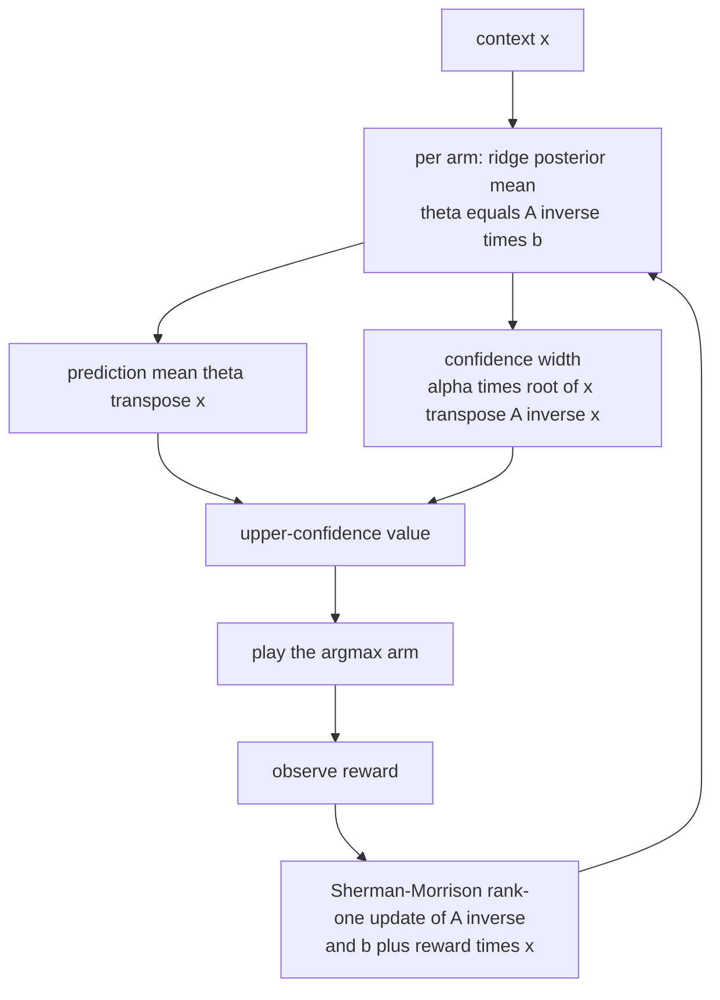
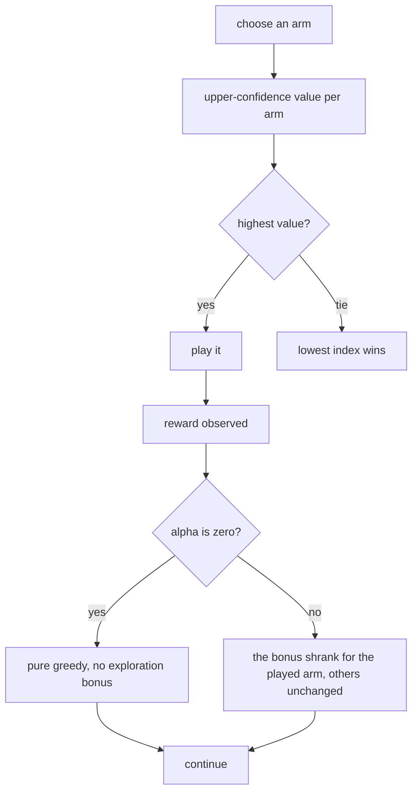
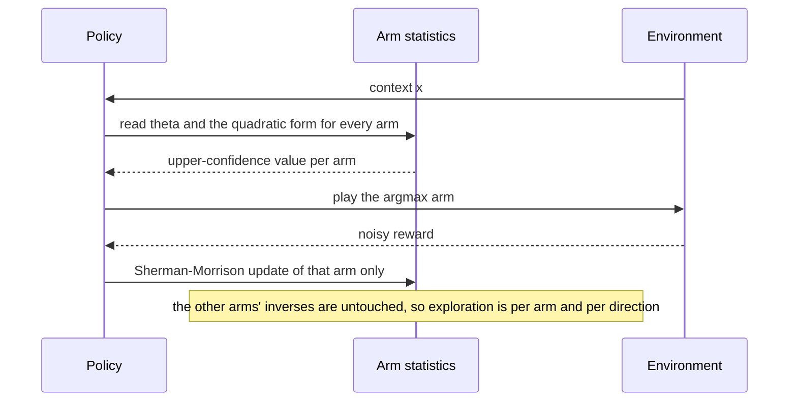

# 797 — Implement multi-armed bandit with contextual features (contextual bandits)

> **Tier:** Expert · **CTCI chapter:** Beyond — Machine Learning & AI
> **Task spec:** [797-implement-multi-armed-bandit-with-contextual-features-contextual.md](../../../tasks/expert/797-implement-multi-armed-bandit-with-contextual-features-contextual.md)
> **Solutions:** [Python](../../../solutions/python/expert/797-implement-multi-armed-bandit-with-contextual-features-contextual/solution.py) ·
> [Java](../../../solutions/java/expert/797-implement-multi-armed-bandit-with-contextual-features-contextual/Solution.java) ·
> [JavaScript](../../../solutions/javascript/expert/797-implement-multi-armed-bandit-with-contextual-features-contextual/solution.js) ·
> [C#](../../../solutions/csharp/expert/797-implement-multi-armed-bandit-with-contextual-features-contextual/Solution.cs)

## 1. Problem restatement

**LinUCB** models the reward of arm `a` in context `x` as `x^T theta_a` with an unknown per-arm weight
vector, keeps a ridge posterior per arm,

```text
A_a = I_d + sum over pulls of x x^T          b_a = sum over pulls of r x
theta_a_hat = A_a^{-1} b_a
UCB_a(x) = theta_a_hat^T x + alpha * sqrt( x^T A_a^{-1} x )
```

and plays `argmax_a UCB_a(x)`. The second term is the (scaled) standard deviation of the prediction — the
*exploration bonus*, which shrinks like `1 / sqrt(n_a)` as an arm collects pulls. Only the pulled arm's
statistics change, and its inverse is updated in `O(d^2)` with the **Sherman-Morrison** identity

```text
A^{-1} <- A^{-1} - (A^{-1} x x^T A^{-1}) / (1 + x^T A^{-1} x)
```

so no matrix is ever re-inverted. Two baselines run on the identical reward stream: uniform-random and
`epsilon`-greedy using the same ridge estimates. Measured results from the solution's own summary:

| Measurement | Value |
| --- | --- |
| worst gap between the inverse-based `theta` and an explicit normal-equation solve | `2.442e-15` |
| `A A^{-1} - I` worst deviation | `1.665e-15` |
| mean regret over 8 repetitions of 1500 steps | LinUCB `41.2468`, `epsilon`-greedy `495.1826`, uniform `4528.5934` |
| sublinear growth | `254.9925` at 750 steps versus `255.0964` at 1500 steps |
| parameter recovery on the dominant arm (1254 pulls) | worst gap `0.0027` |

Further assertions: the arm actually pulled is the argmax of the reported scores, the inverse stays
symmetric (within `1e-15`) and positive definite for **every** arm and step, LinUCB's regret is below half
the uniform policy's and no worse than `epsilon`-greedy's, regret grows sublinearly (doubling the horizon
must less than double it), a well-explored arm's estimate converges to the true `theta`, and a single arm,
`alpha = 0`, a one-step horizon and a negative `alpha` (`ValueError`) all behave exactly.

## 2. Intuition

A bandit faces the exploration/exploitation dilemma; a *contextual* bandit faces it per context, because
the best arm depends on the features. LinUCB resolves it with an optimistic estimate: behave as if each
arm's reward were the most favourable value consistent with the data.

1. **Ridge regression is the posterior.** With a Gaussian prior and Gaussian noise, `theta_hat = A^{-1} b`
   *is* the posterior mean, and `x^T A^{-1} x` is the posterior variance of the prediction in direction
   `x`. That makes the confidence width more than a heuristic: it is the standard deviation of the
   prediction, scaled by `alpha`.
2. **The bonus shrinks automatically.** `A_a` grows by `x x^T` on every pull, so `A_a^{-1}` shrinks; an
   unplayed arm has the largest width (`alpha |x|` for the identity prior) and a heavily played one almost
   none. Exploration is therefore front-loaded and self-limiting, without any explicit schedule.
3. **The inverse update is what makes it cheap.** Adding one outer product is a rank-one change, so
   Sherman-Morrison gives the new inverse in `O(d^2)` instead of `O(d^3)`. The risk is numerical: the
   update is only valid if the stored matrix really is the inverse, which the checks verify two ways — the
   predicted `theta` must match a fresh elimination solve, and `A A^{-1}` must be the identity.



## 3. Algorithm

1. **Linear algebra.** `solve_linear(matrix, rhs)` is Gaussian elimination with partial pivoting (the
   independent reference path, returning `None` for a singular system); `quadratic_form(inverse, vector)`
   computes `x^T A^{-1} x`; `sherman_morrison(inverse, vector)` returns
   `A^{-1} - (A^{-1} x x^T A^{-1}) / (1 + x^T A^{-1} x)`.
2. **Agent.** `LinUCB(arms, dim, alpha, ridge=1.0)` validates `arms >= 1`, `dim >= 1` and `alpha >= 0`, and
   initialises `A_a^{-1} = ridge * I` and `b_a = 0` for every arm.
3. **Prediction.** `theta(arm)` multiplies the stored inverse by `b`; `scores(context)` adds
   `alpha * sqrt(max(0, x^T A^{-1} x))` to `theta . x` for every arm, storing the values in `last_scores`
   so that the selection can be verified against the numbers the policy actually saw.
4. **Selection.** `select(context)` returns the argmax of `scores`, ties going to the lowest index (which
   is what makes `alpha = 0` deterministic when all arms are identical).
5. **Update.** `update(arm, context, reward)` applies the Sherman-Morrison update to that arm's inverse only,
   adds `reward * x` to `b[arm]`, and increments the pull counter.
6. **Baselines.** `EpsilonGreedy(arms, dim, epsilon, ridge, seed)` explores uniformly with probability
   `epsilon` and otherwise plays the argmax of `theta . x`, recomputing each `theta` with `solve_linear`
   from the accumulated `A` — a completely different code path from the inverse-based agent.
7. **Environment and measurement.** `make_theta(arms, dim, seed, scale)` draws the true weights;
   `run_policy(policy, thetas, steps, seed, noise=0.05)` generates i.i.d. Gaussian contexts, computes the
   **pseudo-regret** `max_a theta_a . x - theta_{chosen} . x` from the true model (not from the noisy
   reward) and feeds the policy a noisy reward; `run_uniform` is the random baseline.

```text
procedure scores(context)
    values ← empty
    for arm in 0 .. arms - 1 do
        theta ← inverse[arm] * b[arm]
        mean ← theta dot context
        variance ← quadraticForm(inverse[arm], context)
        values.append(mean + alpha * sqrt(max(0, variance)))
    lastScores ← values
    return values

procedure update(arm, context, reward)
    inverse[arm] ← inverse[arm] - (inverse[arm] context context^T inverse[arm])
                              / (1 + context^T inverse[arm] context)
    b[arm] ← b[arm] + reward * context
    pulls[arm] ← pulls[arm] + 1

procedure runPolicy(policy, thetas, steps, seed, noise)
    regret ← 0
    for step in 1 .. steps do
        context ← an i.i.d. Gaussian context
        best ← max over arms of theta_arm dot context
        arm ← policy.select(context)
        regret ← regret + best - theta_arm dot context
        reward ← theta_arm dot context + noise * gaussian()
        policy.update(arm, context, reward)
    return regret
```



## 4. Worked example

**(a) The inverse is the inverse.** After a 30-step exploratory episode the checks rebuild `A_a` by hand —
`I` plus the outer products of every context that arm received — and compare two ways:

| Check | Tolerance | Measured |
| --- | --- | --- |
| `A_a^{-1} b_a` versus `solve_linear(A_a, b_a)` | `1e-9` | `2.442e-15` |
| `A_a A_a^{-1} = I` | `1e-9` | `1.665e-15` |
| symmetry of the stored inverse | `1e-15` | satisfied |

Both are machine-precision, so 30 Sherman-Morrison updates produce the same matrix as one exact solve. This
is the check that matters most for an incremental implementation: the update formula is easy to get subtly
wrong (a missing `1 +`, a transposed factor) and the error would otherwise accumulate invisibly over
thousands of pulls.

**(b) The confidence width does the exploring.** With a 5-dimensional context, a 4-arm problem and
`alpha = 0.6`, the mean regret over 8 repetitions of 1500 steps is

| Policy | Mean pseudo-regret | Comment |
| --- | --- | --- |
| LinUCB | `41.2468` | uses the context and the confidence width |
| `epsilon`-greedy (`epsilon = 0.1`) | `495.1826` | uses the context but explores blindly |
| uniform random | `4528.5934` | ignores both |

LinUCB beats `epsilon`-greedy by a factor of `12` and the uniform policy by a factor of `110`, and the check
requires at least `2x` against uniform and no loss against `epsilon`-greedy. The gap to `epsilon`-greedy is
the point of the task: `epsilon`-greedy explores *regardless of how uncertain an arm is*, while the
`sqrt(x^T A^{-1} x)` term explores exactly the arms whose predictions are uncertain in *this* context.

**(c) Sublinear regret.** The regret over 750 steps averages `254.9925`; over 1500 steps it is `255.0964` —
essentially unchanged. Doubling the horizon added `0.1`, and the check requires the longer run to be below
twice the shorter one. That is the signature of a policy that has learned the problem: once exploration has
converged, additional steps cost almost nothing, whereas a uniform policy's regret grows linearly by
construction.

**(d) Parameter recovery and the tie case.** Running 4000 steps and looking at the most-pulled arm
(`1254` pulls, well above the `200` the check requires) gives

| Quantity | Value |
| --- | --- |
| worst `|theta_hat - theta_true|` component gap | `0.0027` |
| required | below `0.05` |

With `alpha = 0` the bonus vanishes and the policy becomes greedy; the checks construct a case where all
arms' scores coincide and require arm `0` to be chosen, so ties resolve deterministically. A single-arm
problem forces the choice (and accumulates exactly zero regret in the related check), a one-step run yields
a non-negative regret, and a negative `alpha` raises `ValueError` because the "confidence" term would invert
into anti-exploration.



## 5. Complexity

Let `K` be the number of arms, `d` the context dimension and `T` the number of steps.

| Operation | Best | Average | Worst | Why the bound holds |
| --- | --- | --- | --- | --- |
| `scores` | O(K d²) | O(K d²) | O(K d²) | `theta = A^{-1} b` costs `O(d²)` and the quadratic form another `O(d²)` per arm |
| `select` | O(K d²) | O(K d²) | O(K d²) | dominated by `scores`, plus an `O(K)` argmax |
| `update` | O(d²) | O(d²) | O(d²) | Sherman-Morrison is three matrix-vector products and an outer product |
| `theta` on demand | O(d²) | O(d²) | O(d²) | the stored inverse times `b` |
| one `run_policy` step | O(K d²) | O(K d²) | O(K d²) | one selection and one update for the played arm |
| full run | O(T K d²) | same | `O(T K d² + K d³)` with periodic re-inversion | the measured run is 1500 steps with `K = 4`, `d = 5` |
| `epsilon`-greedy baseline | O(T K d³) | same | same | it re-solves the normal equations per arm (`d³`), which is why the inverse is worth maintaining |
| Space | O(K d²) | O(K d²) | O(K d²) | one `d x d` inverse and one `d`-vector per arm |
| Oracle context generation | O(T d) | same | same | `d` Gaussian draws per step |

Comparison with the alternatives:

| Policy | Uses the context | Exploration | Measured regret (1500 steps) |
| --- | --- | --- | --- |
| Uniform random (baseline) | no | maximal | `4528.5934` |
| `epsilon`-greedy (baseline) | yes, for exploitation | blind, `epsilon` fixed | `495.1826` |
| LinUCB with `alpha = 0` | yes | none (greedy) | worse than LinUCB — the docstrings note it does strictly worse |
| LinUCB (this task) | yes | confidence-scaled per context | `41.2468` |

## 6. Pitfalls and edge cases

- **A wrong Sherman-Morrison update is invisible for a while.** The formula must be
  `A^{-1} - (A^{-1} x x^T A^{-1}) / (1 + x^T A^{-1} x)`; two independent oracles (a fresh elimination solve
  and `A A^{-1} = I`) are checked, both to `1e-9` and both measured at machine precision.
- **`alpha` must be non-negative.** A negative `alpha` would reward *uncertainty-avoidance*, which is not
  exploration; the constructor raises `ValueError`.
- **Numerical safety in the square root.** The variance is clamped with `max(0.0, variance)` before the
  square root, because rounding can make a positive-definite quadratic form slightly negative.
- **Positive definiteness is asserted.** `A_a^{-1}` stays positive definite for every arm and every step
  (checked via a quadratic form with the all-ones vector), and symmetry is asserted within `1e-15` — the
  update is symmetric by construction, so a violation would mean an indexing bug.
- **Ties must be deterministic.** `select` compares with `>`, so the lowest index wins; with `alpha = 0` and
  identical arms, the check requires arm `0`.
- **The reported scores must be the ones used.** `last_scores` is stored so the check can verify
  `values[chosen] == max(values)` — a policy that reports one number and acts on another is a classic
  logging bug.
- **Pseudo-regret, not realised reward.** Regret is computed from the *true* model (`max_a theta_a . x`
  minus the chosen arm's mean), while the learner only sees the noisy reward. Using the noisy draw would add
  variance to the metric and blur the comparison between policies.
- **Degenerate horizons.** A one-step run must still give non-negative regret, and a single-arm problem must
  choose that arm (with zero regret, since it is always the best).
- **Parameter recovery needs exploration.** The estimate converges only on a well-explored arm (`1254`
  pulls here); an arm with a handful of pulls has a wide posterior and a correspondingly loose estimate, so
  the check both requires enough pulls and a tight gap.
- **Documented simplifications.** The reward model is linear-Gaussian with a known noise scale so the
  confidence width is analytic, contexts are i.i.d. and low-dimensional (`d = 5`, `K = 4`), there is no
  feature mapping for non-linear rewards, no off-policy logging or exploration-budget accounting, and regret
  is measured in expectation via the true model rather than as realised reward.

## 7. Variants and follow-ups

- **Non-linear rewards.** Replace the raw context by a feature map (random Fourier features, a small neural
  network) and keep the same ridge-and-bonus machinery; the analysis becomes approximate but the algorithm
  is unchanged.
- **Hybrid models.** LinUCB with shared features across arms, or a low-rank weight matrix, reduces the
  per-arm parameter count when arms are related.
- **Thompson sampling instead of UCB.** Sample `theta` from the posterior and play the argmax; the
  exploration is then probabilistic rather than optimistic — see
  [798 — hierarchical Thompson sampling](../../../tasks/expert/798-implement-thompson-sampling-with-hierarchical-prior-simulation.md).
- **Off-policy evaluation.** Logging the propensity of each decision makes counterfactual estimates possible,
  which is what a production contextual bandit needs before deploying a new policy.
- **Related tasks.** [796 — federated evaluation aggregator](../../../tasks/expert/796-implement-privacy-preserving-federated-evaluation-aggregator.md)
  shows how such logged metrics can be aggregated privately, and
  [795 — LSH parameter tuning](../../../tasks/expert/795-implement-advanced-lsh-parameter-tuning-for-recall-precision.md)
  is another closed-form-versus-measured validation of a statistical trade-off.

## 8. Check yourself

<details><summary>Show answer</summary>
**Why is `x^T A^{-1} x` the right exploration bonus?** For a Gaussian linear model with noise variance
`sigma^2` and prior covariance `I / lambda`, the posterior variance of the prediction `theta^T x` is
`sigma^2 x^T A^{-1} x` with `A = lambda I + sum x x^T`. The bonus is therefore a scaled standard deviation —
an upper confidence bound in the statistical sense — and it automatically shrinks as an arm's `A` grows.
</details>

<details><summary>Show answer</summary>
**What does Sherman-Morrison exploit, and what is the cost of not using it?** Adding one observation changes
`A` by the rank-one term `x x^T`, and the matrix inversion lemma gives the new inverse in `O(d²)`. Recomputing
the inverse from scratch would cost `O(d³)` per pull; the `epsilon`-greedy baseline in the same file does
exactly that and is listed with `O(T K d³)` in the complexity table.
</details>

<details><summary>Show answer</summary>
**With `alpha = 0` the algorithm is greedy. Why is that worse, and why is it still tested?** Because an arm
that looks best from very few pulls is played forever, so a mistaken early estimate is never corrected —
the docstrings record it doing strictly worse. It is tested because it is the boundary case that
demonstrates the bonus's contribution: with `alpha = 0` and identical arms every score coincides, which also
pins down the deterministic tie-breaking.
</details>

<details><summary>Show answer</summary>
**Regret barely changed between 750 and 1500 steps (`254.9925` versus `255.0964`). Why is that the expected
shape?** Because after the policy has identified the good arm for the context distribution, additional steps
are almost always played optimally, so the *increment* to regret is near zero. The total is dominated by the
initial learning phase, which is why the check phrase is "doubling the horizon must less than double the
regret" — that is the empirical statement of sublinearity, as opposed to the linear growth of the uniform
policy.
</details>

<details><summary>Show answer</summary>
**Why compare with an `epsilon`-greedy policy that uses the *same* ridge estimates?** To isolate the effect of
the exploration *rule* rather than the model class. Both policies use `theta_hat = A^{-1} b`; the difference
is that one explores uniformly at random while the other explores where its prediction is uncertain. The
measured `41.2468` versus `495.1826` therefore attributes the improvement to the confidence width, not to
linear regression.
</details>
