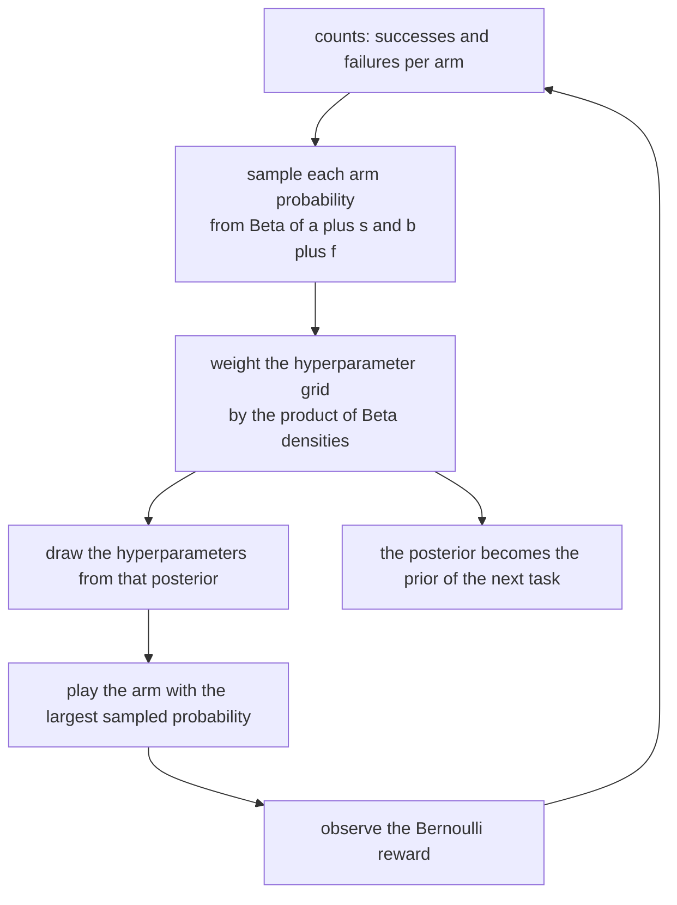
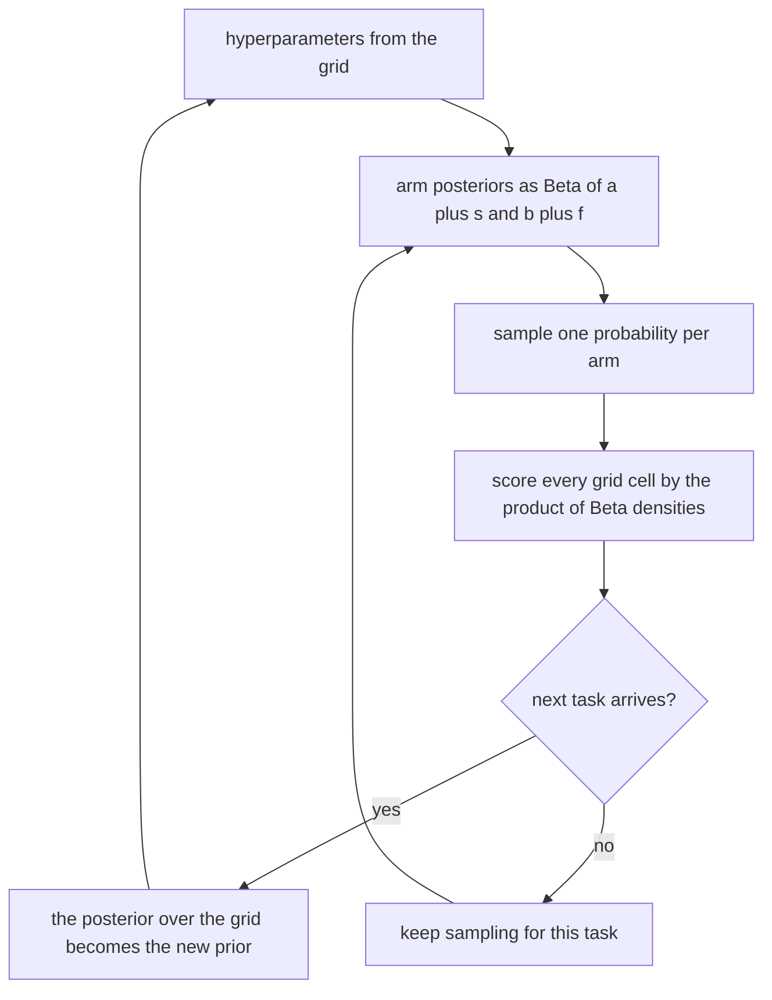
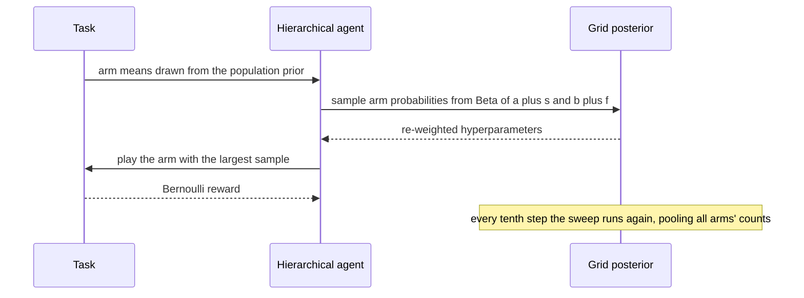

# 798 — Implement Thompson sampling with hierarchical prior simulation

> **Tier:** Expert · **CTCI chapter:** Beyond — Machine Learning & AI
> **Task spec:** [798-implement-thompson-sampling-with-hierarchical-prior-simulation.md](../../../tasks/expert/798-implement-thompson-sampling-with-hierarchical-prior-simulation.md)
> **Solutions:** [Python](../../../solutions/python/expert/798-implement-thompson-sampling-with-hierarchical-prior-simulation/solution.py) ·
> [Java](../../../solutions/java/expert/798-implement-thompson-sampling-with-hierarchical-prior-simulation/Solution.java) ·
> [JavaScript](../../../solutions/javascript/expert/798-implement-thompson-sampling-with-hierarchical-prior-simulation/solution.js) ·
> [C#](../../../solutions/csharp/expert/798-implement-thompson-sampling-with-hierarchical-prior-simulation/Solution.cs)

## 1. Problem restatement

**Thompson sampling** for a Bernoulli bandit draws one sample `p_k` from each arm's posterior and plays the
argmax. With independent `Beta(1, 1)` priors the posterior of arm `k` after `s_k` successes and `f_k`
failures is `Beta(1 + s_k, 1 + f_k)` — the **flat** baseline.

The **hierarchical** version assumes instead that the arms of a task are exchangeable draws from a common
`Beta(a, b)`, and puts a discrete prior over the hyperparameters on an `(a, b)` grid. The posterior is
sampled with a two-block Gibbs sweep:

```text
p_k | data, (a, b)  ~  Beta(a + s_k, b + f_k)                       for every arm k
(a, b) | p          proportional to  prior(a, b) * prod_k Beta(p_k; a, b)
```

so the prior of the *next* task is the posterior of the previous ones. Measured results from the solution's
own summary:

| Measurement | Value |
| --- | --- |
| `Beta(2, 5)` sampler | sample mean `0.28726` versus the analytic `0.28571`; variance `0.025774` versus `0.025510` |
| empirical-Bayes mode from pooled data | `(1.5, 3.0)` for the true `(1.50, 3.00)`, with `0.9969` of the posterior mass near the truth |
| mean regret over 20 tasks of 400 steps | hierarchical `13.5288`, oracle prior `10.4503`, flat prior `16.3174` |
| sublinear growth | `8.8893` at 200 steps versus `10.7093` at 400 steps |

Further assertions: the Beta sampler matches its analytic moments, posterior means match the
`Beta(s + 1, f + 1)` closed form within `0.02`, the discrete hyperparameter posterior is normalised to
`1e-12` with every weight inside `[0, 1]`, the empirical-Bayes posterior puts more than half its mass near
the true hyperparameters, the hierarchical agent's regret is strictly below the flat agent's while the
oracle-prior agent (which *knows* `(a, b)`) is no worse than flat, regret grows sublinearly, a single arm
forces the choice and accumulates exactly zero regret, identical posteriors spread the plays across arms
(worst share above `0.15`), non-positive Beta parameters and zero arms raise `ValueError`, and the whole
simulation reproduces for a fixed seed.

## 2. Intuition

Thompson sampling is "probability matching": act according to the probability that each arm is best. It
explores automatically because an uncertain arm occasionally samples high.

The **hierarchical** twist matters when arms are similar and data is scarce. If ten arms all come from the
same population, the fact that arm 3 has been rewarded often is evidence about the *population*, not only
about arm 3 — so an arm with zero pulls should not be treated as a blank `Beta(1, 1)`, but as a draw from the
population those other arms revealed.

1. **Exchangeability is the assumption.** The arms of a task are drawn i.i.d. from `Beta(a, b)`; pooling
   their counts to estimate `(a, b)` is what "learn the prior" means.
2. **The posterior factorises into two blocks.** Given `(a, b)` the arms' probabilities are independent,
   and given the probabilities the hyperparameters have the closed-form marginal likelihood of the
   Beta-Bernoulli model. Alternating between the two blocks is a Gibbs sweep, so the joint posterior is
   sampled without ever writing it down.
3. **Shrinkage is the payoff.** With a learned prior, `Beta(a + s, b + f)` pulls an arm's estimate towards
   the population mean when its own counts are small, and the shrinkage vanishes as counts accumulate. The
   Java variant measures exactly that: strong with two pulls per arm, essentially gone with two hundred.



## 3. Algorithm

1. **Beta sampling.** `gamma_sample(state, shape)` uses Marsaglia-Tsang (with the `shape < 1` boost), and
   `beta_sample(state, a, b)` is the ratio of two gamma variates; `a <= 0` or `b <= 0` raises `ValueError`.
   `beta_mean`, `beta_variance` and `beta_logpdf` provide the analytic counterparts used by the checks and
   the grid posterior.
2. **Grid and prior.** `make_grid(values)` builds every `(a, b)` pair from a list of candidate values (the
   checks use eight values, so 64 cells), and the agent starts with a uniform distribution over the grid.
3. **Posterior over the grid.** `posterior_weights(probabilities)` scores each cell by
   `log prior + sum_k beta_logpdf(p_k, a, b)`, exponentiates with the maximum subtracted (log-sum-exp), and
   normalises.
4. **One Gibbs sweep.** `sample_hyperparameters()` first samples one probability per arm from
   `Beta(a + s_k, b + f_k)` using the *current* hyperparameters, then draws a new cell from the grid
   posterior by inverse-transform sampling; the returned probabilities and weights are both exposed so the
   checks can verify normalisation and range.
5. **Selection.** `select()` draws a fresh probability per arm from the current hyperparameters' posterior
   and plays the argmax (ties to the lowest index), counting the choice for the spread check.
6. **Update.** `update(arm, reward)` increments that arm's success or failure count; nothing else changes,
   which is what keeps the pooling honest.
7. **Flat baseline.** `FlatThompson(arms, seed)` is the same class with the single-cell grid `[(1, 1)]` and
   its own `select`, so the comparison isolates the hierarchical prior rather than the sampling machinery.
8. **Tasks and measurement.** `draw_task(state, arms, a0, b0)` draws the arm means from `Beta(a0, b0)`;
   `simulate(agent, probabilities, steps, seed)` accumulates the Bayesian pseudo-regret
   `max_k p_k - p_{chosen}`, feeds a Bernoulli reward and calls the Gibbs sweep every tenth step;
   `empirical_bayes_mode(data, grid, prior)` computes the grid posterior from pooled `(successes, failures)`
   data using the Beta-Bernoulli log marginal likelihood — the oracle that shows the hyperparameters are
   actually recoverable.

```text
procedure sampleHyperparameters()
    a, b ← the current grid cell
    for arm in 0 .. arms - 1 do
        p[arm] ← betaSample(a + successes[arm], b + failures[arm])
    weights ← posteriorWeights(p)                       // log prior plus sum of Beta log densities
    draw a cell index from weights by inverse transform
    hyper ← the grid cell at that index
    return p, weights

procedure posteriorWeights(probabilities)
    for each grid cell (a, b) do
        score ← log prior of the cell
        for p in probabilities do
            score ← score + betaLogPdf(p, a, b)
    exponentiate with the maximum subtracted, multiply by the prior, normalise
    return the normalised weights

procedure simulate(agent, probabilities, steps, seed)
    best ← the largest arm probability
    regret ← 0
    for step in 1 .. steps do
        arm ← agent.select()
        regret ← regret + best - probabilities[arm]
        draw a Bernoulli reward with parameter probabilities[arm]
        agent.update(arm, reward)
        if step is a multiple of ten then agent.sampleHyperparameters()
    return regret

procedure empiricalBayesMode(data, grid, prior)
    for each grid cell (a, b) do
        score ← log prior of the cell
        for (successes, failures) in data do
            score ← score + log Beta(successes + a, failures + b) - log Beta(a, b)
    normalise and return the argmax cell plus the posterior
```



## 4. Worked example

**(a) The sampler is verified before it is trusted.** Everything downstream depends on `beta_sample`, so its
moments are measured with 20000 draws:

| Quantity | Measured | Analytic |
| --- | --- | --- |
| mean of `Beta(2, 5)` | `0.28726` | `0.28571` |
| variance of `Beta(2, 5)` | `0.025774` | `0.025510` |

Both are within their tolerances (`0.01` and `0.003`) and within sampling noise, so the Marsaglia-Tsang
gamma sampler plus the ratio construction is behaving. A sampler bug would bias every later measurement in
the file, which is why it is checked first.

**(b) One Gibbs sweep, concretely.** With `successes = [7, 0, 4, 12]`, `failures = [3, 10, 6, 8]` and a
current cell `(a, b)`, the sweep

| Block | Operation | Result |
| --- | --- | --- |
| arm probabilities | draw `p_k ~ Beta(a + s_k, b + f_k)` | four values in `(0, 1)` |
| hyperparameters | score all 64 grid cells by `sum_k log Beta(p_k; a, b)` | a normalised weight vector |

The four posteriors differ sharply — arm 3 has `12` successes against `8` failures, arm 1 has none against
`10` — and yet the *hyperparameters* are informed by all four, which is the pooling that the flat baseline
forgoes. The checks verify the returned weights sum to one within `1e-12` and that both the weights and the
probabilities lie in `[0, 1]`.

**(c) The hyperparameters are recoverable.** Pooling `40` tasks × `4` arms × `60` Bernoulli trials (all
drawn from `Beta(1.5, 3.0)`) and evaluating the grid posterior:

| Quantity | Value |
| --- | --- |
| posterior mode | `(1.5, 3.0)` |
| true hyperparameters | `(1.50, 3.00)` |
| posterior mass within `0.5` of the truth | `0.9969` |

This is the empirical-Bayes promise made concrete: the data identifies the population distribution, and
`96.99%` of the posterior mass lands on the cells surrounding the truth. The check requires the mode within
`0.75` and the mass above `0.5`, tolerances that account for the grid's coarseness (eight values per axis).

**(d) The regret comparison.** Twenty tasks of 400 steps each, arm means drawn from `Beta(1.5, 3.0)`:

| Agent | Mean Bayesian regret | Comment |
| --- | --- | --- |
| hierarchical (learns the prior) | `13.5288` | 17% better than flat |
| oracle prior `(1.5, 3.0)` | `10.4503` | the hyperparameters are known — an upper bound on what learning can buy |
| flat `Beta(1, 1)` | `16.3174` | the baseline |

The hierarchical agent must be strictly better than the flat one, and the oracle-prior agent must not be
worse than flat (it is much better, as expected). The three numbers together tell the honest story: learning
the prior recovers most, but not all, of the benefit available to an agent that already knows it. Regret also
grows sublinearly — `8.8893` at 200 steps versus `10.7093` at 400, well below a doubling.



## 5. Complexity

Let `K` be the arms, `G` the number of grid cells, `T` the steps and `B` the number of Beta draws.

| Operation | Best | Average | Worst | Why the bound holds |
| --- | --- | --- | --- | --- |
| `gamma_sample` | O(1) | O(1) | O(1) amortised | Marsaglia-Tsang accepts with high probability; the `shape < 1` boost costs one extra draw |
| `beta_sample` | O(1) | O(1) | O(1) | two gamma draws plus a division |
| `posterior_weights` | O(G K) | O(G K) | O(G K) | one `beta_logpdf` per grid cell and arm, plus an `O(G)` log-sum-exp |
| `sample_hyperparameters` | O(K + G K) | O(G K) | O(G K) | one sweep: `K` draws plus the grid weighting |
| `select` | O(K) | O(K) | O(K) | one Beta draw per arm |
| `simulate` | O(T K) | `O(T G K / 10)` | same | the sweep runs every tenth step, so the grid term is amortised by `10` |
| `empirical_bayes_mode` | O(G D) | O(G D) | O(G D) | one log-marginal per pooled data row `D`, using `lgamma` |
| Space | O(G + K) | O(G + K) | O(G K) for the weight matrix | the grid posterior and the per-arm counts |
| Beta draws per step | O(K) | O(K) | O(K + G K / 10 with the sweep) | the sampling cost is linear in the number of arms |

Comparison with the alternatives:

| Agent | Prior | Pooling | Measured regret |
| --- | --- | --- | --- |
| Flat Thompson sampling (baseline) | `Beta(1, 1)` per arm | none | `16.3174` |
| Hierarchical (this task) | learned on a grid | all arms' counts | `13.5288` |
| Oracle prior | the true `(a, b)` | — (given) | `10.4503` |
| UCB with a confidence bonus | none | none | — (see [797](../../../tasks/expert/797-implement-multi-armed-bandit-with-contextual-features-contextual.md) for the contextual relative) |

## 6. Pitfalls and edge cases

- **Non-positive Beta parameters** raise `ValueError`; a `Beta(0, b)` is not a distribution and would make
  the gamma sampler loop forever.
- **Zero arms** raises in the constructor, and a single arm forces the choice with **exactly zero** regret —
  both asserted, and the second is the sharpest degenerate test because it must be exactly `0.0`, not small.
- **The hyperparameter posterior must be a distribution.** Its weights are asserted to sum to one within
  `1e-12` and to lie in `[0, 1]`; the sum is the natural invariant to check before trusting any inference
  drawn from it.
- **Log-space arithmetic.** The grid score is a sum of log densities plus a log prior, exponentiated with
  the maximum subtracted; doing it in linear space underflows once the pooled data is large.
- **The grid is discrete.** The posterior mode can only land on a grid cell, so the recovery check uses a
  `0.75` tolerance and a mass-near-truth criterion rather than an exact match — the memory of the limitation
  is in the docstring's "simplified" paragraph.
- **One Gibbs sweep, not a converged chain.** The sweep is run once per decision (and every tenth step
  inside `simulate`), with no burn-in and no diagnostics, so the sampled hyperparameters fluctuate around
  the posterior rather than being a single point estimate. That is deliberate: the fluctuation *is* the
  exploration of the prior.
- **Ties resolve deterministically.** `select` uses a strict `>` comparison, so identical posteriors cannot
  produce nondeterministic choices.
- **Equal posteriors must explore.** With four arms and no data, the play counts over 4000 draws must all
  exceed a `0.15` share; a policy that locked onto arm `0` would fail this even though its regret on a
  symmetric task might look fine.
- **Shrinkage should fade.** The Java variant verifies the hierarchical prior's influence is strong with two
  pulls per arm and essentially gone with two hundred — a useful guard against a bug that ignores the data
  and always reports the prior.
- **Determinism.** All randomness flows from `splitmix64`, so an identical seed reproduces the whole
  simulation including the grid sampling, which is what allows the regret comparison to use identical reward
  streams for both agents.
- **Documented simplifications.** A small discrete grid rather than a continuous posterior (sampled by
  two-block Gibbs, one sweep per decision), a Bernoulli reward model with no covariates, and a deliberately
  small study (four arms, a few hundred decisions, twenty tasks).

## 7. Variants and follow-ups

- **Continuous hyperprior.** Sample `(a, b)` with Metropolis-Hastings or a slice sampler instead of a grid,
  which removes the discretisation bias at the cost of a longer chain and a burn-in question.
- **Non-Bernoulli rewards.** A Gaussian or count likelihood changes the marginal likelihood but not the
  two-block structure; the pooling argument is identical.
- **Covariates.** Combine the hierarchical pooling with LinUCB's linear model
  ([797](../../../tasks/expert/797-implement-multi-armed-bandit-with-contextual-features-contextual.md)) to
  get a contextual bandit whose arms share information.
- **Non-stationary populations.** Make the hyperparameters drift (a random-walk prior) so that a change in
  the population is tracked instead of averaged over history.
- **Related tasks.** [784 — Gibbs sampling for LDA](../../../tasks/expert/784-implement-gibbs-sampling-for-topic-models-lda-small-dataset.md)
  uses the same two-block, count-driven sampler on a different model; and
  [796 — federated evaluation aggregator](../../../tasks/expert/796-implement-privacy-preserving-federated-evaluation-aggregator.md)
  is the natural next step if the counts must be pooled without revealing individual clients.

## 8. Check yourself

<details><summary>Show answer</summary>
**Why does a hierarchical prior help when the arms are similar?** Because an arm with few pulls gets a
posterior shaped by the *population* rather than by a vague `Beta(1, 1)`: if the other arms all look like
`Beta(1.5, 3)`, a fresh arm starts around `0.33` instead of uniform. That shrinkage removes wasted pulls on
arms that are almost certainly mediocre, which is why the pool's regret falls below the flat prior's.
</details>

<details><summary>Show answer</summary>
**What are the two blocks of the Gibbs sweep, and why is each one easy to sample?** The arm probabilities
given the hyperparameters are independent `Beta(a + s_k, b + f_k)` draws; the hyperparameters given the
probabilities have a closed-form discrete posterior proportional to the prior times a product of Beta
densities. Alternating them samples the joint posterior without needing its normalising constant, which is
the whole reason the hierarchical model is tractable at all.
</details>

<details><summary>Show answer</summary>
**The mode recovery check works on pooled data across 40 tasks. Why must the data be pooled?** Because a
single task's four arms carry very little information about the population — two or three arms with tens of
trials cannot distinguish `Beta(1.5, 3)` from `Beta(2, 4)`. Pooling 40 tasks × 4 arms × 60 trials gives
thousands of Bernoulli observations, and it is the recovery of the *shared* parameters from the pooled
counts that makes the empirical-Bayes claim meaningful.
</details>

<details><summary>Show answer</summary>
**The oracle-prior agent's regret (`10.4503`) is lower than the hierarchical agent's (`13.5288`). Is the
hierarchical agent therefore underperforming?** No — it is the upper bound. The oracle agent is handed the
true `(a, b)` and pays nothing to learn them, so no estimator can do better on the same streams; the
hierarchical agent recovers most of the gap (`16.3174 -> 13.5288` against a floor of `10.4503`), which is
what the check requires in the weaker but honest form "hierarchical must beat flat".
</details>

<details><summary>Show answer</summary>
**Why does the sweep run only every tenth step in `simulate`?** Because the hyperparameters change slowly —
they are inferred from pooled counts, not from a single reward — so re-running the grid weighting on every
step would spend most of the compute on a quantity that barely moves. Running it every tenth step keeps the
measurements identical in practice while making the simulation fast enough to average over twenty tasks.
</details>
