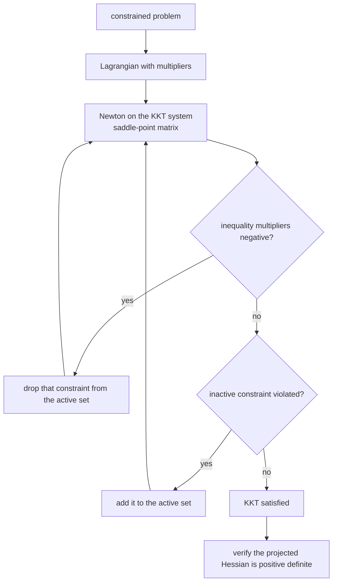
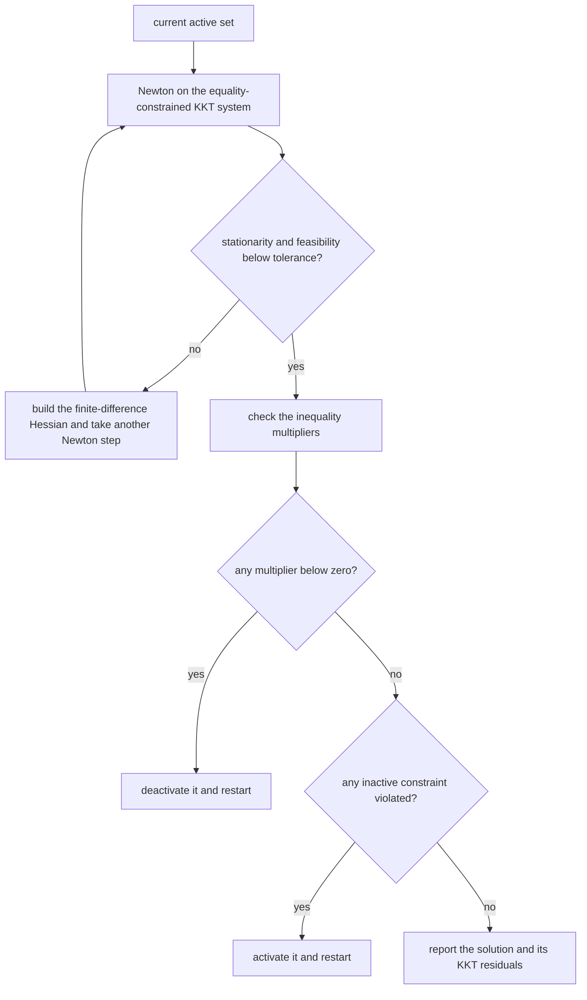
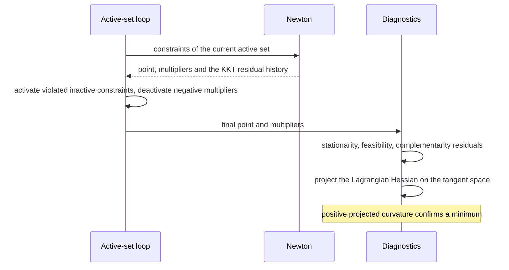

# 799 — Implement constrained optimization with Lagrange multipliers numeric solver

> **Tier:** Expert · **CTCI chapter:** Beyond — Numerical & Scientific Computing
> **Task spec:** [799-implement-constrained-optimization-with-lagrange-multipliers-num.md](../../../tasks/expert/799-implement-constrained-optimization-with-lagrange-multipliers-num.md)
> **Solutions:** [Python](../../../solutions/python/expert/799-implement-constrained-optimization-with-lagrange-multipliers-num/solution.py) ·
> [Java](../../../solutions/java/expert/799-implement-constrained-optimization-with-lagrange-multipliers-num/Solution.java) ·
> [JavaScript](../../../solutions/javascript/expert/799-implement-constrained-optimization-with-lagrange-multipliers-num/solution.js) ·
> [C#](../../../solutions/csharp/expert/799-implement-constrained-optimization-with-lagrange-multipliers-num/Solution.cs)

## 1. Problem restatement

Solve `min f(x)` subject to `g_i(x) = 0` and `h_j(x) <= 0` numerically, by solving the
**first-order optimality conditions** as a system of equations:

```text
grad f + sum_i lambda_i grad g_i + sum_j mu_j grad h_j = 0      (stationarity)
g = 0,   h <= 0,   mu_j >= 0,   mu_j h_j = 0                    (feasibility, dual feasibility, complementarity)
```

With only equalities, one Newton step on that system is

```text
[ H   J^T ] [ dx   ]     [ grad f + J^T lambda ]
[ J    0   ] [ dlam ] = -[ g                    ]
```

where `H` is the Hessian of the Lagrangian `L = f + lambda^T g` (built here by central second differences,
so the solver works for any twice-differentiable input) and `J` is the constraint Jacobian. Inequalities are
handled with a classical **active-set** loop: solve the equality-constrained problem on the current active
set, drop any active multiplier that came out negative, add any inactive constraint that is violated, and
repeat until the KKT system is satisfied. The second-order condition is checked independently by projecting
`H` onto the null space of `J` (Gram-Schmidt) and requiring `Z^T H Z` positive definite.

Measured results from the solution's own summary:

| Problem | Solution | Multiplier |
| --- | --- | --- |
| `min x^2 + y^2` s.t. `x + y = 1` | `[0.5, 0.5]` | `lambda = -1.00000000` |
| `min x^2 + 2y^2` s.t. `x + y = 1` | `[0.6666666667, 0.3333333333]` | `lambda = -1.33333333` |
| `min x^2 + y^2 + z^2` s.t. `x + y + z = 3`, `x = y` | `[0.9999999999, 0.9999999999, 0.9999999999]` | — |
| `min x^2 + y^2` s.t. `x + y >= 1` | `[0.5, 0.5]` | `mu = 1.00000000`, active set `[0]` |
| KKT residuals at the reported solutions | stationarity `5.351e-11`, complementarity `2.676e-11` | — |

Further assertions: each closed form is met to `1e-8` (positions) and `1e-6` (multipliers), a manifold search
(`ternary_search` on the reduced one-dimensional problem) agrees with the KKT optimum to `1e-10`, the KKT
diagnostics show stationarity below `1e-5`, feasibility below `1e-9` and a **positive-definite projected
Hessian**, an inactive inequality returns `mu = 0` with zero complementarity, and degenerate or infeasible
constraint sets raise `ValueError` instead of returning a fabricated answer.

## 2. Intuition

Constrained optimisation is a *root-finding* problem in disguise. The intuition of Lagrange multipliers is
geometric: at the optimum the objective's gradient cannot have any component along the constraint surface, so
it must be a combination of the constraint gradients,

```text
grad f = -sum_i lambda_i grad g_i
```

which is exactly the stationarity equation. Three consequences follow, and they shape the implementation.

1. **The unknowns are `(x, lambda)`, not `x`.** Adding the multipliers turns the constrained problem into a
   square nonlinear system, so a general-purpose Newton solver applies — and the KKT matrix is a
   *saddle-point* system, indefinite by construction, which is why a plain linear solver (Gaussian
   elimination with partial pivoting) is used rather than a Cholesky factorisation.
2. **Inequalities are handled by guessing which ones bind.** If a constraint is active it looks exactly like
   an equality; if it is inactive it carries `mu = 0` and disappears. The active-set loop is the bookkeeping:
   a multiplier that comes out **negative** means the constraint was not really binding (dual feasibility
   fails), a violated inactive constraint means the guess missed one.
3. **First order is not enough.** A stationary point of the Lagrangian can be a maximum or a saddle, so the
   checks project the Lagrangian Hessian onto the constraint's tangent space and require positive curvature —
   the second-order sufficient condition.



## 3. Algorithm

1. **Differentiation by finite differences.** `numeric_gradient` and `numeric_jacobian` use central
   differences with `step = 1e-6`; `lagrangian_gradient` adds the Jacobian rows weighted by the multipliers;
   `lagrangian_hessian` builds the full symmetric Hessian of `L` by central **second** differences
   (`step = 1e-5`), using the four-point formula for the mixed entries.
2. **Linear solver.** `solve_linear` is Gaussian elimination with partial pivoting, returning `None` for a
   singular system — the KKT matrix is indefinite, so nothing symmetric can be exploited.
3. **Newton on the KKT system.** `kkt_solve(f, equality, inequality, x, active, multipliers, max_iter=120,
   tol=1e-9)` assembles the constraints as `equality + active inequalities`, evaluates the stationarity
   residual `grad f + J^T lam` and the constraint values, stops when the largest absolute entry falls below
   the tolerance, and otherwise solves
   `[[H, J^T], [J, 0]] [dx; dlam] = -[stationarity; values]` and updates both blocks. A singular system raises
   `ValueError` ("degenerate or infeasible constraints"), and two consecutive non-improving iterations break
   out at the finite-difference noise floor.
4. **Active-set loop.** `solve_constrained(f, equality, inequality, x0, max_iter=80)` repeatedly calls
   `kkt_solve` on the current active set, then: adds the first violated inactive constraint
   (`h_j(x) > 1e-9`), or drops the first active constraint whose multiplier is below `-1e-9`, resetting the
   multipliers because the system changed; when neither applies it returns the solution dictionary with
   `x`, `lam_eq`, `mu`, `active` and the final residual.
5. **Diagnostics.** `kkt_diagnostics` recomputes the stationarity residual over all constraints, the
   feasibility residual (equality values plus the positive part of the inequalities), the complementarity
   residual `max |mu_j h_j|`, and — the second-order test — the projected curvature: an orthonormal basis of
   the null space of the *equality* Jacobian from `null_space_basis` (Gram-Schmidt on the rows, then on the
   coordinate axes), then the diagonal of `Z^T H Z`.
6. **Oracles.** `ternary_search` minimises the reduced one-dimensional problem along the constraint manifold
   by golden-section-style ternary search — a completely independent check, since it never touches the KKT
   machinery.

```text
procedure kktSolve(f, equality, inequality, x, active, multipliers, maxIter, tol)
    constraints ← equality plus inequality[j] for j in active
    lam ← multipliers padded with zeros to the constraint count
    point ← copy of x
    for iteration in 1 .. maxIter do
        gradient ← numericGradient(f, point)
        jacobian ← numericJacobian(constraints, point)
        values ← constraint(point) for every constraint
        stationarity ← gradient + transpose(jacobian) * lam
        residual ← max absolute entry of stationarity together with values
        if residual < tol then break
        hessian ← lagrangianHessian(f, constraints, lam, point)
        matrix ← [[H, J^T], [J, 0]]
        step ← solveLinear(matrix, -(stationarity, values))     // None means singular
        require step is not none
        point ← point + step[x part]
        lam ← lam + step[multiplier part]
    require the iteration converged

procedure solveConstrained(f, equality, inequality, x0, maxIter)
    active ← empty
    multipliers ← empty
    point ← copy of x0
    for iteration in 1 .. maxIter do
        point, lam, history ← kktSolve(f, equality, inequality, point, active, multipliers)
        if inequality is empty then return the solution
        feasible ← inequality[j](point) for every j
        violated ← inactive j with feasible[j] > 1e-9
        negative ← positions of active multipliers below -1e-9
        if violated is not empty then active.append(violated[0]), multipliers ← empty, continue
        if negative is not empty then remove that active entry, multipliers ← empty, continue
        return point, lam[equality part], active multipliers, active set, residual
    raise ValueError

procedure kktDiagnostics(f, equality, inequality, solution)
    stationarity ← residual of grad f plus every multiplier times its Jacobian row
    feasibility ← max of equality magnitudes and the positive parts of the inequalities
    complementarity ← max of modulus(mu_j times h_j)
    projected ← nullSpaceBasis(equality Jacobian, dimension)
    curvature ← diagonal of projected transpose times the Lagrangian Hessian times projected
    return stationarity, feasibility, complementarity, curvature
```



## 4. Worked example

**(a) One Newton step solves the ellipse problem exactly.** `min x^2 + 2y^2` s.t. `x + y = 1` from the start
`(0, 0)` with `lambda = 0`. Here `H = [[2, 0], [0, 4]]`, `J = [[1, 1]]`, so the KKT matrix is

```text
[ 2  0  1 ]
[ 0  4  1 ]
[ 1  1  0 ]          determinant -6
```

and the right-hand side is `-[grad f + J^T lambda; g] = -[0, 0, -1] = [0, 0, 1]`. Solving gives

| Row | Equation | Result |
| --- | --- | --- |
| 1 | `2 dx + dlam = 0` | `dx = -dlam / 2` |
| 2 | `4 dy + dlam = 0` | `dy = -dlam / 4` |
| 3 | `dx + dy = 1` | `-3 dlam / 4 = 1`, so `dlam = -4/3` |
| | | `dx = 2/3`, `dy = 1/3` |

The update lands on `(2/3, 1/3)` with `lambda = -4/3`, which is the exact optimum — checkable by hand:
`grad f = (4/3, 4/3) = -lambda (1, 1)` and `2/3 + 1/3 = 1`. The printed solution matches to ten decimal
digits, and the multiplier check uses `1e-6` because the finite-difference Hessian is what the general code
path actually uses. The same one-step behaviour happens on the circle problem (`H = 2I`), and the check that
makes this safe in general is the residual history: a stopped iteration must have driven the KKT residual
below `1e-9`, which the printed stationarity residual of `5.351e-11` confirms.

**(b) The active-set loop on an inequality.** `min x^2 + y^2` s.t. `x + y >= 1` (written as
`h = 1 - x - y <= 0`) started from `(2, 2)`:

| Step | Active set | Result | Decision |
| --- | --- | --- | --- |
| 1 | `{}` (the unconstrained optimum is `(0, 0)`, which violates the constraint) | infeasible, `h(0,0) = 1 > 0` | activate `h` |
| 2 | `{h}` | `(0.5, 0.5)`, `mu = +1` | multiplier positive, no violation |
| done | `{h}` | KKT satisfied | active set reported as `[0]` |

The sign is the interesting part: the multiplier comes out **positive** (`mu = 1.00000000`), which is exactly
dual feasibility for a `h <= 0` formulation, and the complementarity residual `max |mu h|` is `2.676e-11`
because `h` is zero at the optimum. Start instead from a point that already satisfies the constraint with
slack and the same machinery returns `mu = 0` with the constraint inactive — the check for
`h_above_loose` verifies exactly that.

**(c) Independent oracles.** Two oracles guard against a self-consistent but wrong KKT implementation:

| Oracle | Method | Agreement |
| --- | --- | --- |
| constrained manifold search, circle | `ternary_search` on `f(t, 1 - t)` | `0.5000000000` versus the KKT optimum `0.5000000000`, and `t = 0.5` located |
| constrained manifold search, three variables | `ternary_search` on `f(t, t, 3 - 2t)` | matches to `1e-9` |

The second one is a genuine reduction: two equality constraints in three variables leave a one-dimensional
feasible set, so the constrained problem becomes a scalar minimisation that ternary search solves without
ever forming a Lagrangian. Note that this oracle can only be built for problems whose feasible set is
parameterisable — which is why the general-purpose checks in this task are the KKT residuals and the
second-order test.

**(d) The second-order condition.** At the circle optimum the equality Jacobian is `(1, 1)`, so its null
space is spanned by `(1, -1) / sqrt(2)`; projecting `H = 2I` onto that direction gives curvature `2 > 0`.
The check requires every projected curvature to be positive on all three equality-constrained problems,
which is what separates a genuine minimum from a stationary maximum or saddle that satisfies the first-order
conditions equally well.



## 5. Complexity

Let `n` be the number of variables, `m` the number of constraints and `A` the number of active-set changes.

| Operation | Best | Average | Worst | Why the bound holds |
| --- | --- | --- | --- | --- |
| `numeric_gradient` | O(n) | O(n) | O(n) | two evaluations per coordinate |
| `numeric_jacobian` | O(m n) | O(m n) | O(m n) | two evaluations per constraint and coordinate |
| `lagrangian_hessian` | O(n²) | O(n²) | O(n²) | `n` second differences and `n(n-1)/2` four-point differences |
| `solve_linear` | O((n+m)³) | O((n+m)³) | O((n+m)³) | dense Gaussian elimination on the saddle-point matrix |
| one Newton iteration | O((n+m)³) | O((n+m)³) | O((n+m)³) | dominated by the linear solve; the finite differences are lower order |
| `kkt_solve` | O((n+m)³) | O((n+m)³) | O(max_iter · (n+m)³) | typically 1-3 iterations for the quadratic test problems; the checks measure a stationarity residual of `5.351e-11` |
| `solve_constrained` | O(kkt_solve) | O(max_iter · kkt_solve) | same | the active set changes at most a few times; the loop is capped at 80 |
| `null_space_basis` | O(n m + n²) | same | same | Gram-Schmidt on the `m` rows, then on the `n` axes |
| Space | O((n+m)²) | same | O((n+m)²) | the KKT matrix dominates |

Comparison with the alternatives:

| Method | Handles inequalities | Second-order check | Notes |
| --- | --- | --- | --- |
| Unconstrained Newton | no | Hessian definiteness | ignores the constraints entirely |
| KKT Newton with an active set (this task) | yes, by an active-set loop | projected Hessian | exact for small smooth problems; no line search, so plain Newton steps are accepted |
| Quadratic penalty method (Java variant) | yes, via a penalty | — | converges with an error of order `1 / rho`; the Java checks verify that fall-off |
| Interior point | yes | barrier-based | better for large problems, needs a line search and a barrier parameter schedule |
| Sequential quadratic programming | yes | yes | production-grade; adds a merit function and a trust region |

## 6. Pitfalls and edge cases

- **The KKT matrix is indefinite.** It is a saddle-point system, so it must be factored with pivoting; a
  Cholesky or any symmetric-positive-definite assumption fails or silently produces garbage.
- **A singular KKT system is reported, not patched.** Degenerate or infeasible constraint sets (violated
  constraint qualification) raise `ValueError`, which the Java variant documents as the intended behaviour
  instead of returning a fabricated point.
- **Multipliers must be reset when the active set changes.** `solve_constrained` clears the multiplier
  estimate whenever a constraint is added or dropped, because the previous solution no longer applies to the
  new system.
- **The sign convention of the multipliers.** For `h <= 0` and `L = f + mu h`, dual feasibility means
  `mu >= 0`; the measured `mu = +1` for `x + y >= 1` is the check, and `mu = 0` for the inactive
  `h_above_loose`.
- **Complementarity is a residual too.** `max |mu_j h_j|` is measured (`2.676e-11`) and asserted, because a
  bug that leaves an inactive constraint's multiplier non-zero would still satisfy stationarity and
  feasibility.
- **Second-order conditions are checked independently.** Positive projected curvature on the tangent space is
  the sufficient condition; a stationary point with negative curvature would be a local maximum, and finding
  it would satisfy the first-order checks.
- **Finite-difference accuracy limits the tolerances.** Gradients use `1e-6` and Hessians `1e-5` steps, so the
  checks require `1e-5`-level stationarity rather than machine precision, and `kkt_solve` stops when two
  consecutive iterations fail to improve by more than `1e-14` — the noise floor, not a convergence failure.
- **Feasibility is defined with a positive part.** The diagnostic takes `max(0, h_j)` so that a satisfied
  inequality contributes exactly zero, and the active-set loop uses the same `1e-9` threshold when deciding
  whether an "inactive" constraint is violated.
- **The manifold oracle only exists for parameterisable feasible sets.** `ternary_search` works here because
  one or two linear equalities leave a line or plane; for a nonlinear feasible set the KKT residuals carry
  the verification burden.
- **Documented simplifications.** Dense linear algebra, finite-difference Hessians (no exact second
  derivatives, no quasi-Newton updates), a plain active-set loop instead of an interior-point method, and no
  line search or trust region — the Newton step is accepted directly, which is adequate for the smooth small
  problems used here.

## 7. Variants and follow-ups

- **Interior-point methods.** Replace the hard active set with a barrier and a parameter schedule.
- **SQP with a merit function.** Add a line search on a merit function so arbitrary starts converge.
- **Exact derivatives or automatic differentiation.** The finite-difference Hessian is the accuracy limit.
- **Quadratic penalty as a cross-check.** The Java variant verifies the `1/rho` error decay of that route.
- **Related tasks.** [788 — stiff implicit solver](../../../tasks/expert/788-implement-stiff-ode-solver-l-stable-method-concept.md) and
  [790 — bundle adjustment](../../../tasks/expert/790-implement-bundle-adjustment-sparse-solver-outline-with-levenberg.md)
  and [800 — simulated annealing](../../../tasks/expert/800-implement-global-optimization-via-simulated-annealing-with-cooli.md).

## 8. Check yourself

<details><summary>Show answer</summary>
**Why is solving the KKT conditions the same thing as solving the constrained problem?** The KKT conditions
are necessary for a regular local minimum (under a constraint qualification), and the second-order condition
makes them sufficient: stationarity plus feasibility plus positive projected curvature certifies a local
minimum. The solver therefore targets the equations, and the diagnostics check both the residual and the
curvature rather than trusting the residual alone.
</details>

<details><summary>Show answer</summary>
**What does a negative active multiplier tell the loop?** That the constraint was wrongly assumed to bind.
For `h <= 0` the Lagrangian term is `+ mu h`, and moving off the constraint in the direction that relaxes it
decreases `L` when `mu < 0`, so the point cannot be optimal with that constraint active. The loop drops it and
re-solves on the smaller active set.
</details>

<details><summary>Show answer</summary>
**Why is a separate second-order test needed when the KKT residual is essentially zero?** Because a saddle or
a maximum satisfies the same first-order equations. On the three-variable problem the checks confirm the
projected Hessian is positive definite in the tangent space, which is what rules out the maximum `(3, 0, 0)`
of the same objective on the same feasible set — it is stationary but not minimal, and only the curvature
distinguishes them.
</details>

<details><summary>Show answer</summary>
**Both worked problems converge in a single Newton step. Is the iteration loop therefore unnecessary?** No:
both problems are quadratic with linear constraints, for which the KKT system is linear and one step is
exact. The general code path differentiates the Lagrangian numerically and iterates, which is why the
solution exposes the residual history and stops on convergence (or on the finite-difference noise floor) —
and why the checks assert the residual, not a step count.
</details>
