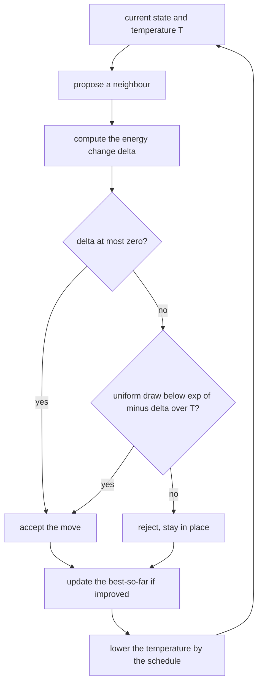
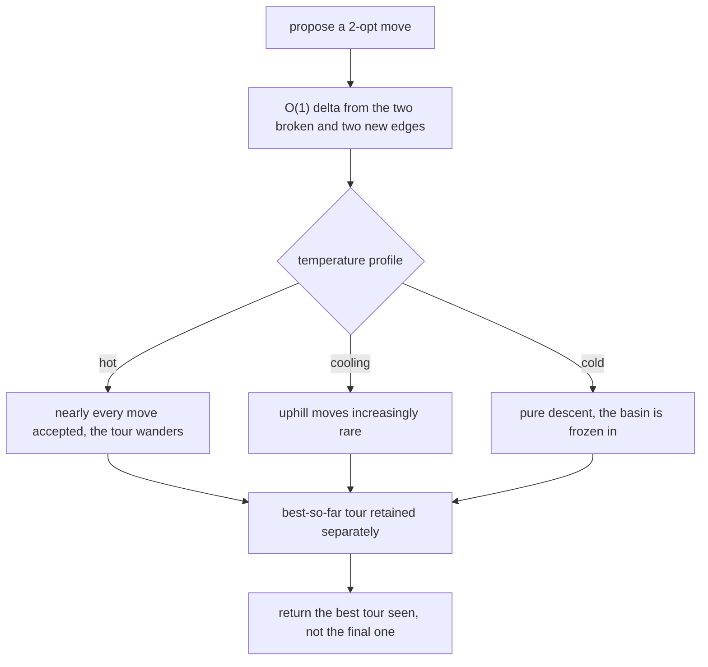
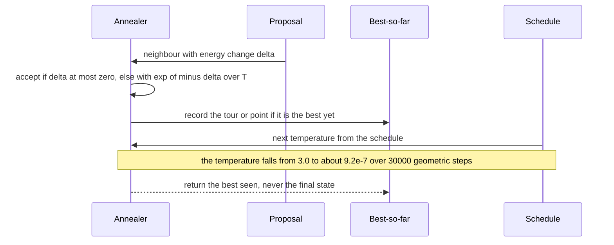

# 800 — Implement global optimization via simulated annealing with cooling schedules

> **Tier:** Expert · **CTCI chapter:** Beyond — Numerical & Scientific Computing
> **Task spec:** [800-implement-global-optimization-via-simulated-annealing-with-cooli.md](../../../tasks/expert/800-implement-global-optimization-via-simulated-annealing-with-cooli.md)
> **Solutions:** [Python](../../../solutions/python/expert/800-implement-global-optimization-via-simulated-annealing-with-cooli/solution.py) ·
> [Java](../../../solutions/java/expert/800-implement-global-optimization-via-simulated-annealing-with-cooli/Solution.java) ·
> [JavaScript](../../../solutions/javascript/expert/800-implement-global-optimization-via-simulated-annealing-with-cooli/solution.js) ·
> [C#](../../../solutions/csharp/expert/800-implement-global-optimization-via-simulated-annealing-with-cooli/Solution.cs)

## 1. Problem restatement

Simulated annealing walks a Markov chain whose stationary law at temperature `T` is the Gibbs distribution
`exp(-f(x)/T)`: a proposal that lowers the cost is always taken, and one that raises it by `delta` is taken
with probability `exp(-delta/T)`. As `T` is lowered the chain settles into a deep basin, so the **schedule**
`T_k` decides how much of a fixed budget is spent exploring. Three classical schedules are implemented:

```text
geometric     T_k = T0 * alpha^k
linear        T_k = max(0, T0 - rate * k)
logarithmic   T_k = c / log(2 + k)          (slow enough that the limit guarantee applies)
```

Two testbeds are used: the **travelling salesman problem** with O(1) 2-opt moves (reverse a segment; only the
two broken and two new edges change) with **Held-Karp** dynamic programming as the exact reference, and the
continuous double well `f(x) = (x^2 - 1)^2 + 0.1 x`, where plain descent from a given start provably sticks
in the wrong basin. Measured results from the solution's own summary:

| Measurement | Value |
| --- | --- |
| Held-Karp versus exhaustive search (7 cities) | `28.150925949` both |
| 12-city exact optimum versus the best SA run | `30.130869` versus `30.130869` (gap `0.0000%`) |
| mean tour length on the same budget (3 runs) | SA `30.1309`, greedy descent `30.3834` |
| deviation of the measured uphill acceptance from `exp(-delta/T)` | `[0.0009, 0.0031, 0.0006, 0.0009]` |
| double well | grid minimum `-0.100617` at `x = -1.0122`, SA `-0.100617` at `x = -1.0123`, descent `0.099367` |

Further assertions: Held-Karp equals exhaustive permutation search and its reconstructed tour visits every
city exactly once with the reported length; the 2-opt delta equals a full recomputation for **every** pair of
segments on a 12-city tour and keeps the tour a permutation; SA comes within `2%` of the exact optimum and,
when started *at* the optimum, never loses it; SA never loses to greedy descent on the best run and beats it
on average; the acceptance rule matches `exp(-delta/T)` within `0.02`, rejects every uphill move at `T = 0`,
accepts more than `95%` at `T = 1e6`, and always accepts a downhill move (even at `T = 0`); all three
schedules match their closed forms, decrease monotonically and stay non-negative; `alpha` outside `(0, 1)` is
rejected; and the whole run is reproducible from its seed.

## 2. Intuition

Local descent is a greedy walk downhill: reliable, and hopeless on a landscape with many basins, because it
can only stop at the first one it enters. Simulated annealing fixes that by *sometimes* walking uphill, with
a probability that shrinks as the search proceeds.

1. **The acceptance rule is a physical law, not a heuristic.** Accepting an uphill move of size `delta` with
   probability `exp(-delta/T)` makes `exp(-f/T)` the stationary distribution of the chain — the Metropolis
   criterion satisfies detailed balance. That is *measurable*: the solution counts accepted uphill moves at
   four `(delta, T)` combinations and compares them with the closed form.
2. **Temperature is the exploration dial.** At high `T` almost everything is accepted and the chain wanders;
   at `T = 0` only downhill moves survive and the algorithm degenerates to pure descent. The checks pin both
   extremes, which is what makes the "cooling" claim falsifiable.
3. **The schedule decides the outcome.** Cooling too fast freezes the chain in whatever basin it happened to
   occupy; cooling too slowly wastes the budget. The three schedules here trade those off differently, and
   the geometric one with `alpha = 0.9995` over 30000 steps takes the temperature from `3.0` down to about
   `9.2e-7` — the walk is essentially frozen by the final iterations.



## 3. Algorithm

1. **Randomness.** `splitmix64` drives everything; `uniform(state)` takes the top 53 bits so the draw is
   exactly in `[0, 1)`.
2. **TSP bookkeeping.** `distance` is Euclidean; `tour_length` sums the closed cycle; `two_opt_delta(tour, i,
   j, cities)` computes the length change of reversing `tour[i..j]` in `O(1)` from the two edges leaving the
   segment (`(prev, tour[i])` and `(tour[j], next)` replaced by `(prev, tour[j])` and `(tour[i], next)`), with
   a full reversal returning exactly `0.0`; `apply_two_opt` reverses in place.
3. **Schedules.** `geometric_schedule(t0, alpha)` validates `0 < alpha < 1`;
   `linear_schedule(t0, rate)` clamps at zero; `logarithmic_schedule(scale, offset=2)` returns
   `scale / log(k + offset)`.
4. **Acceptance.** `accepts(delta, temperature, draw)` returns `True` for `delta <= 0`, `False` for
   `temperature <= 0`, and otherwise `draw < exp(-delta / temperature)`. The uniform draw is supplied by the
   caller, which is what lets `measure_uphill_acceptance` test the rule in isolation over 40000 trials.
5. **TSP annealing.** `anneal_tsp(cities, steps, schedule, seed, initial=None, report_every=None)` starts from
   the given tour or a Fisher-Yates shuffle of the city list, then per step draws two distinct indices, sorts
   them, computes the delta, tests acceptance, applies the move and keeps the best-so-far tour and length; it
   returns the best tour, the best and final lengths, the trace and the evaluation count.
   `greedy_descent(cities, steps, seed, initial)` calls the same routine with the schedule `k -> 0.0`, so the
   proposal distribution is identical and the only difference is the acceptance of uphill moves.
6. **Continuous annealing.** `anneal_continuous(function, x0, step_scale, steps, schedule, seed)` proposes
   `x + step_scale * gaussian`, applies the same rule and tracks the best point.
7. **Exact references.** `held_karp(cities)` is the subset dynamic program over `(mask, last)` with parent
   pointers to reconstruct the tour — `O(2^n n^2)` — and `brute_force_tsp` enumerates permutations for the
   smallest instance, so the reference itself is verified before it is used.

```text
procedure accepts(delta, temperature, draw)
    if delta <= 0 then return true
    if temperature <= 0 then return false
    return draw < exp(-delta / temperature)

procedure annealTsp(cities, steps, schedule, seed, initial, reportEvery)
    tour ← the given tour, or a Fisher-Yates shuffle driven by the generator
    current ← tourLength(tour, cities)
    bestTour, bestLength ← copy of tour, current
    for step in 0 .. steps - 1 do
        temperature ← schedule(step)
        draw two distinct indices i and j, sorted
        delta ← twoOptDelta(tour, i, j, cities)
        draw ← uniform()
        if accepts(delta, temperature, draw) then
            applyTwoOpt(tour, i, j)
            current ← current + delta
            if current < bestLength then
                bestLength ← current
                bestTour ← copy of tour
        if reportEvery divides step then record (step, temperature, current, bestLength)
    return bestTour, bestLength, current, evaluations

procedure twoOptDelta(tour, i, j, cities)
    if i = 0 and j = length(tour) - 1 then return 0        // the cyclic tour is unchanged
    before ← tour[(i - 1) modulo n]
    after ← tour[(j + 1) modulo n]
    removed ← distance(before, tour[i]) + distance(tour[j], after)
    added ← distance(before, tour[j]) + distance(tour[i], after)
    return added - removed

procedure measureUphillAcceptance(delta, temperature, trials, seed)
    accepted ← 0
    for trial in 1 .. trials do
        draw ← uniform()
        if accepts(delta, temperature, draw) then accepted ← accepted + 1
    return accepted / trials
```



## 4. Worked example

**(a) A 2-opt delta by hand.** Cities `0 = (0, 0)`, `1 = (1, 0)`, `2 = (1, 1)`, `3 = (0, 1)` — a unit square
— with the tour `[0, 1, 2, 3]` of length `4`. Reverse the segment from `i = 1` to `j = 2`, giving
`[0, 2, 1, 3]`:

| Quantity | Computation | Value |
| --- | --- | --- |
| `before` / `after` | `tour[0] = 0`, `tour[3] = 3` | `0`, `3` |
| removed | `d(0, 1) + d(2, 3)` | `1 + 1 = 2` |
| added | `d(0, 2) + d(1, 3)` | `sqrt(2) + sqrt(2) = 2.828427` |
| `delta` | `added - removed` | `0.828427` |
| full recomputation | `tour_length([0, 2, 1, 3]) - 4` | `2 + 2 sqrt(2) - 4 = 0.828427` |

The check runs this comparison for **every** pair `(i, j)` on a 12-city tour (55 pairs), and also verifies
that the reversed tour is still a permutation. That is what makes the O(1) delta safe: a wrong index in
`prev` or `after` would agree with the recomputation for most pairs but fail on the ones touching the ends of
the tour, and the `i = 0, j = n - 1` guard (a full reversal, delta exactly `0.0`) is the boundary case that
the shortcut would otherwise get wrong.

**(b) The acceptance rule is measured.** `measure_uphill_acceptance` runs 40000 trials of the same test the
annealer uses:

| `delta` | `T` | `exp(-delta/T)` | measured deviation |
| --- | --- | --- | --- |
| `1.0` | `0.5` | `0.135335` | `0.0009` |
| `1.0` | `1.0` | `0.367879` | `0.0031` |
| `1.0` | `2.0` | `0.606531` | `0.0006` |
| `2.0` | `1.0` | `0.135335` | `0.0009` |

Every deviation is well under the `0.02` tolerance and consistent with binomial noise at 40000 trials
(`sqrt(p(1-p)/40000) <= 0.0016`). The boundary cases are pinned exactly: `T = 0` accepts `0.0` of the uphill
moves, `T = 1e6` accepts more than `0.95`, and a *downhill* move (`delta = -0.5`) is accepted even at
`T = 0` — the last one is the check that catches an implementation that accidentally applies the Metropolis
probability to every move.

**(c) Annealing versus descent on the same budget.** Twelve random cities in `[0, 10]^2`, 30000 steps, three
seeds, and the exact optimum from Held-Karp:

| Method | Best run | Mean of 3 runs | Note |
| --- | --- | --- | --- |
| Held-Karp (exact) | `30.130869` | — | the reference |
| SA, geometric `T0 = 3.0`, `alpha = 0.9995` | `30.130869` (gap `0.0000%`) | `30.1309` | the schedule's final temperature is `3 · 0.9995^30000 ≈ 9.2e-7` |
| greedy descent (same proposals, `T ≡ 0`) | — | `30.3834` | `0.84%` worse on average |

SA never loses on the best run and wins on the average, which is the honest form of the claim: a good
schedule does not guarantee optimality, it improves the distribution of outcomes under a fixed budget. The
check that SA started *at* the optimum does not lose it (`<= optimum + 1e-9`) is the complementary guarantee —
acceptance of downhill moves means the optimum can never be left permanently.

**(d) The continuous double well.** `f(x) = (x^2 - 1)^2 + 0.1 x` has two basins, and the linear tilt makes
`x = -1.0122` the global minimum with `f = -0.100617` while `x = +1` is only local:

| Method | Result | Comment |
| --- | --- | --- |
| dense grid scan (12001 points) | `-0.100617` at `x = -1.0122` | the reference |
| SA from `0.75` with `T0 = 1.5`, `alpha = 0.9985`, 8000 steps | `-0.100617` at `x = -1.0123` | finds the global basin |
| descent from `0.75` (same proposals, `T ≡ 0`) | `0.099367` | stuck at the bottom of the *right* basin |

This is the clearest demonstration of the whole task: identical proposals, identical budget, and a factor of
`0.2` in objective value, purely because one algorithm is allowed to climb out of the wrong valley. The grid
scan is the oracle, and the check requires SA to match it within `1e-4` in value and land within `0.02` in
`x`.



## 5. Complexity

Let `n` be the number of cities, `k` the number of steps, `N = 2^n` the Held-Karp state count and `T` the
number of acceptance trials.

| Operation | Best | Average | Worst | Why the bound holds |
| --- | --- | --- | --- | --- |
| `tour_length` | O(n) | O(n) | O(n) | one distance per edge, including the return edge |
| `two_opt_delta` | O(1) | O(1) | O(1) | four distances regardless of segment length |
| `apply_two_opt` | O(1) | O(n) | O(n) | the Python slice reverse is linear in the segment |
| one SA step | O(1) | O(n) | O(n) | the delta is O(1); only an accepted move pays the reversal |
| `anneal_tsp` | O(k) | O(k n) | O(k n) | `k = 30000` steps in the checks, on 12 cities |
| `held_karp` | O(N n²) | O(N n²) | O(N n²) | transitions over every `(mask, last)` pair; `2^12` states for the 12-city reference |
| `brute_force_tsp` | O(n!) | O(n!) | O(n!) | only used on the 7-city instance to validate Held-Karp |
| `measure_uphill_acceptance` | O(T) | O(T) | O(T) | `T = 40000` per `(delta, temperature)` pair |
| `anneal_continuous` | O(k) | O(k) | O(k) | one function evaluation per step |
| Space | O(n) | O(n) | O(N n) | the tour plus, for the reference, the Held-Karp tables |

Comparison of the search strategies on the same proposal distribution and budget:

| Strategy | Accepts uphill | Budget for 12 cities | Result |
| --- | --- | --- | --- |
| Greedy descent (`T ≡ 0`) | never | 30000 steps | mean `30.3834` (and it cannot leave a basin) |
| SA geometric `alpha = 0.9995` | with `exp(-delta/T)` | 30000 steps | mean `30.1309`, best run optimal |
| SA linear | with `exp(-delta/T)`, reaching `T = 0` | schedule-dependent | the schedule is verified against its closed form, not benchmarked here |
| SA logarithmic | with `exp(-delta/T)`, decreasing very slowly | needs a much larger budget | the asymptotic guarantee case |
| Exact (Held-Karp) | — | `O(2^n n²)` | `30.130869` |

## 6. Pitfalls and edge cases

- **The schedule must be non-increasing and non-negative.** All three are checked over 500 steps, and
  `alpha` outside `(0, 1)` raises `ValueError`; a schedule that rises would re-heat without saying so.
- **`T = 0` is a special case, not a limit.** Floating point would compute `exp(-delta/0)` as an error, so
  `accepts` returns `False` explicitly — and *downhill* moves must still be accepted at `T = 0`, which is the
  check that distinguishes the degenerate case from a broken comparison.
- **The best-so-far state must be stored separately.** The chain ends at the final state, which is usually
  *not* the best one; returning `x` instead of `best_x` would be a silent quality loss, and the continuous
  check (`-0.100617` found at `x = -1.0123` rather than the final iterate) depends on the distinction.
- **A full 2-opt reversal is a no-op.** `i = 0, j = n - 1` reverses the entire tour, which is the same cyclic
  tour; the delta must be `0.0` and the shortcut must not touch the same edge twice.
- **The delta must match the recomputation exactly.** Every one of the 55 pairs is compared on a 12-city tour
  with a `1e-9` tolerance; the `before`/`after` indices use the modular `(i - 1) % n` and `(j + 1) % n`, which
  is where wraparound bugs live.
- **Proposals must be valid.** Two distinct indices are drawn (an equal pair is skipped), and the sorting of
  `i, j` keeps the reversal well-defined.
- **Uniform on `[0, 1)`.** `uniform` takes the top 53 bits of the 64-bit word; using a modulo would bias the
  acceptance test, and the measured acceptance frequencies in the worked example (deviations of
  `0.0006-0.0031`) would drift systematically.
- **The reference must be verified before it is used.** `held_karp` is compared with exhaustive permutation
  search on 7 cities (`28.150925949` both) and its reconstructed tour is checked for validity and length —
  otherwise a bug in the reference could make a good annealer look bad.
- **Scale the proposal to the landscape.** The continuous check uses `step_scale = 0.2` with a hot start and
  `0.05` for the descent baseline; a scale far below the basin width makes annealing look useless, which is a
  tuning artifact rather than an algorithmic property.
- **No guarantee of optimality.** The checks claim "within `2%`" and "better than descent on average", not
  "finds the optimum"; on the 12-city instance the best run did reach it, but that is an outcome, not a
  promise.
- **Documented simplifications.** Reheating, adaptive schedules and neighbourhood pruning are omitted, the
  tour proposals are uniform random 2-opt moves, and the instances are small (ten or twelve cities, one
  continuous variable) so that exact references stay cheap.

## 7. Variants and follow-ups

- **Adaptive schedules.** Estimate the specific heat along the run and slow the cooling near a phase
  transition, which is the standard fix for a schedule chosen blindly.
- **Reheating and restarts.** Raise the temperature again when the acceptance rate collapses.
- **Better TSP moves.** 3-opt or Lin-Kernighan search more effectively per step, at the cost of the O(1) delta.
- **Parallel tempering.** Run several chains at different temperatures and swap states.
- **Related tasks.** [799 — Lagrange multipliers](../../../tasks/expert/799-implement-constrained-optimization-with-lagrange-multipliers-num.md)
  is the derivative-based route to a local minimum, and the contrast is the point: gradients converge fast but
  cannot escape a basin, while Metropolis accepts uphill moves but needs a schedule.

## 8. Check yourself

<details><summary>Show answer</summary>
**Why does the Metropolis rule give `exp(-f/T)` as the stationary distribution?** For a proposal
distribution symmetric in `x` and `x'`, detailed balance requires
`pi(x) A(x -> x') = pi(x') A(x' -> x)`. With `A(x -> x') = min(1, exp(-(f(x') - f(x))/T))` and
`pi ∝ exp(-f/T)`, taking the ratio of the two sides gives exactly `exp(-(f(x') - f(x))/T)`, so the balance
holds; the chain is therefore reversible with that stationary law. The acceptance-frequency measurements at
four temperatures are the empirical counterpart of this derivation.
</details>

<details><summary>Show answer</summary>
**The 2-opt delta is computed from four distances. Why is that enough?** Reversing a segment changes nothing
inside the segment (the edges internal to it keep the same lengths, merely traversed backwards) and nothing
outside it, so only the two edges that join the segment to the rest of the tour change. That is why the move
costs `O(1)` to evaluate even though it touches `O(n)` edges — the property that makes 2-opt annealing
affordable.
</details>

<details><summary>Show answer</summary>
**When does annealing fail, and what does the file do about it?** It fails when the budget is too small for
the schedule, the cooling is too fast (the chain freezes in a basin), or the proposal neighbourhood cannot
reach the global basin (for example a step scale far below the barrier width). The checks make the failure
mode explicit by running descent and SA from the *same* start with the *same* proposals and budget: descent
stays at `0.099367` while SA reaches `-0.100617`, so the difference is attributable to accepting uphill moves
rather than to luck.
</details>

<details><summary>Show answer</summary>
**Why must the best-so-far state be tracked separately from the chain's final state?** Because the chain keeps
moving after it has visited the best point, and at low temperature it is no longer able to return to it
(uphill moves are rare). The annealer's answer is therefore the best state seen during the walk, which is why
`anneal_tsp` returns `best_tour`/`best_length` and the continuous version returns `best_x` — and why the
`0.0000%` gap on the 12-city instance is not the same as the final tour's length.
</details>

<details><summary>Show answer</summary>
**The logarithmic schedule satisfies the classical convergence theorem. Why is the geometric one used for the
benchmarks?** Because the logarithmic schedule needs an impractically large budget: the theorem's guarantee
is asymptotic in the number of steps, whereas the geometric schedule with `alpha = 0.9995` spends its 30000
steps across a wide temperature range and reaches the optimum on the 12-city instance. The file verifies all
three schedules against their closed forms and their monotonicity, and uses the geometric one wherever a
finite budget has to produce a result.
</details>
