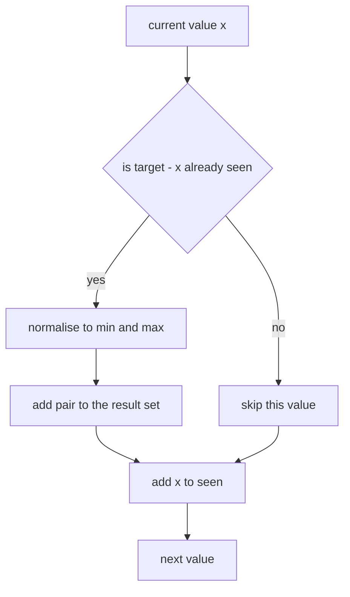
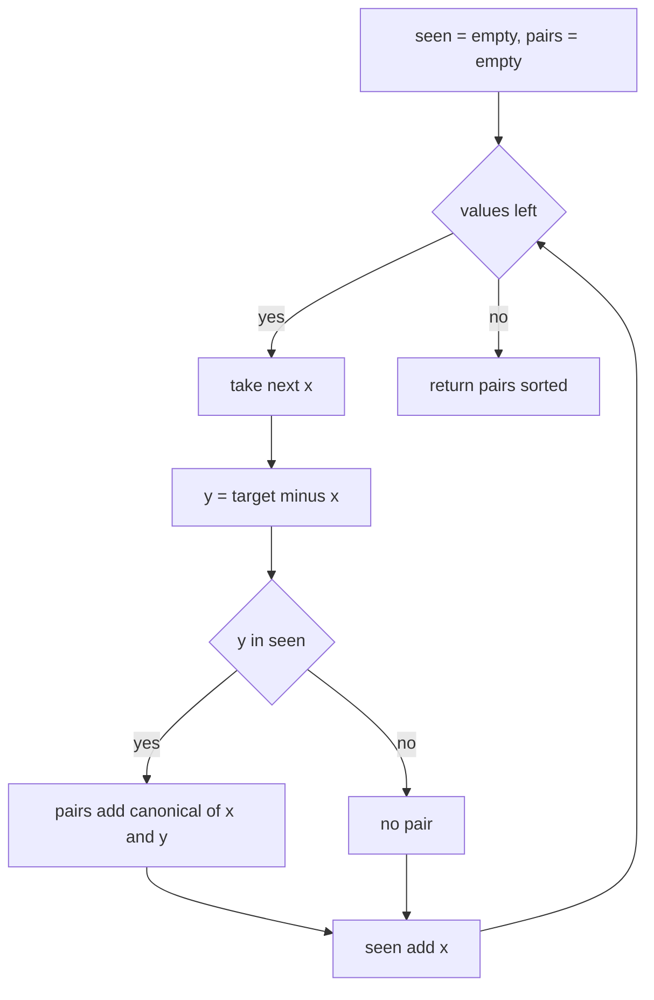
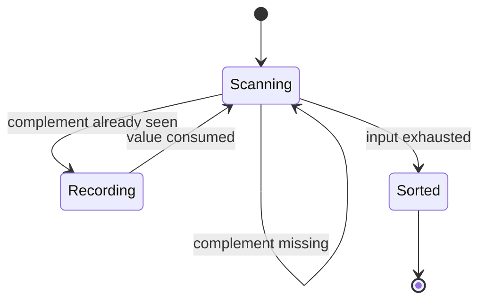
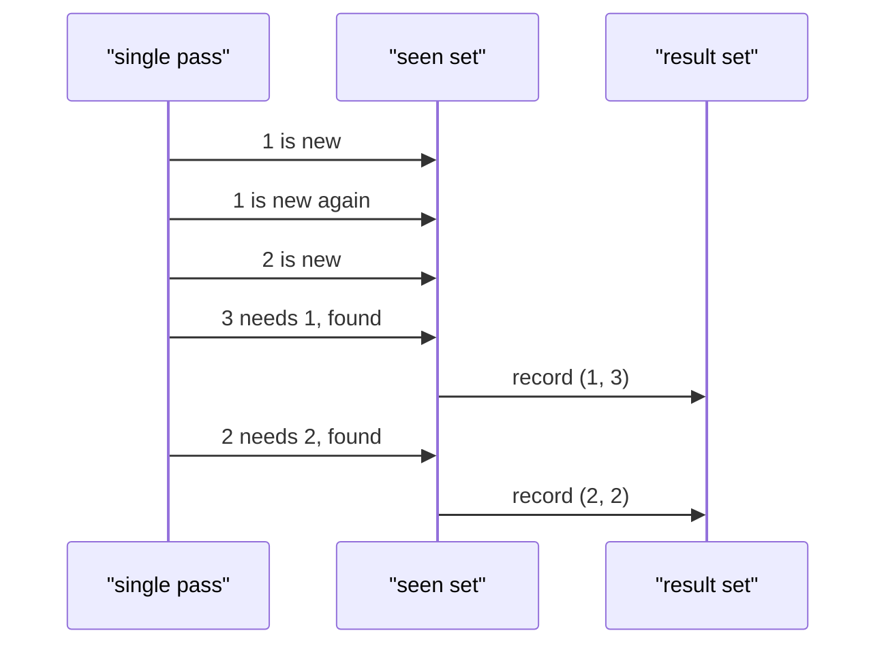

# 201 — Two-sum unique pairs (return all unique pairs).

> **Tier:** Intermediate · **CTCI chapter:** Ch 1 — Arrays and Strings
> **Task spec:** [201-two-sum-unique-pairs-return-all-unique-pairs.md](../../../tasks/intermediate/201-two-sum-unique-pairs-return-all-unique-pairs.md)
> **Solutions:** [Python](../../../solutions/python/intermediate/201-two-sum-unique-pairs-return-all-unique-pairs/solution.py) ·
> [Java](../../../solutions/java/intermediate/201-two-sum-unique-pairs-return-all-unique-pairs/Solution.java) ·
> [JavaScript](../../../solutions/javascript/intermediate/201-two-sum-unique-pairs-return-all-unique-pairs/solution.js) ·
> [C#](../../../solutions/csharp/intermediate/201-two-sum-unique-pairs-return-all-unique-pairs/Solution.cs)

## 1. Problem restatement

**Input:** an array `nums` of integers (possibly empty, possibly with repeated values, possibly
negative) and an integer `target`.

**Output:** every *distinct* pair of **values** `(x, y)` with `x + y == target` and `x <= y`,
each pair reported once, the list ordered ascending. A pair is a pair of values, not of indices:
if the value `3` occurs five times, `(3, 3)` is still reported once.

The task spec states the problem in one line, so the contract is pinned down by the assertions
the four solution files ship with:

| Call | Result | Why |
| --- | --- | --- |
| `two_sum_unique_pairs([1, 1, 2, 3, 2], 4)` | `[(1, 3), (2, 2)]` | `1+3` appears twice and `2+2` appears twice, but each pair is emitted once |
| `two_sum_unique_pairs([1, 5, 3, 3, 5], 6)` | `[(1, 5), (3, 3)]` | the two `5`s pair with the single `1`, still one pair |
| `two_sum_unique_pairs([0, 0, 0], 0)` | `[(0, 0)]` | three zeros, one pair |
| `two_sum_unique_pairs([-1, 1, 0], 0)` | `[(-1, 1)]` | negative values are ordinary values here |
| `two_sum_unique_pairs([1, 2, 3], 100)` | `[]` | no pair reaches the target |
| `two_sum_unique_pairs([], 5)` | `[]` | nothing to pair |

Python and Java assert all six rows; JavaScript and C# assert all of them except the empty-array
case. The C# file renders tuples as text
(`"(1, 3),(2, 2)"`) purely for its `Check` helper. No input validation is required, the input
array is never modified, and duplicates in the *input* must not become duplicates in the
*output*.

## 2. Intuition

The naive idea is to look at every index pair and keep the ones whose values add up:

```text
for i ← 0 to n - 1 do
    for j ← i + 1 to n - 1 do
        if nums[i] + nums[j] == target then
            report the pair of values
        end
    end
end
```

That is `n * (n - 1) / 2` comparisons — **O(n²)** — and it still does not answer the question,
because it reports `(1, 3)` twice for `[1, 1, 2, 3, 2]`. Making the output unique means
deduplicating afterwards, which costs another pass and another structure.

The change of view that fixes both problems is to stop thinking about index pairs and start
thinking about **value pairs**. A pair is identified by the unordered pair `{x, y}` with
`x + y == target`; the canonical form is `(min(x, y), max(x, y))`. Once you normalise a pair
that way, a plain set does the deduplication for free, and you only ever need to know whether
the complementary value `target - x` has been seen *somewhere earlier in the array*:

- Walk the array once, keeping a set of the values already visited.
- For the current value `x`, the partner must be `y = target - x`. If `y` is in the seen set,
  the unordered pair `(min(x, y), max(x, y))` is a witness and belongs in the result set.
- Add `x` to the seen set and continue.

Every valid unordered pair has a unique *first* index and a unique *second* index (first
occurrence order), so when the second one is read the first is already in `seen` and the pair
is recorded exactly once. That is the whole algorithm: one pass, one hash set, one result set.



## 3. Algorithm

1. Create an empty `seen` set and an empty `pairs` set.
2. For each `x` in `nums`:
   1. Let `y = target - x`.
   2. If `y` is in `seen`, insert `(min(x, y), max(x, y))` into `pairs`.
   3. Insert `x` into `seen`.
3. Return the contents of `pairs` in ascending order.

```text
function two_sum_unique_pairs(nums, target)
    seen ← empty set
    pairs ← empty set
    for each x in nums do
        y ← target - x
        if seen contains y then
            pairs.add(min(x, y), max(x, y))
        end
        seen.add(x)
    end
    return sorted(pairs)
end
```

The ordering step is the only difference between the four languages: Python sorts the set of
tuples, Java uses a `TreeSet` with an explicit `(first, second)` comparator, JavaScript stores
values in a `Map` keyed by the string `a + "," + b` and sorts the extracted array, and C# uses
`SortedSet<(int, int)>` with the language's default tuple ordering. All four therefore return
the same sequence, which is what makes the assertions portable.



Seen as a small machine, the loop has exactly two decisions per value — "was the complement
already here" and "is there another value" — and never revisits a value:



## 4. Worked example

Run `two_sum_unique_pairs([1, 1, 2, 3, 2], 4)`. The target is `4`, so the complement of `x` is
`4 - x`:

| Step | `x` | `y = 4 - x` | `y` in `seen`? | `pairs` after | `seen` after |
| --- | --- | --- | --- | --- | --- |
| 1 | 1 | 3 | no | `{}` | `{1}` |
| 2 | 1 | 3 | no | `{}` | `{1}` |
| 3 | 2 | 2 | no | `{}` | `{1, 2}` |
| 4 | 3 | 1 | yes | `{(1, 3)}` | `{1, 2, 3}` |
| 5 | 2 | 2 | yes (the `2` from step 3) | `{(1, 3), (2, 2)}` | `{1, 2, 3}` |

Sorted output: `[(1, 3), (2, 2)]`. Two things are worth noticing in that table. Step 2 finds no
pair because step 1 has only put a single `1` in `seen` — the value `3` needed to make `1 + 3`
is still ahead of it. Step 5 finds `(2, 2)` because a *different* occurrence of `2` was already
in `seen`, which is exactly the "two occurrences of the same value" case that a value-only view
must still detect.



## 5. Complexity

Let `n` be the number of values and `p` the number of distinct answer pairs (`p <= n/2`).

| Measure | Bound | Why it holds |
| --- | --- | --- |
| Time, best | O(n) | even the empty input is scanned once; the loop is unconditional |
| Time, average | O(n) | one set lookup and two set insertions per value |
| Time, worst | O(n) | hash operations are expected O(1); the scan itself is `n` iterations |
| Time, output ordering | O(p log p) | Python sorts, JavaScript sorts, Java `TreeSet` and C# `SortedSet` keep the order on insert |
| Space | O(n + p) | `seen` holds up to `n` values, `pairs` holds up to `p` pairs |
| Naive index-pair scan | O(n²) time | every index pair is compared, then the result still needs deduplication |

The set membership test is what buys the linear bound: without it, the only way to know whether
`target - x` exists is to look at the rest of the array. The result set is essential too — it is
what turns "count the witnesses" into "report each pair once", and it is why the answer of
`[1, 1, 1, 1]` with `target 2` is a single `(1, 1)` rather than `C(4, 2) = 6` witnesses.

## 6. Pitfalls and edge cases

- **Values, not indices.** The most common wrong answer for task 201 is returning all index
  pairs, which duplicates `(1, 3)` for `[1, 1, 2, 3, 2]`. All four solutions store the
  normalised *value* pair, so duplicates collapse.
- **Empty array.** `[]` with any target returns `[]`; the loop body never runs. Python and Java
  assert this, C# passes `new int[0]`.
- **Target doubling.** `(0, 0)` for `target 0` and `[0, 0, 0]` is legal: the pair uses two
  *different occurrences* of the value `0`, which the first-witness argument allows.
- **Negative values.** `[-1, 1, 0]` with `target 0` yields `[(-1, 1)]`; `min`/`max` normalise
  the pair so the output order does not depend on which value was met first. Python, Java,
  JavaScript and C# all assert this row.
- **Unsorted input.** The input array is read as given; the *output* is sorted by the solutions'
  own choice of container, not by sorting the input.
- **Canonical form of equal values.** When `x == y`, `(min, max)` is `(x, x)`, which is still a
  single distinct pair — do not special-case it away.
- **Duplicate detection needs the first occurrence.** Inserting `x` into `seen` before looking up
  the complement changes `(2, 2)` into a self-match for every single `2`, so the order of the two
  statements in the loop body matters.
- **`target - x` overflow.** In fixed-width languages the subtraction can overflow for extreme
  targets; Java, C# and JavaScript use 32-bit-int arithmetic here, which is fine for the test
  data but worth remembering for adversarial input.

## 7. Variants and follow-ups

- **Triplets instead of pairs.** [202-3-sum-all-unique-triplets.md](../../../tasks/intermediate/202-3-sum-all-unique-triplets.md)
  applies exactly the same "canonical value tuple" idea, but the hash set is no longer enough
  because the third value is not determined by the first two; it sorts and uses two pointers.
- **Counting instead of listing.** [205-count-pairs-with-sum-k-when-array-unsorted-hash.md](../../../tasks/intermediate/205-count-pairs-with-sum-k-when-array-unsorted-hash.md)
  keeps the same seen map but multiplies counts instead of collecting pairs, which is the right
  shape when duplicates should count individually: `[1, 1, 1, 1]` with `target 2` gives `6`, not
  `1`.
- **Difference instead of sum.** [204-count-pairs-with-given-difference-k-in-array-hash.md](../../../tasks/intermediate/204-count-pairs-with-given-difference-k-in-array-hash.md)
  replaces `target - x` with `x + k` and has to special-case `k == 0`, where the answer is a sum
  of binomial coefficients rather than a product of two frequencies.
- **General `k`.** [203-4-sum-problem-k-sum-generalization.md](../../../tasks/intermediate/203-4-sum-problem-k-sum-generalization.md)
  pushes the idea to arbitrary `k`, at which point the hash-membership trick stops scaling and
  recursion plus two pointers takes over.
- The chapter walkthrough [Arrays and Strings](../../ctci/01-arrays-and-strings.md) places this
  problem next to the duplicate-skipping problems as the canonical "normalise the answer" case.

## 8. Check yourself

1. Why does the single pass with a `seen` set never miss a pair?

<details><summary>Show answer</summary>

For every valid unordered pair of values there are occurrences `i` and `j`, and one of them has
the larger index. When the loop reaches that occurrence, the other occurrence has already been
inserted into `seen`, so the complement is found and the pair is recorded. Nothing is recorded
before both partners have been met, and nothing valid is skipped.

</details>

2. What does `[1, 1, 1, 1]` with target `2` return, and why is that different from task 205?

<details><summary>Show answer</summary>

It returns `[(1, 1)]`: the output is a set of distinct value pairs, so the six index pairs
collapse into one. Task 205 asks a different question — how many index pairs exist — and there
the answer is `C(4, 2) = 6`.

</details>

3. Why is inserting `x` into `seen` before the lookup a bug?

<details><summary>Show answer</summary>

Because `x` would then pair with itself. For `target = 2x` every single occurrence of `x` would
find its own entry and emit `(x, x)`, so `[5]` would wrongly answer `[(5, 5)]`. The lookup must
see only strictly earlier occurrences.

</details>

4. The four solutions use four different containers for the deduplication — does that change the
   answer?

<details><summary>Show answer</summary>

No. Python's `set` of tuples, Java's `TreeSet` with an explicit comparator, JavaScript's `Map`
keyed by `"a,b"` and C#'s `SortedSet<(int, int)>` all (a) deduplicate on the canonical pair and
(b) iterate in ascending order, so the assertions that compare the rendered output are portable
across the four implementations.

</details>

5. When would you choose the naive O(n²) scan anyway?

<details><summary>Show answer</summary>

When memory matters more than time and the input is tiny: the scan needs O(1) extra space for the
current pair (plus the output), while the hash approach allocates a set of up to `n` values. It is
also the natural first draft in an interview, and describing why it is insufficient — both the
quadratic time and the duplicate output — is the fastest route to the intended solution.

</details>
