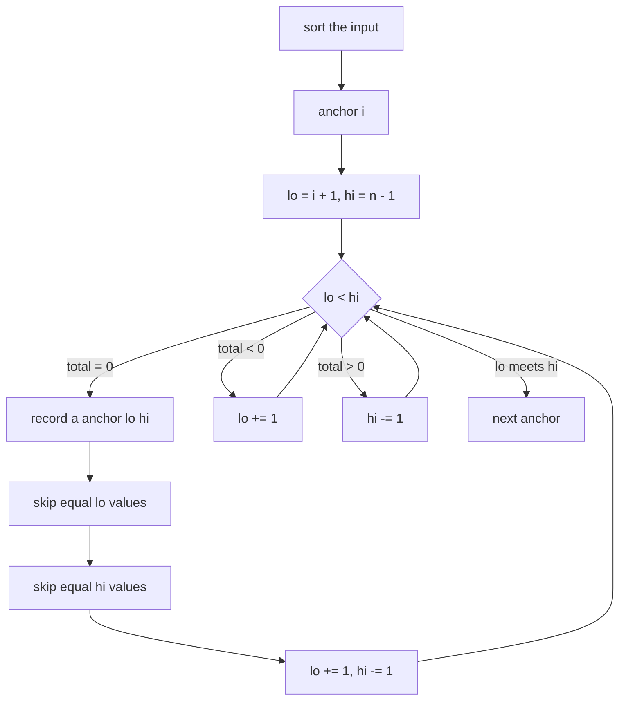
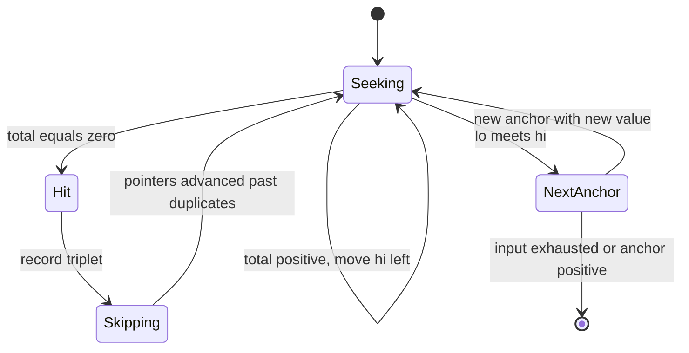
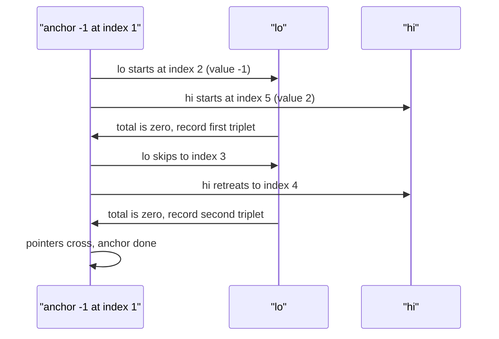

# 202 — 3-sum all unique triplets.

> **Tier:** Intermediate · **CTCI chapter:** Ch 1 — Arrays and Strings
> **Task spec:** [202-3-sum-all-unique-triplets.md](../../../tasks/intermediate/202-3-sum-all-unique-triplets.md)
> **Solutions:** [Python](../../../solutions/python/intermediate/202-3-sum-all-unique-triplets/solution.py) ·
> [Java](../../../solutions/java/intermediate/202-3-sum-all-unique-triplets/Solution.java) ·
> [JavaScript](../../../solutions/javascript/intermediate/202-3-sum-all-unique-triplets/solution.js) ·
> [C#](../../../solutions/csharp/intermediate/202-3-sum-all-unique-triplets/Solution.cs)

## 1. Problem restatement

**Input:** an array `nums` of integers (possibly empty, possibly with repeats, possibly negative).

**Output:** every distinct triplet `[a, b, c]` with `a + b + c == 0`, taken from three distinct
array positions, each triplet reported once in ascending order, and the list of triplets ordered
as the assertions expect.

| Call | Result | Why |
| --- | --- | --- |
| `three_sum([-1, 0, 1, 2, -1, -4])` | `[[-1, -1, 2], [-1, 0, 1]]` | the only two zero-sum triplets, duplicates removed |
| `three_sum([0, 0, 0])` | `[[0, 0, 0]]` | three positions, one value |
| `three_sum([-2, 0, 0, 2, 2])` | `[[-2, 0, 2]]` | four raw witnesses collapse to one triplet |
| `three_sum([0, 1, 1])` | `[]` | `0 + 1 + 1 = 2`, not zero |
| `three_sum([1, 2, 3])` | `[]` | all positive |
| `three_sum([])` | `[]` | nothing to pick |

Python asserts every row in the table; Java asserts all but the `[1, 2, 3]` row; JavaScript and C#
assert the first four. The result is a *value* multiset triple — `[-1, -1, 2]`
legitimately uses the value `-1` twice, because the input contains two occurrences of it.

## 2. Intuition

The naive approach is three nested loops over positions:

```text
for i ← 0 to n - 1 do
    for j ← i + 1 to n - 1 do
        for k ← j + 1 to n - 1 do
            if nums[i] + nums[j] + nums[k] == 0 then
                report the triplet
            end
        end
    end
end
```

That is **O(n³)** and, as in task 201, it produces duplicates: `[-1, 0, 1]` is found once for
each occurrence of `-1` and `0`. The hash trick from
[201](201-two-sum-unique-pairs-return-all-unique-pairs.md) does not transfer directly, because
after fixing one value the remaining two are not determined by a single lookup — you still need a
2-sum over the rest.

The insight is that a *sorted* array makes the 2-sum solvable with two pointers in O(n), so the
whole problem becomes **O(n²)**: sort once, then for every position `i` solve 2-sum for
`-nums[i]` on the subarray to its right. Sorting also hands you duplicate elimination almost for
free:

- **Duplicate anchors** — if `nums[i] == nums[i - 1]`, the same set of triplets was already
  enumerated with the previous anchor, so skip `i`.
- **Duplicate partners** — after recording a triplet, advance `lo` past equal values and retreat
  `hi` past equal values before stepping both pointers inward.

Two extra observations fall out of the ordering:

- If `nums[i] > 0` then `nums[i] + nums[lo] + nums[hi] >= 0` can only hold for the all-positive
  triplet, so once the anchor becomes positive there is nothing left to find and the loop can
  `break` — the Java, JavaScript, C# and Python code all do this.
- Because the array is sorted, moving `lo` right increases the sum and moving `hi` left decreases
  it, so the two-pointer walk is monotone: each `total < 0` step can only be fixed by `lo`, each
  `total > 0` step only by `hi`.



## 3. Algorithm

1. Copy and sort the input ascending (the four solutions all sort a copy; the caller's array is
   never reordered in place except inside the clone).
2. For each anchor index `i` from `0` to `n - 3`:
   1. If `i > 0` and `nums[i] == nums[i - 1]`, skip this anchor — its triplets are already in the
      result.
   2. If `nums[i] > 0`, stop: no remaining triplet can sum to zero.
   3. Set `lo = i + 1` and `hi = n - 1`.
   4. While `lo < hi`: compute `total = nums[i] + nums[lo] + nums[hi]`.
      - If `total == 0`, append the triplet, then skip duplicate `lo` values, skip duplicate `hi`
        values, and step both pointers inward.
      - If `total < 0`, increment `lo` (the sum must grow).
      - If `total > 0`, decrement `hi` (the sum must shrink).
3. Return the collected triplets.

```text
function three_sum(nums)
    a ← sorted copy of nums
    out ← empty list
    for i ← 0 to length(a) - 3 do
        if i > 0 and a[i] == a[i - 1] then
            continue
        end
        if a[i] > 0 then
            break
        end
        lo ← i + 1
        hi ← length(a) - 1
        while lo < hi do
            total ← a[i] + a[lo] + a[hi]
            if total == 0 then
                out.append(a[i], a[lo], a[hi])
                while lo < hi and a[lo] == a[lo + 1] do lo ← lo + 1 end
                while lo < hi and a[hi] == a[hi - 1] do hi ← hi - 1 end
                lo ← lo + 1
                hi ← hi - 1
            else if total < 0 then
                lo ← lo + 1
            else
                hi ← hi - 1
            end
        end
    end
    return out
end
```

Java, JavaScript and C# follow this pseudocode line for line; C# uses `Array.Sort` on a clone and
Java uses `Arrays.sort`. The skipped-duplicate pointers are the only subtle part: they run
*before* the final `lo += 1` / `hi -= 1` so that a run of equal values is consumed exactly once.



## 4. Worked example

Trace `three_sum([-1, 0, 1, 2, -1, -4])`. After sorting: `[-4, -1, -1, 0, 1, 2]`, `n = 6`.

| Anchor `i` | `nums[i]` | `lo` | `hi` | `total` | Action | `out` |
| --- | --- | --- | --- | --- | --- | --- |
| 0 | -4 | 1 | 5 | -4 + -1 + 2 = -3 | `lo` moves right repeatedly; no zero | `[]` |
| 1 | -1 | 2 | 5 | -1 + -1 + 2 = 0 | record `[-1, -1, 2]`, then `lo → 3`, `hi → 4` | `[[-1, -1, 2]]` |
| 1 | -1 | 3 | 4 | -1 + 0 + 1 = 0 | record `[-1, 0, 1]`, then `lo → 4`, `hi → 3` | `[[-1, -1, 2], [-1, 0, 1]]` |
| 1 | -1 | 4 | 3 | — | `lo` passed `hi`, anchor exhausted | unchanged |
| 2 | -1 | — | — | — | same value as `nums[1]`, skipped as a duplicate anchor | unchanged |
| 3 | 0 | 4 | 5 | 0 + 1 + 2 = 3 | `hi` moves left, then `lo` meets `hi` | unchanged |

Anchor `0` is the instructive one: `-4` is so small that even `-4 + 1 + 2 = -1` stays negative
until the window collapses, which is why the two-pointer walk finishes that anchor without ever
recording. Anchor `2` never runs a single comparison because of the duplicate-anchor rule, and the
early `break` would fire at index `4` if the loop ever got that far.



## 5. Complexity

Let `n` be the length of `nums` and `t` the number of distinct triplets found.

| Measure | Bound | Why it holds |
| --- | --- | --- |
| Time, best | O(n log n) | an all-positive or all-negative array only pays for the sort; the `break` fires on the first anchor |
| Time, average | O(n²) | for each of the `n` anchors the two-pointer walk advances the `lo`/`hi` gap at most `n` times |
| Time, worst | O(n²) | the duplicate-skipping loops only ever move pointers forward, so they do not add a factor |
| Space, extra | O(n) | the sorted copy; the Java, JavaScript and C# files clone the input, Python's `sorted` builds a new list |
| Space, output | O(t) | at most `n²/4` triplets in theory, `t` in practice |
| Naive triple loop | O(n³) | every index triple is tested, and the output still needs deduplication |

The `break` on a positive anchor is a constant-factor win rather than an asymptotic one, but it
matters on adversarial input: an array like `[1, 2, 3, ..., n]` returns after a single comparison
instead of after `n` anchors.

## 6. Pitfalls and edge cases

- **Empty and short input.** `[]` and any array with `n < 3` return `[]`; the loop condition
  `i + 2 < n` (Python writes `range(n - 2)`) handles this without a special case.
- **All-positive input.** `[1, 2, 3]` returns `[]` because the anchor `1` is already positive and
  the loop breaks immediately. Python, Java and C# assert this row in some form.
- **Three equal values.** `[0, 0, 0]` returns `[[0, 0, 0]]`: the triplet consumes three distinct
  *positions*, so it is legal, but the duplicate-anchor rule keeps it from being reported three
  times.
- **Duplicate anchors.** Without `if i > 0 and nums[i] == nums[i - 1]: continue`, `[-1, 0, 1, 2,
  -1, -4]` would report `[-1, 0, 1]` twice. Python, JavaScript and C# all assert
  `[-2, 0, 0, 2, 2] → [[-2, 0, 2]]`, which is the duplicate-partner case.
- **Do not mutate the caller's array.** Python sorts a fresh list; Java, JavaScript and C# clone
  before sorting, so the caller's order survives. Sorting in place would be an observable side
  effect that the assertions do not license.
- **Sorting must be numeric.** JavaScript's default `sort()` is lexicographic; the solution passes
  `(x, y) => x - y`. Without it `[-1, -4, -1, 0, 1, 2]` sorts to `[-1, -1, -4, 0, 1, 2]` and the
  two-pointer monotonicity breaks.
- **Overflow.** In Java and C# the sums are computed in 32-bit `int`. Values near `Integer.MAX_VALUE`
  can overflow the anchor-plus-two-pointer sum; the test data stays well inside that range.
- **Output order.** The result order is a consequence of the sorted scan (`[-1, -1, 2]` before
  `[-1, 0, 1]`), which is exactly what the four files' expectations encode. Sorting the output
  again is unnecessary.

## 7. Variants and follow-ups

- **Closest instead of exact.** [207-three-sum-closest.md](../../../tasks/intermediate/207-three-sum-closest.md)
  runs the same anchor-plus-two-pointer loop but tracks the sum with the smallest distance to the
  target, and returns as soon as the distance reaches zero.
- **General `k`.** [203-4-sum-problem-k-sum-generalization.md](../../../tasks/intermediate/203-4-sum-problem-k-sum-generalization.md)
  replaces the single anchor loop with recursion, so the same duplicate-skipping rules have to be
  applied at every recursion level.
- **Pairs, not triplets.** [201-two-sum-unique-pairs-return-all-unique-pairs.md](../../../tasks/intermediate/201-two-sum-unique-pairs-return-all-unique-pairs.md)
  is the case `k = 2`, where the two-pointer walk is not even needed if a hash set is available.
- **Counting instead of listing.** [205-count-pairs-with-sum-k-when-array-unsorted-hash.md](../../../tasks/intermediate/205-count-pairs-with-sum-k-when-array-unsorted-hash.md)
  shows the same family with the opposite output contract: duplicates are counted, not collapsed.
- The chapter walkthrough [Arrays and Strings](../../ctci/01-arrays-and-strings.md) treats
  sort-then-two-pointers as the standard way to trade a dimension of the search for a `log n`.

## 8. Check yourself

1. Why is the sort necessary rather than merely convenient?

<details><summary>Show answer</summary>

The two-pointer walk is only correct because moving `lo` right is guaranteed to increase the sum
and moving `hi` left to decrease it. That monotonicity is a property of sorted order, and it is
also what makes the duplicate-skipping runs contiguous, so both the O(n²) bound and the
uniqueness argument depend on sorting.

</details>

2. How many comparisons does the algorithm make for `[-1, 0, 1, 2, -1, -4]`, and which anchor
   does the most work?

<details><summary>Show answer</summary>

After sorting to `[-4, -1, -1, 0, 1, 2]`, anchor `0` (`-4`) walks the pair window from
`(1, 5)` down to the crossing point, and anchor `1` (`-1`) records both triplets in two steps
before crossing. Anchor `2` is skipped as a duplicate, and anchor `3` (`0`) makes one comparison
and then crosses. The total stays well under `n²/2 = 18` pair checks.

</details>

3. What breaks if you move the `lo += 1` before the duplicate-skipping loop?

<details><summary>Show answer</summary>

You skip one element too soon: after recording a triplet, `lo` advances onto the next `lo` value,
and the skipping loop then `while` compares `a[lo]` with `a[lo + 1]`, so it discards the first
occurrence of the next distinct value and can miss a valid triplet such as `[-1, 0, 1]` after
`[-1, -1, 2]`.

</details>

4. The four solutions all output `[-1, -1, 2]` before `[-1, 0, 1]`. Is that required by the
   problem statement?

<details><summary>Show answer</summary>

Not by the one-line spec, but it is required by the shipped assertions, and it is not an accident:
the sorted anchor order fixes the first element, and for a fixed anchor the `lo`-ascending walk
fixes the second element ascending, so the third element ascends within it. Any implementation
that follows this pseudocode reproduces the order.

</details>

5. When is the `total == 0` early return of task 207 not available here, and why?

<details><summary>Show answer</summary>

Task 207 can return the moment it finds an exact match because the distance is then `0` and
nothing can be better. Task 202 must keep going after a zero total, because a zero total is the
answer rather than a proof of optimality — there can be many distinct zero-sum triplets, and all
of them have to be collected.

</details>
