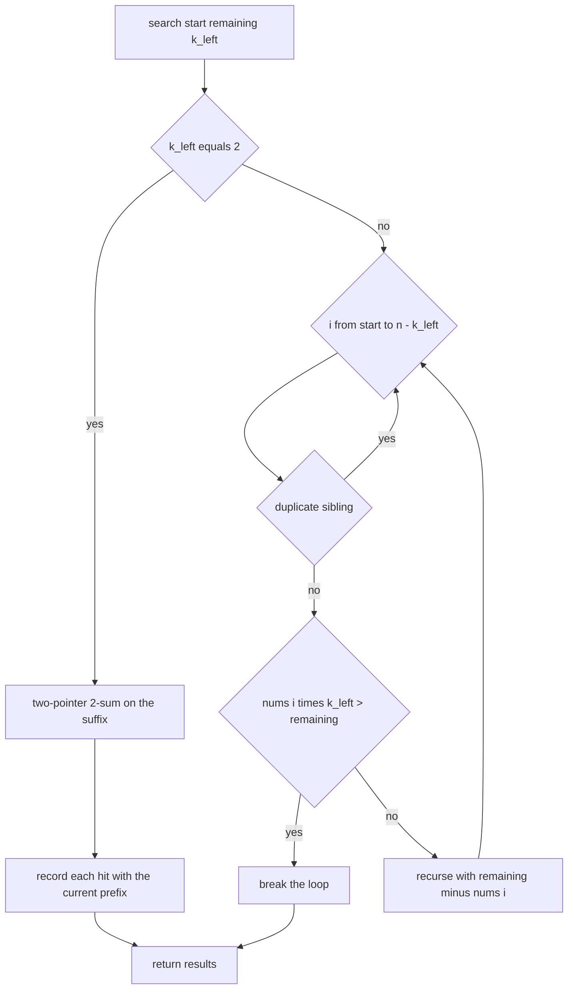
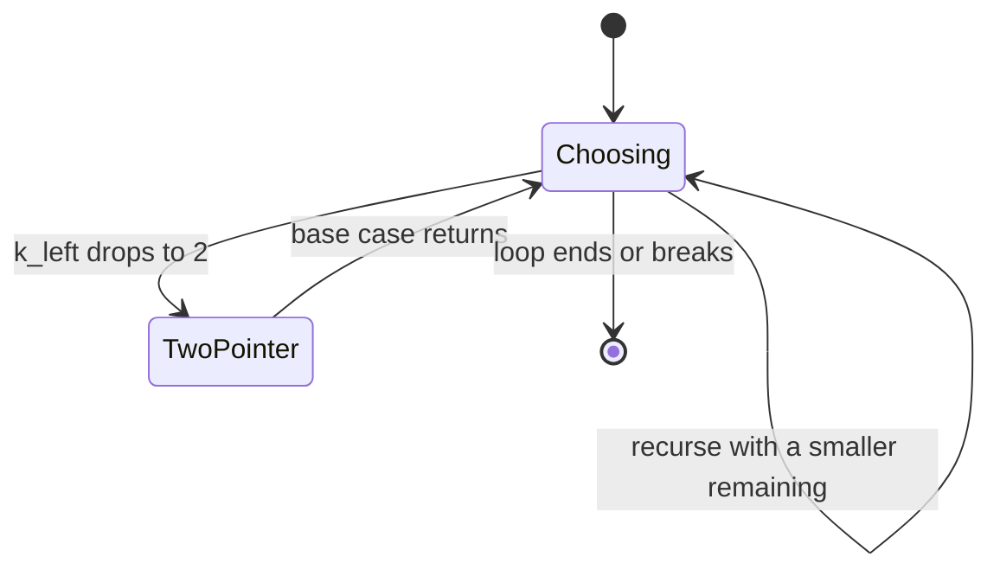
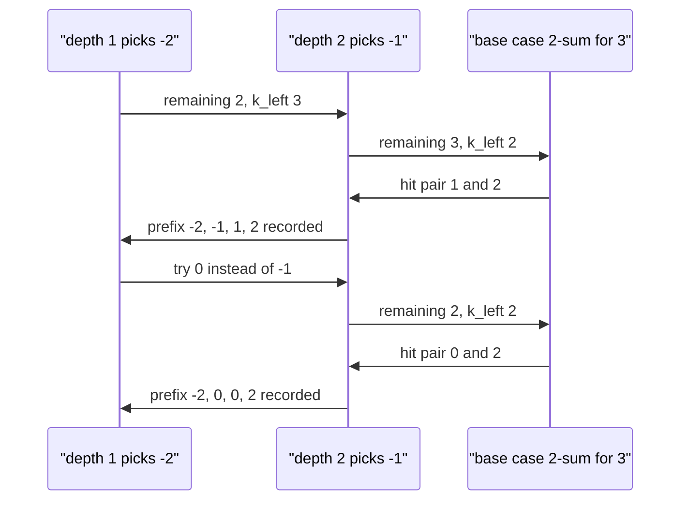

# 203 — 4-sum problem (k-sum generalization).

> **Tier:** Intermediate · **CTCI chapter:** Ch 1 — Arrays and Strings
> **Task spec:** [203-4-sum-problem-k-sum-generalization.md](../../../tasks/intermediate/203-4-sum-problem-k-sum-generalization.md)
> **Solutions:** [Python](../../../solutions/python/intermediate/203-4-sum-problem-k-sum-generalization/solution.py) ·
> [Java](../../../solutions/java/intermediate/203-4-sum-problem-k-sum-generalization/Solution.java) ·
> [JavaScript](../../../solutions/javascript/intermediate/203-4-sum-problem-k-sum-generalization/solution.js) ·
> [C#](../../../solutions/csharp/intermediate/203-4-sum-problem-k-sum-generalization/Solution.cs)

## 1. Problem restatement

**Input:** an array `nums` of integers, a `target` sum and an integer `k` (the number of values to
pick). The shipped wrappers call `k_sum(nums, target, k)`; `four_sum` is `k_sum(nums, target, 4)`.

**Output:** all distinct `k`-value multisets `[v1, ..., vk]` drawn from distinct positions with
sum `target`, each reported once, in the order produced by a sorted scan with duplicate skipping.
An `n < k` input produces `[]`.

| Call | Result | Why |
| --- | --- | --- |
| `four_sum([1, 0, -1, 0, -2, 2], 0)` | `[[-2, -1, 1, 2], [-2, 0, 0, 2], [-1, 0, 0, 1]]` | the three classical four-sum answers |
| `four_sum([2, 2, 2, 2, 2], 8)` | `[[2, 2, 2, 2]]` | five `2`s, one multiset |
| `four_sum([1, 2, 3, 4], 100)` | `[]` | nothing reaches `100`; the prune stops early |
| `four_sum([], 0)` | `[]` | fewer values than `k` |
| `k_sum([1, 2, 3, 4], 5, 2)` | `[[1, 4], [2, 3]]` | `k = 2` degrades to two-sum |
| `k_sum([-1, 0, 1, 2, -1, -4], 0, 3)` | `[[-1, -1, 2], [-1, 0, 1]]` | `k = 3` reproduces task 202 |

Python and Java assert all six rows; JavaScript and C# assert five — both omit the empty-array case —
and every file checks the `k = 2` and `k = 3` rows, because the generalization is part of the
contract, not a bonus.

## 2. Intuition

Four nested loops are the naive answer, and they are also the wrong answer: they are **O(n⁴)** and
they emit duplicates for repeated values, exactly like
[201](201-two-sum-unique-pairs-return-all-unique-pairs.md) and
[202](202-3-sum-all-unique-triplets.md). Writing five nested loops for `k = 5` is not an option.

The observation that unlocks arbitrary `k` is that the *first* `k - 2` picks can be enumerated by
recursion and the last two picks handled by the two-pointer 2-sum walk from task 202. Fixing
`k - 2` values leaves a 2-sum with a residual target, and a sorted array solves any 2-sum in
linear time. That gives **O(n^(k-1))** — for `k = 4` it is O(n³) instead of O(n⁴) — with the same
duplicate rules applied at every level:

- **Duplicate sibling:** at recursion depth `start`, skipping `nums[i] == nums[i - 1]` for
  `i > start` removes repeated choices without removing valid multisets, because repeats are
  still reachable by picking the same value at *different* positions.
- **Monotone prune:** since the array is sorted ascending, if the smallest remaining choice
  `nums[i]` already overshoots the residual when taken `k_left` times
  (`nums[i] * k_left > remaining`), every later choice overshoots too and the loop breaks.
- **Base case:** when two picks remain, run the exact 2-sum walk from task 202 against
  `remaining`, with the same duplicate-skipping pointers after a hit.

The recursion therefore has one job per level — choose one value, prune, recurse — and the only
real code is the 2-sum base case.



## 3. Algorithm

1. Sort a copy of the input ascending.
2. Call `search(start = 0, remaining = target, k_left = k, current = [])`.
3. In `search`:
   1. If `k_left == 2`: run the two-pointer 2-sum of `remaining` over `nums[start..n-1]`. On every
      hit, append `current + [nums[lo], nums[hi]]` to the results, then skip equal `lo` values,
      skip equal `hi` values, and step both pointers inward. Return.
   2. Otherwise loop `i` from `start` while `i + k_left <= n`:
      - skip `i` when `i > start` and `nums[i] == nums[i - 1]`;
      - break when `nums[i] * k_left > remaining`;
      - push `nums[i]`, recurse with `start = i + 1`, `remaining - nums[i]`, `k_left - 1`, then pop.
4. Return the results.

```text
function k_sum(nums, target, k)
    a ← sorted copy of nums
    results ← empty list
    search(0, target, k, empty list)
    return results
end

procedure search(start, remaining, k_left, current)
    if k_left == 2 then
        lo ← start
        hi ← length(a) - 1
        while lo < hi do
            total ← a[lo] + a[hi]
            if total == remaining then
                results.append(current with a[lo] and a[hi])
                while lo < hi and a[lo] == a[lo + 1] do lo ← lo + 1 end
                while lo < hi and a[hi] == a[hi - 1] do hi ← hi - 1 end
                lo ← lo + 1
                hi ← hi - 1
            else if total < remaining then
                lo ← lo + 1
            else
                hi ← hi - 1
            end
        end
        return
    end
    for i ← start to length(a) - k_left do
        if i > start and a[i] == a[i - 1] then
            continue
        end
        if a[i] * k_left > remaining then
            break
        end
        current.append(a[i])
        search(i + 1, remaining - a[i], k_left - 1, current)
        current.remove_last()
    end
end
```

The four implementations differ only in how `current` is materialised. Python and JavaScript pass a
fresh list into each call (`current + [nums[i]]`, `[...current, a[i]]`), Java keeps one
`ArrayList` and removes the last element after the recursive call, and C# does the same with
`current.RemoveAt(current.Count - 1)`. All three forms produce the same results because the
prefix is read only at a hit.



## 4. Worked example

Trace `four_sum([1, 0, -1, 0, -2, 2], 0)`. After sorting: `[-2, -1, 0, 0, 1, 2]`, `k = 4`,
`remaining = 0`, `current = []`. Depth one picks the first value:

| Depth 1 `i` | `nums[i]` | prune `nums[i] * 3 > 0`? | Recurse with | Outcome |
| --- | --- | --- | --- | --- |
| 0 | -2 | no | `remaining = 2`, `k_left = 3` | yields `[-2, -1, 1, 2]` and `[-2, 0, 0, 2]` |
| 1 | -1 | no | `remaining = 1`, `k_left = 3` | yields `[-1, 0, 0, 1]` |
| 2 | 0 | no | `remaining = 0`, `k_left = 3` | three values from `{0, 0, 1, 2}` cannot sum to `0`; no result |
| 3 | 0 | — | — | skipped: sibling of the `0` at index 2 |
| 4 | 1 | yes if `1 * 3 > 0` | — | loop breaks |

Following the first branch, depth two fixes `-1` and recurses with `remaining = 3`, `k_left = 2`,
where the 2-sum base case scans `[0, 0, 1, 2]` from the pointer pair `(2, 5)`:

| `lo` | `hi` | `total` | Action |
| --- | --- | --- | --- |
| 2 (0) | 5 (2) | 2 | below `3`, move `lo` right |
| 3 (0) | 5 (2) | 2 | below `3`, move `lo` right |
| 4 (1) | 5 (2) | 3 | hit: record `[-2, -1, 1, 2]`, then pointers cross |

The second answer `[-2, 0, 0, 2]` comes from the depth-two choice of the `0` at index 2, whose
base case hits `(3, 5)` with total `2`; the pair `[0, 2]` plus the prefix `[-2, 0]` is exactly that
multiset. The third answer `[-1, 0, 0, 1]` comes from the depth-one choice of `-1`.



## 5. Complexity

Let `n` be the input length and `k` the number of values per answer.

| Measure | Bound | Why it holds |
| --- | --- | --- |
| Time, best | O(n log n) | the prune `nums[i] * k_left > remaining` can break every loop immediately, leaving only the sort |
| Time, average | O(n^(k-1)) | `k - 2` recursive levels each pick one value plus a linear two-pointer base case |
| Time, worst | O(n^(k-1)) | the duplicate-skipping and pointer walks only move forwards, so each level is at most O(n) per choice |
| Space, recursion | O(k) | the depth is exactly `k`, plus the prefix that holds `k` values |
| Space, output | O(t) | one entry per distinct answer multiset |
| Naive nested loops | O(n^k) time | `k` nested loops over positions, still with duplicates to remove |

The two-pointer base case is what removes one whole factor of `n` compared with nested loops. For
`k = 4` that is the difference between scanning `n²` pairs per triple and walking a shrinking
window once. The prune is a constant-factor improvement asymptotically, but it is the difference
between "instant" and "minutes" on inputs whose values are all larger than the residual target,
such as `four_sum([1, 2, 3, 4], 100)`: the very first level breaks after one comparison.

## 6. Pitfalls and edge cases

- **Fewer values than `k`.** `[]` and any `n < k` input returns `[]`; the loop bound
  `i + k_left <= n` (Python writes `range(start, n - k_left + 1)`) never executes.
- **Repeated values that legitimately repeat in an answer.** `[2, 2, 2, 2, 2]` with `target 8`
  and `k = 4` must return `[[2, 2, 2, 2]]`: the sibling rule skips *anchors*, never positions
  inside an answer, so the same value can appear four times.
- **Sibling skipping is `i > start`, not `i > 0`.** Writing `nums[i] == nums[i - 1]` with a global
  check would suppress valid answers whose first pick equals the previous recursion level's value.
- **Duplicate anchors produce duplicates.** Without the sibling rule, `four_sum([1, 0, -1, 0, -2, 2], 0)`
  would report `[-2, 0, 0, 2]` twice, once for each `0`.
- **Prune only works ascending.** `nums[i] * k_left > remaining` relies on the sorted order and on
  `k_left` further picks being at least `nums[i]`. Java and C# cast to `long` before multiplying to
  avoid a 32-bit overflow in the prune itself.
- **The input must not be reordered for the caller.** Python sorts a new list; Java, JavaScript and
  C# clone before sorting.
- **`k = 2` and `k = 3` are the regression tests.** Both are asserted by all four files, so a
  rewrite that hard-codes four picks fails immediately.
- **No explicit `k < 2` guard.** The solutions assume `k >= 2`; `k = 1` would take the recursive
  branch with a nonsensical `k_left` and is outside the tested contract.

## 7. Variants and follow-ups

- **Three-sum as a special case.** [202-3-sum-all-unique-triplets.md](../../../tasks/intermediate/202-3-sum-all-unique-triplets.md)
  is the hand-unrolled `k = 3` version of this recursion; comparing the two makes the recursion's
  overhead visible.
- **Closest rather than exact.** [207-three-sum-closest.md](../../../tasks/intermediate/207-three-sum-closest.md)
  shows how the base case changes when you want the nearest achievable sum instead of every exact
  hit.
- **Met in the middle.** [219-implement-meet-in-the-middle-for-subset-problems-n-40.md](../../../tasks/intermediate/219-implement-meet-in-the-middle-for-subset-problems-n-40.md)
  is the alternative for large `k`: split the values in half, enumerate both halves, and match
  sums. It trades the `n^(k-1)` dependence for `O(2^(n/2))`, which is far better for `k` close to
  `n/2`.
- **Counting subsets that hit a target.**
  [218-count-subsets-that-sum-to-target-dp.md](../../../tasks/intermediate/218-count-subsets-that-sum-to-target-dp.md)
  drops the fixed-size restriction entirely and counts instead of listing.
- The chapter walkthrough [Recursion and Dynamic Programming](../../ctci/08-recursion-and-dp.md)
  covers the "reduce the dimension by recursion, finish with a linear base case" pattern.

## 8. Check yourself

1. Why does the recursion stop at `k_left == 2` rather than at `k_left == 1` or `0`?

<details><summary>Show answer</summary>

Because 2-sum has a linear-time solution on a sorted array, so delegating the last two picks to the
two-pointer walk saves an entire factor of `n`. Stopping at `k_left == 1` would mean looking up a
single value with a hash or a binary search, which is also linear per choice but loses the free
duplicate skipping of the shared window; stopping at `0` would re-implement the naive loops.

</details>

2. How many distinct answers does `four_sum([2, 2, 2, 2, 2], 8)` produce, and why not more?

<details><summary>Show answer</summary>

Exactly one, `[[2, 2, 2, 2]]`. All `C(5, 4) = 5` position quadruples have the same value multiset,
and the sibling rule and the canonical value triple ensure the set-like output collapses them to
a single entry.

</details>

3. What does the prune do for `four_sum([1, 2, 3, 4], 100)`?

<details><summary>Show answer</summary>

Nothing here, and that is the point: at depth one the anchor `1` passes (`1 * 4 = 4 <= 100`) and
recurses with `remaining = 99`; the second pick `2` also passes (`2 * 3 = 6 <= 99`) and hands
`remaining = 97` to the 2-sum base case, which walks the pair `(3, 4)`, sees `3 + 4 = 7` far below
`97`, and moves `lo` until the pointers meet. Every anchor fails the same way and the answer is
`[]`. The prune earns its keep on inputs whose values are large relative to the target — for
instance `four_sum([5, 6, 7, 8], 10)`, where `5 * 4 = 20 > 10` breaks the outermost loop after a
single comparison.

</details>

4. Why is `current` copy semantics rather than aliasing important?

<details><summary>Show answer</summary>

Java and C# keep a single mutable list and pop after the recursive call; if the base case stored a
reference instead of a copy, every stored answer would end up empty once the recursion unwound.
Java's base case builds `new ArrayList<>(current)` and C# builds `new List<int>(current)`
explicitly, while Python and JavaScript avoid the issue by concatenating a new list.

</details>

5. What is the complexity difference between this recursion and meet-in-the-middle for `k = 4` and
   `n = 40`?

<details><summary>Show answer</summary>

This recursion is O(n^3) at `k = 4`, i.e. on the order of `40³ = 64,000` base-case operations
after sorting. Meet-in-the-middle enumerates `2^20` subsets per half, roughly a million entries,
before matching — worse for `k = 4` and clearly better once `k` grows towards `n/2`. The crossover
is why both techniques are in this repository.

</details>
