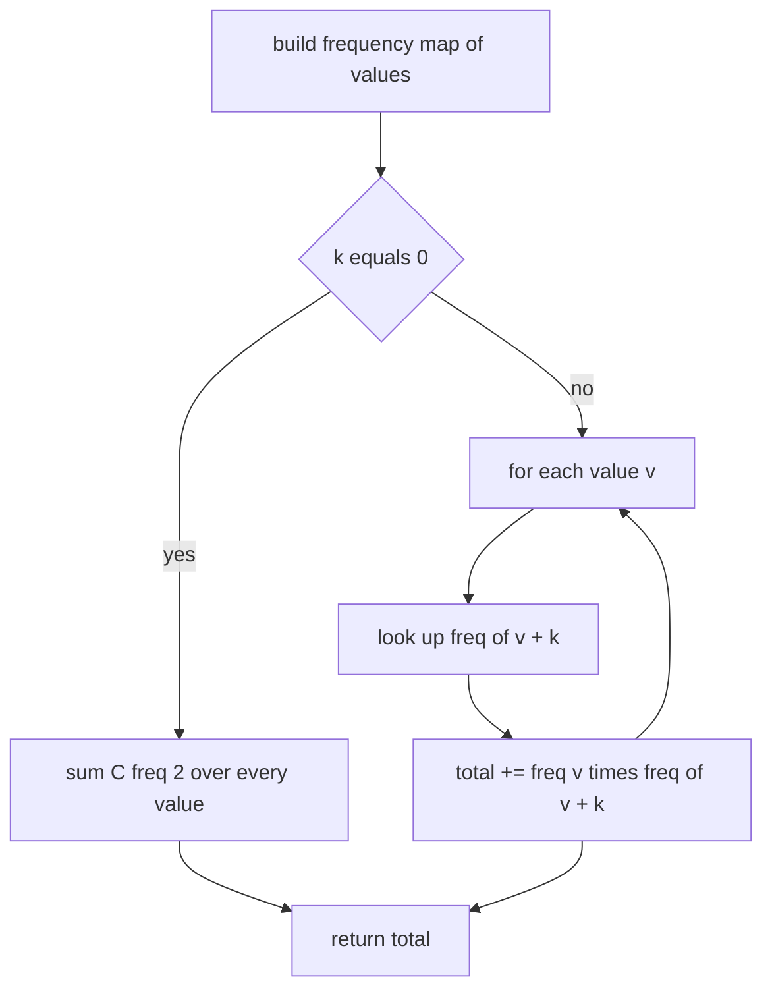
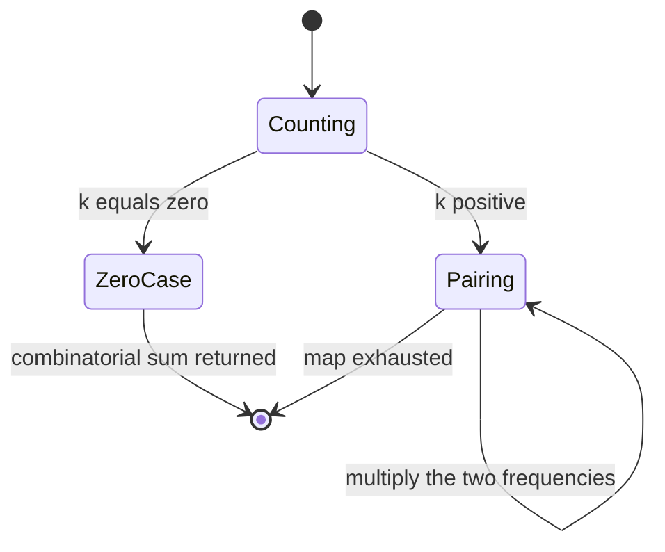
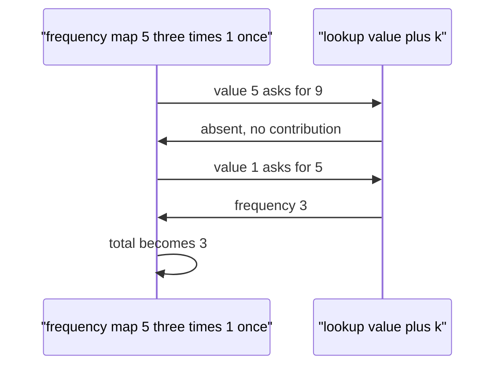

# 204 — Count pairs with given difference K in array (hash).

> **Tier:** Intermediate · **CTCI chapter:** Ch 1 — Arrays and Strings
> **Task spec:** [204-count-pairs-with-given-difference-k-in-array-hash.md](../../../tasks/intermediate/204-count-pairs-with-given-difference-k-in-array-hash.md)
> **Solutions:** [Python](../../../solutions/python/intermediate/204-count-pairs-with-given-difference-k-in-array-hash/solution.py) ·
> [Java](../../../solutions/java/intermediate/204-count-pairs-with-given-difference-k-in-array-hash/Solution.java) ·
> [JavaScript](../../../solutions/javascript/intermediate/204-count-pairs-with-given-difference-k-in-array-hash/solution.js) ·
> [C#](../../../solutions/csharp/intermediate/204-count-pairs-with-given-difference-k-in-array-hash/Solution.cs)

## 1. Problem restatement

**Input:** an array `nums` of integers (possibly empty, possibly with repeats) and an integer `k`.
The Python docstring states the contract precisely: count index pairs `(i, j)` with `i < j` and
`abs(a[i] - a[j]) == k`.

**Output:** the **number of index pairs**, not the number of distinct value pairs. A repeated value
therefore contributes many pairs. A negative `k` raises (`ValueError` in Python, an
`IllegalArgumentException` / `ArgumentException` / `Error` elsewhere) because an absolute
difference can never be negative.

| Call | Result | Why |
| --- | --- | --- |
| `count_pairs_with_difference([1, 5, 3, 4, 2], 2)` | `3` | the pairs `(1, 3)`, `(3, 5)` and `(2, 4)` |
| `count_pairs_with_difference([1, 1, 1, 1], 0)` | `6` | `k = 0` counts equal-index-pairs: `C(4, 2)` |
| `count_pairs_with_difference([5, 5, 5, 1], 4)` | `3` | every `5` pairs with the single `1` |
| `count_pairs_with_difference([1, 1, 1, 1], 1)` | `0` | no two values differ by one |
| `count_pairs_with_difference([1, 2, 3, 4], 10)` | `0` | no pair reaches a difference of ten |
| `count_pairs_with_difference([], 3)` | `0` | nothing to pair |

Python asserts all six rows; Java and C# assert five of them (both include the empty case, which C#
passes as `new int[0]`); JavaScript asserts four, omitting the `k = 1` and empty rows. The return
type is `long` in Java and C# because the count can exceed
`Integer.MAX_VALUE` for large inputs; Python and JavaScript have no such ceiling.

## 2. Intuition

The naive approach compares every index pair:

```text
total ← 0
for i ← 0 to n - 1 do
    for j ← i + 1 to n - 1 do
        if abs(nums[i] - nums[j]) == k then
            total ← total + 1
        end
    end
end
```

That is **O(n²)** and it throws away all the information that repeats carry: for
`[5, 5, 5, 1]` it compares the `1` against each `5` separately, when the answer is visibly
`3 × 1`.

The insight is that the *index* pairing is irrelevant once values are grouped. If value `v` occurs
`f(v)` times and value `v + k` occurs `f(v + k)` times, then every occurrence of `v` forms a valid
unordered pair with every occurrence of `v + k`, contributing the product `f(v) × f(v + k)`. The
absolute value disappears because each pair is discovered exactly once by looking *upward* from
the smaller value: we count `v` with `v + k`, never `v` with `v - k`, so nothing is double counted.

The `k = 0` case is special and cannot be handled by the product rule: `v` paired with `v + 0` is
`v` paired with itself, which counts the same occurrence twice. The correct count for `k = 0` is
the number of ways to choose two distinct occurrences of the same value, i.e.
`f(v) × (f(v) - 1) / 2` summed over all values — the binomial coefficient `C(f(v), 2)`.



## 3. Algorithm

1. If `k < 0`, raise — the call is meaningless.
2. Build a frequency map: value to number of occurrences.
3. If `k == 0`, return the sum of `count * (count - 1) / 2` over the map's values.
4. Otherwise, for every value `value` with frequency `count`, add `count` times the frequency of
   `value + k` (zero if that value is absent).
5. Return the total.

```text
function count_pairs_with_difference(nums, k)
    if k < 0 then
        raise error
    end
    freq ← counts of each value in nums
    total ← 0
    if k == 0 then
        for each count in values of freq do
            total ← total + count * (count - 1) / 2
        end
        return total
    end
    for each value, count in freq do
        total ← total + count * freq.get(value + k, 0)
    end
    return total
end
```

The iteration order of the frequency map does not matter: every entry contributes its own product,
and the `value + k` side is never also iterated as a source for the same pair, because the lookup
always moves upward in value space. That is what makes the count exact rather than doubled.



## 4. Worked example

Trace `count_pairs_with_difference([1, 5, 3, 4, 2], 2)`. The frequency map is
`{1: 1, 5: 1, 3: 1, 4: 1, 2: 1}` and `k = 2`, so the answer is the number of values `v` for which
`v + 2` is present:

| Source value `v` | `f(v)` | `v + k` | `f(v + k)` | Contribution | Running total |
| --- | --- | --- | --- | --- | --- |
| 1 | 1 | 3 | 1 | 1 | 1 |
| 5 | 1 | 7 | 0 | 0 | 1 |
| 3 | 1 | 5 | 1 | 1 | 2 |
| 4 | 1 | 6 | 0 | 0 | 2 |
| 2 | 1 | 4 | 1 | 1 | 3 |

The final total is `3`, matching the asserted result. Note which lookups succeed: `1 → 3`, `3 → 5`
and `2 → 4`. The pair `(1, 3)` is discovered from `1` and never again from `3` (which looks at `5`),
so each pair is counted exactly once even though the map iterates over both its members.

Now trace the degeneracy `count_pairs_with_difference([5, 5, 5, 1], 4)`: the map is `{5: 3, 1: 1}`.

| Source value `v` | `f(v)` | `v + k` | `f(v + k)` | Contribution | Running total |
| --- | --- | --- | --- | --- | --- |
| 5 | 3 | 9 | 0 | 0 | 0 |
| 1 | 1 | 5 | 3 | 3 | 3 |

Three pairs from one multiplication. The naive scan would have performed six comparisons to reach
the same number.



## 5. Complexity

Let `n` be the input length and `d` the number of distinct values (`d <= n`).

| Measure | Bound | Why it holds |
| --- | --- | --- |
| Time, best | O(n) | the frequency pass is unconditional; an empty input is O(1) |
| Time, average | O(n) | one hash insertion per value plus one lookup per distinct value |
| Time, worst | O(n) | expected O(1) hash operations; `k = 0` adds one multiply per distinct value |
| Space | O(d) | the frequency map holds at most one entry per distinct value |
| Naive index-pair scan | O(n²) time, O(1) space | every index pair is compared; no memory for grouping |

Two properties make the linear bound possible. First, grouping by value collapses the multiplicity
into a single map entry, so the `n²` comparisons become `d` lookups. Second, the upward convention
turns "count unordered pairs" into "count ordered pairs by value order", which is a plain
multiplication. Both are why the space cost of `O(d)` is a good trade.

## 6. Pitfalls and edge cases

- **Counting pairs, not values.** `[1, 1, 1, 1]` with `k = 0` gives `6`, not `1` and not `4`. The
  assertions in all four files pin this down; a solution that reports distinct value pairs fails.
- **`k == 0` is a different formula.** Using the product rule with `k = 0` would return
  `sum(f(v)²)`, counting each occurrence with itself; the correct formula is `C(f(v), 2)`.
  `[1, 1, 1, 1]` with `k = 1` gives `0`, which is the neighbouring regression test.
- **The upward-only convention.** Iterating the map and adding both `freq[value + k]` and
  `freq[value - k]` doubles every count. The shipped solutions only ever look upward.
- **Negative `k`.** The Python, Java, JavaScript and C# files all raise (or, in JavaScript, throw
  an `Error`) before touching the data. Silently returning `0` would hide a caller bug, because
  `abs(a - b) == k` can never hold for negative `k`.
- **Empty input.** `[]` returns `0`; the frequency map is empty and the loop body never runs.
- **Absent partner.** `freq.get(value + k, 0)` / `getOrDefault` / `TryGetValue` must treat a missing
  value as zero frequency rather than as an error. Java's `freq.getOrDefault(e.getKey() + k, 0)`
  and C#'s `TryGetValue` pattern both do this inline.
- **Counter overflow.** The count can reach `n²/4`. Java and C# deliberately accumulate in `long`
  and cast the operands before multiplying (`(long) c * (c - 1) / 2`), which is the right habit
  even when the asserted inputs are small.
- **Duplicates inside a single occurrence.** `k = 0` counts two *different* positions holding the
  same value, so it never counts an occurrence against itself.

## 7. Variants and follow-ups

- **Sum instead of difference.** [205-count-pairs-with-sum-k-when-array-unsorted-hash.md](../../../tasks/intermediate/205-count-pairs-with-sum-k-when-array-unsorted-hash.md)
  keeps the same "one hash map, count multiplicities" shape but pairs `x` with `target - x` in a
  single left-to-right pass, which handles `target = 2x` naturally through the ordering of the
  lookup and the insertion.
- **Listing the pairs instead of counting.** [201-two-sum-unique-pairs-return-all-unique-pairs.md](../../../tasks/intermediate/201-two-sum-unique-pairs-return-all-unique-pairs.md)
  shows the opposite contract: collapse multiplicities into distinct value pairs rather than
  counting them.
- **Sorted input.** [206-pair-with-sum-closest-to-target-in-sorted-array.md](../../../tasks/intermediate/206-pair-with-sum-closest-to-target-in-sorted-array.md)
  solves a pair-sum variant with two pointers and no hash map at all; when the input arrives sorted,
  that route needs no extra memory.
- **Counting subarray sums.**
  [211-subarray-sum-equals-k-count-hashmap.md](../../../tasks/intermediate/211-subarray-sum-equals-k-count-hashmap.md)
  uses a frequency map of prefix sums to count subarrays, which is the same "frequency of a
  complementary key" idea applied to a different object.
- The chapter walkthrough [Arrays and Strings](../../ctci/01-arrays-and-strings.md) frames value
  grouping plus a hash lookup as the standard upgrade from quadratic pair scanning.

## 8. Check yourself

1. Why does looking only at `value + k` avoid double counting when `k > 0`?

<details><summary>Show answer</summary>

Because every valid pair consists of a smaller and a larger value (they cannot be equal when
`k > 0`), and the smaller one is the only one of the two that ever proposes the larger. The larger
value's own iteration looks at `value + k`, which is a third value, so the pair is generated once.

</details>

2. How would the algorithm change if the input were sorted?

<details><summary>Show answer</summary>

Not much for the count, but the frequency map becomes a run-length scan and the `value + k` lookup
could be a binary search, giving O(n log n) time with O(1) extra space beyond the sort. The hash
version is O(n) time and O(d) space; the sorted version trades memory for a `log n` factor.

</details>

3. What is the answer for `[1, 1, 1]` and `k = 0`, and which line of the code produces it?

<details><summary>Show answer</summary>

`3`, from the `k == 0` branch: `1 * 2 / 2 = 1` occurrence pair per value times... precisely,
`C(3, 2) = 3`. Python computes `c * (c - 1) // 2` with `c = 3`, i.e. `3`. The general product loop
would have returned `9`.

</details>

4. The four files raise on negative `k` but nothing in the one-line spec demands it. Why do it?

<details><summary>Show answer</summary>

Because the predicate `abs(a[i] - a[j]) == k` is unsatisfiable for negative `k`, so `0` would be a
silently plausible-looking answer that hides a caller bug, and because the assertion suites include
a `k = 0` row that makes the boundary at zero explicit. Failing loudly is the only behaviour the
test data does not contradict.

</details>

5. How does this differ from task 205's contract on duplicates?

<details><summary>Show answer</summary>

Both count index pairs, but the pairing rule differs: here the same value pairs with itself
(`k = 0`), and one value pairs with one specific partner value. In task 205 every occurrence of `x`
pairs with every earlier occurrence of `target - x`, so the accumulation is done incrementally with
a running map rather than with a fixed frequency table.

</details>
