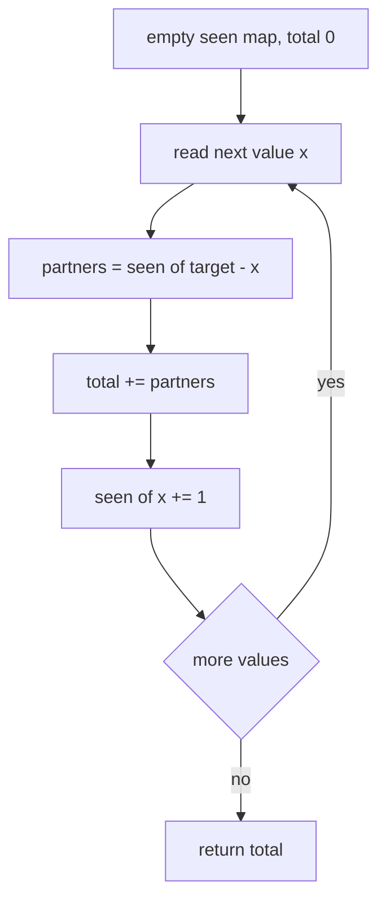
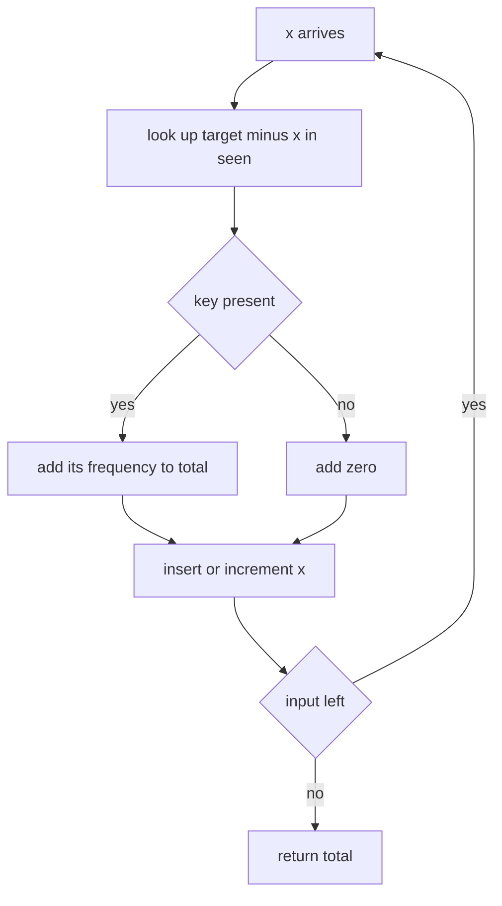
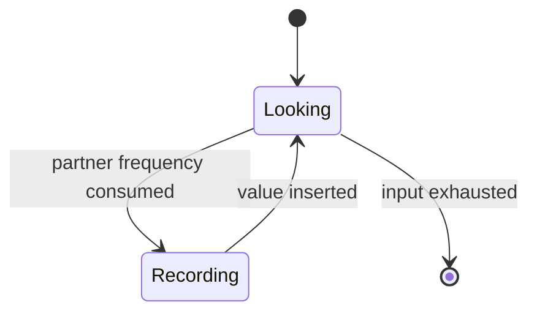
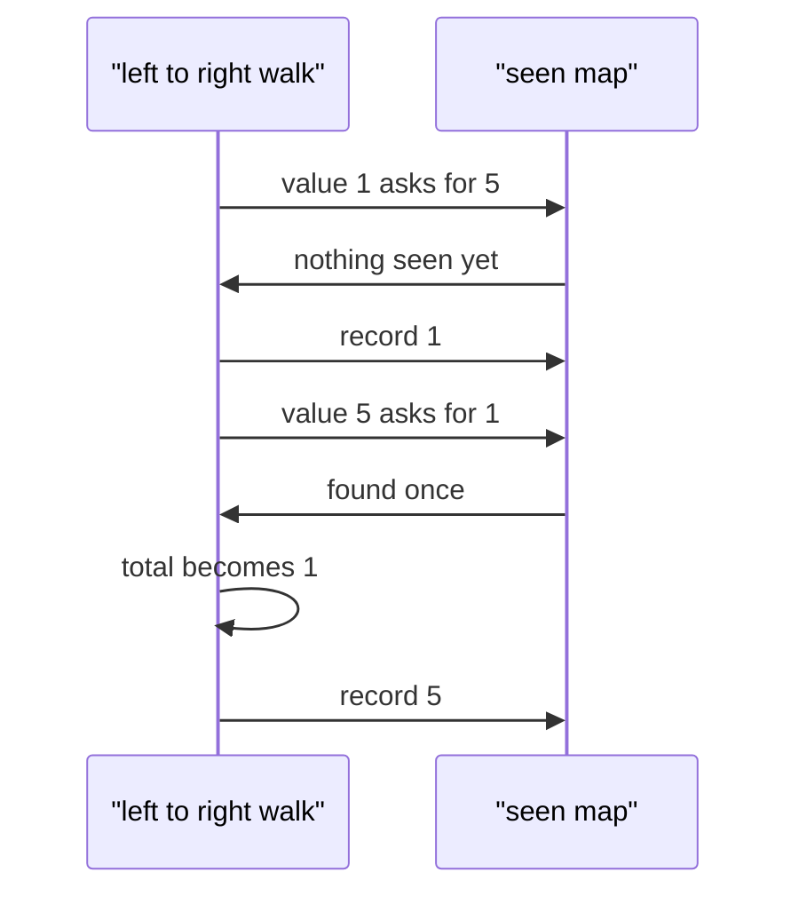

# 205 — Count pairs with sum K when array unsorted (hash).

> **Tier:** Intermediate · **CTCI chapter:** Ch 1 — Arrays and Strings
> **Task spec:** [205-count-pairs-with-sum-k-when-array-unsorted-hash.md](../../../tasks/intermediate/205-count-pairs-with-sum-k-when-array-unsorted-hash.md)
> **Solutions:** [Python](../../../solutions/python/intermediate/205-count-pairs-with-sum-k-when-array-unsorted-hash/solution.py) ·
> [Java](../../../solutions/java/intermediate/205-count-pairs-with-sum-k-when-array-unsorted-hash/Solution.java) ·
> [JavaScript](../../../solutions/javascript/intermediate/205-count-pairs-with-sum-k-when-array-unsorted-hash/solution.js) ·
> [C#](../../../solutions/csharp/intermediate/205-count-pairs-with-sum-k-when-array-unsorted-hash/Solution.cs)

## 1. Problem restatement

**Input:** an unsorted array `nums` of integers (possibly empty, possibly with repeats) and a
`target`.

**Output:** the number of index pairs `(i, j)` with `i < j` and `nums[i] + nums[j] == target`. The
array is explicitly unsorted, so no two-pointer shortcut is available; the result counts every
occurrence, not distinct value pairs.

| Call | Result | Why |
| --- | --- | --- |
| `count_pairs_with_sum([1, 5, 3, 3, 3], 6)` | `4` | `(1, 5)` plus the `C(3, 2) = 3` pairs among the three `3`s |
| `count_pairs_with_sum([1, 2, 3, 4], 5)` | `2` | `(1, 4)` and `(2, 3)` |
| `count_pairs_with_sum([1, 1, 1, 1], 2)` | `6` | `C(4, 2)` pairs, each contributing |
| `count_pairs_with_sum([0, 0], 0)` | `1` | the doubled-target case still counts as one pair |
| `count_pairs_with_sum([1, 2, 3], 100)` | `0` | nothing reaches the target |
| `count_pairs_with_sum([], 5)` | `0` | nothing to pair |

Python and Java assert all six rows; JavaScript and C# assert five, both skipping the empty case.
The return type is `long` in Java and C#, and
a plain number in Python and JavaScript.

## 2. Intuition

The naive double loop is **O(n²)**:

```text
total ← 0
for i ← 0 to n - 1 do
    for j ← i + 1 to n - 1 do
        if nums[i] + nums[j] == target then
            total ← total + 1
        end
    end
end
```

The problem with the quadratic scan is not the counting rule but the *lookup*: for every `x`, the
number of partners is a property of the whole remainder of the array, and computing it by
inspection is what costs the second loop.

The insight is to replace "scan the remainder" with "remember what has already gone by". Walk the
array once, maintaining a map from value to the number of times it has been seen so far. When you
reach `x`:

- the number of valid partners is exactly the number of *earlier* occurrences of `target - x`;
  the map gives that number in one lookup;
- add it to the running total, then record `x` itself by incrementing `seen[x]`.

Because the lookup happens *before* the insertion, an element never pairs with itself, which is
what makes `[0, 0]` with `target 0` return `1` rather than `2`, and it is also why no `i < j`
bookkeeping is needed at all — every pair is counted at the moment its second element is read.
This is the counting sibling of
[201](201-two-sum-unique-pairs-return-all-unique-pairs.md), which stores a set of values and a set
of answer pairs instead of frequencies.



## 3. Algorithm

1. Create an empty counting map `seen` (a `defaultdict`, `HashMap`, `Map` or `Dictionary`) and set
   `total = 0`.
2. For each value `x` in `nums`, in the given order:
   1. Add `seen[target - x]` to `total` (zero when the key is absent).
   2. Increment `seen[x]` by one.
3. Return `total`.

```text
function count_pairs_with_sum(nums, target)
    seen ← empty counting map
    total ← 0
    for each x in nums do
        total ← total + seen[target - x]
        seen[x] ← seen[x] + 1
    end
    return total
end
```

The order of the two statements inside the loop is the entire subtlety. Looking up before
incrementing guarantees that the partner came from an earlier index, which simultaneously enforces
`i < j` and prevents self-pairing.



As a state machine the element has exactly two states — looked up, then recorded — and the
transition back to the input is unconditional:



## 4. Worked example

Trace `count_pairs_with_sum([1, 5, 3, 3, 3], 6)`. The target is `6`, so the partner of `x` is
`6 - x`:

| Step | `x` | `seen[6 - x]` | `total` after | `seen` after |
| --- | --- | --- | --- | --- |
| 1 | 1 | `seen[5] = 0` | 0 | `{1: 1}` |
| 2 | 5 | `seen[1] = 1` | 1 | `{1: 1, 5: 1}` |
| 3 | 3 | `seen[3] = 0` | 1 | `{1: 1, 5: 1, 3: 1}` |
| 4 | 3 | `seen[3] = 1` | 2 | `{1: 1, 5: 1, 3: 2}` |
| 5 | 3 | `seen[3] = 2` | 4 | `{1: 1, 5: 1, 3: 3}` |

The final total is `4`, the asserted value. Step 2 is the `(1, 5)` pair — the `1` was already
recorded, so the `5` harvests it. Steps 3 to 5 are the three `3`s harvesting each other in the
classic triangular pattern: the first contributes nothing, the second contributes one, the third
contributes two, for a total of `C(3, 2) = 3`.

The doubled-target case behaves identically and is worth reading separately, because it is where
"look up before insert" earns its keep:

| Step | `x` | `seen[0 - x]` | `total` after | `seen` after |
| --- | --- | --- | --- | --- |
| 1 | 0 | `seen[0] = 0` | 0 | `{0: 1}` |
| 2 | 0 | `seen[0] = 1` | 1 | `{0: 2}` |



## 5. Complexity

Let `n` be the input length and `d` the number of distinct values.

| Measure | Bound | Why it holds |
| --- | --- | --- |
| Time, best | O(n) | every element is visited exactly once, even when nothing matches |
| Time, average | O(n) | one lookup and one increment per element, each expected O(1) |
| Time, worst | O(n) | the hash operations dominate, and their expected cost is constant |
| Space | O(d) | the map holds one entry per distinct value seen so far |
| Naive double loop | O(n²) time, O(1) space | one comparison per index pair, no memory needed |

The single pass is what makes the unsorted input irrelevant: unlike the sorted variants
([206](206-pair-with-sum-closest-to-target-in-sorted-array.md),
[202](202-3-sum-all-unique-triplets.md)), nothing here depends on the relative order of the values,
only on whether a value has been encountered before. The price is the `O(d)` map, which is why the
sort-plus-two-pointers alternative is preferable when the input is sorted anyway.

## 6. Pitfalls and edge cases

- **Look up before inserting.** Swapping the two statements makes every element its own partner
  when `2x == target`: `[1, 5, 3, 3, 3]` with `target 6` would return `4 + 3 = 7`, and `[0, 0]`
  with `target 0` would return `3` instead of `1`.
- **Empty input.** `[]` returns `0`; the loop never runs. Python and C# assert this row.
- **The zero case `[0, 0]` with target `0`.** Returns exactly `1`; all four files assert it or an
  equivalent, which is the sharpest check on the ordering rule.
- **Large counts.** All ones with `target 2` gives `C(n, 2)`, which grows quadratically; Java and
  C# accumulate in `long`, and Python and JavaScript count in arbitrary precision / doubles.
- **Missing keys must default to zero.** Python uses `defaultdict(int)`, JavaScript and C# guard
  the lookup (`?? 0`, `TryGetValue`), Java uses `getOrDefault`. A raw map access throws or yields
  `undefined`.
- **Duplicates are intended, not a bug.** This task counts index pairs; do not copy the
  deduplication from [201](201-two-sum-unique-pairs-return-all-unique-pairs.md), which would turn
  `6` into `1` for `[1, 1, 1, 1]`.
- **Input order is respected.** The array is read in the given order; sorting it would change
  nothing about the count, but it would invalidate the "unsorted input" premise the task is built
  on.
- **Negative values work unchanged.** `target - x` is just arithmetic; nothing in the algorithm
  assumes positivity.

## 7. Variants and follow-ups

- **List the distinct pairs rather than counting them.**
  [201-two-sum-unique-pairs-return-all-unique-pairs.md](../../../tasks/intermediate/201-two-sum-unique-pairs-return-all-unique-pairs.md)
  keeps a set of canonical value pairs and returns them; the same single pass, a different output
  contract.
- **Difference instead of sum.** [204-count-pairs-with-given-difference-k-in-array-hash.md](../../../tasks/intermediate/204-count-pairs-with-given-difference-k-in-array-hash.md)
  pairs `x` with `x + k` on a frequency map, with a special case for `k = 0` that this algorithm
  does not need because the ordering rule already handles it.
- **Sorted input, no hash.** [206-pair-with-sum-closest-to-target-in-sorted-array.md](../../../tasks/intermediate/206-pair-with-sum-closest-to-target-in-sorted-array.md)
  is the two-pointer answer when the array is sorted and the question is about the closest sum.
- **From pairs to subarrays.** [211-subarray-sum-equals-k-count-hashmap.md](../../../tasks/intermediate/211-subarray-sum-equals-k-count-hashmap.md)
  applies the identical frequency-map trick to prefix sums, counting subarrays instead of pairs.
- The chapter walkthrough [Arrays and Strings](../../ctci/01-arrays-and-strings.md) uses this task
  as the reference for "single pass, incremental hash, count at the moment of discovery".

## 8. Check yourself

1. Why is the result for `[1, 5, 3, 3, 3]` with target `6` equal to `4` rather than `3`?

<details><summary>Show answer</summary>

Because `(1, 5)` is one pair and the three equal `3`s contribute `C(3, 2) = 3` more, for a total of
`4`. A tempting wrong answer is to notice only the `3`s, or to treat `(3, 3)` as a single pair —
but this task counts index pairs, and there are three of them.

</details>

2. What would go wrong if `seen[x]` were incremented before the lookup?

<details><summary>Show answer</summary>

The current element would be counted as its own partner whenever `2x == target`, so `[0, 0]` with
`target 0` would answer `3` and every `x` with `target = 2x` would contribute one spurious partner.
The `i < j` constraint is exactly the "look up earlier insertions only" rule.

</details>

3. Could this be solved in O(1) extra space?

<details><summary>Show answer</summary>

Yes, at the cost of time: the naive double loop uses constant space. If the array can be sorted, a
two-pointer walk gives O(n log n) time and O(1) extra space, but the input here is explicitly
unsorted and sorting would change it (or require a copy, which is not O(1) space either).

</details>

4. Does the order in which the array is given affect the count?

<details><summary>Show answer</summary>

The final count is order-independent, because every valid index pair is discovered exactly once,
at whichever of its two indices comes second in the traversal. The intermediate totals differ from
order to order, but the sum does not.

</details>

5. How would you adapt this to report the pairs as well as count them?

<details><summary>Show answer</summary>

Replace the integer `seen` map with a map from value to the list of indices where it occurs, then
for each `x` at index `j` emit `(i, j)` for every `i` in the stored list of `target - x`. The
counting version is the same shape with the list replaced by its length — which is precisely why
the frequency map is enough.

</details>
