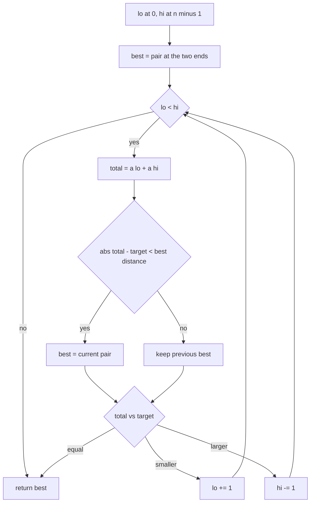
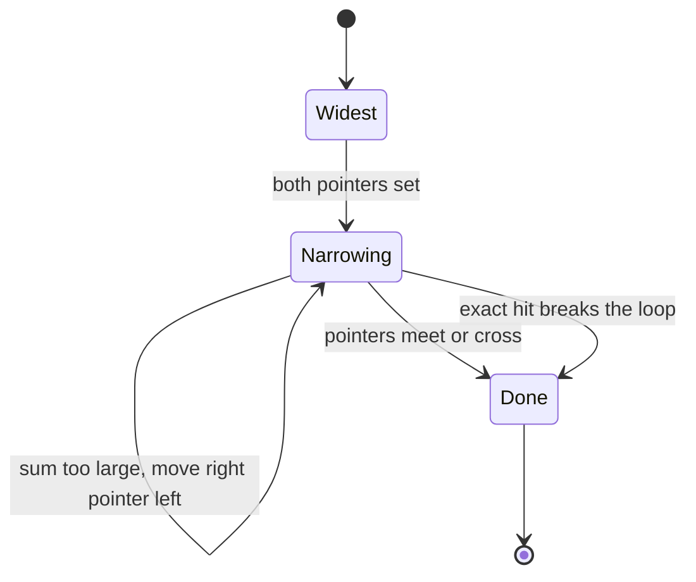
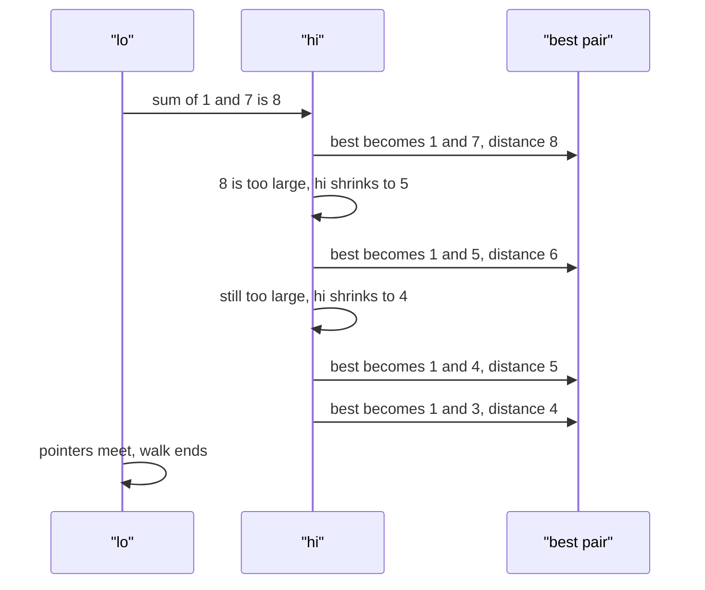

# 206 — Pair with sum closest to target in sorted array.

> **Tier:** Intermediate · **CTCI chapter:** Ch 10 — Sorting and Searching
> **Task spec:** [206-pair-with-sum-closest-to-target-in-sorted-array.md](../../../tasks/intermediate/206-pair-with-sum-closest-to-target-in-sorted-array.md)
> **Solutions:** [Python](../../../solutions/python/intermediate/206-pair-with-sum-closest-to-target-in-sorted-array/solution.py) ·
> [Java](../../../solutions/java/intermediate/206-pair-with-sum-closest-to-target-in-sorted-array/Solution.java) ·
> [JavaScript](../../../solutions/javascript/intermediate/206-pair-with-sum-closest-to-target-in-sorted-array/solution.js) ·
> [C#](../../../solutions/csharp/intermediate/206-pair-with-sum-closest-to-target-in-sorted-array/Solution.cs)

## 1. Problem restatement

**Input:** a **sorted** array `a` of at least two values and a `target`. A shorter array is an
error: Python and JavaScript raise, Java throws `IllegalArgumentException`, C# throws
`ArgumentException`.

**Output:** the pair `(a[lo], a[hi])` with `lo < hi` whose sum is closest to `target`, together with
that sum. On a tie — two pairs with the same distance — the solutions document that **the first
pair found wins**, which in practice means the pair discovered earliest by the two-pointer walk
starting from the ends.

| Call | Result | Why |
| --- | --- | --- |
| `closest_pair([1, 3, 4, 5, 7], 10)` | `((3, 7), 10)` | exact hit, walk stops immediately |
| `closest_pair([1, 3, 4, 5, 7], 8)` | `((1, 7), 8)` | `1 + 7` is exact |
| `closest_pair([1, 3, 4, 5, 7], 12)` | `((5, 7), 12)` | `5 + 7` is exact |
| `closest_pair([1, 3, 4, 5, 7], 0)` | `((1, 3), 4)` | the smallest achievable sum is `4`, distance `4` |
| `closest_pair([2, 4], 5)` | `((2, 4), 6)` | only one pair exists |
| `closest_pair([1], 5)` | raises | fewer than two values |

Python and JavaScript assert the first three rows and the error case; Java asserts all six rows
including the error case; C# asserts four numeric rows (the `10`, `8`, `0` and `[2, 4]` cases) plus
the error case. The return shape differs by
language — a tuple in Python and C#, a triple `{x, y, sum}` in Java, an object `{pair, sum}` in
JavaScript — but the numeric content is identical.

## 2. Intuition

The naive approach tries every pair, which is **O(n²)** and ignores the one piece of information
the input hands you for free: the array is sorted.

The insight is the same monotone walk used throughout this chapter. Put one pointer at each end and
compare the current sum with the target:

- If the sum is **too small**, the only way to increase it is to move the left pointer right —
  pairing the current left value with anything to the left of the current right pointer is even
  smaller, so those pairs cannot be improvements.
- If the sum is **too large**, the only way to decrease it is to move the right pointer left.
- If the sum is **exactly** the target, the distance is `0` and no pair can beat it, so the walk
  can stop.

Every step therefore discards a whole "triangle" of pairs from consideration at cost `O(1)`, which
is what turns the quadratic scan into a single linear sweep of the `lo`/`hi` gap. The bookkeeping
needed is just the best distance seen so far (`abs(total - target)`), the pair that produced it, and
the tie-break rule.



## 3. Algorithm

1. Reject inputs with fewer than two values.
2. Start with `lo = 0`, `hi = n - 1` and take the end pair as the initial best.
3. While `lo < hi`:
   1. Compute `total = a[lo] + a[hi]` and `diff = abs(total - target)`.
   2. If `diff < best_diff`, record this pair as the new best (this is the "first found wins"
      tie-break: later pairs with equal distance never overwrite).
   3. If `total < target`, increment `lo`; if `total > target`, decrement `hi`; if equal, stop.
4. Return the best pair and its sum.

```text
function closest_pair(a, target)
    if length(a) < 2 then
        raise error
    end
    lo ← 0
    hi ← length(a) - 1
    best_pair ← a[lo], a[hi]
    best_diff ← abs(a[lo] + a[hi] - target)
    while lo < hi do
        total ← a[lo] + a[hi]
        diff ← abs(total - target)
        if diff < best_diff then
            best_diff ← diff
            best_pair ← a[lo], a[hi]
        end
        if total < target then
            lo ← lo + 1
        else if total > target then
            hi ← hi - 1
        else
            break
        end
    end
    return best_pair, best_pair[0] + best_pair[1]
end
```

Note that the best pair is initialised to the widest pair `(a[0], a[n-1])` *before* the loop, so an
array of exactly two values is answered without entering the loop body — `closest_pair([2, 4], 5)`
returns `(2, 4)` with sum `6` even though the loop condition `0 < 1` would also run it once.



## 4. Worked example

Trace `closest_pair([1, 3, 4, 5, 7], 0)` — the interesting case, since no pair can reach the target
and the walk has to inspect the whole space.

| Step | `lo` | `hi` | `total` | `diff` | `best_pair` | `best_diff` | Move |
| --- | --- | --- | --- | --- | --- | --- | --- |
| init | 0 | 4 | 1 + 7 = 8 | 8 | `(1, 7)` | 8 | — |
| 1 | 0 | 4 | 8 | 8 | `(1, 7)` | 8 | too large, `hi → 3` |
| 2 | 0 | 3 | 1 + 5 = 6 | 6 | `(1, 5)` | 6 | too large, `hi → 2` |
| 3 | 0 | 2 | 1 + 4 = 5 | 5 | `(1, 4)` | 5 | too large, `hi → 1` |
| 4 | 0 | 1 | 1 + 3 = 4 | 4 | `(1, 3)` | 4 | too large, `hi → 0` |
| end | 0 | 0 | — | — | `(1, 3)` | 4 | `lo` is not below `hi`, stop |

The answer is `(1, 3)` with sum `4`, exactly what the assertion expects. The walk visits four
pairs, not the `C(5, 2) = 10` that a brute-force scan would.

The exact-hit case terminates immediately:

| Step | `lo` | `hi` | `total` | `diff` | `best_pair` | `best_diff` | Action |
| --- | --- | --- | --- | --- | --- | --- | --- |
| init | 0 | 4 | 1 + 7 = 8 | 2 | `(1, 7)` | 2 | too small, `lo → 1` |
| 1 | 1 | 4 | 3 + 7 = 10 | 0 | `(3, 7)` | 0 | exact hit, `break` |
| end | 1 | 4 | — | — | `(3, 7)` | 0 | the loop exits from inside |

The same array produces opposite pointer moves in the two traces: with `target 0` every step had to
shrink `hi`, while with `target 10` the first step grows `lo` and the second hits the target
exactly, so the walk ends after two comparisons instead of four.



## 5. Complexity

Let `n` be the length of the sorted array.

| Measure | Bound | Why it holds |
| --- | --- | --- |
| Time, best | O(1) | an exact hit at the end pair, or an array of exactly two values, ends after one comparison |
| Time, average | O(n) | the `lo`/`hi` gap shrinks by one on every iteration |
| Time, worst | O(n) | at most `n - 1` iterations, each doing constant work |
| Space, extra | O(1) | two indices, one best pair and one best distance |
| Naive pair scan | O(n²) time | all `C(n, 2)` pairs are summed |
| Sort-then-scan | O(n log n) + O(n) | if the input were not already sorted, sorting the copy would dominate |

The `O(1)` extra space is the interesting column: unlike the hash-based tasks in this tier, the
closest-pair walk needs no auxiliary structure at all, because sorted order plus two indices *is*
the data structure. That is the trade the task is designed to teach — the sort is assumed to be
free because the caller already paid for it.

## 6. Pitfalls and edge cases

- **Fewer than two values.** `[1]` and `[]` cannot form a pair and the solution files raise rather
  than invent a result. Java and C# assert the thrown error explicitly.
- **All pairs on one side of the target.** `[1, 3, 4, 5, 7]` with `target 0` produces sums all
  larger than the target; the walk still terminates with the smallest achievable sum `(1, 3)`.
  A variant that only tracked exact hits would return the initial pair and be wrong.
- **Ties.** With `abs(total - target)` equal, the code uses a strict `<`, so the earlier-discovered
  pair wins. Replacing `<` with `<=` silently changes which pair is returned for arrays where two
  pairs are equidistant — the documented behaviour is required for the assertions.
- **Exact hit.** The `break` on `total == target` is an optimisation only; if it is removed, the
  algorithm still returns a distance-`0` pair because nothing can beat it, but it loses the early
  exit.
- **The input must already be sorted.** The monotonicity argument collapses on unsorted data. The
  task guarantees sortedness, and none of the four solutions sorts defensively.
- **Duplicate values.** `[2, 2, 2]` with `target 5` returns `(2, 2)` sum `4`; `lo` and `hi` are
  different indices and the pair is legal even though the values are equal.
- **Sum overflow.** Java and C# compute `a[lo] + a[hi]` in 32-bit `int`; values close to
  `Integer.MAX_VALUE` overflow. The asserted inputs stay far below that, but a defensive
  implementation would widen the sum.
- **Return shape.** Java returns a three-element `int[]` (`x`, `y`, `sum`), C# an
  `(int x, int y, int sum)` tuple, Python a `((x, y), sum)` tuple and JavaScript an object. The
  pseudocode's "return best pair and its sum" hides this, so read the language file before porting.

## 7. Variants and follow-ups

- **Three values instead of two.** [207-three-sum-closest.md](../../../tasks/intermediate/207-three-sum-closest.md)
  wraps this exact walk in an outer anchor loop and tracks the closest *triplet* sum; the inner
  logic is the same monotone walk.
- **Exact sum on an unsorted array.** [205-count-pairs-with-sum-k-when-array-unsorted-hash.md](../../../tasks/intermediate/205-count-pairs-with-sum-k-when-array-unsorted-hash.md)
  counts rather than reports, and uses a hash map because it cannot rely on sorted order.
- **Exact sum with deduplication.** [202-3-sum-all-unique-triplets.md](../../../tasks/intermediate/202-3-sum-all-unique-triplets.md)
  and [201-two-sum-unique-pairs-return-all-unique-pairs.md](../../../tasks/intermediate/201-two-sum-unique-pairs-return-all-unique-pairs.md)
  show the same two-pointer primitive applied to "find all" rather than "find nearest".
- **Sorting as the preprocessing step.** The chapter walkthrough
  [Sorting and Searching](../../ctci/10-sorting-and-searching.md) discusses when sorting a copy is
  worth the `n log n` investment; this task is the cleanest example, since the walk itself never
  reorders anything.

## 8. Check yourself

1. Why does moving `lo` right after a too-small sum never skip the optimal pair?

<details><summary>Show answer</summary>

For the current `hi`, the pair `(a[lo], a[hi])` is already too small, and any `lo' < lo` would give
an even smaller sum, hence at least as far from the target on the low side. All pairs of the form
`(a[lo'], a[hi])` with `lo' <= lo` are therefore no better, so discarding them costs nothing. The
symmetric argument applies when the sum is too large.

</details>

2. What is the role of initialising `best_pair` before the loop?

<details><summary>Show answer</summary>

It gives the walk a valid incumbent even when the loop body never runs — the two-element case — and
it makes the update rule uniformly "replace only on a strictly smaller distance", which is exactly
the documented tie-break. Without the initialisation, a single-comparison input would return
nothing.

</details>

3. For `[1, 3, 4, 5, 7]` with `target 0`, why is `(1, 3)` the answer rather than `(1, 4)` or
   `(5, 7)`?

<details><summary>Show answer</summary>

Because the distance is `abs(sum - target) = sum` when the target is `0`, so the closest pair is
the one with the smallest achievable sum. The pairs `(1, 7) = 8`, `(1, 5) = 6`, `(1, 4) = 5` and
`(1, 3) = 4` are visited in that order and each beats the previous best; `(1, 3)` wins with
distance `4`.

</details>

4. How many pairs does the walk examine in the worst case, and how does that compare with the
   brute-force scan?

<details><summary>Show answer</summary>

At most `n - 1`: each iteration moves exactly one pointer, and the walk stops when they meet. The
brute-force scan examines `C(n, 2) = n(n-1)/2` pairs, so the saving is a factor of roughly `n/2`.

</details>

5. What changes if the caller also wants the pair that is *furthest* from the target?

<details><summary>Show answer</summary>

The walk itself still works — every pair the two pointers visit is a candidate — but the pruning
argument breaks, because "too small" no longer implies the neighbours are worse for the new
objective. The robust answer is to take the maximum of `abs(sum - target)` over all pairs, which is
the end pair and the pair of the two extreme values on the same side; alternatively keep the same
walk and evaluate both extremes explicitly. Do not simply flip the comparison in the update rule.

</details>
