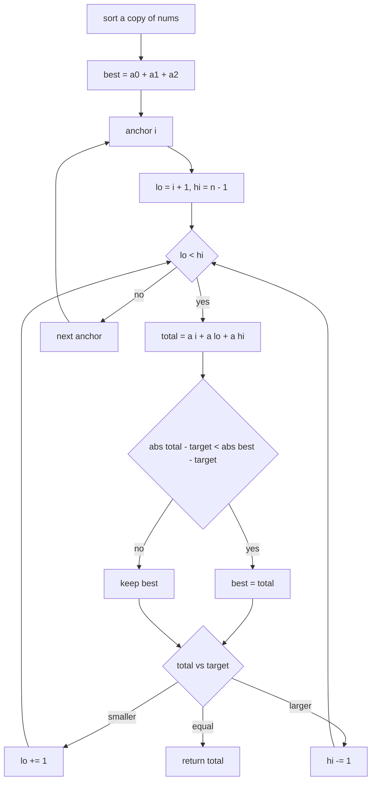
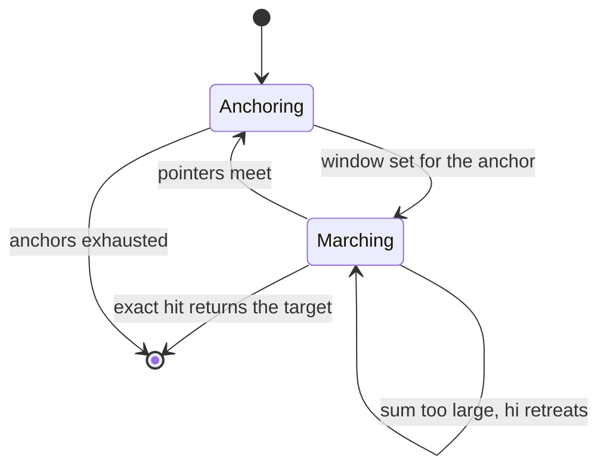
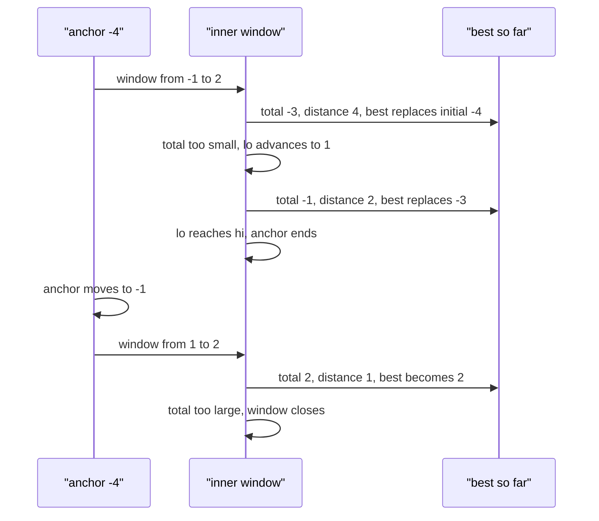

# 207 — Three-sum closest.

> **Tier:** Intermediate · **CTCI chapter:** Ch 1 — Arrays and Strings
> **Task spec:** [207-three-sum-closest.md](../../../tasks/intermediate/207-three-sum-closest.md)
> **Solutions:** [Python](../../../solutions/python/intermediate/207-three-sum-closest/solution.py) ·
> [Java](../../../solutions/java/intermediate/207-three-sum-closest/Solution.java) ·
> [JavaScript](../../../solutions/javascript/intermediate/207-three-sum-closest/solution.js) ·
> [C#](../../../solutions/csharp/intermediate/207-three-sum-closest/Solution.cs)

## 1. Problem restatement

**Input:** an array `nums` of integers and a `target`. Fewer than three values is an error: Python
and JavaScript raise, Java throws `IllegalArgumentException`, C# throws `ArgumentException`.

**Output:** the **sum** (not the triplet) of three values at distinct positions that is closest to
`target`. If two triplets are equidistant from the target, the walk keeps whichever it found first,
and the assertions only pin down cases without ties.

| Call | Result | Why |
| --- | --- | --- |
| `three_sum_closest([-1, 2, 1, -4], 1)` | `2` | `-1 + 2 + 1 = 2`, distance `1`; no other triple is closer |
| `three_sum_closest([0, 0, 0], 1)` | `0` | the only triple, distance `1` |
| `three_sum_closest([1, 1, 1, 1], 5)` | `3` | every triple sums to `3`, distance `2` |
| `three_sum_closest([-5, -2, -1], -3)` | `-8` | the whole array, distance `5`; the only triple |
| `three_sum_closest([1, 2], 3)` | raises | only two values |

Python, Java, JavaScript and C# all assert the four numeric rows and the error case; Python catches
its own exception explicitly, Java and C# use `try`/`catch`, and JavaScript uses `assert.throws`.

## 2. Intuition

The naive answer enumerates all `C(n, 3)` triplets, recomputing each sum from scratch: **O(n³)**.
Sorting first does not change the number of triplets, but it makes the *search* for the best
partner pair cheap.

The insight is to reuse the two-pointer primitive from
[206](206-pair-with-sum-closest-to-target-in-sorted-array.md) — but with a twist. In task 206 the
target was literal; here, after fixing one anchor `nums[i]`, the remaining two values have to sum
to `target - nums[i]`, and we want the *closest* achievable inner pair sum. So for each anchor the
inner walk minimises `abs(nums[i] + nums[lo] + nums[hi] - target)` over the window, exactly as the
closest-pair walk does, and the outer loop takes the best over all anchors. That is **O(n²)**.

Two properties make it work:

- **Monotone window.** On a sorted array the inner sum grows when `lo` moves right and shrinks when
  `hi` moves left, so the walk can prune whole regions instead of enumerating pairs.
- **Early exit on an exact hit.** Unlike [202](202-3-sum-all-unique-triplets.md), where a zero sum
  is one answer among many, here a sum equal to the target has distance `0`, which is optimal, so
  the function can `return total` immediately. Python, Java, JavaScript and C# all do.

This is what distinguishes the "closest" family from the "exact" family: one optimum to find, and a
provable stopping condition.



## 3. Algorithm

1. Sort a copy of the input ascending; if there are fewer than three values, raise.
2. Initialise `best` to the sum of the three smallest values, `a[0] + a[1] + a[2]` — a valid triple,
   so the incumbent is always achievable.
3. For every anchor `i` from `0` to `n - 3`:
   1. Set `lo = i + 1` and `hi = n - 1`.
   2. While `lo < hi`, compute `total = a[i] + a[lo] + a[hi]`.
      - If `abs(total - target) < abs(best - target)`, set `best = total`.
      - If `total < target`, increment `lo`; if `total > target`, decrement `hi`; if equal, return
        `total` immediately.
4. Return `best`.

```text
function three_sum_closest(nums, target)
    a ← sorted copy of nums
    if length(a) < 3 then
        raise error
    end
    best ← a[0] + a[1] + a[2]
    for i ← 0 to length(a) - 3 do
        lo ← i + 1
        hi ← length(a) - 1
        while lo < hi do
            total ← a[i] + a[lo] + a[hi]
            if abs(total - target) < abs(best - target) then
                best ← total
            end
            if total < target then
                lo ← lo + 1
            else if total > target then
                hi ← hi - 1
            else
                return total
            end
        end
    end
    return best
end
```

Note what is *absent* compared with task 202: no duplicate-anchor skipping
(`if i > 0 and a[i] == a[i - 1] then continue`), because duplicates cannot produce a duplicate
*sum*, and no duplicate-pointer skipping after a hit, because the walk returns as soon as it finds
an exact match and otherwise never records anything.



## 4. Worked example

Trace `three_sum_closest([-1, 2, 1, -4], 1)`. After sorting: `[-4, -1, 1, 2]`, `n = 4`, and the
incumbent is `a[0] + a[1] + a[2] = -4 + -1 + 1 = -4`, distance `5`.

| Step | `i` | `lo` | `hi` | `total` | `abs(total - 1)` | `best` | `abs(best - 1)` | Move |
| --- | --- | --- | --- | --- | --- | --- | --- | --- |
| 0 | 0 (-4) | 1 (-1) | 3 (2) | -3 | 4 | -3 | 4 | too small, `lo → 2` |
| 1 | 0 (-4) | 2 (1) | 3 (2) | -1 | 2 | -1 | 2 | too small, `lo → 3` |
| — | 0 (-4) | 3 (2) | 3 (2) | — | — | -1 | 2 | `lo` not below `hi`, next anchor |
| 2 | 1 (-1) | 2 (1) | 3 (2) | 2 | 1 | 2 | 1 | too large, `hi → 2` |
| — | 1 (-1) | 2 (1) | 2 (1) | — | — | 2 | 1 | window closed, next anchor |
| 3 | 2 (1) | 3 | 3 | — | — | 2 | 1 | no window left |

The function returns `2`, matching the assertion. Anchor `0` drags the sum below the target because
`-4` is very negative, and the walk ends up moving `lo` right the whole way without ever
overshooting. Anchor `1` is the one that produces the answer: `-1 + 1 + 2 = 2` is within `1` of the
target and cannot be improved by moving `hi` further left, since `-1 + 1 + 1 = 1` would be exact
only if `lo` and `hi` were the same index — which is not allowed.



## 5. Complexity

Let `n` be the input length.

| Measure | Bound | Why it holds |
| --- | --- | --- |
| Time, best | O(n log n) | sort plus an immediate exact hit at the first anchor |
| Time, average | O(n²) | the outer loop runs `n - 2` times and each inner window advances at most `n` steps |
| Time, worst | O(n²) | the inner walk never revisits a pointer position, so the per-anchor cost is bounded by the gap width |
| Space, extra | O(n) | the sorted copy; the walk itself uses two indices and one incumbent |
| Space, output | O(1) | a single integer |
| Naive triplet enumeration | O(n³) time | all `C(n, 3)` triplets are summed, with no pruning |

The single incumbent integer is what makes this variant cheaper to *write* than the exact variant:
there is no result list, no duplicate skipping and no canonical ordering to maintain. The cost is
the same O(n²) asymptotic bound, which is why the "closest" family is a favourite interview follow-up
to the "exact" one — it tests whether the candidate understood the pruning rather than the
bookkeeping.

## 6. Pitfalls and edge cases

- **Fewer than three values.** `[1, 2]` and `[]` cannot form a triplet. Python and JavaScript raise
  a plain error, Java and C# throw their argument exception types, and Python, Java, JavaScript and
  C# all assert the failure explicitly.
- **Initialise `best` from a real triple.** `a[0] + a[1] + a[2]` is used rather than infinity,
  because the return type is an integer sum; the first anchor's first comparison then refines it.
  Using `0` as the initial value would be wrong for inputs whose closest sum is far from zero.
- **All-negative input.** `[-5, -2, -1]` with `target -3` returns `-8`: the sum can be less than the
  target, and distance is measured with `abs`, so a solution that assumed "closest means just below"
  fails here. Java, JavaScript and C# assert this row.
- **Exact hit returns immediately.** Replacing `return total` with `break`-and-continue would still
  be correct, but slower; returning is what the four files do, and it is provably safe because the
  distance is `0`.
- **Ties.** With strict `<` in the update, the first triplet encountered at a given distance wins.
  No assertion depends on a tie, but changing to `<=` would alter the result only in tied cases —
  which the test data deliberately avoids.
- **Duplicate values need no special handling.** `[0, 0, 0]` and `[1, 1, 1, 1]` are asserted and
  work: three positions may hold the same value, and because the output is a sum rather than a set
  of triplets, repeating a triplet cannot create duplicate output.
- **The input must not be reordered for the caller.** Python sorts a new list; Java, JavaScript and
  C# clone first. Sorting in place would be an observable side effect.
- **Numeric sort.** JavaScript's default `sort()` is lexicographic; the solution passes
  `(x, y) => x - y`, without which the monotone pruning argument breaks.
- **Overflow.** Java and C# sum three 32-bit ints into an `int`. With values near `Integer.MAX_VALUE`
  the sum wraps; the asserted inputs are small, but the general fix is to widen to `long`.

## 7. Variants and follow-ups

- **All exact triplets.** [202-3-sum-all-unique-triplets.md](../../../tasks/intermediate/202-3-sum-all-unique-triplets.md)
  is the same anchor-plus-window skeleton with the exact-match objective and duplicate skipping.
- **Closest pair.** [206-pair-with-sum-closest-to-target-in-sorted-array.md](../../../tasks/intermediate/206-pair-with-sum-closest-to-target-in-sorted-array.md)
  is the base case of this algorithm, and the one to derive first: a single window with an
  incumbent distance.
- **Closest with more values.** [203-4-sum-problem-k-sum-generalization.md](../../../tasks/intermediate/203-4-sum-problem-k-sum-generalization.md)
  shows the recursion that generalises both this task and task 202 to arbitrary `k`; the closest
  objective can be threaded through the same recursion by keeping an incumbent instead of a list.
- **Counting instead of optimising.** [205-count-pairs-with-sum-k-when-array-unsorted-hash.md](../../../tasks/intermediate/205-count-pairs-with-sum-k-when-array-unsorted-hash.md)
  shows the opposite extreme: no sorted input, no window, one hash map.
- The chapter walkthrough [Sorting and Searching](../../ctci/10-sorting-and-searching.md) is the
  natural companion reading, since the sort is the preprocessing step that makes the window sound.

## 8. Check yourself

1. Why can the inner loop return as soon as `total == target` while task 202 must keep going?

<details><summary>Show answer</summary>

Because the objective is a minimum of a non-negative quantity: the distance `abs(total - target)`
reaches `0` at an exact hit and cannot go below it, so the incumbent is provably optimal. Task 202
is asking for *all* zero-sum triplets, so one hit is one answer among possibly many.

</details>

2. What is the difference between this algorithm and calling task 206's closest-pair routine on
   every suffix?

<details><summary>Show answer</summary>

In effect nothing — that is what the inner loop does — but here the inner loop is inline and shares
the outer anchor, so there is no reset of `lo` beyond `i + 1` and no reallocation. Both are O(n²);
writing it as an outer loop plus an inlined two-pointer walk avoids the function-call and
data-structure overhead of materialising each suffix.

</details>

3. For `[-5, -2, -1]` with `target -3`, which triple is considered, and what is the final distance?

<details><summary>Show answer</summary>

Only one triple exists: `-5 + -2 + -1 = -8`. The incumbent is initialised to exactly that sum, the
single window `(1, 2)` computes the same total, the distance `abs(-8 - -3) = 5` is not beaten, and
the function returns `-8`. This is the test that catches implementations that assume the answer is
always below the target or always above it.

</details>

4. Why is duplicate-anchor skipping unnecessary here even though it is essential in task 202?

<details><summary>Show answer</summary>

Because the output is a single sum, not a collection. In task 202, processing the same anchor value
twice would append the same triplet to the answer list twice; here the second visit would recompute
the same totals and fail to improve the incumbent, so it costs time but cannot corrupt the result.

</details>

5. How would you report the triplet itself rather than the sum, and what extra state would that
   require?

<details><summary>Show answer</summary>

Track the anchor index and the `lo`/`hi` values alongside the incumbent: whenever
`abs(total - target)` improves, store `(i, lo, hi)` together with `total`. That is all — the
pruning logic and the early exit are unchanged, because the objective is still the same scalar
distance.

</details>
