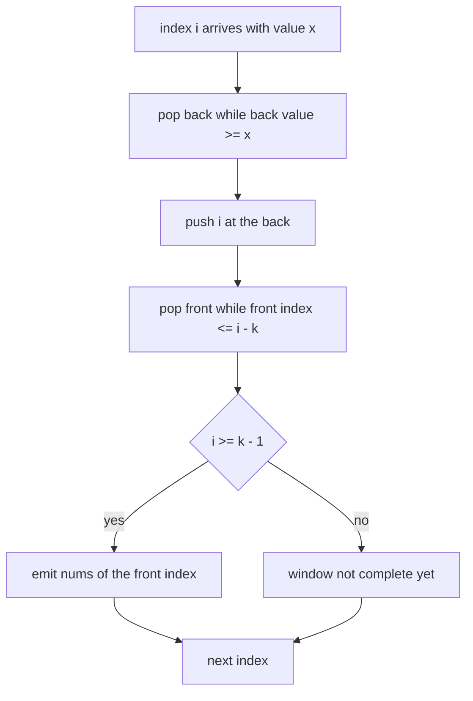
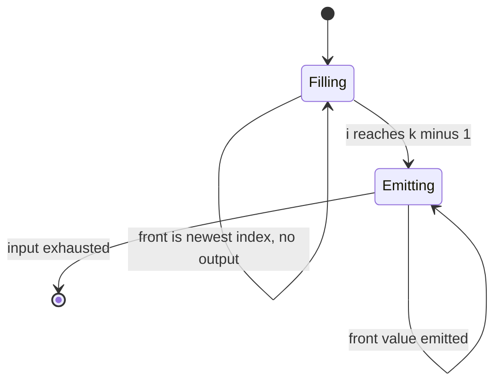
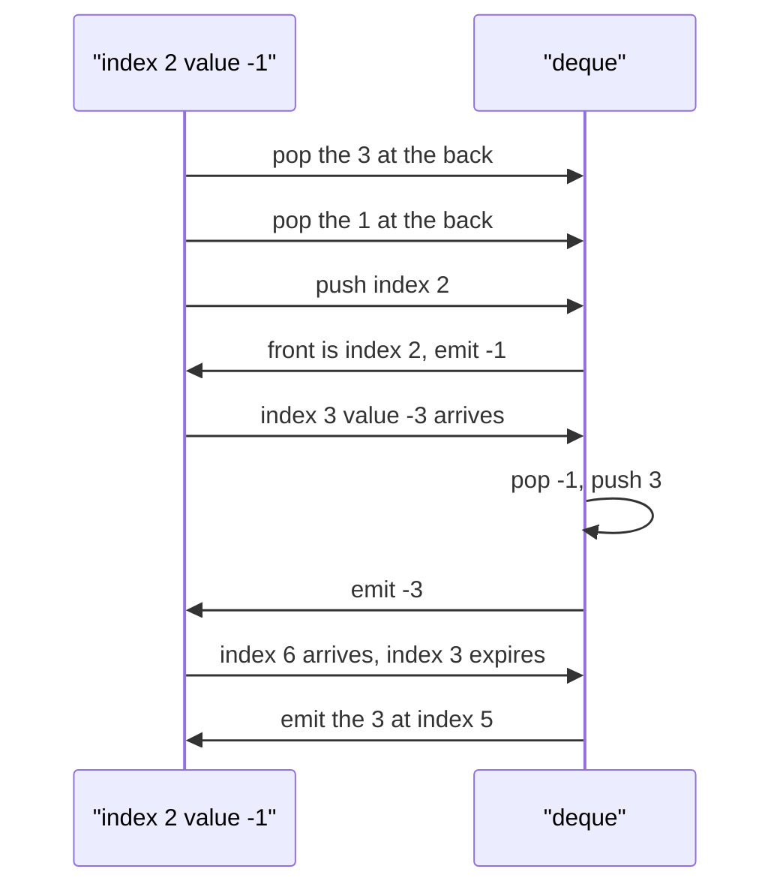

# 208 — Implement sliding window minimum using deque.

> **Tier:** Intermediate · **CTCI chapter:** Ch 3 — Stacks and Queues
> **Task spec:** [208-implement-sliding-window-minimum-using-deque.md](../../../tasks/intermediate/208-implement-sliding-window-minimum-using-deque.md)
> **Solutions:** [Python](../../../solutions/python/intermediate/208-implement-sliding-window-minimum-using-deque/solution.py) ·
> [Java](../../../solutions/java/intermediate/208-implement-sliding-window-minimum-using-deque/Solution.java) ·
> [JavaScript](../../../solutions/javascript/intermediate/208-implement-sliding-window-minimum-using-deque/solution.js) ·
> [C#](../../../solutions/csharp/intermediate/208-implement-sliding-window-minimum-using-deque/Solution.cs)

## 1. Problem restatement

**Input:** an array `nums` and a window size `k`. `k <= 0` is an error: Python and JavaScript raise,
Java throws `IllegalArgumentException`, C# throws `ArgumentException`.

**Output:** one minimum per window position, i.e. a list of `max(0, n - k + 1)` values where entry
`j` is `min(nums[j], ..., nums[j + k - 1])`. If `k > n` there are no complete windows and the result
is empty.

| Call | Result | Why |
| --- | --- | --- |
| `sliding_window_minimum([1, 3, -1, -3, 5, 3, 6, 7], 3)` | `[-1, -3, -3, -3, 3, 3]` | six windows of size three |
| `sliding_window_minimum([1], 1)` | `[1]` | the single window is the whole array |
| `sliding_window_minimum([1, 2], 5)` | `[]` | `k` exceeds `n`, no complete window |
| `sliding_window_minimum([5, 5, 5], 2)` | `[5, 5]` | duplicates keep every window at `5` |
| `sliding_window_minimum([9, 8, 7], 1)` | `[9, 8, 7]` | windows of size one are the elements themselves |
| `sliding_window_minimum([], 3)` | `[]` | nothing to slide over |

Python asserts all six rows; Java asserts the first five; JavaScript and C# assert the first four.
The function returns a fresh list in every language and
never mutates the input.

## 2. Intuition

The naive approach recomputes each window's minimum from scratch: `O(nk)` time, and on top of that
the minimum of the whole array is recomputed `O(n)` times when the maximum value is at a fixed
position.

The insight is that most of a window's contents are shared with the previous window, and that the
only elements worth remembering are the **candidates for being the smallest**: an element is
irrelevant the moment a later element that is at least as small appears, because within any window
that contains both, the earlier one can never be the minimum.

That gives a *monotonic deque* of **indices** whose values are increasing from front to back:

- **Push rule.** Before inserting index `i`, pop indices from the back while their values are
  `>= nums[i]`. Those elements are dominated — `nums[i]` is smaller (or equal) and lasts longer.
  Removing equal values keeps the front minimal and the structure tight; equality can never produce
  a wrong answer because the kept index is the later one.
- **Expiry rule.** The window is `[i - k + 1, i]`, so a front index `<= i - k` has fallen out of the
  window and is popped from the front.
- **Read rule.** Once `i >= k - 1` there is a complete window, and its minimum is exactly
  `nums[deque front]` — the smallest surviving candidate.

Because each index is pushed once and popped at most once, the amortised cost is `O(n)` rather than
`O(nk)`.



## 3. Algorithm

1. Reject `k <= 0`.
2. Create an empty deque of indices and an empty result list.
3. For each index `i` from `0` to `n - 1`, in order:
   1. While the deque is non-empty and `nums[back] >= nums[i]`, pop the back — `i` dominates those
      indices.
   2. Push `i` at the back.
   3. If the front index is `<= i - k`, pop it from the front: it has left the window.
   4. If `i >= k - 1`, append `nums[front]` to the result.
4. Return the result.

```text
function sliding_window_minimum(nums, k)
    if k <= 0 then
        raise error
    end
    result ← empty list
    dq ← empty deque of indices
    for i ← 0 to length(nums) - 1 do
        while dq not empty and nums[dq.back] >= nums[i] do
            dq.pop_back()
        end
        dq.push_back(i)
        if dq.front <= i - k then
            dq.pop_front()
        end
        if i >= k - 1 then
            result.append(nums[dq.front])
        end
    end
    return result
end
```

The order of the three deque operations matters. The back-popping must happen before the push, so
that the new index is compared against the surviving candidates only. The front-expiry check can
happen before or after the push, because only one index can expire per step and the newly pushed
index is never the front unless the deque was empty — but it must happen before the read, otherwise
the emitted minimum can be an index that already left the window.



## 4. Worked example

Trace `sliding_window_minimum([1, 3, -1, -3, 5, 3, 6, 7], 3)`.

| `i` | `nums[i]` | Pop back while `>= nums[i]` | Deque after push | Pop front if `<= i - 3` | `i >= 2`? | Emitted |
| --- | --- | --- | --- | --- | --- | --- |
| 0 | 1 | — | `[0]` | — | no | — |
| 1 | 3 | none (1 is smaller) | `[0, 1]` | — | no | — |
| 2 | -1 | pop 1 (3), pop 0 (1) | `[2]` | — | yes | `-1` |
| 3 | -3 | pop 2 (-1) | `[3]` | — | yes | `-3` |
| 4 | 5 | none (-3 is smaller) | `[3, 4]` | front `3 > 1`, keep | yes | `-3` |
| 5 | 3 | pop 4 (5) | `[3, 5]` | front `3 > 2`, keep | yes | `-3` |
| 6 | 6 | none (3 is smaller) | `[3, 5, 6]` | front `3 <= 3`, pop | yes | `3` |
| 7 | 7 | none (6 is smaller) | `[5, 6, 7]` | front `5 > 4`, keep | yes | `3` |

The emitted sequence is `[-1, -3, -3, -3, 3, 3]`, which is the asserted result. Two rows carry the
lesson:

- Row `i = 2` shows domination: the `1` at index `0` and the `3` at index `1` are both removed by a
  single smaller value, which is why the deque stayed size one.
- Rows `i = 6` and `i = 7` show expiry: index `3` was the minimum for four consecutive windows and
  is only dropped when it leaves the window at `i = 6`, after which the minimum becomes the `3` from
  index `5` and then stays there.



## 5. Complexity

Let `n` be the length of `nums` and `w = n - k + 1` the number of windows.

| Measure | Bound | Why it holds |
| --- | --- | --- |
| Time, best | O(n) | every index is still pushed once, even for sorted input |
| Time, average | O(n) | each index enters the deque once and leaves at most once, so total pops are bounded by total pushes |
| Time, worst | O(n) | the inner `while` loops are amortised, not per-iteration: the sum of all pops is at most `n` |
| Space | O(k) | the deque never holds more than `k` indices, plus the `w`-element output |
| Naive recomputation | O(nk) time, O(1) extra space | each window rescans its `k` elements |

The amortised argument is the crux and the reason the task is filed under stacks and queues rather
than under arrays: a single step may pop many elements, but the popped elements were pushed by
earlier steps, so the total work across the whole run is bounded by `2n` deque operations. This is
the same accounting used for the two-pointer and sliding-window tasks in this tier, just with a
deque instead of an index pair.

## 6. Pitfalls and edge cases

- **`k <= 0`.** All four files raise rather than return something meaningless; `k = 0` would make
  every window empty and the minimum undefined.
- **`k > n`.** `[1, 2]` with `k = 5` returns `[]`: the guard `i >= k - 1` is never satisfied, so the
  result stays empty. Java, C# and Python assert this row.
- **`k = 1`.** Every window is a single element, so the result is the input. `[9, 8, 7]` with `k = 1`
  returns `[9, 8, 7]`; the deque holds exactly one index at any time, and the back-popping rule
  removes the previous index before the new one is pushed.
- **Empty input.** `[]` returns `[]` regardless of `k`, as long as `k` is positive.
- **Duplicates.** The rule is `>=` on the back-pop, so equal values evict their predecessors and the
  deque keeps the newest occurrence. With `[5, 5, 5]` and `k = 2` the answer is `[5, 5]` either way,
  but the `>=` choice also keeps the deque from growing with useless duplicates. Using `>` instead
  is still correct for the *minimum* problem — it only changes how many indices are kept.
- **Expiry must be checked after the push.** If the expiry check runs before the back-popping and
  push, the deque can still contain an expired index when the value is read, which produces a
  minimum from outside the window. The failure appears only when the front is exactly `i - k` away.
- **Reading `front` before any window exists.** The read is guarded by `i >= k - 1`; without the
  guard, indices `0 .. k - 2` would emit a minimum for a window that has not fully appeared.
- **Do not store values, store indices.** A deque of values cannot tell which entry has expired.
- **Python's `collections.deque`, Java's `ArrayDeque`, C#'s `LinkedList` and a plain JavaScript
  array.** The JavaScript file uses `push`/`pop`/`shift` on an array; `shift` is O(k) in a naive
  engine, so the language file is amortised O(n) in the same way but with a different constant.
  Python's `deque`, Java's `ArrayDeque` and C#'s linked list all support O(1) at both ends.

## 7. Variants and follow-ups

- **Maximum instead of minimum.** Negate the comparison: pop the back while the back value is
  `<= nums[i]`. The windowing mechanics are unchanged.
- **Sum of window minimums, or other aggregates.**
  [209-longest-subarray-with-sum-equal-to-k-array-of-positives.md](../../../tasks/intermediate/209-longest-subarray-with-sum-equal-to-k-array-of-positives.md)
  shows the sibling sliding-window trick for sums, where the window is grown and shrunk by value
  conditions rather than evicted by size.
- **Windowed counting with a hash.** [211-subarray-sum-equals-k-count-hashmap.md](../../../tasks/intermediate/211-subarray-sum-equals-k-count-hashmap.md)
  counts windows satisfying a sum condition using prefix sums, a different form of the same
  "remember only what can still matter" principle.
- **Stacks and queues fundamentals.** The chapter walkthrough
  [Stacks and Queues](../../ctci/03-stacks-and-queues.md) derives the monotonic deque from the
  simpler monotonic stack, where nothing ever expires.
- **Minimum queue as a data structure.** Implementing a queue that answers `getMinimum()` in O(1) is
  the abstract version of this task; the deque here is a windowed specialisation of it.

## 8. Check yourself

1. Why is the deque monotonically increasing, and what would happen if it were not?

<details><summary>Show answer</summary>

Because any element that is at least as large as a later element is popped when that later element
arrives — it can never be the window minimum while the later, smaller element is present. If the
deque were not monotone, the front would not necessarily be the window minimum, so the read would
have to scan the whole deque and the amortised `O(n)` bound would be lost.

</details>

2. Why does removing elements from the back not lose the correct answer?

<details><summary>Show answer</summary>

An element `j` is popped only when an `i > j` with `nums[i] <= nums[j]` is seen. For every window
that contains `j` and that has `i` inside it, `nums[i]` is a no-worse minimum with a later expiry;
and every window containing `j` after `i` has entered contains `i` too. So `j` is never the unique
minimum of any future window.

</details>

3. What is the total number of deque operations for an array of length `n`?

<details><summary>Show answer</summary>

At most `2n` in total: `n` pushes, and at most `n` pops across all steps, since each element can be
popped only once, either from the back when dominated or from the front when it expires. That is the
whole amortised argument for the linear bound.

</details>

4. The example returns `-3` for four consecutive windows. Which index produces it, and when is it
   finally evicted?

<details><summary>Show answer</summary>

Index `3`, the value `-3`. It stays at the front from `i = 3` to `i = 5`, producing the windows
starting at `1`, `2` and `3`. At `i = 6` the expiry test `3 <= 6 - 3` fires and it is popped from
the front, after which the front is index `5` with value `3`.

</details>

5. How would you adapt this to report the minimum of every window of size *at least* `k`?

<details><summary>Show answer</summary>

The deque mechanics still apply, but the semantics change: rather than a fixed window you would
maintain a deque over a sliding range defined by the predicate, popping the front only when the
range condition fails. A common instance is "shortest subarray with sum at least `k`", where the
deque stores prefix sums and the front is expired by the sum condition rather than by index
distance.

</details>
