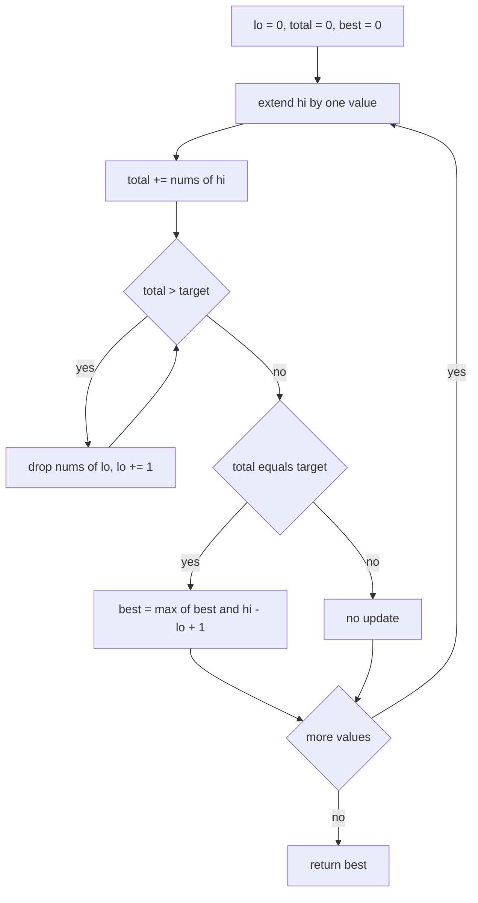
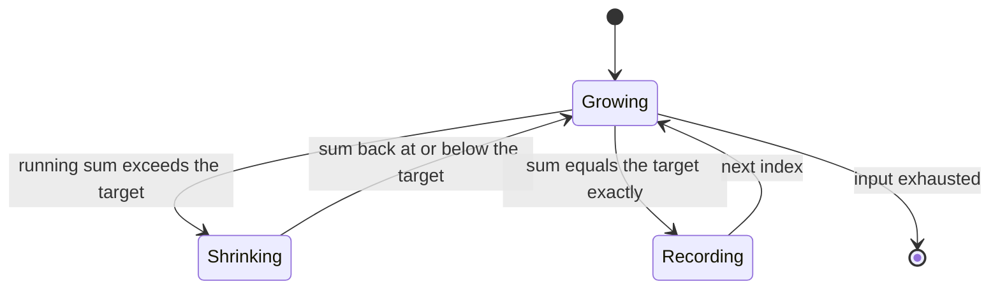
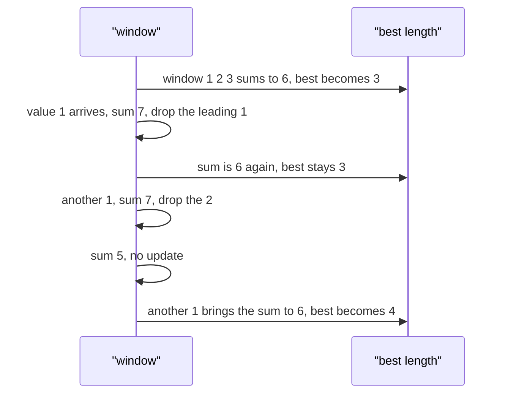

# 209 — Longest subarray with sum equal to K (array of positives).

> **Tier:** Intermediate · **CTCI chapter:** Ch 1 — Arrays and Strings
> **Task spec:** [209-longest-subarray-with-sum-equal-to-k-array-of-positives.md](../../../tasks/intermediate/209-longest-subarray-with-sum-equal-to-k-array-of-positives.md)
> **Solutions:** [Python](../../../solutions/python/intermediate/209-longest-subarray-with-sum-equal-to-k-array-of-positives/solution.py) ·
> [Java](../../../solutions/java/intermediate/209-longest-subarray-with-sum-equal-to-k-array-of-positives/Solution.java) ·
> [JavaScript](../../../solutions/javascript/intermediate/209-longest-subarray-with-sum-equal-to-k-array-of-positives/solution.js) ·
> [C#](../../../solutions/csharp/intermediate/209-longest-subarray-with-sum-equal-to-k-array-of-positives/Solution.cs)

## 1. Problem restatement

**Input:** an array `nums` of **strictly positive** integers and a `target`. The positivity is part
of the contract, not a convenience: the Python docstring says the sliding window is valid "only
because all values are positive, so the sum is monotone in the window size", and all four files
raise if they find a value `<= 0` (Python and JavaScript raise, Java throws
`IllegalArgumentException`, C# throws `ArgumentException`).

**Output:** the length of the longest **contiguous** subarray whose elements sum to exactly
`target`; `0` when no such subarray exists, and also when the input is empty.

| Call | Result | Why |
| --- | --- | --- |
| `longest_subarray_sum_k([1, 2, 3, 1, 1, 1, 1], 6)` | `4` | the window `[3, 1, 1, 1]` sums to `6` |
| `longest_subarray_sum_k([1, 1, 1, 1], 2)` | `2` | any two adjacent ones |
| `longest_subarray_sum_k([2, 2, 2], 6)` | `3` | the whole array |
| `longest_subarray_sum_k([5], 5)` | `1` | a single element |
| `longest_subarray_sum_k([1, 2, 3], 100)` | `0` | the total is far below the target |
| `longest_subarray_sum_k([1, -1, 1], 0)` | raises | a non-positive value breaks the contract |

Python, Java and C# assert the first five rows and the rejection of non-positive input; JavaScript
asserts four rows — it does not check the `[2, 2, 2]` whole-array case. The result is an `int` (or
`number`) length, never the subarray itself.

## 2. Intuition

The naive approach enumerates every subarray: `O(n²)` (or `O(n³)` if each sum is recomputed). The
prefix-sum trick from [210](210-longest-subarray-with-sum-equal-to-k-with-negatives-using-hashma.md)
also solves this in `O(n)` but needs an `O(n)` hash map.

The positivity assumption buys something better: `O(1)` extra space. Because every value is
positive, the running sum is **monotone in the window size** — extending the window to the right
can only increase the sum, and dropping from the left can only decrease it. Two consequences:

- If the current window sums to *more* than `target`, no amount of extending can fix it; the only
  repair is to drop elements from the left. That gives the shrink loop
  `while total > target and lo <= hi: total -= nums[lo]; lo += 1`.
- Because shrinking stops as soon as the sum is `<= target`, the window is always the *longest*
  candidate ending at the current index, so a `total == target` check right after the shrink loop
  is enough to record the best length. There is no need to try shorter windows ending at `hi`:
  those could only have smaller sums.

The equality check is deliberately *outside* the shrink loop. If you check inside, you may record a
window that is about to be shrunk — but more importantly, checking after the loop means you never
stop shrinking early on an equality that could be improved by a longer window ending at the same
index. The four files all place it after.



## 3. Algorithm

1. Verify that every value is strictly positive; raise otherwise.
2. Initialise `lo = 0`, `total = 0`, `best = 0`.
3. For each index `hi` from `0` to `n - 1`:
   1. Add `nums[hi]` to `total`.
   2. While `total > target` and `lo <= hi`, subtract `nums[lo]` from `total` and increment `lo`.
   3. If `total == target`, set `best = max(best, hi - lo + 1)`.
4. Return `best`.

```text
function longest_subarray_sum_k(nums, target)
    for each x in nums do
        if x <= 0 then
            raise error
        end
    end
    lo ← 0
    total ← 0
    best ← 0
    for hi ← 0 to length(nums) - 1 do
        total ← total + nums[hi]
        while total > target and lo <= hi do
            total ← total - nums[lo]
            lo ← lo + 1
        end
        if total == target then
            best ← max(best, hi - lo + 1)
        end
    end
    return best
end
```

The `lo <= hi` guard in the shrink condition matters when a single element exceeds the target: the
loop would otherwise run past `hi`, making `lo > hi` and the window-length expression negative. With
the guard, the oversized element is dropped and the window becomes empty again.



## 4. Worked example

Trace `longest_subarray_sum_k([1, 2, 3, 1, 1, 1, 1], 6)`.

| `hi` | `nums[hi]` | `total` after adding | Shrink steps | Window after shrink | `total == 6`? | `best` |
| --- | --- | --- | --- | --- | --- | --- |
| 0 | 1 | 1 | none | `[0..0]` = `1` | no | 0 |
| 1 | 2 | 3 | none | `[0..1]` = `3` | no | 0 |
| 2 | 3 | 6 | none | `[0..2]` = `6` | yes, length `3` | 3 |
| 3 | 1 | 7 | drop `1` at index 0 | `[1..3]` = `6` | yes, length `3` | 3 |
| 4 | 1 | 7 | drop `2` at index 1 | `[2..4]` = `5` | no | 3 |
| 5 | 1 | 6 | none | `[2..5]` = `6` | yes, length `4` | 4 |
| 6 | 1 | 7 | drop `3` at index 2 | `[3..6]` = `4` | no | 4 |

The answer is `4`, matching the assertion. The interesting steps are `hi = 5`, where the window
`[3, 1, 1, 1]` reaches length `4` and becomes the best, and `hi = 6`, where the sum overshoots again
and the shrink loop has to drop the `3`, leaving a sum of `4` that is below the target — the window
is now the longest candidate ending at index `6`, and no shorter window ending there can reach `6`
either, because all values are positive.



## 5. Complexity

Let `n` be the input length.

| Measure | Bound | Why it holds |
| --- | --- | --- |
| Time, best | O(n) | the positivity check is a full pass, so even an easy input is linear |
| Time, average | O(n) | `hi` advances `n` times and `lo` advances at most `n` times in total |
| Time, worst | O(n) | the shrink loop is amortised: every index enters and leaves the window once |
| Space, extra | O(1) | two indices, one running total and one best length |
| Hash-map alternative | O(n) time, O(n) space | [210](210-longest-subarray-with-sum-equal-to-k-with-negatives-using-hashma.md) works with negatives but stores every prefix sum |

The `O(1)` extra space is the payoff for the positivity assumption, and it is exactly what the
hash-map version has to give up. Note that the check at the top of the function also costs a pass,
so the two implementations' asymptotic time is the same — the difference is memory, plus the fact
that the hash version tolerates negative values.

## 6. Pitfalls and edge cases

- **Non-positive input must be rejected, not silently mishandled.** `[1, -1, 1]` with `target 0`
  raises in all four files. With a negative value the window sum is no longer monotone, the shrink
  loop can drop below the target and never recover, and the answer can be wrong.
- **Empty array.** `[]` returns `0`; no window forms and the function exits with `best = 0`.
- **No qualifying window.** `[1, 2, 3]` with `target 100` returns `0`, not `n`: a window that never
  reaches the target is not an answer.
- **A single element larger than the target.** The `lo <= hi` guard keeps the window well-formed;
  without it, `lo` could pass `hi` and `hi - lo + 1` would go negative, corrupting `best`.
- **Equality check placement.** Placing `if total == target` *inside* the shrink loop records
  windows that are about to shrink and, worse, can record them with a stale `lo`; the shipped code
  checks once, after the shrink loop has restored the invariant `total <= target`.
- **Repeated values.** `[1, 1, 1, 1]` with `target 2` returns `2`: several windows tie and the first
  maximum sticks because the update uses `max`.
- **Multiplicity of best windows.** The task asks for the length, not the indices. If you also need
  the subarray, record `lo` whenever `best` improves; nothing else changes.
- **Overflow.** Java and C# accumulate `total` in a 32-bit `int`. With `n` large and values large,
  the running sum before shrinking can overflow; the asserted inputs are small, but widening to
  `long` is the safe habit.
- **This is not the general problem.** The moment the input may contain zero or negative values, use
  [210](210-longest-subarray-with-sum-equal-to-k-with-negatives-using-hashma.md) instead. The
  duplicate name in that file is deliberate: both solve "longest subarray with sum `k`", with
  different assumptions and different complexity in the *space* column.

## 7. Variants and follow-ups

- **Negatives allowed.** [210-longest-subarray-with-sum-equal-to-k-with-negatives-using-hashma.md](../../../tasks/intermediate/210-longest-subarray-with-sum-equal-to-k-with-negatives-using-hashma.md)
  keeps the same question but answers it with prefix sums and a map from prefix value to earliest
  index.
- **Counting instead of maximising.**
  [211-subarray-sum-equals-k-count-hashmap.md](../../../tasks/intermediate/211-subarray-sum-equals-k-count-hashmap.md)
  counts how many subarrays sum to the target, which is the same prefix-sum machinery with
  frequencies rather than earliest indices.
- **Fixed-size windows.** [208-implement-sliding-window-minimum-using-deque.md](../../../tasks/intermediate/208-implement-sliding-window-minimum-using-deque.md)
  slides a window of a *given* size, where the eviction rule is positional rather than value-based.
- **Maximum sum instead of an exact sum.**
  [212-find-subarray-with-maximum-sum-kadane-s-algorithm.md](../../../tasks/intermediate/212-find-subarray-with-maximum-sum-kadane-s-algorithm.md)
  shows the complementary window discipline, where the window is reset rather than shrunk.
- **Products instead of sums.** [214-subarray-with-given-product-positive-integers.md](../../../tasks/intermediate/214-subarray-with-given-product-positive-integers.md)
  relies on the same monotonicity for positive factors, with multiplication and division replacing
  addition and subtraction.
- The chapter walkthrough [Arrays and Strings](../../ctci/01-arrays-and-strings.md) presents the
  sliding window as the go-to tool once positivity makes the window sum monotone.

## 8. Check yourself

1. Where exactly does positivity get used in the correctness argument?

<details><summary>Show answer</summary>

In two places. First, the shrink loop is justified because a sum above the target can only be
reduced by removing elements, and every removal strictly decreases the sum. Second, checking
equality only after the shrink loop is enough because the window ending at `hi` with the largest
length is always the one with the largest sum — with non-positive values, a shorter window could
have a larger (or equal) sum and the argument collapses.

</details>

2. Why is the check `if total == target` outside the shrink loop?

<details><summary>Show answer</summary>

Because the invariant that matters is "the window is the longest prefix-style window ending at `hi`
with sum at most `target`", and it only holds after the shrink loop finishes. Checking inside the
loop would evaluate windows that are still too large, and it would also evaluate them before `lo`
has settled.

</details>

3. What happens with `[4]` and `target 3`?

<details><summary>Show answer</summary>

`[4]` with `target 3` returns `0`. `total` becomes `4 > 3`, so the shrink loop removes the `4` — the
`lo <= hi` guard is what stops the loop from overrunning into a negative-length window — `total` is
back to `0`, `lo` is `1`, and no equality is ever observed.

</details>

4. How many times does the shrink loop body execute over a whole run, and why?

<details><summary>Show answer</summary>

At most `n` times in total, because each execution increments `lo` and `lo` only ever moves forward
from `0` to `n`. That amortised accounting is what makes the worst case linear despite the nested
loop.

</details>

5. Could you solve this in `O(1)` space without the positivity assumption?

<details><summary>Show answer</summary>

Not with this technique. With arbitrary signs, the earliest subarray with a given sum is not
determined by a monotone window, and the standard linear solution necessarily stores seen prefix
sums, i.e. `O(n)` space. You can still sort nothing useful here, so the alternative is a slower
`O(n²)` or `O(n log n)` prefix-sums-plus-search approach.

</details>
