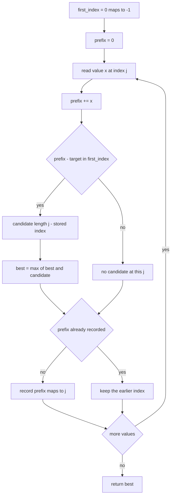
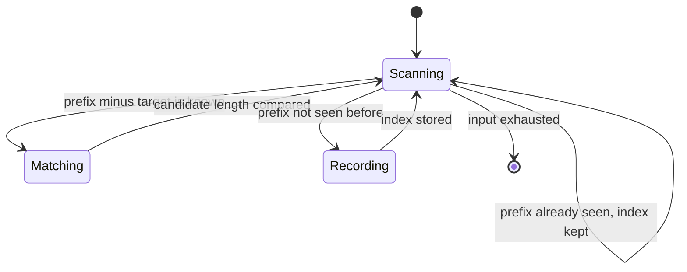
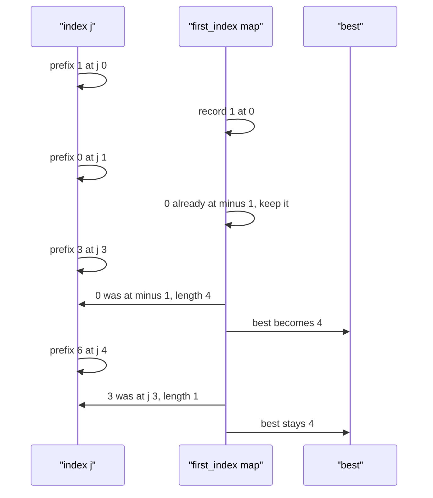

# 210 — Longest subarray with sum equal to K (with negatives) using hashmap.

> **Tier:** Intermediate · **CTCI chapter:** Ch 1 — Arrays and Strings
> **Task spec:** [210-longest-subarray-with-sum-equal-to-k-with-negatives-using-hashma.md](../../../tasks/intermediate/210-longest-subarray-with-sum-equal-to-k-with-negatives-using-hashma.md)
> **Solutions:** [Python](../../../solutions/python/intermediate/210-longest-subarray-with-sum-equal-to-k-with-negatives-using-hashma/solution.py) ·
> [Java](../../../solutions/java/intermediate/210-longest-subarray-with-sum-equal-to-k-with-negatives-using-hashma/Solution.java) ·
> [JavaScript](../../../solutions/javascript/intermediate/210-longest-subarray-with-sum-equal-to-k-with-negatives-using-hashma/solution.js) ·
> [C#](../../../solutions/csharp/intermediate/210-longest-subarray-with-sum-equal-to-k-with-negatives-using-hashma/Solution.cs)

## 1. Problem restatement

**Input:** an array `nums` of integers — **negative values allowed**, which is the whole point of
this variant — and a `target` sum.

**Output:** the length of the longest contiguous subarray with sum exactly `target`; `0` when no
subarray qualifies, and also for an empty array.

| Call | Result | Why |
| --- | --- | --- |
| `longest_subarray_sum_k([1, 2, 3, 1, 1, 1, 1], 6)` | `4` | the same answer as the positive-only variant |
| `longest_subarray_sum_k([-1, 1, 1], 1)` | `3` | the whole array sums to `1`, negatives and all |
| `longest_subarray_sum_k([1, -1, 5, -2, 3], 3)` | `4` | the prefix `[1, -1, 5, -2]` sums to `3` |
| `longest_subarray_sum_k([-2, -1, 2, 1], 1)` | `2` | `[2, 1]` |
| `longest_subarray_sum_k([0, 0, 0], 0)` | `3` | zeros are fine here, unlike in the positive-only variant |
| `longest_subarray_sum_k([1, 2, 3], 100)` | `0` | nothing reaches the target |
| `longest_subarray_sum_k([], 0)` | `0` | nothing to consider |

Python asserts every row in the table; Java asserts all but the empty case; JavaScript and C#
assert five rows, omitting both the `100` row and the empty case. Unlike
[209](209-longest-subarray-with-sum-equal-to-k-array-of-positives.md), no value is rejected — the
same function name is used in both files, with different assumptions and a different algorithm.

## 2. Intuition

The sliding window of task 209 is unavailable: with negative values the sum is no longer monotone in
the window size, so shrinking from the left can *increase* the sum and the two-pointer discipline
breaks. The fix is to stop sliding a window and start comparing **prefix sums**.

Let `prefix(j)` be the sum of the first `j` elements, so `prefix(0) = 0`. The subarray
`[i, j)` (elements from index `i` up to but not including `j`) sums to

    prefix(j) - prefix(i)

so the question "which subarrays sum to `target`?" becomes "which pairs of prefix values differ by
`target`?" — i.e. for the prefix at position `j`, look for a position `i` where
`prefix(i) = prefix(j) - target`.

That is the same complementary-key lookup as
[205](205-count-pairs-with-sum-k-when-array-unsorted-hash.md), with one twist: we want the *longest*
subarray, so for each prefix value we must remember the **earliest** index at which it occurs, never
the latest. The map is written with `putIfAbsent` in Java, a `if prefix not in first_index` guard in
Python and JavaScript, and a `ContainsKey` guard in C# — all meaning "first occurrence wins".

The seed `{0: -1}` is what makes subarrays starting at index `0` work: it represents the empty
prefix, whose "position" is one before the first element, so a subarray `[0, j)` has length
`j - (-1) = j + 1`.



## 3. Algorithm

1. Create a map `first_index` with the single entry `0 -> -1`.
2. Set `prefix = 0` and `best = 0`.
3. For each index `j` from `0` to `n - 1`:
   1. Add `nums[j]` to `prefix`.
   2. If `prefix - target` is a key in the map, set `best = max(best, j - first_index[prefix - target])`.
   3. If `prefix` is **not** already a key, record `first_index[prefix] = j`.
4. Return `best`.

```text
function longest_subarray_sum_k(nums, target)
    first_index ← map with one entry 0 maps to -1
    prefix ← 0
    best ← 0
    for j ← 0 to length(nums) - 1 do
        prefix ← prefix + nums[j]
        if first_index contains prefix - target then
            best ← max(best, j - first_index[prefix - target])
        end
        if first_index does not contain prefix then
            first_index[prefix] ← j
        end
    end
    return best
end
```

Step 3.3 is where the "earliest occurrence" rule lives. Writing unconditionally
(`first_index[prefix] = j`) would overwrite earlier indices with later ones, which shortens every
candidate measured against them and can return a subarray that is too short — for example
`[-2, -1, 2, 1]` with `target 1` relies on the prefix `-2` being remembered at index `0`, not at
some later repeat.



## 4. Worked example

Trace `longest_subarray_sum_k([1, -1, 5, -2, 3], 3)`. The expected answer is `4`, from the prefix
`[1, -1, 5, -2]`.

| `j` | `nums[j]` | `prefix` | `prefix - target` | Present? | Length candidate | `best` | Map update |
| --- | --- | --- | --- | --- | --- | --- | --- |
| 0 | 1 | 1 | -2 | no | — | 0 | add `1 -> 0` |
| 1 | -1 | 0 | -3 | no | — | 0 | `0` already maps to `-1`; keep `-1` |
| 2 | 5 | 5 | 2 | no | — | 0 | add `5 -> 2` |
| 3 | -2 | 3 | 0 | yes, at `-1` | `3 - (-1) = 4` | 4 | add `3 -> 3` |
| 4 | 3 | 6 | 3 | yes, at `3` | `4 - 3 = 1` | 4 | add `6 -> 4` |

The answer is `4`, from `j = 3` and the seeded index `-1`: the subarray `[0, 4)` is exactly
`[1, -1, 5, -2]`, whose sum is `3`. Two details in the table are worth pausing on.

First, `j = 1` shows an already-seen prefix: the running sum returns to `0`, which was seeded at
`-1`, and the guard keeps the earlier index. If the map were overwritten to `0 -> 1`, then a later
lookup for prefix `0` would yield a length one shorter than the truth.

Second, `j = 4` shows a *shorter* valid subarray being correctly ignored: `prefix - target = 3` is
found at index `3`, so the candidate is the single element `[3]`, which does sum to the target, but
its length `1` is not an improvement and `best` stays `4`.



## 5. Complexity

Let `n` be the input length.

| Measure | Bound | Why it holds |
| --- | --- | --- |
| Time, best | O(n) | the scan is a single pass with no early exit available, since the longest match may be at the very end |
| Time, average | O(n) | one map lookup and at most one map insertion per index |
| Time, worst | O(n) | expected O(1) hash operations; no nested loops anywhere |
| Space | O(n) | the map stores one entry per distinct prefix sum, up to `n + 1` of them |
| Sliding-window alternative | not applicable | with negative values the window sum is not monotone |
| Naive subarray enumeration | O(n²) or O(n³) | every start and end pair, with or without recomputed sums |

The prefix-sum map is the price of generality: `O(n)` space in exchange for tolerating negative
values. Where task 209 achieves `O(1)` extra space under a positivity assumption, this task spends
linear memory to remove the assumption — a textbook example of a space-time trade decided by the
input's structure rather than by the problem statement.

## 6. Pitfalls and edge cases

- **Take the earliest index, not the latest.** Overwriting `first_index[prefix]` makes candidates
  shorter. All four files guard the write (`if prefix not in first_index`, `putIfAbsent`,
  `!firstIndex.has(prefix)`, `!firstIndex.ContainsKey(prefix)`).
- **Seed `0 -> -1`.** Without the seed, `[-1, 1, 1]` with `target 1` would miss the whole-array
  answer of `3`, because the relevant partner is the empty prefix at position `-1`. The seed also
  creates the `j + 1` length arithmetic for subarrays that start at index `0`.
- **Empty input.** `[]` with any target returns `0`; the loop never runs and `best` stays `0`.
  Python asserts this row.
- **All zeros.** `[0, 0, 0]` with `target 0` returns `3`. Each step finds prefix `0` at index `-1`
  and measures the full length, and the guard prevents the `0` entry from being overwritten. Java,
  JavaScript and C# assert this row.
- **Negative targets and negative values.** Nothing changes: `target` is only ever subtracted from a
  running sum, so `[1, -1, 5, -2, 3]` with `target 3` works exactly as shown above.
- **Zero-length subarrays.** The convention is that the empty subarray has length `0` and is never
  reported by itself, because a match at index `i` and prefix `j` with `j == i` would give length
  `0` — but the loop only measures `j - first_index[...]` where the stored index is strictly less
  than `j`, since `prefix - target` for `target 0` and the same key at the same `j` is impossible
  (the write happens after the lookup).
- **Numeric range.** Prefix sums can exceed 32-bit range over long arrays; Java and C# use `int`
  here. The asserted inputs are small, but a widening to `long` is the safe general fix.
- **This is not the O(1)-space variant.** Do not try to apply the two-pointer shrink here; on
  `[-1, 1, 1]` with `target 1` it would have to move `lo` backwards at some point.

## 7. Variants and follow-ups

- **Positive values only.** [209-longest-subarray-with-sum-equal-to-k-array-of-positives.md](../../../tasks/intermediate/209-longest-subarray-with-sum-equal-to-k-array-of-positives.md)
  is the `O(1)`-space sliding window that exploits monotonicity; comparing the two is the fastest way
  to see what the positivity assumption is worth.
- **Count the subarrays instead of measuring the longest.**
  [211-subarray-sum-equals-k-count-hashmap.md](../../../tasks/intermediate/211-subarray-sum-equals-k-count-hashmap.md)
  keeps a frequency map of prefix sums rather than an earliest-index map, so `[0, 0]` with `target 0`
  yields `3` rather than a length.
- **Pairs with the same complementary lookup.** [205-count-pairs-with-sum-k-when-array-unsorted-hash.md](../../../tasks/intermediate/205-count-pairs-with-sum-k-when-array-unsorted-hash.md)
  does one pass with a running map to count pairs; the prefix-sum version is the same operation
  applied to an array of prefix values.
- **Maximum-sum windows.** [212-find-subarray-with-maximum-sum-kadane-s-algorithm.md](../../../tasks/intermediate/212-find-subarray-with-maximum-sum-kadane-s-algorithm.md)
  gives up on matching a target and instead optimises over all windows, which needs neither a map
  nor a monotonicity assumption about a target.
- The chapter walkthrough [Arrays and Strings](../../ctci/01-arrays-and-strings.md) places prefix
  sums next to sliding windows as the two duality tricks for contiguous-range questions.

## 8. Check yourself

1. Why does the map store the earliest index of each prefix sum rather than the latest?

<details><summary>Show answer</summary>

Because the length of a matching subarray ending at `j` is `j - first_index[prefix - target]`, which
is maximised by the *smallest* possible stored index. Storing the latest index would still find
valid subarrays but would under-report their lengths — for `[0, 1, -1, 2]` with `target 2`, for
instance, one valid subarray of length `3` would be measured as shorter.

</details>

2. What is the role of the initial `0 -> -1` entry?

<details><summary>Show answer</summary>

It records the empty prefix that precedes the array, so a subarray starting at index `0` can be
recognised: its sum is `prefix(j) - 0`, matched by the key `prefix(j) - target = 0`, and its length
is `j - (-1) = j + 1`. Without the seed, every subarray starting at index `0` would be invisible, so
`[-1, 1, 1]` with `target 1` would answer `2` instead of `3`.

</details>

3. The answer for `[1, -1, 5, -2, 3]` with `target 3` is `4`. Which subarray is it, and which two
   indices produce it?

<details><summary>Show answer</summary>

`[1, -1, 5, -2]`, the prefix ending at index `3`. It is produced by `j = 3` (`prefix = 3`) and the
seeded index `-1` (`prefix = 0`), giving length `3 - (-1) = 4`.

</details>

4. Why can the algorithm not stop earlier when `best` already equals some large value?

<details><summary>Show answer</summary>

Because the longest subarray may only be discovered at the end of the array: prefix sums are not
sorted, so a later `j` can produce a much longer match than any earlier one. There is no monotone
quantity to exploit, which is precisely why the extra memory is needed.

</details>

5. How would the algorithm change if the array were guaranteed to contain only zeros and ones?

<details><summary>Show answer</summary>

The prefix sums would be non-decreasing, so the map could be replaced by two pointers or by an array
of length `n + 1` indexed by prefix value, giving `O(1)`-ish space. That is the same reasoning that
makes task 209's sliding window valid for positive values: monotonicity lets you throw away history.

</details>
