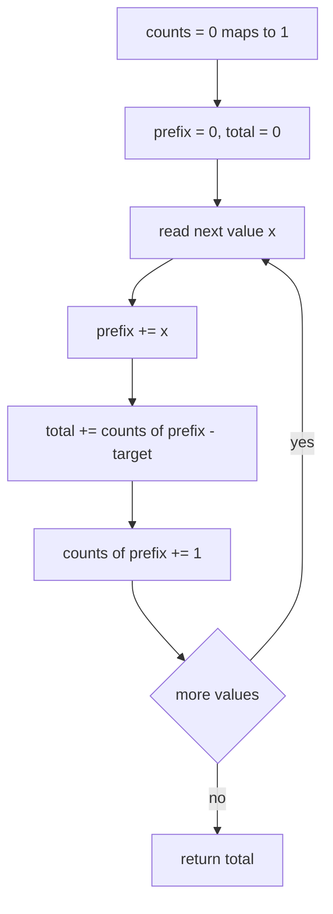
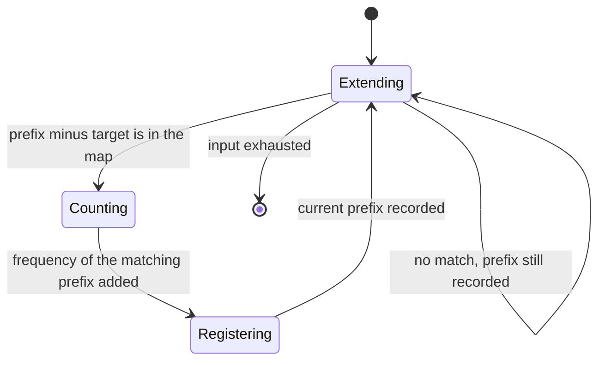
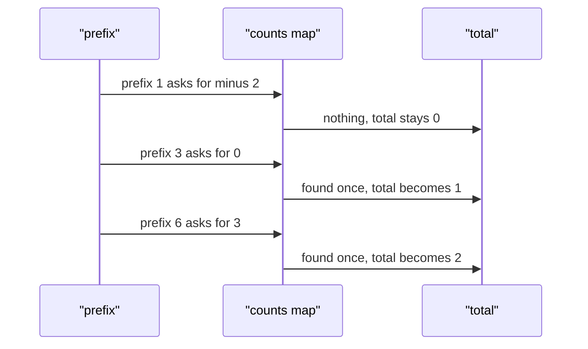

# 211 — Subarray sum equals K count (hashmap).

> **Tier:** Intermediate · **CTCI chapter:** Ch 1 — Arrays and Strings
> **Task spec:** [211-subarray-sum-equals-k-count-hashmap.md](../../../tasks/intermediate/211-subarray-sum-equals-k-count-hashmap.md)
> **Solutions:** [Python](../../../solutions/python/intermediate/211-subarray-sum-equals-k-count-hashmap/solution.py) ·
> [Java](../../../solutions/java/intermediate/211-subarray-sum-equals-k-count-hashmap/Solution.java) ·
> [JavaScript](../../../solutions/javascript/intermediate/211-subarray-sum-equals-k-count-hashmap/solution.js) ·
> [C#](../../../solutions/csharp/intermediate/211-subarray-sum-equals-k-count-hashmap/Solution.cs)

## 1. Problem restatement

**Input:** an array `nums` of integers (negatives allowed, zeros allowed, possibly empty) and a
`target`.

**Output:** how many contiguous subarrays sum to exactly `target`, as an integer. A subarray is
identified by its start and end index, so two subarrays with the same values at different positions
both count — including the empty-ish case of `[0, 0]` with `target 0`, where three different index
ranges qualify.

| Call | Result | Why |
| --- | --- | --- |
| `count_subarrays_sum_k([1, 1, 1], 2)` | `2` | `[0..1]` and `[1..2]` |
| `count_subarrays_sum_k([1, 2, 3], 3)` | `2` | `[2..2]` (the `3`) and `[0..1]` (the `1 + 2`) |
| `count_subarrays_sum_k([-1, -1, 1], 0)` | `1` | `[-1, -1, 1]` itself sums to `-1`; only `[-1, 1]` sums to `0` |
| `count_subarrays_sum_k([0, 0], 0)` | `3` | `[0..0]`, `[1..1]` and `[0..1]` |
| `count_subarrays_sum_k([1, 2, 3], 100)` | `0` | no range matches |
| `count_subarrays_sum_k([], 0)` | `0` | no ranges exist |

Python asserts all six rows; Java asserts all but the empty case; JavaScript and C# assert four,
omitting the `100` row and the empty case. The count fits in an `int` for these inputs but is
accumulated in `long` in Java and C#
because a large all-zeros array produces `n(n+1)/2` matches.

## 2. Intuition

The naive enumeration tries all `C(n, 2)` ranges and sums each from scratch, which is `O(n³)`, or
`O(n²)` with a rolling sum. The interesting object is not the range but the **prefix sum**:

    sum of nums[i..j] = prefix(j) - prefix(i - 1)

where `prefix(t) = nums[0] + ... + nums[t]`. So counting ranges with sum `target` is counting pairs
of prefixes that differ by `target`, and that is a lookup problem rather than a search problem.

The single-pass insight: while scanning, keep a map from prefix value to **how many times that
prefix value has occurred so far**. When the current prefix is `prefix`, every earlier occurrence of
the value `prefix - target` closes a range summing to `target`, so adding `counts[prefix - target]`
to a running total counts all ranges ending at the current index in one operation. After the count,
increment `counts[prefix]` so the current position becomes available as an earlier endpoint for
future ranges.

Two details make it exact:

- **Why frequencies, not indices.** The question asks *how many* ranges, so a single number per
  prefix value suffices. The "longest" variant,
  [210](210-longest-subarray-with-sum-equal-to-k-with-negatives-using-hashma.md), needs the earliest
  index instead, and that is the only difference between the two solutions.
- **The seed `{0: 1}`.** It stands for the empty prefix, so ranges that start at index `0` are
  counted. Without it, `[1, 2, 3]` with `target 3` would miss the range `[0..1]`.



## 3. Algorithm

1. Create a counting map `counts` with the single entry `0 -> 1`, representing the empty prefix.
2. Set `prefix = 0` and `total = 0`.
3. For each value `x` in `nums`:
   1. Add `x` to `prefix`.
   2. Add `counts[prefix - target]` to `total` (zero when the key is absent).
   3. Increment `counts[prefix]` by one.
4. Return `total`.

```text
function count_subarrays_sum_k(nums, target)
    counts ← map with one entry 0 maps to 1
    prefix ← 0
    total ← 0
    for each x in nums do
        prefix ← prefix + x
        total ← total + counts.get(prefix - target, 0)
        counts[prefix] ← counts.get(prefix, 0) + 1
    end
    return total
end
```

The order of steps 3.2 and 3.3 is what keeps the "earlier prefix" semantics: the lookup must not see
the prefix that was just computed, or a range of length zero would be counted whenever
`target == 0` and the prefix repeats a value — which is exactly the `[0, 0]` case, where the correct
answer is `3` rather than `6`.



## 4. Worked example

Trace `count_subarrays_sum_k([0, 0], 0)`. The expected answer is `3`: the two single-element ranges
and the whole array.

| Step | `x` | `prefix` | `counts[prefix - 0]` | `total` after | `counts` after |
| --- | --- | --- | --- | --- | --- |
| start | — | 0 | — | 0 | `{0: 1}` |
| 1 | 0 | 0 | `counts[0] = 1` | 1 | `{0: 2}` |
| 2 | 0 | 0 | `counts[0] = 2` | 3 | `{0: 3}` |

The final count is `3`. The mechanism is worth spelling out: step 1 counts the range `[0..0]` using
the seeded empty prefix, step 2 counts the ranges `[0..1]` (against the seed) and `[1..1]` (against
the prefix recorded in step 1). This is why the seed is worth exactly one unit of frequency and why
the increment happens after the lookup.

Now trace `count_subarrays_sum_k([1, 2, 3], 3)`, which mixes distinct prefix values:

| Step | `x` | `prefix` | `counts[prefix - 3]` | `total` after | `counts` after |
| --- | --- | --- | --- | --- | --- |
| start | — | 0 | — | 0 | `{0: 1}` |
| 1 | 1 | 1 | `counts[-2] = 0` | 0 | `{0: 1, 1: 1}` |
| 2 | 2 | 3 | `counts[0] = 1` | 1 | `{0: 1, 1: 1, 3: 1}` |
| 3 | 3 | 6 | `counts[3] = 1` | 2 | `{0: 1, 1: 1, 3: 1, 6: 1}` |

Result `2`: the range `[0..1]` from step 2 and the range `[2..2]` from step 3.



## 5. Complexity

Let `n` be the input length and `d` the number of distinct prefix values.

| Measure | Bound | Why it holds |
| --- | --- | --- |
| Time, best | O(n) | every element is processed exactly once, even when no range matches |
| Time, average | O(n) | one lookup plus one increment per element, both expected O(1) |
| Time, worst | O(n) | no nested loops; hash operations are expected constant |
| Space | O(d) | one map entry per distinct prefix value, at most `n + 1` |
| Naive range enumeration | O(n²) time with a rolling sum, O(n³) without | all start/end pairs are considered |
| Prefix array plus binary search | O(n log n) | sorts prefix values, needs extra space for the sorted structure |

The map is what converts "for each range, is the sum right?" into "for each endpoint, how many
starts work?", which is the same inversion that makes
[205](205-count-pairs-with-sum-k-when-array-unsorted-hash.md) linear. The cost is the `O(d)` map,
which is unavoidable for a correct linear solution with negative values — the monotone structure
that task 209 exploits is simply not present.

## 6. Pitfalls and edge cases

- **Seed the map with `0 -> 1`.** Without it, every range starting at index `0` is lost:
  `[1, 2, 3]` with `target 3` would return `1` instead of `2`. This is the single most common bug in
  this task.
- **Insert after the lookup.** Incrementing `counts[prefix]` before adding `counts[prefix - target]`
  counts the current prefix against itself when `target == 0`, which turns the `[0, 0]` answer of `3`
  into `1 + 2 + 3 = 6`. All four files order the statements the same way.
- **Empty input.** `[]` returns `0`. Note that the seeded map is still built; it simply never
  matches, because the loop body never runs. Python asserts this.
- **Zeros and negative values.** They are ordinary values here. `[-1, -1, 1]` with `target 0`
  returns `1`, and `[0, 0]` with `target 0` returns `3`; Python, Java, JavaScript and C# all assert
  the zeros row.
- **Counting ranges, not lengths.** The answer counts (start, end) pairs. Do not confuse it with
  task 210's output; a range and its length are different quantities.
- **Large counts.** An array of `n` zeros with `target 0` gives `n(n+1)/2`, which overflows 32-bit
  `int` around `n = 65000`. Java and C# accumulate in `long`.
- **Distinct prefix collisions.** Repeated prefix values are the mechanism, not an error: each
  repeat creates as many new ranges as there were earlier occurrences.
- **Numerical range of prefixes.** Prefix sums can exceed 32 bits for long arrays; the map keys are
  `int` in Java and C#, which is fine for the asserted inputs and a known limit in general.

## 7. Variants and follow-ups

- **Longest instead of counting.**
  [210-longest-subarray-with-sum-equal-to-k-with-negatives-using-hashma.md](../../../tasks/intermediate/210-longest-subarray-with-sum-equal-to-k-with-negatives-using-hashma.md)
  replaces the frequency map with an earliest-index map; the lookup key is identical.
- **Positive values only.** [209-longest-subarray-with-sum-equal-to-k-array-of-positives.md](../../../tasks/intermediate/209-longest-subarray-with-sum-equal-to-k-array-of-positives.md)
  needs no map at all, because window sums are monotone and the sliding window can discard history.
- **Pair counting in a flat array.** [205-count-pairs-with-sum-k-when-array-unsorted-hash.md](../../../tasks/intermediate/205-count-pairs-with-sum-k-when-array-unsorted-hash.md)
  is the same "count complementary occurrences" trick on values instead of prefixes.
- **Optimising instead of counting.** [212-find-subarray-with-maximum-sum-kadane-s-algorithm.md](../../../tasks/intermediate/212-find-subarray-with-maximum-sum-kadane-s-algorithm.md)
  answers a maximum-sum question with `O(1)` state, showing that when the objective changes the map
  can disappear entirely.
- The chapter walkthrough [Arrays and Strings](../../ctci/01-arrays-and-strings.md) develops the
  prefix-sum viewpoint that this task shares with its neighbours.

## 8. Check yourself

1. Why does the map start with `0 -> 1` and not `0 -> 0` or an empty map?

<details><summary>Show answer</summary>

Because the empty prefix has already "occurred" once before the array begins. It is a legitimate
left endpoint for any range starting at index `0`, and its frequency of one is what makes such a
range contribute exactly one to the count. Removing the seed loses all leading ranges; setting the
frequency to zero makes them unreachable because the lookup returns `0`.

</details>

2. What would `[0, 0]` with `target 0` return if the increment came before the lookup?

<details><summary>Show answer</summary>

`5`. With the swap the map would already hold `{0: 2}` when the first lookup runs (contributing `2`)
and `{0: 3}` at the second (contributing `3`), so the total would be `5` instead of the correct `3`.
Any such swap inflates the answer by counting the current prefix against itself.

</details>

3. How many ranges does `[0, 0, 0]` with `target 0` have, and which row of the assertions is
   closest to that case?

<details><summary>Show answer</summary>

There are `C(4, 2) = 6` ranges: three of length one, two of length two and one of length three. The
assertions cover the `n = 2` version (`[0, 0]` gives `3`), and the same triangular pattern continues
for larger all-zero arrays.

</details>

4. Is the prefix-sum approach necessary, or does a sliding window work?

<details><summary>Show answer</summary>

A sliding window does not work in general, because prefix sums with negative values are not
monotone: shrinking the window from the left can increase the sum. The prefix-map approach avoids
the assumption entirely, at the price of `O(d)` space.

</details>

5. How would you also return the ranges rather than just their count?

<details><summary>Show answer</summary>

Store, for each prefix value, the list of indices where it occurred (instead of only a count), then
for each `j` emit `(i + 1, j)` for every stored index `i`. The count is then the total number of
emitted ranges — the frequency map is exactly that list compressed to its length.

</details>
