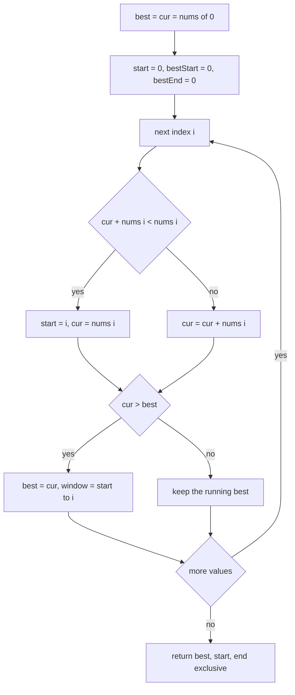
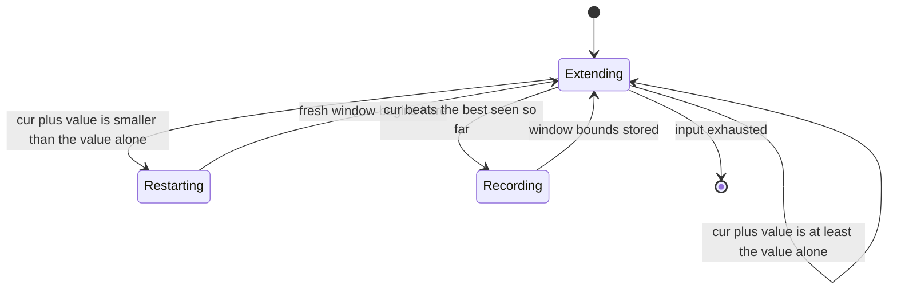
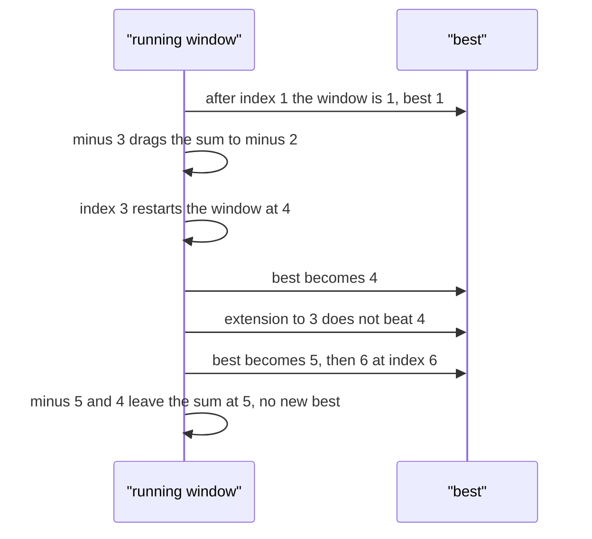

# 212 — Find subarray with maximum sum (Kadane's algorithm).

> **Tier:** Intermediate · **CTCI chapter:** Ch 8 — Recursion and Dynamic Programming
> **Task spec:** [212-find-subarray-with-maximum-sum-kadane-s-algorithm.md](../../../tasks/intermediate/212-find-subarray-with-maximum-sum-kadane-s-algorithm.md)
> **Solutions:** [Python](../../../solutions/python/intermediate/212-find-subarray-with-maximum-sum-kadane-s-algorithm/solution.py) ·
> [Java](../../../solutions/java/intermediate/212-find-subarray-with-maximum-sum-kadane-s-algorithm/Solution.java) ·
> [JavaScript](../../../solutions/javascript/intermediate/212-find-subarray-with-maximum-sum-kadane-s-algorithm/solution.js) ·
> [C#](../../../solutions/csharp/intermediate/212-find-subarray-with-maximum-sum-kadane-s-algorithm/Solution.cs)

## 1. Problem restatement

**Input:** a non-empty array `nums` of integers, possibly all negative. An empty array is an error —
the Python docstring says "an empty array has no subarray" — and Java, JavaScript and C# throw as
well.

**Output:** the maximum subarray sum and the winning window. The Python function returns
`(sum, start, end)` with **end exclusive**; Java returns `{bestSum, start, endExclusive}`; C#
returns `(int sum, int start, int end)`; JavaScript returns `{sum, start, end}`. Every language
uses the same half-open convention.

| Call | Result | Why |
| --- | --- | --- |
| `max_subarray([-2, 1, -3, 4, -1, 2, 1, -5, 4])` | `(6, 3, 7)` | the window `[4, -1, 2, 1]` sums to `6` |
| `max_subarray([-3, -1, -2])` | `(-1, 1, 2)` | all negative: the best single element is `-1` |
| `max_subarray([1])` | `(1, 0, 1)` | the single element, half-open `[0, 1)` |
| `kadane_sum([5, -1, 5])` | `9` | the whole array |
| `max_subarray([])` | raises | no non-empty subarray exists |

Python asserts all the numeric rows plus the error; Java and C# assert the classic row with the
indices `(6, 3, 7)`; the JavaScript file asserts the object form `{sum: 6, start: 3, end: 7}`. A
`kadane_sum` helper that returns only the sum is defined in the Python and JavaScript files, since
the sum-only version is the form most often quoted in interviews.

## 2. Intuition

The brute-force answer enumerates every range and sums it, which is `O(n²)` with a rolling sum and
`O(n³)` without. The dynamic-programming insight is that the best window **ending exactly at index
`i`** is all you need to remember, because any longer answer is an extension of one of those:

    cur(i) = max(nums[i], cur(i - 1) + nums[i])

In words: either the window ending at `i` is the single element `nums[i]` — start fresh — or it
extends the best window ending at `i - 1`. Extension is worth it exactly when the prefix sum
`cur(i - 1)` is non-negative; when `cur(i - 1)` is negative, adding it can only hurt.

The global answer is the maximum of `cur(i)` over all `i`, which is why `best` is tracked alongside
`cur`. To recover the *indices* as well, the code also remembers where the current window started:
`start` is reset to `i` at the moment a fresh window begins, and when `cur` beats `best` the pair
`(start, i)` is stored.

Kadane's algorithm is therefore the classic two-state DP expressed in constant memory: one variable
for "best window ending here", one for "best window anywhere", plus one bookkeeping index.



## 3. Algorithm

1. Reject the empty array.
2. Initialise `best = cur = nums[0]`, `best_start = best_end = 0` and `start = 0`.
3. For each index `i` from `1` to `n - 1`:
   1. If `cur + nums[i] < nums[i]`, start a fresh window: `start = i` and `cur = nums[i]`.
      Otherwise extend: `cur += nums[i]`.
   2. If `cur > best`, record `best = cur`, `best_start = start`, `best_end = i`.
4. Return `(best, best_start, best_end + 1)` — the end is exclusive.

```text
function max_subarray(nums)
    if length(nums) == 0 then
        raise error
    end
    best ← nums[0]
    cur ← nums[0]
    start ← 0
    best_start ← 0
    best_end ← 0
    for i ← 1 to length(nums) - 1 do
        if cur + nums[i] < nums[i] then
            start ← i
            cur ← nums[i]
        else
            cur ← cur + nums[i]
        end
        if cur > best then
            best ← cur
            best_start ← start
            best_end ← i
        end
    end
    return best, best_start, best_end + 1
end
```

The comparison `cur + nums[i] < nums[i]` is equivalent to `cur < 0` and is the form all four files
use, because it generalises to other objectives (products, in
[213](213-maximum-product-subarray.md)) where "is the running value negative" is not the right
question.



## 4. Worked example

Trace `max_subarray([-2, 1, -3, 4, -1, 2, 1, -5, 4])`. The expected answer is `(6, 3, 7)`.

| `i` | `nums[i]` | `cur` before | Fresh or extend? | `cur` after | `best` after | Current window |
| --- | --- | --- | --- | --- | --- | --- |
| 0 | -2 | — | initial | -2 | -2 | `[0, 1)` |
| 1 | 1 | -2 | fresh (`-2 + 1 < 1`) | 1 | 1 | `[1, 2)` |
| 2 | -3 | 1 | extend | -2 | 1 | `[1, 3)` |
| 3 | 4 | -2 | fresh (`-2 + 4 < 4`) | 4 | 4 | `[3, 4)` |
| 4 | -1 | 4 | extend | 3 | 4 | `[3, 5)` |
| 5 | 2 | 3 | extend | 5 | 5 | `[3, 6)` |
| 6 | 1 | 5 | extend | 6 | 6 | `[3, 7)` |
| 7 | -5 | 6 | extend | 1 | 6 | `[3, 8)` |
| 8 | 4 | 1 | extend | 5 | 6 | `[3, 9)` |

The final answer is `(6, 3, 7)`: sum `6` over the half-open range `[3, 7)`, i.e. the elements
`4, -1, 2, 1`. The trace shows both halves of the algorithm working.

At `i = 1` the running value was negative, so starting fresh at the `1` is better than inheriting a
debt. At `i = 3` the same thing happens with the `4`, which becomes the start of the eventual
winning window: `start` is reset to `3` and never changes again, because the running value stays
positive through index `6`. At `i = 7` the `-5` drags the running value down to `1` but does not
beat `best`, so the recorded window keeps its old bounds — the algorithm does not need to know that
the *current* window is now shorter, only whether it beats the best.



## 5. Complexity

Let `n` be the input length.

| Measure | Bound | Why it holds |
| --- | --- | --- |
| Time, best | O(n) | the loop body runs `n - 1` times regardless of the data |
| Time, average | O(n) | constant work per element: one comparison, one addition, one comparison |
| Time, worst | O(n) | no nested loops; the restart decision is local |
| Space, extra | O(1) | `best`, `cur`, `start`, `best_start` and `best_end` |
| Naive range enumeration | O(n²) time, O(1) space | all `C(n, 2)` ranges, with a rolling sum to avoid a third factor |
| Divide and conquer | O(n log n) time, O(log n) space | split in half, recurse, and combine across the midpoint; useful when ranges must be reported from both sides |

This is the strongest form of the DP: the recurrence
`cur(i) = max(nums[i], cur(i - 1) + nums[i])` has a one-element history, so the usual `O(n)` DP table
collapses to a single scalar. Recognising that collapse is the whole point of the exercise, and it is
why the chapter lists Kadane's algorithm under dynamic programming even though no table appears in
the code.

## 6. Pitfalls and edge cases

- **Empty array.** All four files raise rather than return `0`, because "the maximum over no
  subarrays" is undefined and returning `0` would be wrong for an all-negative array. Python and
  C# assert the error explicitly.
- **All-negative input.** `[-3, -1, -2]` returns `(-1, 1, 2)`, the single element `-1`, not `0` and
  not the whole array. Initialising `best = 0` is the classic bug: it makes the algorithm report an
  empty range for all-negative input. The solutions initialise from `nums[0]` instead.
- **Single element.** `[1]` returns `(1, 0, 1)`; the loop body never runs and the initial values are
  the answer. The half-open convention makes the end index `1`, not `0`.
- **Zeros.** `[0, 0]` returns `(0, 0, 1)` under strict `>` on the update: the first window wins
  because a later equal sum does not beat the incumbent. With `>=` the bounds would change to the
  second element — same sum, different indices. No assertion depends on it, but the strict
  comparison is what the files use.
- **Restart vs extend.** The condition is `cur + nums[i] < nums[i]`, which is a comparison between
  two candidate window sums, not `cur < 0`. The two are equivalent for sums, but the written form
  carries over to the product variant.
- **Recovering indices.** `best_end + 1` is returned because the loop records `i` inclusively. If
  you return `best_end` directly you get a half-open range that is one element short.
- **Updating indices only on improvement.** The window bounds are written inside the
  `if cur > best` branch. Setting them on every iteration would overwrite the winning window with
  the trailing, non-winning one.
- **Overflow.** Sums can exceed 32-bit range; Java and C# accumulate in `int` here. The asserted
  inputs are small; widening to `long` is the safe habit for adversarial data.
- **Distinct-but-equal answers.** When several windows tie on the maximum sum, the strict `>` returns
  the first one found. The assertions avoid ties.

## 7. Variants and follow-ups

- **Circular arrays.** [221-circular-array-maximum-subarray-kadane-variant.md](../../../tasks/intermediate/221-circular-array-maximum-subarray-kadane-variant.md)
  runs Kadane twice — once for the maximum and once for the minimum — and takes the better of
  "wrap" and "do not wrap".
- **Products instead of sums.** [213-maximum-product-subarray.md](../../../tasks/intermediate/213-maximum-product-subarray.md)
  tracks both a running maximum and a running minimum, because a negative factor flips which end of
  the range matters.
- **Exact sums instead of a maximum.** [209-longest-subarray-with-sum-equal-to-k-array-of-positives.md](../../../tasks/intermediate/209-longest-subarray-with-sum-equal-to-k-array-of-positives.md)
  and [211-subarray-sum-equals-k-count-hashmap.md](../../../tasks/intermediate/211-subarray-sum-equals-k-count-hashmap.md)
  answer different questions about the same windows, with a target rather than an objective.
- **Longest increasing subsequences.** [228-maximum-sum-increasing-subsequence.md](../../../tasks/intermediate/228-maximum-sum-increasing-subsequence.md)
  keeps the same "best ending here" recurrence but adds an order constraint, which costs a second
  dimension.
- The chapter walkthrough [Recursion and Dynamic Programming](../../ctci/08-recursion-and-dp.md)
  derives the recurrence from first principles and shows the collapse to constant space.

## 8. Check yourself

1. Why is `best` initialised to `nums[0]` rather than to `0` or negative infinity?

<details><summary>Show answer</summary>

Because it must be the sum of some real, non-empty subarray. `0` would be wrong for all-negative
input, where the correct answer is the least negative single element; a sentinel like negative
infinity would work but then the *indices* also need initialising from `nums[0]`, which the solutions
do anyway. Starting from `nums[0]` is the simplest choice that is always achievable.

</details>

2. What does `cur` represent at index `i`, and why is that enough to find the global maximum?

<details><summary>Show answer</summary>

`cur` is the maximum sum over all windows ending exactly at `i`. Every subarray ends at some index
`i`, so the global maximum is the maximum of `cur(i)` over `i` — which is what `best` accumulates.
No other information about the past is needed, which is why the recurrence has a one-element
history.

</details>

3. For `[-2, 1, -3, 4, -1, 2, 1, -5, 4]`, which index resets the window, and what would the answer be
   if the reset never happened?

<details><summary>Show answer</summary>

Index `3` (the value `4`) resets the window, because the running value at that point was `-2` and
`-2 + 4 < 4`. Without any reset, the algorithm would be tracking the prefix sums alone: the maximum
of `prefix(i)` is `prefix(6) = 6`, which happens to be the same sum here, but the reported window
would begin at index `0` and would not be a valid answer for other inputs — for instance
`[-1, 5]`, where the prefix-sum reading would still claim the whole array while the correct window
is `[5]`.

</details>

4. How many windows does the algorithm implicitly consider, and how does that compare with the
   brute-force enumeration?

<details><summary>Show answer</summary>

It considers exactly one candidate per ending index — the best window ending there — so `n`
candidates, collapsed through a running maximum. Brute force considers `C(n, 2)` ranges, a factor of
`(n-1)/2` more work.

</details>

5. How would you adapt the algorithm to return the shortest window among those with the maximum sum?

<details><summary>Show answer</summary>

Keep the same recurrence, but change the update rule: replace `best` when `cur` is strictly greater,
and when `cur == best` also replace if `i - start + 1` is smaller than the current window length.
The restart rule (`cur + nums[i] < nums[i]`) can stay, though to find the shortest maximal window you
may also want a restart on ties to keep the window tight.

</details>
