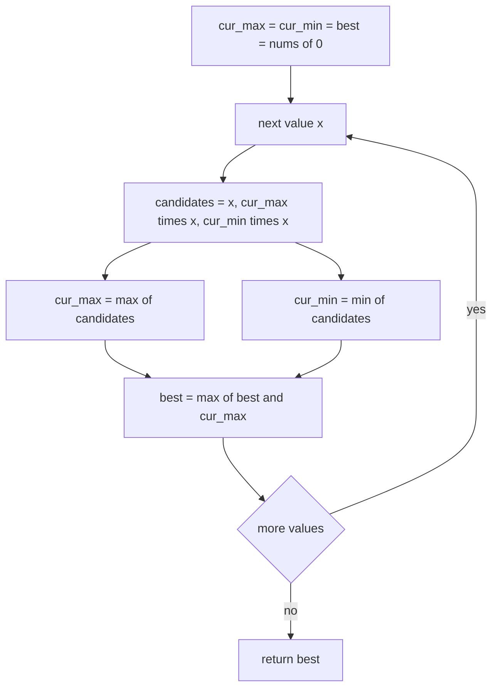
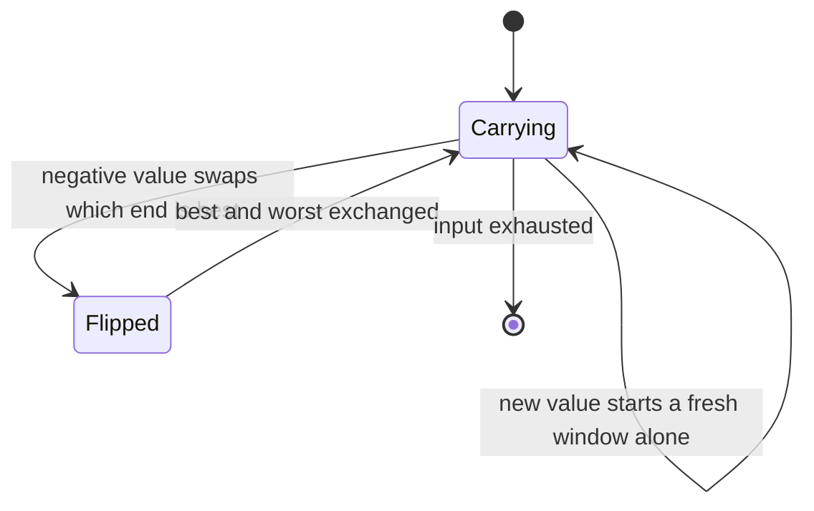
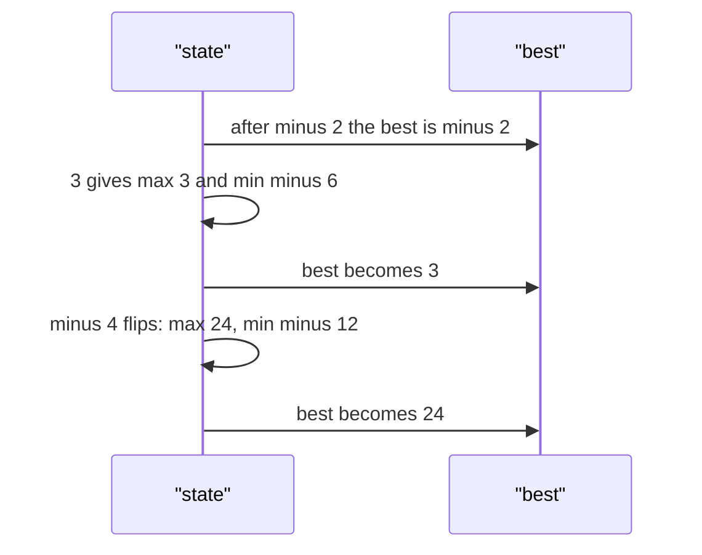

# 213 — Maximum product subarray.

> **Tier:** Intermediate · **CTCI chapter:** Ch 8 — Recursion and Dynamic Programming
> **Task spec:** [213-maximum-product-subarray.md](../../../tasks/intermediate/213-maximum-product-subarray.md)
> **Solutions:** [Python](../../../solutions/python/intermediate/213-maximum-product-subarray/solution.py) ·
> [Java](../../../solutions/java/intermediate/213-maximum-product-subarray/Solution.java) ·
> [JavaScript](../../../solutions/javascript/intermediate/213-maximum-product-subarray/solution.js) ·
> [C#](../../../solutions/csharp/intermediate/213-maximum-product-subarray/Solution.cs)

## 1. Problem restatement

**Input:** a non-empty array `nums` of integers, possibly negative, possibly containing zeros. An
empty array raises (the docstring: "empty array has no subarray").

**Output:** the largest product of any contiguous subarray. Python returns an `int`, Java and C#
return a `long`, JavaScript returns a number — the wider types exist because products grow far
faster than sums.

| Call | Result | Why |
| --- | --- | --- |
| `max_product([2, 3, -2, 4])` | `6` | the prefix `[2, 3]`; including the `-2` hurts |
| `max_product([-2, 3, -4])` | `24` | the whole array: two negatives multiply to a positive |
| `max_product([-2, 0, -1])` | `0` | the zero splits the array; `0` beats `-1` and `-2` |
| `max_product([0, 2])` | `2` | the single `2` |
| `max_product([-2])` | `-2` | one element, nothing to pair it with |
| `max_product([2, -5, -2, -4, 3])` | `24` | the suffix `[-2, -4, 3]` |

The Python file asserts all six rows; Java and C# assert the first five (they include the
single-negative row), and JavaScript asserts four of them — the classic, the zero split, the double
negative and the single negative. The Python file also carries a comment noting that the winning
subarray for the last row is `[-2, -4, 3]`, whose product is `24` — a useful hint that the answer is
neither the whole array nor the prefix.

## 2. Intuition

Kadane's algorithm from [212](212-find-subarray-with-maximum-sum-kadane-s-algorithm.md) tracks the
best window ending at each index, because extending a window by a value either helps or hurts in a
way that only depends on the sign of the running sum. For products the situation is subtler: a
running product that is very *negative* is dangerous, but it is also a valuable asset, because
multiplying it by another negative value turns it into a very *positive* product.

So one number is not enough state. Track both:

- `cur_max(i)` — the largest product of a window ending at `i`;
- `cur_min(i)` — the smallest (most negative) product of a window ending at `i`.

When `nums[i] = x` arrives, the candidates are exactly three: start a fresh window at `x`, extend
the previous best window (`cur_max * x`), or extend the previous worst window (`cur_min * x`). The
new `cur_max` is the maximum of the three and the new `cur_min` is the minimum — both computed from
the *same* three candidates, which is why they must be computed before either is overwritten.

The global answer is the maximum of `cur_max` over all indices, exactly as in Kadane's algorithm.
Zeros need no special case: multiplying by `0` collapses both running values, and the fresh-window
candidate `x` takes over on the next element, which is precisely the "zero splits the array"
behaviour the third assertion checks.



## 3. Algorithm

1. Reject the empty array.
2. Initialise `best = cur_max = cur_min = nums[0]`.
3. For each `x` in `nums[1:]`:
   1. Compute the three candidates `x`, `cur_max * x` and `cur_min * x` using the *previous*
      `cur_max` and `cur_min`.
   2. Set `cur_max` to the maximum of the candidates and `cur_min` to the minimum.
   3. Set `best = max(best, cur_max)`.
4. Return `best`.

```text
function max_product(nums)
    if length(nums) == 0 then
        raise error
    end
    best ← nums[0]
    cur_max ← nums[0]
    cur_min ← nums[0]
    for each x in nums from index 1 onwards do
        candidates ← x, cur_max * x, cur_min * x
        cur_min ← min of candidates
        cur_max ← max of candidates
        best ← max(best, cur_max)
    end
    return best
end
```

The three candidates encode three genuinely different decisions. Taking `x` alone discards the whole
history — the right move after a zero, or when both running values are smaller than `x` in magnitude.
Extending `cur_max` continues the best window. Extending `cur_min` deliberately continues the *worst*
window, which is exactly what pays off when `x` is negative, because a very negative product times a
negative value becomes a very positive one.



## 4. Worked example

Trace `max_product([-2, 3, -4])`, whose answer is `24` — the whole array, something no sum-based
algorithm would ever guess because the running sum goes `-2, 1, -3`.

| `i` | `x` | Candidates `x`, `cur_max * x`, `cur_min * x` | `cur_max` | `cur_min` | `best` |
| --- | --- | --- | --- | --- | --- |
| 0 | -2 | initial values | -2 | -2 | -2 |
| 1 | 3 | `3`, `-2 * 3 = -6`, `-2 * 3 = -6` | 3 | -6 | 3 |
| 2 | -4 | `-4`, `3 * -4 = -12`, `-6 * -4 = 24` | 24 | -12 | 24 |

The final row is the entire point of the algorithm: the winning candidate is `cur_min * x = 24`,
produced by a running product that was the *worst* value two steps earlier. A Kadane-style
sum algorithm with a single state variable would have discarded `-6` at `i = 1` and, with it, the
answer.

Now trace the zero-splitting case `max_product([-2, 0, -1])`, whose answer is `0`:

| `i` | `x` | Candidates | `cur_max` | `cur_min` | `best` |
| --- | --- | --- | --- | --- | --- |
| 0 | -2 | initial values | -2 | -2 | -2 |
| 1 | 0 | `0`, `-2 * 0 = 0`, `-2 * 0 = 0` | 0 | 0 | 0 |
| 2 | -1 | `-1`, `0 * -1 = 0`, `0 * -1 = 0` | 0 | -1 | 0 |

The `0` at index `1` resets both running values to zero, and the `-1` at index `2` cannot revive the
`-2` because that window is no longer contiguous with it. The best subarray product is therefore
`0` — the single-element window `[0]` — and `best` is never improved afterwards.



## 5. Complexity

Let `n` be the input length.

| Measure | Bound | Why it holds |
| --- | --- | --- |
| Time, best | O(n) | the loop runs `n - 1` times regardless of the values |
| Time, average | O(n) | constant work per element: three products, two comparisons, one maximum |
| Time, worst | O(n) | no nested loops and no recursion |
| Space, extra | O(1) | `best`, `cur_max`, `cur_min` and the three temporary candidates |
| Prefix-product enumeration | O(n²) | every start and end pair, with division to keep the inner loop constant |
| Zero-splitting recursion | O(n) time, O(n) space | solve each zero-free segment separately; equivalent results, more memory |

The only structural difference from Kadane's algorithm is that the state is a *pair* rather than a
single value. That pair is the minimum number of states that can encode sign information, which is
why the space bound stays `O(1)` and the time bound stays linear.

## 6. Pitfalls and edge cases

- **Compute both running values before overwriting either.** `cur_max` and `cur_min` are derived
  from the same three candidates, and all four solutions materialise the candidates
  (`candidates = (x, cur_max * x, cur_min * x)`, or `a`/`b`/`c` locally in Java and C#) before
  assigning. Updating `cur_max` first and then computing `cur_min` from the *new* `cur_max` produces
  wrong answers wherever the sign flips.
- **All-negative input.** `[-2]` returns `-2`, and `[-2, 3, -4]` returns `24`. Initialising `best`
  to `1` is the classic bug: it turns `[-2]` into `1`, a product no subarray has. Initialise from
  `nums[0]`, exactly as in Kadane's algorithm.
- **Zeros.** `[-2, 0, -1]` returns `0` and `[0, 2]` returns `2`. No explicit zero handling is needed:
  the fresh-window candidate `x` covers it, and both running values collapse to `0` at the zero.
- **Single element.** `[1]` and `[-2]` return that element; the loop body never runs. Python asserts
  the `-2` row, which is the sharpest test of the initialisation.
- **A negative minimum is an asset, not noise.** The Python file's own comment on the last row
  ("actually best is 24") documents that the answer comes from `[-2, -4, 3]`; an implementation that
  tracks only `cur_max` returns `6` for that input (the prefix `[2, -5]` is worse, but the pair
  `[-2, -4]` becomes invisible).
- **Overflow.** `2 * 3 * ... ` grows exponentially with `n`; Java and C# use `long` for the running
  values and the result, Python uses arbitrary-precision integers, and JavaScript uses doubles,
  which silently lose exactness beyond `2^53`. The asserted inputs are far smaller, but this is the
  reason the Java and C# signatures differ from the sum-based tasks.
- **Return type.** Python returns `int`, Java and C# return `long`, and JavaScript returns a number;
  the printed assertions are numeric comparisons, so the extra width is invisible in the tests.
- **Empty input.** All four files raise rather than return `0`, since a product over no subarray is
  undefined and `0` would be indistinguishable from the legitimate zero answer of `[-2, 0, -1]`.

## 7. Variants and follow-ups

- **Sum instead of product.** [212-find-subarray-with-maximum-sum-kadane-s-algorithm.md](../../../tasks/intermediate/212-find-subarray-with-maximum-sum-kadane-s-algorithm.md)
  needs a single state variable; comparing the two shows exactly where the sign information is lost
  and why the product version must keep two.
- **Fixed-product windows.** [214-subarray-with-given-product-positive-integers.md](../../../tasks/intermediate/214-subarray-with-given-product-positive-integers.md)
  asks for a subarray whose product equals a target, which is a sliding-window problem because the
  factors are positive and the product is monotone.
- **Circular products.** [221-circular-array-maximum-subarray-kadane-variant.md](../../../tasks/intermediate/221-circular-array-maximum-subarray-kadane-variant.md)
  shows the same maximum/minimum pairing used for a wrap-around sum problem.
- **Transition tables over prices.** [224-stock-with-cooldown-dp.md](../../../tasks/intermediate/224-stock-with-cooldown-dp.md)
  is another DP whose state is a small set of "running bests" rather than a table.
- The chapter walkthrough [Recursion and Dynamic Programming](../../ctci/08-recursion-and-dp.md)
  frames "best ending here" as the standard shape of a linear DP.

## 8. Check yourself

1. Why is tracking only `cur_max` insufficient?

<details><summary>Show answer</summary>

Because a very negative running product can become the maximum when multiplied by a negative value.
On `[-2, 3, -4]` the running product `-6` after index `1` looks worthless on its own, but
`-6 * -4 = 24` is the answer. Keeping `cur_min` preserves that option.

</details>

2. Why are the new `cur_max` and `cur_min` computed from the same three candidates?

<details><summary>Show answer</summary>

Because a window ending at `i` must be either the single element `nums[i]` or an extension of a
window ending at `i - 1`, and the only windows ending at `i - 1` that can be optimal for the
product objective are the best and the worst. Both new values are the extreme of the same candidate
set, so computing them in one shot is exact and avoids depending on an already-updated variable.

</details>

3. What happens on `[-2, 0, -1]`, and why is the answer not `2`?

<details><summary>Show answer</summary>

The answer is `0`. The `-2` and the `-1` are separated by the `0`, so no contiguous subarray contains
both; the products available are `-2`, `0`, `-1`, `-2 * 0 = 0` and `0 * -1 = 0`. The maximum is `0`.

</details>

4. Which subarray produces `24` for `[2, -5, -2, -4, 3]`, and what is `cur_min` doing at that point?

<details><summary>Show answer</summary>

The winning subarray is `[-2, -4, 3]`, product `24`, and `cur_min` is what makes it reachable: after
the `-2` at index 2 the running minimum becomes negative, and the `-4` multiplies that negative
value by a negative value, producing the positive `24`-candidate that the `3` then preserves.

</details>

5. How would the algorithm change if the array were guaranteed strictly positive?

<details><summary>Show answer</summary>

Then `cur_min` is redundant — every partial product is positive and non-decreasing as the window
grows — so the algorithm degenerates to a prefix product, and the answer is the whole array unless a
value is smaller than one, in which case the choice is a short-window comparison. The two-state
machinery exists purely to handle negatives.

</details>
