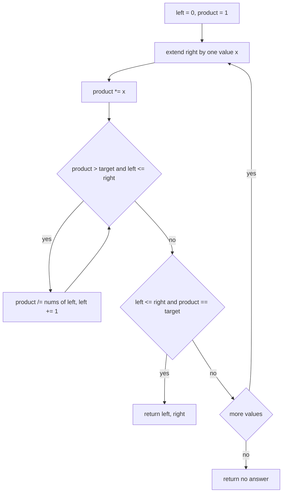
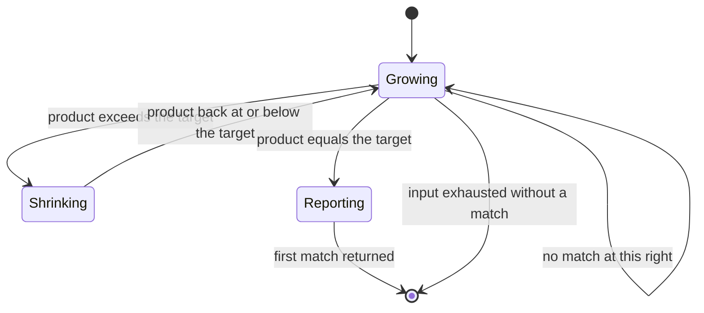
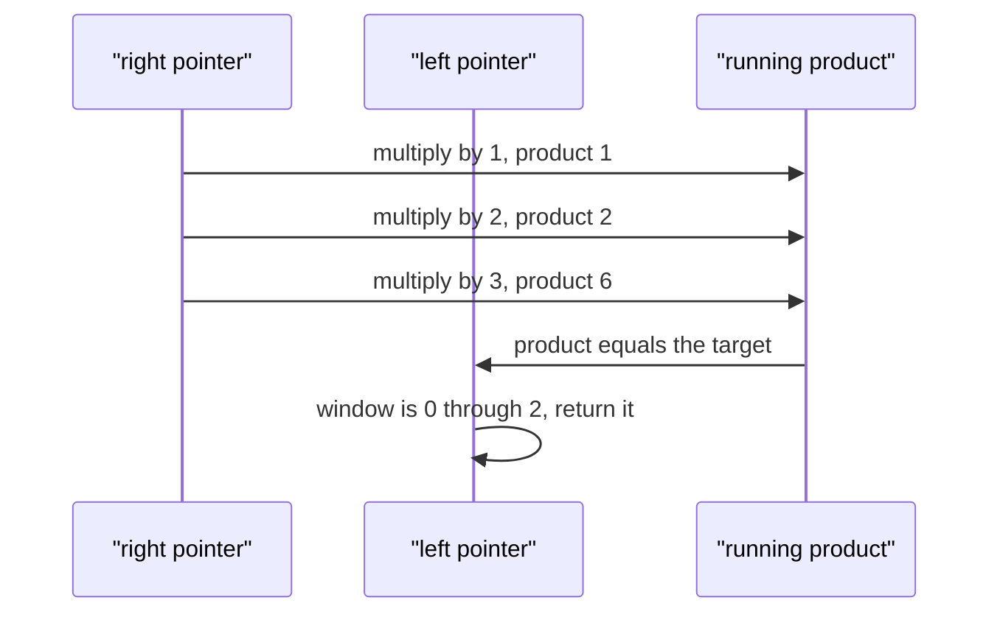

# 214 — Subarray with given product (positive integers).

> **Tier:** Intermediate · **CTCI chapter:** Ch 8 — Recursion and Dynamic Programming
> **Task spec:** [214-subarray-with-given-product-positive-integers.md](../../../tasks/intermediate/214-subarray-with-given-product-positive-integers.md)
> **Solutions:** [Python](../../../solutions/python/intermediate/214-subarray-with-given-product-positive-integers/solution.py) ·
> [Java](../../../solutions/java/intermediate/214-subarray-with-given-product-positive-integers/Solution.java) ·
> [JavaScript](../../../solutions/javascript/intermediate/214-subarray-with-given-product-positive-integers/solution.js) ·
> [C#](../../../solutions/csharp/intermediate/214-subarray-with-given-product-positive-integers/Solution.cs)

## 1. Problem restatement

**Input:** an array `nums` of **strictly positive** integers and a `target` product. A non-positive
value raises (Python and JavaScript raise, Java throws `IllegalArgumentException`, C# throws
`ArgumentException`); a `target` smaller than `1` is not an error but immediately returns "no
answer", because a product of positive integers is at least one.

**Output:** the **first** subarray, in scan order, whose elements multiply to exactly `target`,
returned as inclusive bounds `(start, end)`; "no answer" when none exists. Python and JavaScript
return `None` / `null`, Java returns `null` for an `int[]` result, and C# returns a nullable
`(int, int)?`.

| Call | Result | Why |
| --- | --- | --- |
| `subarray_with_product([2, 3, 1, 2, 4], 6)` | `(0, 1)` | `[2, 3]` is the first window reaching the product |
| `subarray_with_product([1, 2, 3, 4], 6)` | `(0, 2)` | `[1, 2, 3]` ends earlier than `[2, 3]` |
| `subarray_with_product([10], 10)` | `(0, 0)` | one element equals the target |
| `subarray_with_product([1, 1, 1], 1)` | `(0, 0)` | the first element alone is a valid window |
| `subarray_with_product([3, 1, 1], 2)` | no answer | the products are `3`, `3`, `3`, `1`, `1`, `1` |
| `subarray_with_product([2, 4], 6)` | no answer | no contiguous product is `6` |

Python asserts all six rows (plus an empty-array case); Java, JavaScript and C# assert the first
five. The "first match" rule is load-bearing: `[1, 2, 3, 4]`
with `target 6` has the answer `(0, 2)` and not `(1, 2)` because the window starting at index `0`
closes earlier in scan order.

## 2. Intuition

The naive approach tries every start and multiplies forward, which is `O(n²)`. A prefix-product
table with division is `O(n)` but still needs `O(n)` memory and, worse, division by zero is a hazard
whenever a value is zero — which is why this task restricts the input to positive values.

The insight is the multiplicative analogue of the sliding window from
[209](209-longest-subarray-with-sum-equal-to-k-array-of-positives.md). With strictly positive values
the running product is monotone in the window size: extending right can only multiply by something
at least one, and dropping the left end divides by something at least one, so the product never
decreases when you shrink. That gives the same two-phase discipline:

- **Grow.** Multiply the running product by `nums[right]`.
- **Shrink.** While the product exceeds the target, divide by `nums[left]` and advance `left`. On
  positive values this always terminates: the product strictly decreases with each division, and
  the guard `left <= right` keeps the window from collapsing past its own right end.
- **Test.** After the shrink loop, if the product equals the target, the window `[left, right]` is a
  valid answer, and since we scan `right` upward and keep `left` as small as possible, it is the
  first one in the required order.

The exactness of the division is another consequence of positivity: every value divides the running
product exactly, so integer division in Python and Java (and `Math.trunc`-free plain division in
JavaScript, where the operands stay integral) leaves no remainder.



## 3. Algorithm

1. Reject any value `<= 0`.
2. If `target < 1`, return "no answer" — no positive integer product can be that small.
3. Set `left = 0` and `product = 1`.
4. For each `right` from `0` to `n - 1`:
   1. Multiply `product` by `nums[right]`.
   2. While `left <= right` and `product > target`, divide `product` by `nums[left]` and increment
      `left`.
   3. If `left <= right` and `product == target`, return `(left, right)`.
5. Return "no answer".

```text
function subarray_with_product(nums, target)
    for each x in nums do
        if x <= 0 then
            raise error
        end
    end
    if target < 1 then
        return no answer
    end
    left ← 0
    product ← 1
    for right ← 0 to length(nums) - 1 do
        product ← product * nums[right]
        while left <= right and product > target do
            product ← product / nums[left]
            left ← left + 1
        end
        if left <= right and product == target then
            return left, right
        end
    end
    return no answer
end
```

Two guards carry the correctness. The `left <= right` in the shrink condition prevents the window
from becoming empty when a single element already exceeds the target — without it, `left` would
advance past `right` and the subsequent comparison would consult a window that does not exist. The
same guard in the test prevents a vacuous match on an empty window: an empty product is `1`, which
would otherwise falsely "equal" a target of `1`.



## 4. Worked example

Trace `subarray_with_product([1, 2, 3, 4], 6)`, where the expected answer is `(0, 2)` — the window
`[1, 2, 3]`, which is what makes "first match" more subtle than "shortest match".

| `right` | `nums[right]` | `product` after multiply | Shrink steps | Window | `product == 6`? |
| --- | --- | --- | --- | --- | --- |
| 0 | 1 | 1 | none (`1 <= 6`) | `[0..0] = 1` | no |
| 1 | 2 | 2 | none | `[0..1] = 2` | no |
| 2 | 3 | 6 | none | `[0..2] = 6` | yes, return `(0, 2)` |

The function returns as soon as the window closes, so the later window `[1..2] = [2, 3]`, which also
has product `6`, is never examined. That is exactly the documented behaviour: the first match in
scan order, not the shortest or the lexicographically smallest.

Now trace the shrink path, `subarray_with_product([2, 3, 1, 2, 4], 6)`:

| `right` | `nums[right]` | `product` after multiply | Shrink steps | Window | `product == 6`? |
| --- | --- | --- | --- | --- | --- |
| 0 | 2 | 2 | none | `[0..0] = 2` | no |
| 1 | 3 | 6 | none | `[0..1] = 6` | yes, return `(0, 1)` |

And the failure case `subarray_with_product([3, 1, 1], 2)`, where every product stays above the
target:

| `right` | `nums[right]` | `product` | Shrink steps | Window after shrink | `product == 2`? |
| --- | --- | --- | --- | --- | --- |
| 0 | 3 | 3 | divide by `3`, `left → 1` | empty | no, `left > right` |
| 1 | 1 | 1 | none | `[1..1] = 1` | no |
| 2 | 1 | 1 | none | `[1..2] = 1` | no |

The function returns "no answer" after the scan. Note the first row: the guard leaves the window
empty, and the test's `left <= right` guard is what stops the empty product `1` from being compared
with anything.



## 5. Complexity

Let `n` be the input length.

| Measure | Bound | Why it holds |
| --- | --- | --- |
| Time, best | O(n) | the positivity check is a full pass, so even a first-element hit costs linear time |
| Time, average | O(n) | `right` advances `n` times and `left` advances at most `n` times in total |
| Time, worst | O(n) | the shrink loop is amortised: each index leaves the window at most once |
| Space, extra | O(1) | two indices and one running product |
| Naive start-by-start scan | O(n²) time, O(1) space | every start multiplies forward until the product exceeds the target |
| Prefix products plus search | O(n) time, O(n) space | needs a table, a lookup and division, and is unsafe with zeros |

The omission of an early exit because of the first-match rule is worth noting: the function returns
the moment it finds a match, so in practice it stops far earlier than `n`. The `O(n)` bound is the
worst case, achieved when no window ever matches.

## 6. Pitfalls and edge cases

- **`target < 1`.** Returns "no answer" without scanning. A product of positive integers is at least
  one, so `0`, negative targets and (in principle) fractions are unsatisfiable. Python's
  `if target < 1: return None` is the cheapest possible rejection.
- **Non-positive values.** `[1, -1, 1]` raises, because the monotonicity argument — and with it the
  shrink loop — depends on every factor being at least one in magnitude. The multiplication would
  also stop being reversible by integer division.
- **Zero values.** Excluded by the same rule, which is fortunate: a zero factor would make the
  running product zero and the division-by-zero hazard immediate.
- **The `left <= right` guard.** Without it, `[3, 1, 1]` with `target 2` would shrink past its own
  right end and the window would report nonsense. It is also what keeps the empty product `1` from
  masquerading as a match for `target 1`.
- **An element larger than the target.** `[10]` with `target 10` matches and returns `(0, 0)`, but
  `[10]` with `target 3` shrinks to an empty window and returns "no answer" — both are asserted
  behaviours in one form or another across the four files.
- **Ones are harmless but shift the answer.** Because `1` multiplies without changing the product,
  the window can be extended over ones for free, which is why `[1, 2, 3, 4]` with `target 6` returns
  `(0, 2)` rather than `(1, 2)`. Any implementation that returns the shortest window fails this row.
- **Return shape.** Python and JavaScript return `None` / `null` for no answer; Java returns `null`
  from an `int[]`-returning method; C# returns a nullable tuple `(int, int)?`. Callers must handle
  the absence, and the assertions do.
- **Large products.** The product can exceed 32-bit range before the shrink loop brings it back
  down. Java and C# keep it in a `long` and only the *division* brings it back; the asserted inputs
  stay small, but widening is the safe habit.
- **This is not the "maximum product" task.** [213](213-maximum-product-subarray.md) optimises a
  product over all windows and must handle negatives; here the target is fixed and the values are
  constrained precisely so that the window discipline is sound.

## 7. Variants and follow-ups

- **Sum instead of product.** [209-longest-subarray-with-sum-equal-to-k-array-of-positives.md](../../../tasks/intermediate/209-longest-subarray-with-sum-equal-to-k-array-of-positives.md)
  is the additive twin: same grow/shrink loop, different arithmetic, and it maximises the window
  instead of returning the first match.
- **Maximum product rather than a target product.**
  [213-maximum-product-subarray.md](../../../tasks/intermediate/213-maximum-product-subarray.md)
  removes the positivity assumption and pays for it with a two-value DP state.
- **Counting windows with a given sum.** [211-subarray-sum-equals-k-count-hashmap.md](../../../tasks/intermediate/211-subarray-sum-equals-k-count-hashmap.md)
  needs a hash map rather than a window, because its input may contain negatives.
- **Partitioning by products or sums.** [215-partition-array-into-equal-sum-subsets-subset-sum.md](../../../tasks/intermediate/215-partition-array-into-equal-sum-subsets-subset-sum.md)
  moves from "find a subarray" to "partition the whole array", which is a subset-sum DP instead of a
  window.
- The chapter walkthrough [Recursion and Dynamic Programming](../../ctci/08-recursion-and-dp.md)
  contrasts greedy windows with DP over subsets, the two families this tier interleaves.

## 8. Check yourself

1. Why does the shrink loop always terminate, and what property of the input does that rely on?

<details><summary>Show answer</summary>

Because every division by a value `>= 1` does not increase the product, and division by a value
`> 1` strictly decreases it, so the loop can only run while the product is above the target and
`left <= right`. The `left <= right` guard terminates the loop in the worst case. Both arguments
depend on the values being strictly positive integers.

</details>

2. Why is `target < 1` handled before the loop?

<details><summary>Show answer</summary>

Because the product of positive integers is at least `1`, so no window can ever match a target below
one. Returning early avoids scanning and, more importantly, avoids the empty-window comparison:
after shrinking past the right end, the running product is `1`, which would spuriously match
`target 1` if the guard were missing.

</details>

3. For `[1, 2, 3, 4]` with `target 6`, why is `(0, 2)` returned instead of `(1, 2)`?

<details><summary>Show answer</summary>

Because the algorithm scans `right` upward and returns the first window that closes on the target.
At `right = 2` the window `[0..2]` already has product `6`, so the function returns before `right`
ever reaches `3`. The window `[1..2]` is never examined, which is the "first match" contract.

</details>

4. What happens with `[2, 4]` and `target 6`?

<details><summary>Show answer</summary>

No window matches: the reachable products are `2`, `8` and `4`. At `right = 1` the product becomes
`8 > 6`, so the shrink loop divides by `2` and the window becomes `[1..1]` with product `4`, which is
not the target either. The function returns "no answer".

</details>

5. Could the same code answer "how many subarrays have product `target`"?

<details><summary>Show answer</summary>

Not directly. The window discipline keeps exactly one window per right end — the longest one with
product at most the target — because the shrink rule is destructive. Counting would require
enumerating all windows, or switching to a prefix-product plus hash-map approach, which reintroduces
the `O(n)` space and the division-with-zeros problem that the positivity restriction was designed to
avoid.

</details>
