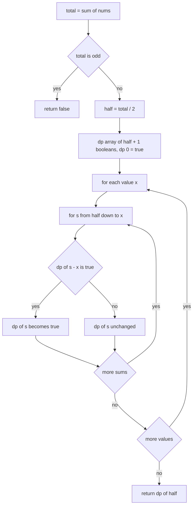
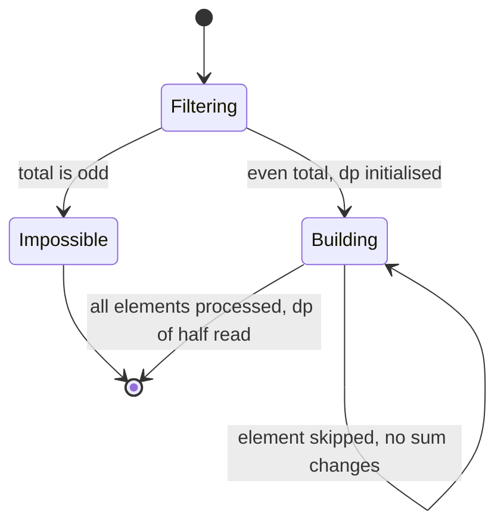
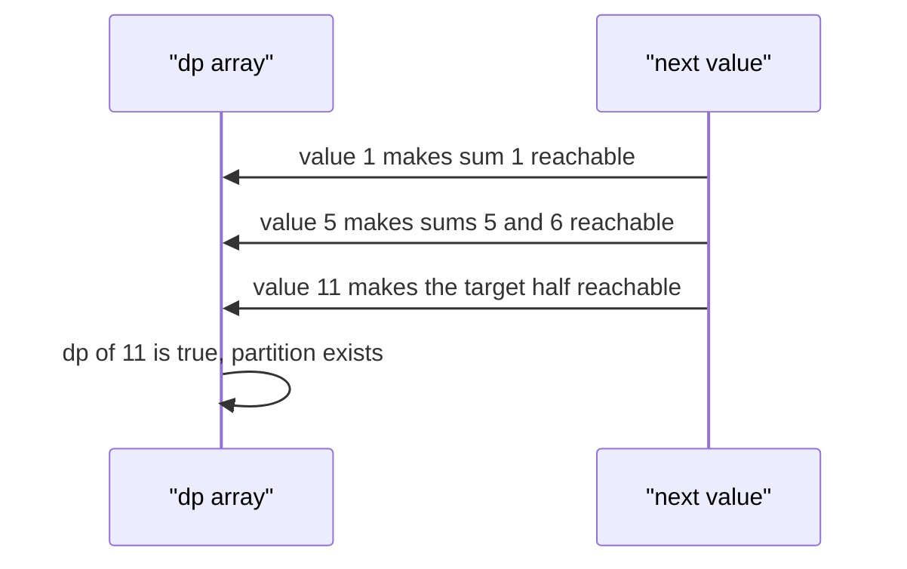

# 215 — Partition array into equal-sum subsets (subset sum).

> **Tier:** Intermediate · **CTCI chapter:** Ch 8 — Recursion and Dynamic Programming
> **Task spec:** [215-partition-array-into-equal-sum-subsets-subset-sum.md](../../../tasks/intermediate/215-partition-array-into-equal-sum-subsets-subset-sum.md)
> **Solutions:** [Python](../../../solutions/python/intermediate/215-partition-array-into-equal-sum-subsets-subset-sum/solution.py) ·
> [Java](../../../solutions/java/intermediate/215-partition-array-into-equal-sum-subsets-subset-sum/Solution.java) ·
> [JavaScript](../../../solutions/javascript/intermediate/215-partition-array-into-equal-sum-subsets-subset-sum/solution.js) ·
> [C#](../../../solutions/csharp/intermediate/215-partition-array-into-equal-sum-subsets-subset-sum/Solution.cs)

## 1. Problem restatement

**Input:** an array `nums` of non-negative integers, possibly empty. The Python docstring states the
reduction precisely: "is there a subset summing to `total/2`?".

**Output:** `true` when the array can be split into two groups with equal sums, `false` otherwise.
The grouping uses every element exactly once, and the two groups are unlabelled — swapping them does
not create a new answer, which is why checking a single half is enough.

| Call | Result | Why |
| --- | --- | --- |
| `can_partition([1, 5, 11, 5])` | `true` | `11` against `5 + 5 + 1` |
| `can_partition([3, 3, 3, 3])` | `true` | `6` against `6` |
| `can_partition([2, 2])` | `true` | one element per side |
| `can_partition([1, 1])` | `true` | two halves of one |
| `can_partition([1, 2, 3, 5])` | `false` | the total `11` is odd, so an even split is impossible |
| `can_partition([1])` | `false` | the total `1` is odd |
| `can_partition([])` | `true` | two empty halves have equal sums |

Python asserts all seven rows; Java asserts all but the `[3, 3, 3, 3]` row; JavaScript and C# assert
the `[1, 5, 11, 5]`, `[2, 2]`, `[1, 2, 3, 5]`, `[1]` and `[]` rows (five in total). The
empty-array answer of `true` is deliberate: the sum
`0` is even and the target half is `0`, which the empty subset already achieves.

## 2. Intuition

The naive approach tries every subset: `2^n` subsets, each checked in `O(n)`, i.e. `O(n · 2^n)` — and
for `n = 30` that is already a billion operations.

Two observations cut the problem down dramatically.

First, a **parity filter**: the two halves have equal sums, so the total must be even. If `sum(nums)`
is odd, the answer is `false` immediately, with no search at all. This is the check the docstring's
characterisation relies on: if the total is `2H`, then one group must have sum exactly `H`, and the
other group is whatever remains — whose sum is also `H` automatically.

Second, the question "does some subset sum to `H`?" is a **subset-sum decision problem**, and it is
solvable by DP over reachable sums rather than by enumeration. Let `dp[s]` mean "some subset of the
elements processed so far sums to `s`". The recurrence is one line: if `dp[s - x]` holds when we
consider element `x`, then `dp[s]` becomes reachable. The state space is `H + 1` booleans instead of
`2^n` subsets, which is the entire trick.

The subtlety is the **iteration direction**. Each element may be used at most once, so the sums must
be visited in *descending* order: `for s from H down to x`. Going ascending would let the update
`dp[s - x] → dp[s]` feed on a value that was already updated for the same element, effectively
allowing that element to be counted twice — a coin-change recurrence instead of a 0/1 recurrence.



## 3. Algorithm

1. Compute `total = sum(nums)`. If `total` is odd, return `false`.
2. Let `half = total / 2`.
3. Create a boolean array `dp` of size `half + 1`, all `false`, with `dp[0] = true` — the empty subset
   reaches sum `0`.
4. For each value `x` in `nums`:
   - For each sum `s` from `half` down to `x`: if `dp[s - x]` is `true`, set `dp[s] = true`.
5. Return `dp[half]`.

```text
function can_partition(nums)
    total ← 0
    for each x in nums do
        total ← total + x
    end
    if total mod 2 != 0 then
        return false
    end
    half ← total / 2
    dp ← array of half + 1 booleans, all false
    dp[0] ← true
    for each x in nums do
        for s ← half down to x do
            if dp[s - x] then
                dp[s] ← true
            end
        end
    end
    return dp[half]
end
```

The descending loop is the only place where a wrong implementation is easy to write and hard to spot
in small tests. Ascending iteration happens to give the right answer for inputs where each element
would be needed at most once anyway — for example `[1, 5, 11, 5]`, where the target half `11` is one
of the elements — but it wrongly accepts `[2, 2, 2]`-style inputs where the target half would need
three copies of the same element.



## 4. Worked example

Trace `can_partition([1, 5, 11, 5])`. The total is `22`, so `half = 11` and the DP array runs from
`0` to `11`.

| Element `x` | Sums updated (descending) | Reachable sums after the element |
| --- | --- | --- |
| — (init) | — | `{0}` |
| 1 | `dp[1] ← dp[0]` | `{0, 1}` |
| 5 | `dp[6] ← dp[1]`, `dp[5] ← dp[0]` | `{0, 1, 5, 6}` |
| 11 | `dp[11] ← dp[0]` | `{0, 1, 5, 6, 11}` |
| 5 | `dp[11] ← dp[6]` (already true), `dp[10] ← dp[5]`, `dp[6]`, `dp[5]` | `{0, 1, 5, 6, 10, 11}` |

`dp[11]` is `true` from the third element onwards — the singleton `{11}` — so the answer is `true`,
and the last element also confirms it independently via `{1, 5, 5} = 11`. The two different witnesses
are exactly why the DP is preferable to a search: it does not care which one is found.

Now trace the odd-total rejection `can_partition([1, 2, 3, 5])`: the total is `11`, the `total mod 2 != 0`
check fires before any allocation, and the function returns `false`. No DP array is even created,
which is the cheapest answer in the whole file.



## 5. Complexity

Let `n` be the input length, `H = total / 2` the target half-sum and `V` the largest element.

| Measure | Bound | Why it holds |
| --- | --- | --- |
| Time, best | O(n) | an odd total is rejected after one summing pass; `[1]` and `[1, 2, 3, 5]` never enter the DP |
| Time, average | O(n · H) | the inner loop runs `H - x + 1` iterations per element |
| Time, worst | O(n · H) | the loop bound `s >= x` limits the work per element to `H - V + 1` at most |
| Space | O(H) | one boolean per reachable sum, not one per subset |
| Brute-force subsets | O(n · 2^n) time | every subset is constructible and checked |
| Recursion with memoisation | O(n · H) time, O(n · H) space | the top-down equivalent keeps a table of `(index, remaining)` states |

Two properties make the DP practical. The state space is bounded by the *sum*, not by the number of
subsets, so the exponential dependence disappears entirely. And the inner loop's lower bound `x`
skips the sums that cannot be reached by the current element, which is where the constant-factor
saving over a full `H + 1` sweep comes from.

## 6. Pitfalls and edge cases

- **Odd totals.** `[1, 2, 3, 5]` (total `11`) and `[1]` (total `1`) return `false` immediately. This
  is the single most important early exit, and every file has it as the first statement after the
  sum; Java and C# both assert the odd case.
- **Descending inner loop.** Ascending iteration allows an element to be reused, turning the 0/1
  subset recurrence into an unbounded one. All four files write `for s = half; s >= x; s--` (Python:
  `range(half, x - 1, -1)`).
- **Empty array.** `can_partition([])` returns `true`: the total is `0`, which is even, `half` is
  `0`, and `dp[0]` was initialised to `true`. Python, Java, JavaScript and C# all assert this
  counter-intuitive row — the correct reading is "two empty groups have equal sums".
- **Single element.** `[1]` returns `false` because of the parity filter; a single zero element would
  return `true`, since `0` is even and `dp[0]` is trivially reachable.
- **Zeros in the input.** They are harmless: `dp[s - 0] = dp[s]` changes nothing, and the descending
  loop still terminates because the inner bound is `s >= 0`. No infinite recursion is possible in
  the array DP.
- **Repeated values.** `[2, 2]` and `[1, 1]` both return `true`; `[3, 3, 3, 3]` also returns `true`
  (`6` versus `6`), and the Python file asserts that row explicitly as the "many equal values" case.
- **Target larger than any single element.** The DP naturally handles it, because sums are built
  from combinations: `[1, 5, 11, 5]` reaches `11` both as the singleton and as `1 + 5 + 5`.
- **Allocation size.** The array is `H + 1` entries; for a large total this can be large, which is
  the practical limit of the approach and the motivation for the meet-in-the-middle variant
  [219](219-implement-meet-in-the-middle-for-subset-problems-n-40.md) when `n` is large and the
  values are large too.
- **Values larger than `half`.** An element above the target half can never be part of the answer,
  so the inner loop simply does not run for it — the `s >= x` bound handles it, and it also makes
  such an element a no-op in the DP, exactly as intended.

## 7. Variants and follow-ups

- **`k` groups instead of two.** [216-partition-array-into-k-equal-sum-subsets-backtracking.md](../../../tasks/intermediate/216-partition-array-into-k-equal-sum-subsets-backtracking.md)
  abandons the single-target DP and uses backtracking with bucket pruning, because "`k` disjoint
  subsets each hitting the target" is not expressible as a single reachable-sum array.
- **Subset-sum without the partition framing.**
  [217-subset-sum-decision-problem-dp-boolean.md](../../../tasks/intermediate/217-subset-sum-decision-problem-dp-boolean.md)
  asks for the same boolean DP with an arbitrary target.
- **Counting the subsets rather than deciding existence.**
  [218-count-subsets-that-sum-to-target-dp.md](../../../tasks/intermediate/218-count-subsets-that-sum-to-target-dp.md)
  replaces the booleans with counts, which is a one-line change to the same recurrence.
- **Large `n` with large values.** [219-implement-meet-in-the-middle-for-subset-problems-n-40.md](../../../tasks/intermediate/219-implement-meet-in-the-middle-for-subset-problems-n-40.md)
  trades the `O(n · H)` table for two enumeration halves, which is better when `H` explodes.
- The chapter walkthrough [Recursion and Dynamic Programming](../../ctci/08-recursion-and-dp.md)
  develops the subset-sum recurrence and its space collapse from a 2-D table.

## 8. Check yourself

1. Why is checking the parity of the total sufficient as a necessary condition?

<details><summary>Show answer</summary>

If the array splits into two groups with equal sums, then `total` is twice a group sum, hence even.
Conversely, when the total is `2H`, any subset summing to `H` has a complement summing to
`total - H = H`, so the two conditions are equivalent and the double implication holds.

</details>

2. Why must the inner loop run from `half` down to `x` rather than upward?

<details><summary>Show answer</summary>

Because each element may be used once. Running upward, `dp[s - x]` may have been set by the very same
element earlier in the sweep, effectively using it twice. Descending order guarantees that
`dp[s - x]` still reflects the state before the current element was considered.

</details>

3. What does `can_partition([])` return, and what does the answer mean?

<details><summary>Show answer</summary>

`true`. The total `0` is even, `half` is `0` and `dp[0]` starts `true`, so the check succeeds. The
reading is that the array splits into two empty groups with equal sums — a degenerate but consistent
instance of the property the function tests.

</details>

4. In the `[1, 5, 11, 5]` trace, which sums are reachable after the third element, and which one
   decides the answer?

<details><summary>Show answer</summary>

`{0, 1, 5, 6, 11}`. The deciding entry is `dp[11]`, made reachable by the singleton `11` against
`dp[0]`. The last element also makes `11` reachable as `1 + 5 + 5`, so the answer would still be
`true` without the singleton.

</details>

5. How does the complexity compare with enumerating subsets, and what does that mean for `n = 30`?

<details><summary>Show answer</summary>

Enumeration is `O(n · 2^n)`, about `30 · 10^9` operations at `n = 30`, which is infeasible in a
coding interview. The DP is `O(n · H)` with `H` the half-sum, which is polynomial in the values
rather than exponential in the count — for typical small values it finishes instantly, and it is
exponential only in the *bit length* of the numbers.

</details>
