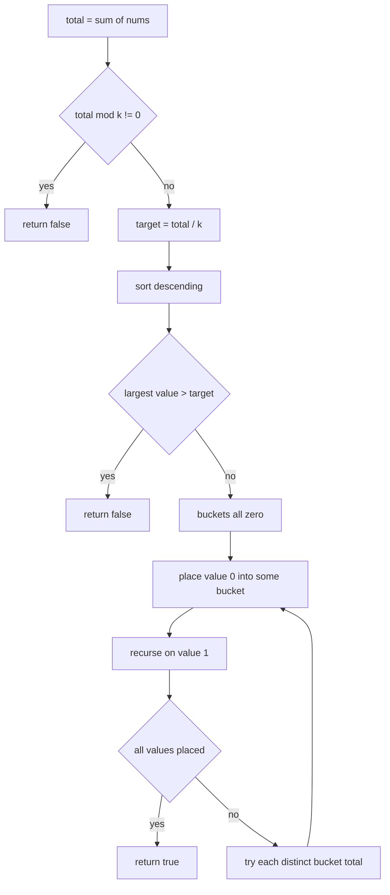
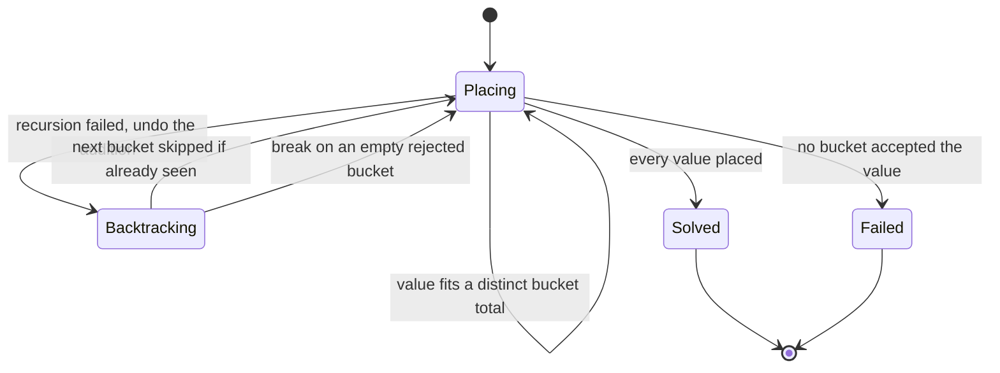
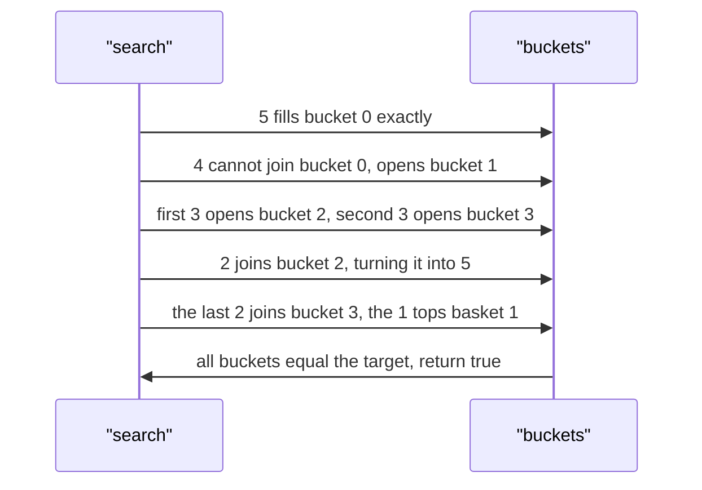

# 216 — Partition array into k equal-sum subsets (backtracking).

> **Tier:** Intermediate · **CTCI chapter:** Ch 8 — Recursion and Dynamic Programming
> **Task spec:** [216-partition-array-into-k-equal-sum-subsets-backtracking.md](../../../tasks/intermediate/216-partition-array-into-k-equal-sum-subsets-backtracking.md)
> **Solutions:** [Python](../../../solutions/python/intermediate/216-partition-array-into-k-equal-sum-subsets-backtracking/solution.py) ·
> [Java](../../../solutions/java/intermediate/216-partition-array-into-k-equal-sum-subsets-backtracking/Solution.java) ·
> [JavaScript](../../../solutions/javascript/intermediate/216-partition-array-into-k-equal-sum-subsets-backtracking/solution.js) ·
> [C#](../../../solutions/csharp/intermediate/216-partition-array-into-k-equal-sum-subsets-backtracking/Solution.cs)

## 1. Problem restatement

**Input:** an array `nums` of positive integers and an integer `k`. `k <= 0` raises (Python and
JavaScript raise, Java throws `IllegalArgumentException`, C# throws `ArgumentException`).

**Output:** `true` when the array can be split into `k` disjoint groups, each summing to
`total / k`, using every element exactly once; `false` otherwise. Groups are unlabelled, and an
empty array trivially satisfies any positive `k` — the recursion reaches its base case immediately.

| Call | Result | Why |
| --- | --- | --- |
| `can_partition_k([4, 3, 2, 3, 5, 2, 1], 4)` | `true` | four buckets of `5`: `[5]`, `[4, 1]`, `[3, 2]`, `[3, 2]` |
| `can_partition_k([1, 2, 3, 4], 2)` | `true` | `5` and `5` |
| `can_partition_k([1, 1, 1, 1], 2)` | `true` | `2` and `2` |
| `can_partition_k([10, 10, 10, 10, 10, 10], 3)` | `true` | three buckets of `20` |
| `can_partition_k([2, 2, 2, 2, 3], 3)` | `false` | the total `11` is not divisible by `3` |
| `can_partition_k([2, 2, 2, 2, 2, 2], 4)` | `false` | the target is `3`, but every value is `2` |

Python, Java, JavaScript and C# all assert these six rows. Note the two distinct failure modes: the
fifth row fails on the divisibility filter before any search, while the sixth passes the filter and
is refuted only by the search itself.

## 2. Intuition

The two-group case ([215](215-partition-array-into-equal-sum-subsets-subset-sum.md)) reduces to "does
some subset sum to `total/2`", which a single boolean DP answers. For `k` groups that reduction does
not exist: the question is whether the elements can be *disjointly partitioned*, and reachability of
a single sum says nothing about the remaining elements. The natural formulation is an assignment
search — each element goes into one of `k` buckets — which is `k^n` in the worst case and needs
pruning to be usable.

Four prunings turn an exponential search into something that finishes immediately on interview-sized
input:

- **Divisibility filter.** If `total % k != 0`, return `false` at once. This is the `k`-ary analogue
  of the parity check in task 215.
- **Impossible largest element.** After sorting descending, if the largest value exceeds
  `target = total / k`, no bucket can hold it, so return `false` without searching.
- **Descending order.** Placing large values first makes buckets fill up quickly and exposes
  infeasible branches early; both the Python solution (`sorted(nums, reverse=True)`) and JavaScript
  (`sort((x, y) => y - x)`) rely on this, and Java and C# sort ascending and then reverse in place.
- **Identical-bucket skipping.** When several buckets currently hold the same total, trying the
  current value in more than one of them leads to structurally identical subtrees. The solutions
  record the bucket totals already tried for this element in a `seen` set and skip repeats. This is
  the single most effective pruning, and it is why the code is more than a plain backtracking loop.

One more pruning catches the common degenerate case: if a bucket is empty and the value does not fit
anywhere else either, there is no point trying the *other* empty buckets, so the loop breaks as soon
as it encounters an empty bucket that was rejected. That is the `if buckets[b] == 0: break` line at
the end of the loop body.



## 3. Algorithm

1. Reject `k <= 0`.
2. Compute `total`. If `total % k != 0`, return `false`; otherwise let `target = total / k`.
3. Sort the values in descending order. If the largest value exceeds `target`, return `false`.
4. Create `k` buckets, all `0`.
5. `place(i)`: if `i` has reached the end of the sorted values, return `true` — everything fits.
   Otherwise, for each bucket `b`:
   - skip `b` if its total is already in the `seen` set for this element (identical subtree);
   - if `buckets[b] + nums[i] <= target`, record the total in `seen`, add the value, recurse on
     `i + 1`, and undo the addition if the recursion fails;
   - if `buckets[b] == 0` after the attempt, break — every remaining bucket is empty and therefore
     equivalent.
   Return `false` if no bucket works.
6. Return `place(0)`.

```text
function can_partition_k(nums, k)
    if k <= 0 then
        raise error
    end
    total ← sum of nums
    if total mod k != 0 then
        return false
    end
    target ← total / k
    a ← nums sorted descending
    if length(a) > 0 and a[0] > target then
        return false
    end
    buckets ← array of k zeros
    return place(0)
end

procedure place(i)
    if i == length(a) then
        return true
    end
    seen ← empty set of bucket totals
    for b ← 0 to k - 1 do
        if buckets[b] in seen then
            continue
        end
        if buckets[b] + a[i] <= target then
            seen.add(buckets[b])
            buckets[b] ← buckets[b] + a[i]
            if place(i + 1) then
                return true
            end
            buckets[b] ← buckets[b] - a[i]
        end
        if buckets[b] == 0 then
            break
        end
    end
    return false
end
```

The `seen` set is per element, not global: it records the bucket totals that have already been tried
*for this value*. Two buckets with equal totals are interchangeable, so the second attempt can only
reproduce the first one's outcome. This pruning is what makes the `[10, 10, 10, 10, 10, 10]` case
with `k = 3` instant: after the first `10` goes into bucket `0`, the other three empty buckets are
collapsed into a single branch.



## 4. Worked example

Trace `can_partition_k([4, 3, 2, 3, 5, 2, 1], 4)`. The total is `20`, `target = 5`, and the sorted
values are `[5, 4, 3, 3, 2, 2, 1]` with `k = 4` buckets.

| `i` | Value | Buckets before | Bucket chosen | Reason | Buckets after |
| --- | --- | --- | --- | --- | --- |
| 0 | 5 | `[0, 0, 0, 0]` | `0` | fits exactly; totals `0, 0, 0` collapse the other empties | `[5, 0, 0, 0]` |
| 1 | 4 | `[5, 0, 0, 0]` | `1` | bucket `0` is full (`5 + 4 > 5`) | `[5, 4, 0, 0]` |
| 2 | 3 | `[5, 4, 0, 0]` | `2` | buckets `0` and `1` cannot accept it | `[5, 4, 3, 0]` |
| 3 | 3 | `[5, 4, 3, 0]` | `3` | only the empty bucket fits | `[5, 4, 3, 3]` |
| 4 | 2 | `[5, 4, 3, 3]` | `1` | gives `6 > 5`, so `1` is rejected; bucket `2` fills exactly | `[5, 4, 5, 3]` |
| 5 | 2 | `[5, 4, 5, 3]` | `3` | bucket `2` is full, bucket `3` becomes `5` | `[5, 4, 5, 5]` |
| 6 | 1 | `[5, 4, 5, 5]` | `1` | only bucket `1` has room, taking it to `5` | `[5, 5, 5, 5]` |

All seven values are placed and the recursion returns `true` with four buckets of `5`. The instructive
step is `i = 1`: the `4` cannot go into bucket `0`, and because bucket `0` is non-empty the `break`
rule does not fire, so the search moves to bucket `1` — which is empty — and succeeds. Had the `4`
failed in bucket `1` as well, the `break` would have fired there, since all later buckets are empty
and therefore equivalent.



## 5. Complexity

Let `n` be the number of values and `k` the number of groups.

| Measure | Bound | Why it holds |
| --- | --- | --- |
| Time, best | O(n log n) | the sort dominates, and the divisibility or largest-value filters can reject before any placement |
| Time, average | far below the worst case | the seen-set collapse and the descending order cut most branches, which is why the asserted inputs finish instantly |
| Time, worst | exponential in `n` | every value may need to be tried in up to `k` buckets, so the search tree has up to `k^n` leaves before pruning |
| Space | O(n + k) | the recursion depth is `n`, the buckets are `k`, and the `seen` set holds at most `k` totals per level |
| Task 215 as a special case | O(n · total/2) time, O(total/2) space | only for `k = 2`, where the problem collapses to a subset-sum decision |
| Bitmask DP alternative | O(2^n · n) time | precomputes subset sums and memoises which prefix subsets are usable; better for small `n` with many equal values, worse in memory |

The exponential worst case is inherent — the problem is NP-complete — so the algorithm's practical
value lies entirely in the pruning. That is also why the file is named for backtracking rather than
for dynamic programming: the state that would be needed for a DP (the multiset of bucket totals) is
too large to tabulate.

## 6. Pitfalls and edge cases

- **Divisibility first.** `[2, 2, 2, 2, 3]` with `k = 3` has total `11`, which is not divisible by
  `3`, so the answer is `false` without any search. Skipping this check wastes exponential time on an
  obviously impossible instance.
- **Oversized values.** `[10, 10]` with `k = 3` has a non-integer target handled by the divisibility
  check, but a case like `[11, 1, 1, 1]` with `k = 2` (target `7`) is rejected by the
  `a[0] > target` filter, since no bucket can hold the `11`.
- **`k <= 0`.** All four files raise; `k = 0` would make the target division undefined and the
  bucket array empty.
- **Empty array.** Returns `true` for any positive `k`: `place(0)` hits `i == length(a)` immediately.
  Java and C# handle it without a special case; the `a.length > 0` guard on the largest-value check
  is what keeps the empty input from indexing out of bounds.
- **Identical buckets must be collapsed.** Without the `seen` set, `[10, 10, 10, 10, 10, 10]` with
  `k = 3` explores three equivalent choices for every value. The pruning is not an optimisation
  detail — it is what makes the asserted inputs tractable.
- **The empty-bucket break.** After an unsuccessful attempt in an empty bucket, all later empty
  buckets are equivalent *for this value* and the loop breaks. Removing the break is still correct
  but slower; changing it to `continue` while keeping the `seen` set is also correct, since the
  totals `0` are recorded.
- **Undo after a failed recursion.** Each attempt must subtract the value back before the next
  bucket is tried; the four files pair `buckets[b] += nums[i]` with `buckets[b] -= nums[i]` around
  the recursive call.
- **Descending sort is a heuristic, not a requirement.** Any order is correct, but descending order
  fills buckets fastest and therefore fails fastest. Java and C# implement it as
  "sort ascending, then reverse in place".
- **`k = 1`.** Every array with a single group trivially works: the target is the whole total, and
  the search places every value into the only bucket. No assertion covers it, but no special case is
  needed either.
- **Numeric range.** Totals can be large; the buckets hold sums, not products, so overflow is only a
  concern for near-`Integer.MAX_VALUE` inputs, which the tests avoid.

## 7. Variants and follow-ups

- **Two groups.** [215-partition-array-into-equal-sum-subsets-subset-sum.md](../../../tasks/intermediate/215-partition-array-into-equal-sum-subsets-subset-sum.md)
  is the `k = 2` case and is solved by a polynomial boolean DP rather than by search — the sharpest
  illustration of how much the problem changes with `k`.
- **Bitmask DP over subsets.** [220-implement-bitmask-dp-for-tsp-small-n.md](../../../tasks/intermediate/220-implement-bitmask-dp-for-tsp-small-n.md)
  shows the standard technique for exponential problems with small `n`, which can be adapted to
  bucket filling by memoising on the set of placed elements.
- **Meet in the middle.** [219-implement-meet-in-the-middle-for-subset-problems-n-40.md](../../../tasks/intermediate/219-implement-meet-in-the-middle-for-subset-problems-n-40.md)
  is the alternative for large `n` when the values are also large, and it is the reason task 219
  exists next to this one in the manifest.
- **Deciding subset sums.** [217-subset-sum-decision-problem-dp-boolean.md](../../../tasks/intermediate/217-subset-sum-decision-problem-dp-boolean.md)
  is the one-target version that this task's divisibility filter builds on.
- The chapter walkthrough [Recursion and Dynamic Programming](../../ctci/08-recursion-and-dp.md)
  discusses when backtracking with pruning is the right tool instead of tabulation.

## 8. Check yourself

1. Why can the `k`-group problem not be solved by a single boolean DP like task 215?

<details><summary>Show answer</summary>

Because a reachable-sum array records only *whether* some subset hits a total, not which elements
were used. For `k > 2` the groups must be disjoint, so knowing that the target is reachable for one
group says nothing about whether the remainder can be split again. The extra state needed is the
multiset of remaining elements, which is exponential.

</details>

2. What is the effect of sorting descending, and is it required for correctness?

<details><summary>Show answer</summary>

It is a pure pruning heuristic: large values are the most constrained, so placing them first fills
buckets quickly and exposes contradictions early. Any order produces the same answer, but the
ascending order explores far more failing subtrees before failing.

</details>

3. Why is the `seen` set per call rather than a single set for the whole search?

<details><summary>Show answer</summary>

Because the interchangeable-bucket argument applies to the bucket *totals at this level of the
recursion*. Two buckets with equal totals are interchangeable right now for the current value; once
the recursion descends and the totals diverge, the buckets are no longer equivalent. A global set
would incorrectly suppress valid placements at other levels.

</details>

4. For `[1, 2, 3, 4]` with `k = 2`, which placements does the search try, and how does the pruning
   behave?

<details><summary>Show answer</summary>

Sorted descending, the order is `[4, 3, 2, 1]` with target `5`. The `4` goes into bucket `0`
(the other bucket is skipped as an identical zero total); the `3` cannot join it, so it goes into
bucket `1`; the `2` cannot join bucket `0` (`4 + 2 > 5`) but joins bucket `1` to make `5`; the `1`
tops up bucket `0` to `5`. Every step is forced, so no backtracking occurs at all.

</details>

5. What does the algorithm return for `[1, 1, 1, 1]` with `k = 2`, and which prunings matter?

<details><summary>Show answer</summary>

`true`: two buckets of `2`. The descending sort is irrelevant because all values are equal, and the
`seen`-set collapse is what keeps the search small — after the first `1` chooses bucket `0`, every
later attempt with an equal bucket total is skipped, so the effective branching factor is closer to
one than to `k`.

</details>
