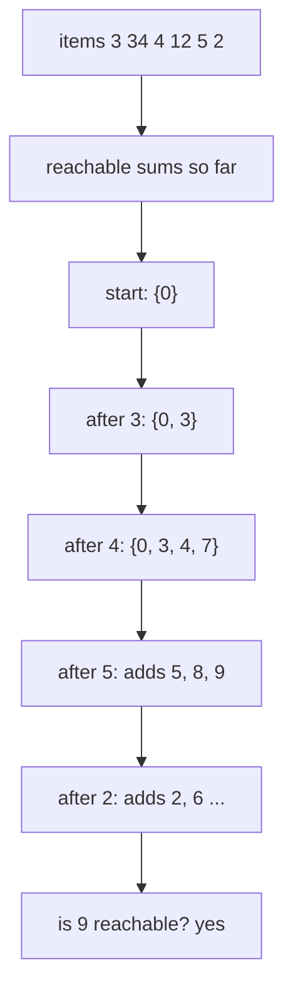
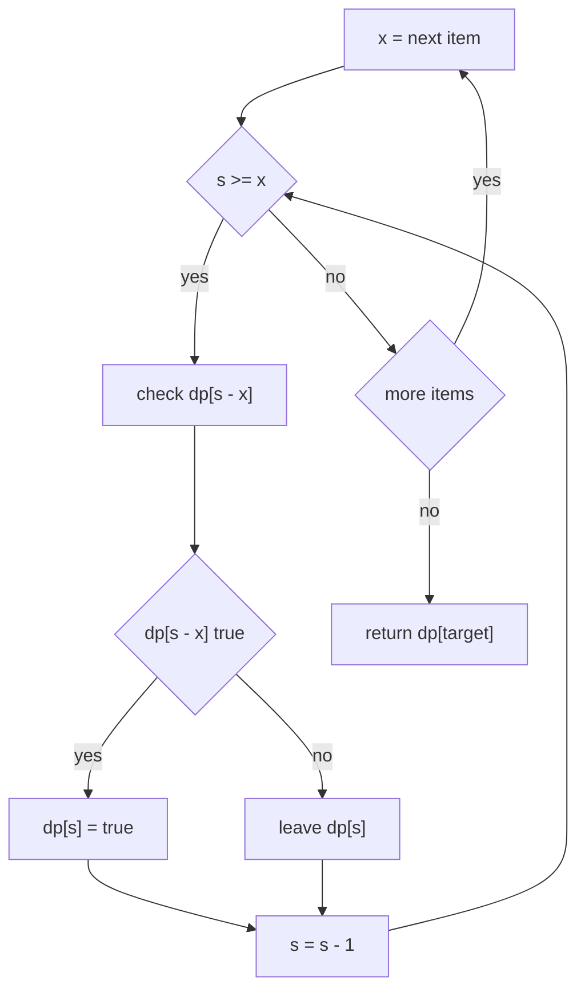
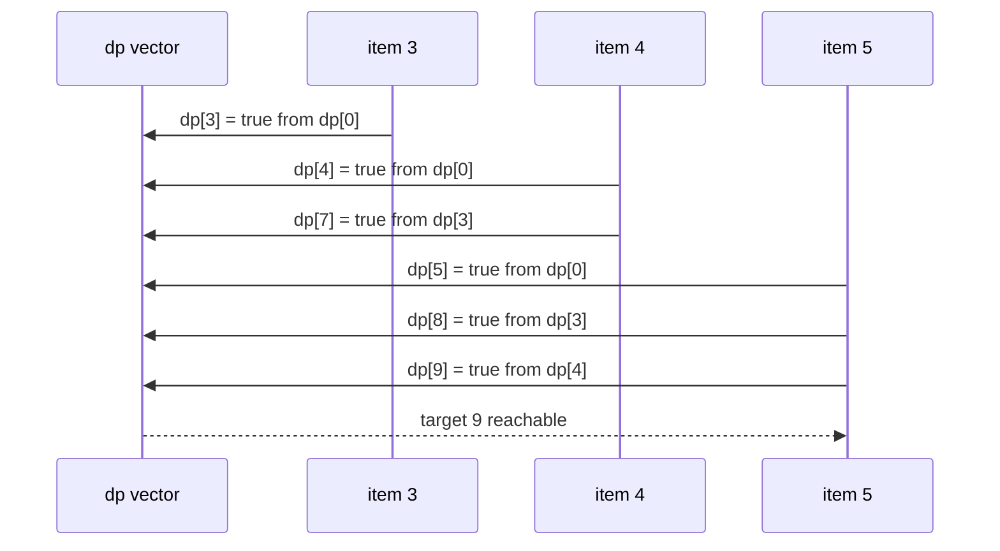

# 217 — Subset sum decision problem (DP boolean).

> **Tier:** Intermediate · **CTCI chapter:** Ch 8 — Recursion and Dynamic Programming
> **Task spec:** [217-subset-sum-decision-problem-dp-boolean.md](../../../tasks/intermediate/217-subset-sum-decision-problem-dp-boolean.md)
> **Solutions:** [Python](../../../solutions/python/intermediate/217-subset-sum-decision-problem-dp-boolean/solution.py) ·
> [Java](../../../solutions/java/intermediate/217-subset-sum-decision-problem-dp-boolean/Solution.java) ·
> [JavaScript](../../../solutions/javascript/intermediate/217-subset-sum-decision-problem-dp-boolean/solution.js) ·
> [C#](../../../solutions/csharp/intermediate/217-subset-sum-decision-problem-dp-boolean/Solution.cs)

## 1. Problem restatement

**Input:** a list of integers `nums` and a target integer `target`. Every element may be
used **at most once** — the empty subset is allowed, and a subset here means "any subset
of the indices", so a repeated value at two different positions is two different choices.

**Output:** a single boolean — `true` when some subset of `nums` sums exactly to `target`,
`false` otherwise.

The task spec states the decision problem in one line, so the contract is fixed by the
assertions the four solution files ship with:

| Call | Result | Why |
| --- | --- | --- |
| `subset_sum([3, 34, 4, 12, 5, 2], 9)` | `true` | `4 + 5`, and also `4 + 3 + 2` |
| `subset_sum([3, 34, 4, 12, 5, 2], 30)` | `false` | every reachable sum misses 30 |
| `subset_sum([], 0)` | `true` | the empty subset sums to 0 |
| `subset_sum([], 5)` | `false` | nothing to add |
| `subset_sum([5], 5)` | `true` | the whole set |
| `subset_sum([5], 3)` | `false` | 5 overshoots |

Python, Java, JavaScript and C# all assert this same table. In addition, all four call an
exponential memoized `subsetSumRecursive` variant on 200 pseudo-random small inputs and
compare it with the DP answer, so the two implementations are pinned to each other.

Constraints the solutions actually enforce: `target < 0` returns `false` immediately
(nothing can sum to a negative number when all relevant arithmetic is additive from 0),
and no other input is rejected.

## 2. Intuition

The naive idea is to enumerate. There are `2^n` subsets, and for each one you add up its
elements to see whether the total is `target`:

```text
procedure brute_force(nums, target)
    for mask ← 0 to 2^n - 1 do
        total ← 0
        for i ← 0 to n - 1 do
            if bit i of mask is set then total ← total + nums[i] end
        end
        if total = target then return true end
    end
    return false
end
```

That is `O(2^n · n)` work for an answer that is a single bit, and at `n = 40` it is
unreachable. The reason it is wasteful is visible in the enumeration: **many different
masks produce the same partial sum**, and once two masks agree on the sum of the items
processed so far, the remaining items affect them identically. The future depends only on
the pair (how many items were processed, what the running total is) — not on *which* items
produced that total.

That collapse is the key insight: replace "which subset" by "which sums are reachable".
Let `dp[s]` mean *"some subset of the items processed so far sums exactly to s"*. Then the
whole exponential family of subsets becomes a single bit vector of length `target + 1`.

Adding an item `x` to the pool of "items processed so far" turns the question into a
one-line recurrence:

- `dp[s]` stays true if it already was (skip `x`), or
- becomes true if `dp[s - x]` was true (take `x`).



The vector never stores a subset, only a reachability bit — that is why the memory is
`target + 1` booleans instead of `2^n` masks.

## 3. Algorithm

1. If `target < 0`, answer `false` outright.
2. Allocate `dp` with `target + 1` boolean slots, all `false`, and set `dp[0] = true`
   (the empty subset exists).
3. For each item `x` in `nums`:
   - Walk `s` from `target` **down to `x`**.
   - If `dp[s - x]` is true, set `dp[s] = true`.
   - Slots below `x` are skipped: they cannot be reached by taking `x`.
4. Return `dp[target]`.

The descending walk is not a micro-optimisation — it is what keeps the item used "at most
once". When `s` decreases, `dp[s - x]` still holds the value from *before* `x` was
considered, so `x` cannot be counted twice in one subset.

```text
procedure subset_sum(nums, target)
    if target < 0 then return false end
    dp ← array of target + 1 booleans, all false
    dp[0] ← true
    for each x in nums do
        for s ← target down to x do
            if dp[s - x] then dp[s] ← true end
        end
    end
    return dp[target]
end
```

The same loop written as a state machine over one item:



An exponential memoized recursion gives the same answer, and the solution files use it as
a cross-check oracle on small inputs: the state `(index, remaining)` is memoized, and each
state branches into "skip item `index`" or "take it".

```text
procedure go(index, remaining)
    if remaining = 0 then return true end
    if index = n or remaining < 0 then return false end
    if (index, remaining) in memo then return memo[(index, remaining)] end
    taken ← go(index + 1, remaining - nums[index])
    skipped ← go(index + 1, remaining)
    memo[(index, remaining)] ← taken or skipped
    return memo[(index, remaining)]
end
```

## 4. Worked example

Trace `subset_sum([3, 34, 4, 12, 5, 2], 9)`. The table shows which indices of `dp`
(only 0..9 are shown) are `true` after each item is processed:

| Step | Item `x` | slots visited | `dp` true at | how `9` gets its answer |
| --- | --- | --- | --- | --- |
| start | — | — | `0` | empty subset |
| 1 | 3 | 9..3 | `0, 3` | 3 is now reachable |
| 2 | 34 | none (`34 > 9`) | `0, 3` | an item above the target is inert |
| 3 | 4 | 9..4 | `0, 3, 4, 7` | `4 = 0 + 4`, `7 = 3 + 4` |
| 4 | 12 | none (`12 > 9`) | `0, 3, 4, 7` | inert again |
| 5 | 5 | 9..5 | `0, 3, 4, 5, 7, 8, 9` | `9 = 4 + 5` — answer becomes true |
| 6 | 2 | 9..2 | `0, 2, 3, 4, 5, 6, 7, 8, 9` | `2 = 0 + 2`, `6 = 4 + 2`, ... |

Two details worth staring at:

- Item 34 and item 12 never touch a slot, because their loop bound `s >= x` is never
  satisfied for `target = 9`. The algorithm does not need a special case for "item larger
  than the target" — the loop bound handles it.
- Once step 5 makes `dp[9]` true, step 6 cannot make it false. Reachability is monotone in
  this DP; there is no "un-take" operation.

Expanded by hand into the subsets behind each new slot at step 5:



## 5. Complexity

With `n = len(nums)` and `T = target`:

| Measure | Bound | Why it holds |
| --- | --- | --- |
| Time, best | O(n · T) | the loop always runs the full product; only `target < 0` returns early in O(1) |
| Time, average | O(n · T) | one boolean read and one boolean write per `(item, sum)` pair |
| Time, worst | O(n · T) | `T + 1 - x` iterations for item `x`; summing over items is at most `n · (T + 1)` |
| Space | O(T) | the single boolean vector; no table over items is needed because each item's update is in place |
| Time, brute force | O(2^n · n) | every mask is materialised and summed |
| Time, memoized recursion | O(n · T) states | but with an O(n · T) hash map and recursion depth `n` |

Two practical consequences the solutions live with:

- `T` is an *input value*, not a bit length, so the DP is only pseudo-polynomial. A target
  of `10^9` makes the allocation impossible while the exponential search might still finish
  early on a lucky instance.
- The in-place vector means the item dimension disappears: memory is `T + 1` booleans, not
  `n · (T + 1)`. In Java, JavaScript and C# an item dimension is unnecessary anyway, as
  item `i` only reads from the row of item `i - 1`.

## 6. Pitfalls and edge cases

- **Empty `nums`.** `dp[0]` is true, every other slot false. Tested: `([], 0) → true`,
  `([], 5) → false`. A loop over items simply never runs.
- **`target = 0`.** Always true: the empty subset sums to 0, and a subset of zeros sums to
  0 too. All four solutions assert this through the `([], 0)` row.
- **Negative target.** Every solution tests `target < 0` first. Without it, Java, C# and
  JavaScript would try to allocate an array of negative length and Python would build an
  empty list, silently returning `false` only by accident.
- **Items equal to the target.** `([5], 5)` is true: the loop runs once at `s = 5`, reads
  `dp[0]`, and sets `dp[5]`.
- **Items larger than the target.** Skipped by the loop bound. `34` and `12` in the worked
  example are never consulted.
- **Descending order is mandatory.** Ascending (`for s = x to target`) would let the same
  item be taken twice — `([5], 5)` would still pass, but `([3], 6)` would wrongly answer
  true. This is the classic 0/1-vs-unbounded bug.
- **Zeros.** `([0], 0)` is true; a zero item writes `dp[s] = dp[s]` for every slot, which is
  harmless. `count_subsets` (task 218) is where a zero changes the *number* rather than the
  answer.
- **Bounds.** `dp[s - x]` is only evaluated for `s >= x`, so the index never goes negative.
  `s` never exceeds `target`, so the upper bound holds by construction.
- **Memory.** The vector needs `target + 1` slots; a large target is an out-of-memory risk
  rather than a wrong answer. Meet-in-the-middle (task 219) exists for that case.
- **Cross-check parity.** The memoized oracle uses `remaining == 0 → true` before the
  index check, which is exactly what makes the empty subset valid — swapping those two
  lines would break `([], 0)`.

## 7. Variants and follow-ups

- **Count instead of decide.** [218-count-subsets-that-sum-to-target-dp.md](../../../tasks/intermediate/218-count-subsets-that-sum-to-target-dp.md)
  replaces the boolean with a counter and `|=` with `+=`; everything else about the loop
  survives unchanged.
- **Target too large for `target + 1` slots.** [219-implement-meet-in-the-middle-for-subset-problems-n-40.md](../../../tasks/intermediate/219-implement-meet-in-the-middle-for-subset-problems-n-40.md)
  splits the array, enumerates `2^(n/2)` sums per half, and binary-searches the complement.
- **Equal-sum partition.** [215-partition-array-into-equal-sum-subsets-subset-sum.md](../../../tasks/intermediate/215-partition-array-into-equal-sum-subsets-subset-sum.md)
  is this DP with `target = total / 2`, plus a parity check on the total.
- **Closest reachable sum.** [292-minimum-subset-sum-difference-dp.md](../../../tasks/intermediate/292-minimum-subset-sum-difference-dp.md)
  keeps the same vector and then reads the nearest hit to `total / 2`.
- **Enumerating the subsets themselves.** [130-generate-all-subsets-power-set-iterative.md](../../../tasks/beginner/130-generate-all-subsets-power-set-iterative.md)
  is the `2^n` side of the trade-off, useful when the subsets rather than a single bit are
  the output.
- The chapter walkthrough in [Recursion and Dynamic Programming](../../ctci/08-recursion-and-dp.md)
  places this DP next to the memoized recursion as the same recurrence, read top-down and
  bottom-up.

## 8. Check yourself

1. Why does the inner loop have to run downwards?

<details><summary>Show answer</summary>

Because the update reads `dp[s - x]` for a *smaller* sum. Running downwards means that when
slot `s` is written, slot `s - x` still holds its value from before item `x` was
considered, so `x` can only be used once. Running upwards would allow `dp[s - x]` to already
contain the effect of `x` on this pass, which turns the 0/1 problem into the unbounded
version.

</details>

2. What exactly does `dp[s]` mean, and does it remember *which* subset?

<details><summary>Show answer</summary>

`dp[s]` is "some subset of the items processed so far sums to `s`". It does not remember
which subset, and it does not need to: the decision answer depends only on reachability,
which is monotone — once a sum is reachable it stays reachable as more items are added. The
reconstructing variant ([291-partition-equal-subset-dp-with-reconstructing-sets.md](../../../tasks/intermediate/291-partition-equal-subset-dp-with-reconstructing-sets.md))
does need the item dimension to walk the choices back.

</details>

3. What does `subset_sum([3, 34, 4, 12, 5, 2], 30)` return, and why is 30 unreachable?

<details><summary>Show answer</summary>

`false`. The whole array sums to 60, but the reachable sums stop at 9 in the trace above:
after all items the vector is true at `0, 2, 3, 4, 5, 6, 7, 8, 9`, so 30 is outside the
reachable set. The largest reachable sums here are small because the two big items (34 and
12) exceed the target and are skipped.

</details>

4. Why can the exponential cross-check oracle be trusted to agree with the DP?

<details><summary>Show answer</summary>

Because they are the same recurrence. The DP computes `reachable(s, i) = reachable(s, i-1)
or reachable(s - x_i, i-1)` for increasing `i`; the memoized recursion computes
`go(i, remaining) = go(i+1, remaining) or go(i+1, remaining - nums[i])` for increasing `i`.
Both are the subset decision expressed as skip-or-take over the items, and the solution
files assert equality on 200 random small instances, which covers the cases the six fixed
assertions do not.

</details>

5. When is the O(n · T) DP the wrong tool?

<details><summary>Show answer</summary>

When `target` is large — the memory is `target + 1` slots, so `target = 10^9` is hopeless
even for `n = 2`. Use meet-in-the-middle (task 219) with `n` around 40, or a bitset over
subsets (task 416) when the values are small enough to pack, or accept exponential search
when `n` is tiny.

</details>
