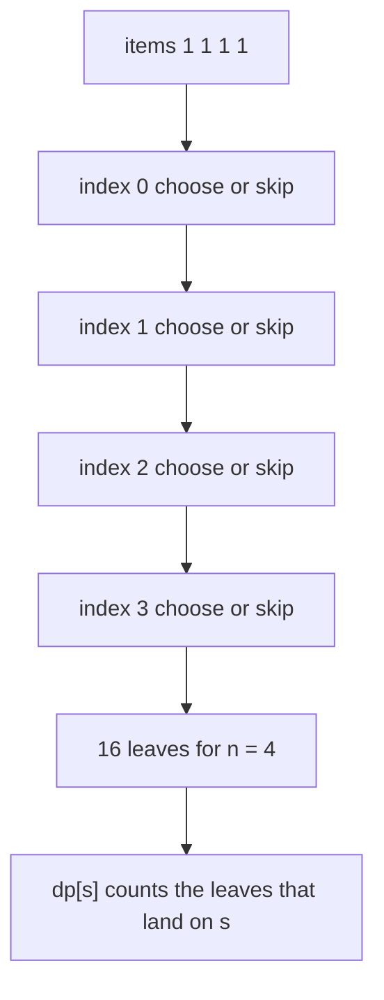
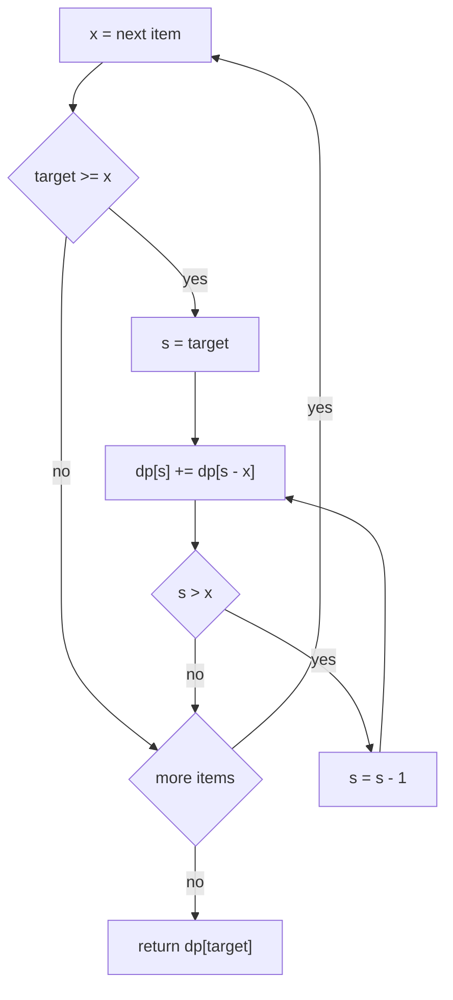
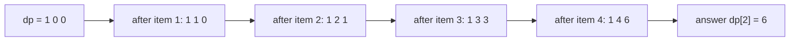

# 218 — Count subsets that sum to target (DP).

> **Tier:** Intermediate · **CTCI chapter:** Ch 8 — Recursion and Dynamic Programming
> **Task spec:** [218-count-subsets-that-sum-to-target-dp.md](../../../tasks/intermediate/218-count-subsets-that-sum-to-target-dp.md)
> **Solutions:** [Python](../../../solutions/python/intermediate/218-count-subsets-that-sum-to-target-dp/solution.py) ·
> [Java](../../../solutions/java/intermediate/218-count-subsets-that-sum-to-target-dp/Solution.java) ·
> [JavaScript](../../../solutions/javascript/intermediate/218-count-subsets-that-sum-to-target-dp/solution.js) ·
> [C#](../../../solutions/csharp/intermediate/218-count-subsets-that-sum-to-target-dp/Solution.cs)

## 1. Problem restatement

**Input:** a list of integers `nums` and a target integer `target`.

**Output:** *how many* subsets of `nums` sum exactly to `target`. Elements are counted
**by index**: two equal values sitting at different positions are two different elements, so
including the one at index 2 or the one at index 5 produces two different subsets even
though the multiset of values is the same.

The spec is one line, so the contract comes from the assertions the four solution files
ship with:

| Call | Result | Why |
| --- | --- | --- |
| `count_subsets([1, 1, 1, 1], 2)` | `6` | `C(4, 2)` pairs of distinct indices |
| `count_subsets([1, 2, 3], 3)` | `2` | `[3]` and `[1, 2]` |
| `count_subsets([], 0)` | `1` | the empty subset |
| `count_subsets([], 5)` | `0` | nothing to add |
| `count_subsets([0], 0)` | `2` | `{}` and `{0}` |
| `count_subsets([2, 3, 5], 5)` | `2` | `[5]` and `[2, 3]` |
| `count_subsets([1, 2, 3], 100)` | `0` | no subset reaches 100 |

The `[0], 0 → 2` row is the sharpest one: it shows the counting unit is the *index*, not the
value. `[1, 2, 3], 100 → 0` shows the table simply never reaches that far and returns the
initial zero. The Python file notes this index-based convention in its docstring; the Java,
JavaScript and C# files assert the same six rows.

## 2. Intuition

The naive method generates every subset and counts the ones that hit the target:

```text
procedure brute_count(nums, target)
    count ← 0
    for mask ← 0 to 2^n - 1 do
        total ← 0
        for i ← 0 to n - 1 do
            if bit i of mask is set then total ← total + nums[i] end
        end
        if total = target then count ← count + 1 end
    end
    return count
end
```

The subset-sum decision DP from [217](../../../tasks/intermediate/217-subset-sum-decision-problem-dp-boolean.md)
already proved that only the *sum* matters, not the identity of the mask. For counting, the
same collapse applies with one extra observation: the number of ways to reach a sum is a
quantity you can accumulate.

Let `dp[s]` mean *"how many subsets of the items processed so far sum exactly to `s`"*. When
item `x` joins the pool, every subset counted by `dp[s - x]` can be extended by taking `x`
and lands on `s`. So:

- `dp[s]` keeps its old count (subsets that skip `x`), and
- `dp[s]` gains `dp[s - x]` (subsets that take `x`).

Reachability was a boolean OR; counting is arithmetic addition. The two implementations
differ by exactly that: `dp[s] = dp[s] | dp[s - x]` becomes `dp[s] += dp[s - x]`.



The tree above has `2^4 = 16` leaves, but the DP never builds it: it groups leaves by the
running sum, which is the only thing that decides whether a leaf still matters.

## 3. Algorithm

1. If `target < 0`, return `0` — no subset of a non-negative-indexed additive walk can sum
   to a negative number.
2. Allocate `dp` with `target + 1` counters, all `0`, and set `dp[0] = 1`: exactly one
   subset (the empty one) sums to 0.
3. For each item `x` in `nums`:
   - Walk `s` from `target` **down to `x`**.
   - `dp[s] += dp[s - x]`.
4. Return `dp[target]`.

The descending walk again exists to keep each item usable at most once: when `s` is written,
`dp[s - x]` still holds the count from before item `x` was considered.

```text
procedure count_subsets(nums, target)
    if target < 0 then return 0 end
    dp ← array of target + 1 counters, all 0
    dp[0] ← 1
    for each x in nums do
        for s ← target down to x do
            dp[s] ← dp[s] + dp[s - x]
        end
    end
    return dp[target]
end
```

Read as a flow, with the zero-item branch included:



When `x = 0` the loop is a single iteration at `s = 0`, and `dp[0] += dp[0]` doubles the
count — precisely the asserted `[0], 0 → 2` behaviour.

## 4. Worked example

Trace `count_subsets([1, 1, 1, 1], 2)`. Only slots `0..2` exist; the item loop walks from
`s = 2` down to `s = 1` every time (the `s >= x` bound excludes `s = 0`). Before each item,
`dp = [1, 0, 0]`:

| Step | Item `x` | `s` | update | `dp` after |
| --- | --- | --- | --- | --- |
| start | — | — | `dp[0] = 1` | `[1, 0, 0]` |
| 1 | 1 | 2 | `dp[2] += dp[1]` → `0` | `[1, 0, 0]` |
| 1 | 1 | 1 | `dp[1] += dp[0]` → `1` | `[1, 1, 0]` |
| 2 | 1 | 2 | `dp[2] += dp[1]` → `1` | `[1, 1, 1]` |
| 2 | 1 | 1 | `dp[1] += dp[0]` → `2` | `[1, 2, 1]` |
| 3 | 1 | 2 | `dp[2] += dp[1]` → `3` | `[1, 2, 3]` |
| 3 | 1 | 1 | `dp[1] += dp[0]` → `3` | `[1, 3, 3]` |
| 4 | 1 | 2 | `dp[2] += dp[1]` → `6` | `[1, 4, 6]` |
| 4 | 1 | 1 | `dp[1] += dp[0]` → `4` | `[1, 4, 6]` |

`dp[2] = 6`, matching `C(4, 2) = 6` — every pair of indices is one subset.

Two things to notice in the trace:

- The order inside one item matters: at item 2 the slot `s = 2` is updated *before*
  `s = 1`, so it reads the `dp[1]` value left by item 1 (`1`), not the value it is about to
  write (`2`). That is what prevents "take the same item twice".
- `dp[0]` is never revisited (`s` stops at 1), which is why the empty subset is counted
  exactly once no matter how many items exist.

The same growth pictured as a doubling of the reachable count:



## 5. Complexity

With `n = len(nums)` and `T = target`:

| Measure | Bound | Why it holds |
| --- | --- | --- |
| Time, best | O(n · T) | only `target < 0` returns early; the loops always run the full product |
| Time, average | O(n · T) | one addition and one read per `(item, sum)` pair |
| Time, worst | O(n · T) | item `x` costs `T + 1 - x` additions, at most `T + 1` each |
| Space | O(T) | one counter array; the item dimension is elided because the update is in place |
| Time, brute force | O(2^n · n) | every subset is materialised and summed |
| Value range | counts reach `2^n` | with `n` items there are `2^n` subsets, so the counter can be that large |

The counter type is where the four solutions diverge in a way that matters:

- **Python** uses arbitrary-precision integers, so no overflow is possible.
- **Java** and **C#** use `long` (`2^63 - 1`), which covers `n` up to about 62 items.
- **JavaScript** uses a `Number`; integers stay exact only up to `2^53`, so a count beyond
  that is silently approximate. The shipped assertions stay tiny for exactly this reason.

## 6. Pitfalls and edge cases

- **Empty `nums`.** `dp[0] = 1` survives, every other slot stays `0`. Asserted as
  `([], 0) → 1` and `([], 5) → 0`. The empty set is a *counted* subset, not an error.
- **`target = 0` with nonzero items.** Counts only the empty subset unless a zero appears.
  The DP does not need a special case.
- **Zero items.** Each `0` doubles `dp[0]` (and any other reachable slot, though for the
  shipped assertions only `dp[0]` is affected). This is the direct consequence of counting
  by index, and it is asserted with `([0], 0) → 2`.
- **Repeated values.** `[1, 1, 1, 1]` with `target = 2` gives `6`, not `1`. If the task
  wanted *distinct multisets* rather than index subsets, the answer would be `1`; the
  docstring pins the index convention.
- **Negative target.** The guard must come first. Without it, Java, JavaScript and C#
  would try to allocate an array of negative length and Python would produce `[]` and
  return `0` by accident.
- **Descending inner loop.** Ascending order turns the recurrence into the unbounded
  coin-change count: `([1], 3)` would report a "subset" using the item three times. The
  shipped code always descends.
- **Items larger than the target.** Skipped by the loop bound, same as task 217.
- **Negative items.** The array is indexed by sum, so a negative value would push indices
  below zero. The solution files assume non-negative values; the assertions use only
  `1..3` magnitudes and a single `0`.
- **Overflow.** Java/C# `long` and JavaScript `Number` can both be exceeded by large `n`;
  Python cannot. Any port that switches Java to `int` breaks `[1, 1, ..., 1]` (34 ones)
  immediately — `C(34, 17)` is far beyond `2^31`.
- **Cost of a big target.** Memory is `T + 1` counters; a huge `target` is an allocation
  failure, not a wrong answer.

## 7. Variants and follow-ups

- **Decision instead of count.** [217-subset-sum-decision-problem-dp-boolean.md](../../../tasks/intermediate/217-subset-sum-decision-problem-dp-boolean.md)
  keeps the identical loop with `true`/`false` slots and `|=` instead of `+=`.
- **Count without a target-sized table.** [219-implement-meet-in-the-middle-for-subset-problems-n-40.md](../../../tasks/intermediate/219-implement-meet-in-the-middle-for-subset-problems-n-40.md)
  enumerates `2^(n/2)` sums per half so a large `target` is fine.
- **Partition into equal halves.** [215-partition-array-into-equal-sum-subsets-subset-sum.md](../../../tasks/intermediate/215-partition-array-into-equal-sum-subsets-subset-sum.md)
  asks the decision question at `total / 2` after a parity check.
- **Counting other combinatorial objects the same way.** [378-implement-integer-partition-dp-count-ways.md](../../../tasks/intermediate/378-implement-integer-partition-dp-count-ways.md)
  and [308-distinct-subsequences-count-dp.md](../../../tasks/intermediate/308-distinct-subsequences-count-dp.md)
  use the same "accumulate counts into a table" shape over different state meanings.
- **Enumerating the subsets.** [130-generate-all-subsets-power-set-iterative.md](../../../tasks/beginner/130-generate-all-subsets-power-set-iterative.md)
  is the exponential baseline this DP compresses.
- The chapter walkthrough in [Recursion and Dynamic Programming](../../ctci/08-recursion-and-dp.md)
  develops this counting DP from the same "state = remaining sum" idea as the decision
  version.

## 8. Check yourself

1. Why is `count_subsets([0], 0)` two rather than one?

<details><summary>Show answer</summary>

Because subsets are counted by index. The empty subset sums to 0, and the subset containing
the single element (whose value happens to be 0) also sums to 0. The DP sees `dp[0] = 1`
before the item and doubles it to `2` at the item. If the task had asked for distinct
multisets, the answer would be `1`.

</details>

2. What would `count_subsets([1], 3)` return if the inner loop ran upwards?

<details><summary>Show answer</summary>

`1`, which is wrong. Ascending order would let slot `s = 1` write into slot `s = 2` on the
same item pass, and then `s = 2` write into `s = 3`, effectively using the single `1` three
times. Descending keeps every read strictly "older" than every write, so each item is used
at most once.

</details>

3. How many subsets of four 1s sum to 2, and where does that number appear in the trace?

<details><summary>Show answer</summary>

Six, and it is exactly `dp[2]` after the fourth item (`[1, 4, 6]`). The recurrence produces
the binomial coefficients: `dp[1]` ends at `4 = C(4, 1)` and `dp[2]` at `6 = C(4, 2)`, which
is the trace's way of enumerating index pairs.

</details>

4. Why does the DP need only `T + 1` slots when the number of subsets is exponential?

<details><summary>Show answer</summary>

Because subsets that share a running sum are interchangeable for the rest of the
computation: the remaining items multiply the count, they do not care which subset produced
the sum. So the DP stores one counter per reachable sum instead of one entry per subset. The
exponential object is only ever represented through its count.

</details>

5. Which language in this repository is the only one that cannot overflow a count?

<details><summary>Show answer</summary>

Python, whose integers are arbitrary precision. Java and C# cap at `2^63 - 1` with `long`,
and JavaScript's `Number` is exact only to `2^53`. The assertions avoid the issue by
using at most four items, but a port to Java `int` would break much earlier.

</details>
