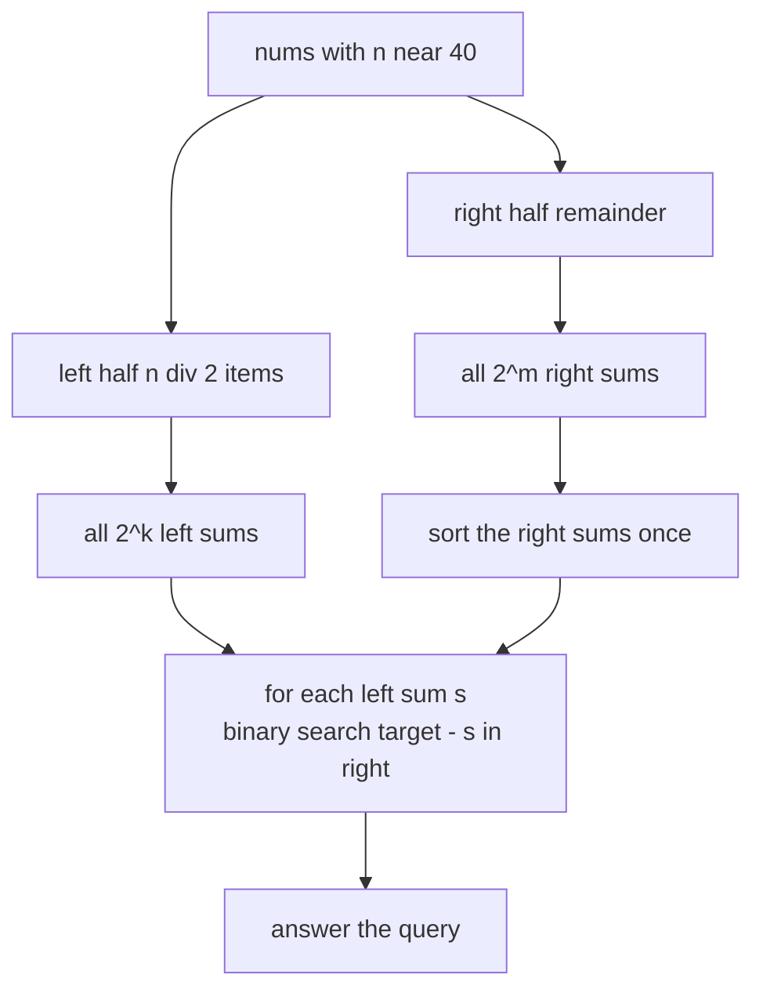
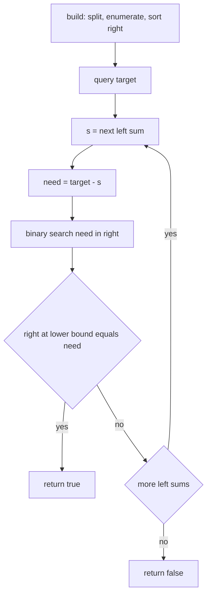
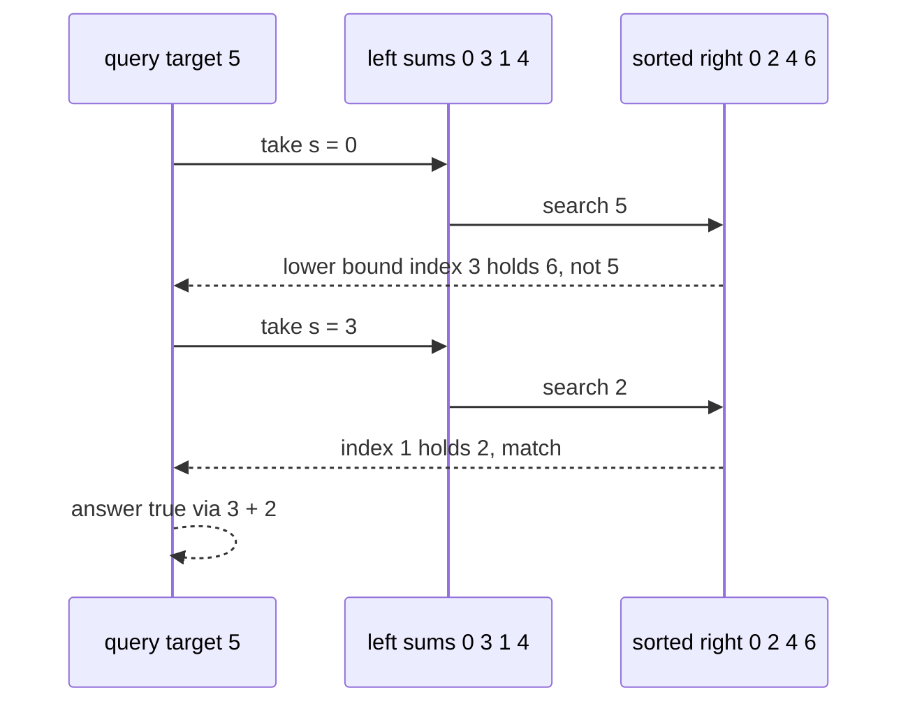

# 219 — Implement meet-in-the-middle for subset problems (n~40).

> **Tier:** Intermediate · **CTCI chapter:** Ch 8 — Recursion and Dynamic Programming
> **Task spec:** [219-implement-meet-in-the-middle-for-subset-problems-n-40.md](../../../tasks/intermediate/219-implement-meet-in-the-middle-for-subset-problems-n-40.md)
> **Solutions:** [Python](../../../solutions/python/intermediate/219-implement-meet-in-the-middle-for-subset-problems-n-40/solution.py) ·
> [Java](../../../solutions/java/intermediate/219-implement-meet-in-the-middle-for-subset-problems-n-40/Solution.java) ·
> [JavaScript](../../../solutions/javascript/intermediate/219-implement-meet-in-the-middle-for-subset-problems-n-40/solution.js) ·
> [C#](../../../solutions/csharp/intermediate/219-implement-meet-in-the-middle-for-subset-problems-n-40/Solution.cs)

## 1. Problem restatement

**Input:** an array `nums` of about 40 values, then any number of *queries*, each query
being a target integer.

**Output:** for a decision query, whether some subset of `nums` (any size, including the
empty one) sums exactly to the target; for the closest query, the achievable subset sum
that is nearest to the target. Each query is answered against a structure that is built
once from `nums`.

The task spec is one line, so the contract is fixed by the code and assertions that ship
with it:

| Fact | Where it comes from |
| --- | --- |
| build once, then answer queries | the solutions expose a `MeetInTheMiddle` object whose constructor does the work |
| `exists(target)` returns a boolean | asserted against brute force for `n = 16` and against a bitset oracle for `n = 40` |
| `closest(target)` returns a sum value | Python cross-checks it against every subset sum on an `n = 18` array, comparing `abs(s - target)` |
| `exists(0)` is `true` | the empty subset is generated by both halves (each half's sum list starts at 0) |
| `exists(total)` is `true`, `exists(total + 1)` is `false` | asserted for the `n = 40` instance in all four languages |
| `n = 40` means `2^20 = 1M` values per half | stated in the Python docstring as the reason the split is affordable |

The C# file implements only the decision query (`Exists`); the Python, Java and JavaScript
files add `closest` as well.

## 2. Intuition

The obvious approach is the subset-sum DP of [task 217](../../../tasks/intermediate/217-subset-sum-decision-problem-dp-boolean.md):
a boolean vector of `target + 1` slots, `O(n · target)` time. It fails here for a reason
that has nothing to do with `n`: a 40-element query can ask about a *huge* target, and the
vector's size is the target. The other extreme, enumerating all subsets, is `2^40` — about a
thousand billion — which is far beyond reach.

Meet in the middle attacks the exponent instead of the target. Split the array into two
halves of about `n / 2` elements each, and enumerate the `2^(n/2)` subset sums of each half
independently:

- at `n = 40` each half is `2^20 = 1,048,576` sums — the number the solutions quote;
- every subset of the *whole* array is a subset of the left half plus a subset of the right
  half, so *every* achievable sum is `left_sum + right_sum`.

That is the key insight: one exponential enumeration becomes two half-sized ones, and
combining them is a **search problem** rather than a product. Sort the right half once, then
for a query `target` and a left sum `s`, the question "is `target - s` in the right half?"
is a binary search.



Nothing about the combination is specific to the decision problem: the same sorted right
list answers "closest sum to the target" by looking at the two neighbours around the
insertion point.

## 3. Algorithm

Build phase:

1. Let `mid = n / 2` (integer division). The left half is `nums[0..mid)` and the right half
   is `nums[mid..n)`.
2. Enumerate the subset sums of a half: start from `[0]` and, for each value `x`, append
   `s + x` for every sum `s` already in the list. After `k` values the list has `2^k`
   entries, one per subset, in no particular order.
3. Keep the left list as generated, and **sort the right list** — this is the only
   preprocessing that a query needs.

Query phase (`exists`):

1. For each left sum `s`, compute the needed complement `need = target - s`.
2. Binary search `need` in the sorted right list (the lower bound: the first index whose
   value is at least `need`).
3. If that index exists and holds exactly `need`, answer `true` immediately.
4. If no left sum produced a hit, answer `false`.

Query phase (`closest`):

1. For each left sum `s`, compute `need = target - s` and its lower bound `i`.
2. Examine the candidates at `i - 1` and `i` (the nearest values below and at/above
   `need`), skipping indices outside the array.
3. Keep the candidate whose distance `abs(s + right[j] - target)` is smallest, and return it
   after the scan.

```text
function subset_sums(values)
    sums ← list containing 0
    for each x in values do
        for each s in a copy of the current sums do
            append s + x to sums
        end
    end
    return sums
end

procedure build(nums)
    mid ← length(nums) / 2
    left ← subset_sums(nums[0 .. mid))
    right ← sort(subset_sums(nums[mid .. length(nums))))
end

function exists(target)
    for each s in left do
        need ← target - s
        i ← lower_bound(right, need)
        if i < length(right) and right[i] = need then return true end
    end
    return false
end

function lower_bound(a, value)
    lo ← 0
    hi ← length(a)
    while lo < hi do
        mid ← (lo + hi) / 2
        if a[mid] < value then lo ← mid + 1 else hi ← mid end
    end
    return lo
end
```

The C# file stops after `exists`; Python, Java and JavaScript continue with:

```text
function closest(target)
    best ← undefined
    for each s in left do
        need ← target - s
        i ← lower_bound(right, need)
        for each j in (i - 1, i) do
            if 0 <= j and j < length(right) then
                candidate ← s + right[j]
                if best is undefined or abs(candidate - target) < abs(best - target) then
                    best ← candidate
                end
            end
        end
    end
    return best
end
```

The whole pipeline as a flow:



## 4. Worked example

Query `exists(5)` on `nums = [3, 1, 4, 2]`. `mid = 2`, so the halves are `[3, 1]` and
`[4, 2]`.

Enumerating the left half: start `[0]`; value 3 appends `3`; value 1 appends `1` and `4`.
The right half: start `[0]`; value 4 appends `4`; value 2 appends `2` and `6`, then sorting
gives `[0, 2, 4, 6]`.

| Step | left sum `s` | `need = 5 - s` | lower bound `i` in `[0, 2, 4, 6]` | `right[i]` | match? |
| --- | --- | --- | --- | --- | --- |
| 1 | 0 | 5 | 3 | 6 | no |
| 2 | 3 | 2 | 1 | 2 | **yes** → return `true` |

The matching pair is `3 + 2 = 5`: left sum 3 is the subset `{3}` and right sum 2 is the
subset `{2}`, so the witness subset is `{3, 2}`. The scan stops as soon as a match appears,
so the remaining left sums are never examined.



The `closest` variant on the same data with `target = 5` visits every left sum and keeps the
best candidate, including the two-sided lookups that the plain existence query ignores:

| Step | `s` | `need` | candidates `j = i - 1, i` | candidate sums | best so far |
| --- | --- | --- | --- | --- | --- |
| 1 | 0 | 5 | 2, 3 | 4, 6 | 4 |
| 2 | 3 | 2 | 0, 1 | 3, 5 | 5 |
| 3 | 1 | 4 | 1, 2 | 3, 5 | 5 |
| 4 | 4 | 1 | 0, 1 | 4, 6 | 5 |

The winner is exactly 5, the target itself, because a `closest` scan contains the `exists`
answer as a special case when the complement is present.

## 5. Complexity

Let `n = len(nums)`, `L = 2^floor(n/2)` for the left half and `R = 2^ceil(n/2)` for the right
half be the two enumeration sizes (with `n = 40`, both are `2^20 = 1,048,576`).

| Measure | Bound | Why it holds |
| --- | --- | --- |
| Build time | O(L + R · log R) | enumerate both halves linearly, then sort the right one |
| Build space | O(L + R) | one array per half, holding every subset sum (with multiplicity) |
| Query time (`exists`) | O(L · log R) | one binary search per left sum, early exit on the first hit |
| Query time (`closest`) | O(L · log R) | the same scan; each step inspects exactly two candidates |
| Brute force for comparison | O(2^n · n) | `2^40` subsets at `n = 40` — the reason the split exists |
| DP for comparison (task 217) | O(n · target) time, O(target) space | unusable when `target` is large, which is exactly the `n = 40` case |

Two consequences the solution files live with:

- Sorting the *right* half only, and scanning the *left* half unsorted, is enough: the split
  is asymmetric on purpose, because only one side needs order for the lookups.
- The memory is `L + R` sums, not `2^n` subsets. In compiled languages `2^20` `long`
  values is 8 MB per half; the Python docstring says this is "fine in compiled languages and
  acceptable here", acknowledging that Python integers are heavier.

## 6. Pitfalls and edge cases

- **Empty array.** `mid = 0`, so the left half is `[]` and the right half is `[]`; both sum
  lists are `[0]`. `exists(0)` therefore returns `true` (the empty subset) and any nonzero
  target returns `false`.
- **Query targets above the total.** `exists(total + 1)` is asserted `false` for the
  `n = 40` instance. Nothing in the structure needs a sum bound, so the query costs the same
  as any other.
- **The empty subset is always available.** Because both `subset_sums` calls start from
  `[0]`, `exists(0)` is `true` for every input, including the empty array. The `n = 40`
  assertions rely on this.
- **Duplicates and multiplicities.** `subset_sums` keeps one entry per *subset*, so the same
  numeric sum can appear many times. That is harmless for existence (`binary search` finds
  one of them) and for `closest`; it would matter if you wanted the number of distinct
  achievable sums, which would need a dedup pass.
- **The split point.** `n / 2` with integer division puts the extra element on the right
  when `n` is odd, which is why the table above writes `L` and `R` separately. A split that
  put all the elements on one side would lose the `2^(n/2)` bound entirely.
- **Which half gets sorted.** Only `right` is sorted in every solution. Sorting `left`
  instead would work symmetrically; sorting neither makes every query linear in `R`.
- **Early exit.** `exists` returns at the first match, so the best case is one left sum
  rather than `L` of them. `closest` cannot exit early — it must see every left sum.
- **`closest` index arithmetic.** The two candidates are `i - 1` and `i`; `i` can equal
  `length(right)` (complement above every right sum) and `i - 1` can be `-1` (complement
  below every right sum). Every solution guards both ends; Java and C# additionally return
  `0` if nothing was ever recorded, although the right list is never empty in practice.
- **Integer width.** The sums are `long` in Java and C# so that 40 values of moderate size
  cannot overflow; JavaScript uses `Number`, exact up to `2^53`. There is no modulus here,
  so widening is the only defence.
- **The bitset oracle is not the algorithm.** The solution files' `subsetExistsBitset`
  helper (a Python/Java/C# `BigInteger` bitset, `bits |= bits << x`) exists only to give the
  `n = 40` tests a second, independent answer; it needs the total sum to be small enough to
  hold in memory and it breaks for negative values.
- **`closest` returns a sum, not a distance.** Callers compare `abs(result - target)`
  themselves, which is how the tests check it.

## 7. Variants and follow-ups

- **Decide with a target-sized table.** [217-subset-sum-decision-problem-dp-boolean.md](../../../tasks/intermediate/217-subset-sum-decision-problem-dp-boolean.md)
  is the `O(n · target)` alternative that this task exists to sidestep.
- **Count the ways.** [218-count-subsets-that-sum-to-target-dp.md](../../../tasks/intermediate/218-count-subsets-that-sum-to-target-dp.md)
  counts subsets; a meet-in-the-middle count needs the sorted right half plus a
  count of equal values at each index rather than a single lookup.
- **Nearest achievable sum.** [292-minimum-subset-sum-difference-dp.md](../../../tasks/intermediate/292-minimum-subset-sum-difference-dp.md)
  solves the same "closest" question for small targets with a DP; the `closest` query here
  is the large-target counterpart.
- **Bitset speed-ups for the same family.** [416-implement-bitset-dp-optimizations-for-subset-problems.md](../../../tasks/advanced/416-implement-bitset-dp-optimizations-for-subset-problems.md)
  packs the reachability vector into machine words, which beats both approaches when the
  total sum is small.
- **Routing problems on subsets.** [220-implement-bitmask-dp-for-tsp-small-n.md](../../../tasks/intermediate/220-implement-bitmask-dp-for-tsp-small-n.md)
  uses a different way of making subsets tractable: index the states by a bitmask instead of
  enumerating sums, which is the right tool when the state is "which cities are visited".
- **Approximate answers when even `2^(n/2)` is too much.** [537-implement-approximate-tsp-heuristics-2-opt-3-opt.md](../../../tasks/advanced/537-implement-approximate-tsp-heuristics-2-opt-3-opt.md)
  gives up exactness rather than the split.
- **Enumerating subsets directly.** [130-generate-all-subsets-power-set-iterative.md](../../../tasks/beginner/130-generate-all-subsets-power-set-iterative.md)
  is the enumeration primitive that `subset_sums` uses in its "append `s + x`" form.
- The chapter walkthrough in [Recursion and Dynamic Programming](../../ctci/08-recursion-and-dp.md)
  treats meet-in-the-middle as the bridge between recursion and dynamic programming.

## 8. Check yourself

1. Why does the structure sort only the right half?

<details><summary>Show answer</summary>

Because only one side needs to be searchable. The query loops over every left sum and asks
"does `target - s` exist on the right?", which needs the right side in sorted order for a
binary search. Sorting the left half as well would cost another `O(L log L)` build time and
change nothing, since the left half is scanned exhaustively anyway.

</details>

2. At `n = 40`, how many sums per half, and what is the brute-force alternative?

<details><summary>Show answer</summary>

`2^20 = 1,048,576` sums per half, as the Python docstring states. The brute-force
alternative is `2^40` subsets, and the solution files avoid it by cross-checking the
`n = 40` answers against a bitset oracle (`bits |= bits << x`) instead of enumerating.

</details>

3. `exists(0)` on an empty array — what is the answer and why?

<details><summary>Show answer</summary>

`true`. `mid = 0` splits nothing, `subset_sums` of an empty list is `[0]` on both sides, and
the very first left sum (`s = 0`) looks for the complement `0`, which is present. The empty
subset counts, so 0 is always achievable.

</details>

4. Why does `closest` look at exactly two right-hand candidates per left sum?

<details><summary>Show answer</summary>

The lower bound gives the first index `i` whose value is at least `need`. Among the sorted
right sums, the closest value to `need` is either that one or its predecessor — no other
index can be nearer, because every index below `i - 1` is at most `right[i-1]` and every
index above `i` is at least `right[i]`.

</details>

5. When is the `O(n · target)` DP from task 217 actually better than this structure?

<details><summary>Show answer</summary>

When the target is small and there are many queries. Build time here is `O(2^(n/2))` even
for `n = 12`, where the DP costs a few dozen slots; and each query then costs `L log R`
instead of a single vector lookup. Meet in the middle wins precisely when `n` is near 40 or
the target is too large to index an array with.

</details>
