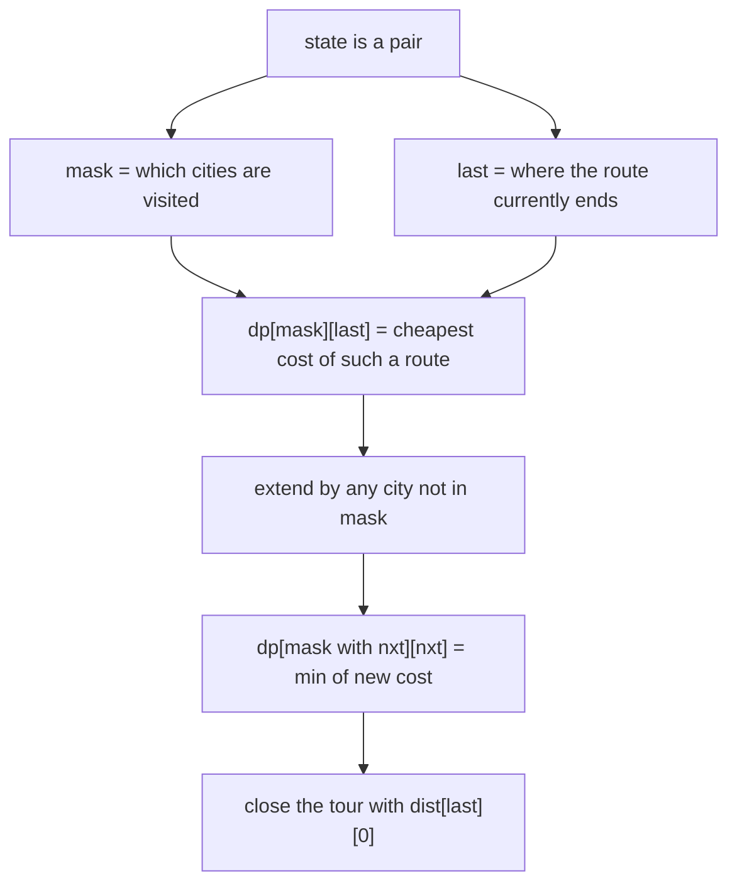
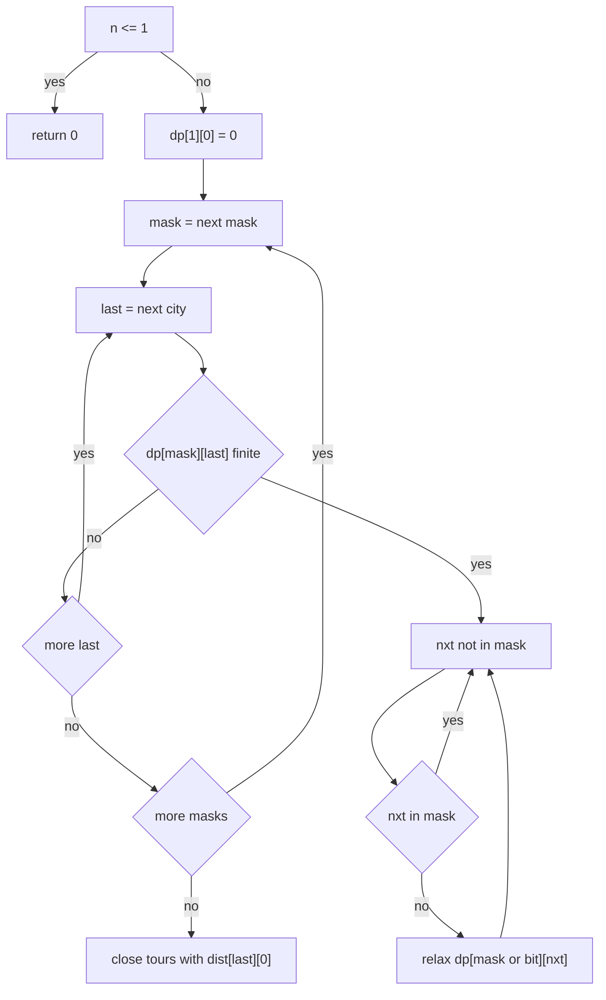
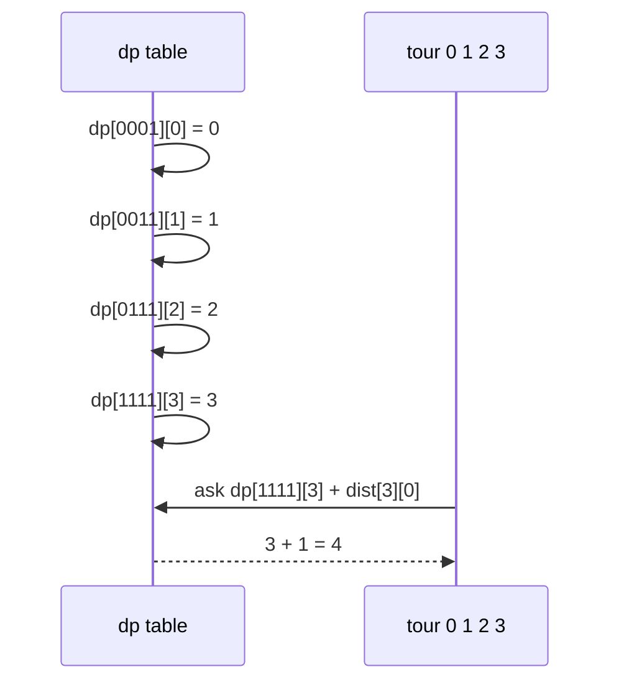
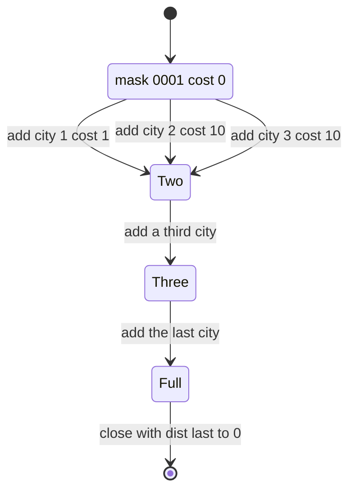

# 220 — Implement bitmask DP for TSP small N.

> **Tier:** Intermediate · **CTCI chapter:** Ch 8 — Recursion and Dynamic Programming
> **Task spec:** [220-implement-bitmask-dp-for-tsp-small-n.md](../../../tasks/intermediate/220-implement-bitmask-dp-for-tsp-small-n.md)
> **Solutions:** [Python](../../../solutions/python/intermediate/220-implement-bitmask-dp-for-tsp-small-n/solution.py) ·
> [Java](../../../solutions/java/intermediate/220-implement-bitmask-dp-for-tsp-small-n/Solution.java) ·
> [JavaScript](../../../solutions/javascript/intermediate/220-implement-bitmask-dp-for-tsp-small-n/solution.js) ·
> [C#](../../../solutions/csharp/intermediate/220-implement-bitmask-dp-for-tsp-small-n/Solution.cs)

## 1. Problem restatement

**Input:** an `n × n` cost matrix `dist`, where `dist[i][j]` is the cost of travelling from
city `i` to city `j`. The graph is assumed complete: every pair has a cost, so there is
always a tour.

**Output:** the cost of the cheapest closed tour that starts at city `0`, visits every city
exactly once, and returns to city `0` — the travelling salesman objective. The task is
framed as "small N", and the Python docstring states the practical range as **`n <= ~12`**.

The task spec is one line, so the contract is fixed by the assertions the four solutions
ship with:

| Call | Result | Why |
| --- | --- | --- |
| `tsp(square)` with 4 cities | `4` | the cycle `0-1-2-3-0` uses four weight-1 edges |
| `tsp(triangle)` | `6` | every cycle uses the weights `1 + 2 + 3` |
| `tsp([[0]])` | `0` | a single city needs no travel |
| `tsp([[0, 7], [7, 0]])` | `14` | out and back: `7 + 7` |
| random 7-city symmetric instance | equals brute force | all six permutations of `1..6` are enumerated and compared |

The brute-force cross-check is the strongest statement in the files: Python uses
`itertools.permutations(range(1, n))`, Java and C# walk permutations with their own
`nextPermutation` helper, and JavaScript permutes recursively — all producing the same
`(n - 1)! = 720` tours for `n = 7`.

## 2. Intuition

The naive answer is permutation search: fix city 0 as the start, try all `(n - 1)!` orders of
the rest, add the return edge, keep the minimum. At `n = 7` that is 720 tours — fine; at
`n = 12` it is `39,916,800`; at `n = 15` it is past 87 billion.

The waste in that search is the same one that powers every subset DP of this chapter: many
*different prefixes* end in the same place having visited the same set of cities. Two partial
routes that have visited `{0, 2, 5, 7}` and currently sit at city 5 are interchangeable for
everything that remains — the future depends only on the **set of visited cities** and the
**current city**, never on the order in which the set was visited.

So the state is a pair, and the natural encoding for "set of cities" is a bitmask: bit `i` of
`mask` is set when city `i` has been visited. With that state:

- `mask` has `2^n` possible values and `last` has `n`, giving `2^n · n` states;
- each state relaxes at most `n` outgoing edges;
- and the answer is a closing step over the `n` states of the full mask.



The recursion behind the table is short enough to write down: the best route ending at `last`
having visited exactly `mask` is the best route ending at some earlier city `prev` on
`mask` minus `last`, plus the edge `prev → last`.

## 3. Algorithm

Held–Karp, bottom-up over masks:

1. If `n <= 1`, return `0` — nothing to visit.
2. Let `full = (1 << n) - 1` and `INF` be a large sentinel (Python `inf`, JavaScript
   `Infinity`, Java `Long.MAX_VALUE / 4`, C# `long.MaxValue / 4`).
3. Allocate `dp` as `2^n` rows of `n` values, all `INF`.
4. Seed the start: `dp[1][0] = 0` — the route that has visited only city `0` and ends there
   costs nothing.
5. For `mask` from `0` to `full`, for each `last` with `dp[mask][last]` finite, for each
   `nxt` whose bit is **not** set in `mask`:
   - `candidate = dp[mask][last] + dist[last][nxt]`
   - `dp[mask | (1 << nxt)][nxt] = min(..., candidate)`
6. Answer: `min` over `last` of `dp[full][last] + dist[last][0]`.

Step 5 is safe to run in increasing `mask` order because every transition sets a new bit, so
`mask | (1 << nxt) > mask` — a state is always filled before it is read.

```text
function tsp(dist)
    n ← length(dist)
    if n <= 1 then return 0 end
    full ← (1 << n) - 1
    dp ← table of size (1 << n) by n filled with INF
    dp[1][0] ← 0
    for mask ← 0 to full do
        for last ← 0 to n - 1 do
            if dp[mask][last] = INF then continue end
            for nxt ← 0 to n - 1 do
                if bit nxt of mask is set then continue end
                new_mask ← mask with bit nxt set
                candidate ← dp[mask][last] + dist[last][nxt]
                if candidate < dp[new_mask][nxt] then
                    dp[new_mask][nxt] ← candidate
                end
            end
        end
    end
    best ← INF
    for last ← 0 to n - 1 do
        if dp[full][last] != INF then
            best ← min(best, dp[full][last] + dist[last][0])
        end
    end
    return best
end
```

As a flow, with the two levels of skipping made explicit:



The final loop is not decoration. `dp[full][0]` is `INF` in every solution because the
transition loop never revisits a city that is already in the mask, and city 0 is in the mask
from the start — so the return to city 0 is added explicitly by the closing loop.

## 4. Worked example

Run `tsp` on the asserted square, whose costs are:

| from / to | 0 | 1 | 2 | 3 |
| --- | --- | --- | --- | --- |
| 0 | 0 | 1 | 10 | 10 |
| 1 | 1 | 0 | 1 | 10 |
| 2 | 10 | 1 | 0 | 1 |
| 3 | 1 | 10 | 1 | 0 |

Only the states that can still lead to the optimum are shown. `mask` is written in binary
with bit 0 on the right.

| `mask` | visited | `last` | `dp[mask][last]` | relaxations taken |
| --- | --- | --- | --- | --- |
| `0001` | `{0}` | 0 | 0 | `→1` gives 1 at mask `0011`; `→2` gives 10 at `0101`; `→3` gives 10 at `1001` |
| `0011` | `{0,1}` | 1 | 1 | `→2` gives 2 at `0111`; `→3` gives 11 at `1011` |
| `0101` | `{0,2}` | 2 | 10 | `→1` gives 11 at `0111`; `→3` gives 11 at `1101` |
| `1001` | `{0,3}` | 3 | 10 | `→1` gives 20 at `1011`; `→2` gives 11 at `1101` |
| `0111` | `{0,1,2}` | 2 | 2 | `→3` gives 3 at `1111` (beats the 21 via city 1) |
| `1011` | `{0,1,3}` | 3 | 11 | `→2` gives 12 at `1111` |
| `1101` | `{0,2,3}` | 2 | 11 | `→1` gives 12 at `1111` |
| `1111` | all | 1 | 12 | closing: `12 + dist[1][0] = 13` |
| `1111` | all | 2 | 12 | closing: `12 + dist[2][0] = 22` |
| `1111` | all | 3 | 3 | closing: `3 + dist[3][0] = 4` ← minimum |

The winner is the route `0 → 1 → 2 → 3 → 0` costing `1 + 1 + 1 + 1 = 4`, and 1 is the
asserted answer. Note the row for `1111` ending at city `0`: it does not exist, which is why
the closing loop has to look at every `last` rather than at `dp[full][0]`.



The same state space drawn by mask size is a lattice: every mask layer only reads from
strictly smaller masks, so the DP is a layering with no cycles.



## 5. Complexity

With `n` cities:

| Measure | Bound | Why it holds |
| --- | --- | --- |
| Time, best | O(2^n · n^2) | `n <= 1` is O(1); otherwise the loops always cover every mask and every `last` |
| Time, average | O(2^n · n^2) | `2^n` masks × `n` ends × at most `n` extensions |
| Time, worst | O(2^n · n^2) | the `nxt` scan runs `n` times per finite state, and the closing loop adds O(n) |
| Space | O(2^n · n) | the whole table must be kept: a state at mask `M` is read by every superset mask, so a rolling layer is not enough |
| Brute force for comparison | O((n - 1)! · n) | `720` tours at `n = 7`, `39,916,800` at `n = 12` |

Concrete state counts, all derived from the loop bounds rather than measured: `n = 4` gives
`2^4 = 16` masks and `16 × 4 = 64` states; `n = 12` gives `4096` masks and `49,152` states;
`n = 20` gives about a million masks and 20 million states, which is why the docstring stops
at "small N" and names `n <= ~12` as the comfortable range. The sentinel choice in Java and
C# (`Long.MAX_VALUE / 4`) is what makes `dp[mask][last] + dist[last][nxt]` safe to compute:
adding a real edge cost to `Long.MAX_VALUE` would overflow, dividing by 4 leaves room.

## 6. Pitfalls and edge cases

- **`n = 0` and `n = 1`.** The `n <= 1` guard returns `0` before any allocation, so an empty
  matrix and `[[0]]` both answer `0`. The single-city assertion pins the second case.
- **Two cities.** `[[0, 7], [7, 0]]` must count the return leg: `dp[11][1] = 7`, closing adds
  `dist[1][0] = 7`, giving the asserted `14`. Forgetting the return leg would answer `7`.
- **`dp[full][0]` is never filled.** Since bit 0 is set from the seed, the relaxation loop can
  never choose `nxt = 0`. Reading `dp[full][0]` instead of closing over all `last` returns
  `INF` (or a huge sentinel), not the tour cost.
- **Ascending mask order is required.** A transition writes to `mask | bit`, which is always
  numerically larger, so forward order guarantees the new state is processed after it is
  written. Iterating in any other order can read stale `INF` values.
- **Skip unreachable states.** `dp[mask][last] = INF` means "no route reaches this state" —
  for example `dp[0010][1]`, since every route must start at city 0. Without the `continue`
  the relaxation would propagate the sentinel.
- **Asymmetric matrices.** The DP uses `dist[last][nxt]` and closes with `dist[last][0]`, so
  an asymmetric instance is handled correctly; the shipped cross-check happens to build a
  symmetric random matrix (`d[i][j] = d[j][i]`), which is a weaker test.
- **Incomplete graphs.** The DP cannot express "no edge"; a missing edge must be encoded as a
  very large finite weight. The closing loop returns whatever the sentinel is if no complete
  tour exists, and the solutions do not assert behaviour for that case.
- **Negative weights.** Nothing in the code forbids them, but a negative cycle would make the
  answer unbounded below; all test instances use positive weights (random `1..19`).
- **Overflow.** Use a sentinel with headroom, as Java and C# do. Python's `float("inf")` and
  JavaScript's `Infinity` mix with integers without overflow, but a `float` sentinel with
  `inf` values would poison arithmetic in a fixed-width language.
- **Memory at the edge.** `2^n · n` cells; at `n = 12` that is 49,152 cells, trivial; at
  `n = 20` it is tens of millions, which is where both the time and the space bounds start to
  bite. There is no rolling-array optimisation here because supersets read the whole table.

## 7. Variants and follow-ups

- **Subset sums instead of tours.** [219-implement-meet-in-the-middle-for-subset-problems-n-40.md](../../../tasks/intermediate/219-implement-meet-in-the-middle-for-subset-problems-n-40.md)
  handles `n` near 40 by splitting rather than by indexing states with masks.
- **Iterating the subsets of a mask.** [298-bitmask-iterate-subsets-of-mask.md](../../../tasks/intermediate/298-bitmask-iterate-subsets-of-mask.md)
  is the enumeration trick that makes "sum over submasks" DPs, including
  [299-dp-over-subsets-sos-dp-simple-task.md](../../../tasks/intermediate/299-dp-over-subsets-sos-dp-simple-task.md),
  the natural next step after Held–Karp.
- **Giving up on exactness.** [537-implement-approximate-tsp-heuristics-2-opt-3-opt.md](../../../tasks/advanced/537-implement-approximate-tsp-heuristics-2-opt-3-opt.md)
  and [538-implement-christofides-algorithm-outline-for-metric-tsp.md](../../../tasks/advanced/538-implement-christofides-algorithm-outline-for-metric-tsp.md)
  trade the `2^n` table for local search or a guaranteed `1.5` approximation on metric
  instances.
- **The recursive reading of the same recurrence.** [215-partition-array-into-equal-sum-subsets-subset-sum.md](../../../tasks/intermediate/215-partition-array-into-equal-sum-subsets-subset-sum.md)
  and [216-partition-array-into-k-equal-sum-subsets-backtracking.md](../../../tasks/intermediate/216-partition-array-into-k-equal-sum-subsets-backtracking.md)
  show the same subset-indexed reasoning in backtracking form.
- The chapter walkthrough in [Recursion and Dynamic Programming](../../ctci/08-recursion-and-dp.md)
  introduces bitmask states as the last stage of the chapter, after the table-shaped DPs.

## 8. Check yourself

1. What exactly does `dp[mask][last]` mean, and why is the order of the visited cities
   irrelevant?

<details><summary>Show answer</summary>

`dp[mask][last]` is the minimum cost of a route that starts at city 0, visits exactly the
cities in `mask`, and ends at `last`. The order does not matter because the state already
records the cheapest way to realise it: any future extension only adds edges from `last` to
cities outside `mask`, so two routes that agree on the pair `(mask, last)` are
interchangeable for everything that follows.

</details>

2. Why must the closing step loop over every `last` instead of reading `dp[full][0]`?

<details><summary>Show answer</summary>

Because the relaxation loop never sets a bit that is already set, and bit 0 is set in the
seed `dp[1][0] = 0`. So city 0 can never be chosen as `nxt`, and every `dp[full][0]` entry
stays `INF`. The tour's return edge has to be added explicitly as
`dp[full][last] + dist[last][0]`.

</details>

3. How many DP states does the algorithm create for `n = 12`, and how does that compare with
   permutation search?

<details><summary>Show answer</summary>

`2^12 = 4096` masks times `12` ends gives `49,152` states, and each finite state relaxes at
most 12 edges, so the work is on the order of `589,824` relaxations. Permutation search would
examine `11! = 39,916,800` tours. That gap is the whole point of Held–Karp.

</details>

4. What goes wrong if the mask loop runs in decreasing order?

<details><summary>Show answer</summary>

A transition reads `dp[mask][last]` and writes `dp[mask | bit][nxt]`, where the written mask
is strictly larger. Running masks downwards means the write lands on a mask that has already
been processed, so the improved state is never expanded — the final answer is either `INF`
or a badly overestimated tour.

</details>

5. The brute-force cross-check in the solutions only builds symmetric random matrices — what
   does that fail to test?

<details><summary>Show answer</summary>

It never exercises an asymmetric instance, where `dist[i][j]` differs from `dist[j][i]`. The
DP itself is written directionally (`dist[last][nxt]` when extending, `dist[last][0]` when
closing), so asymmetric inputs work, but the test suite does not prove it. A hand-check with
a directed 3-city matrix is a good sanity test before trusting a port.

</details>
