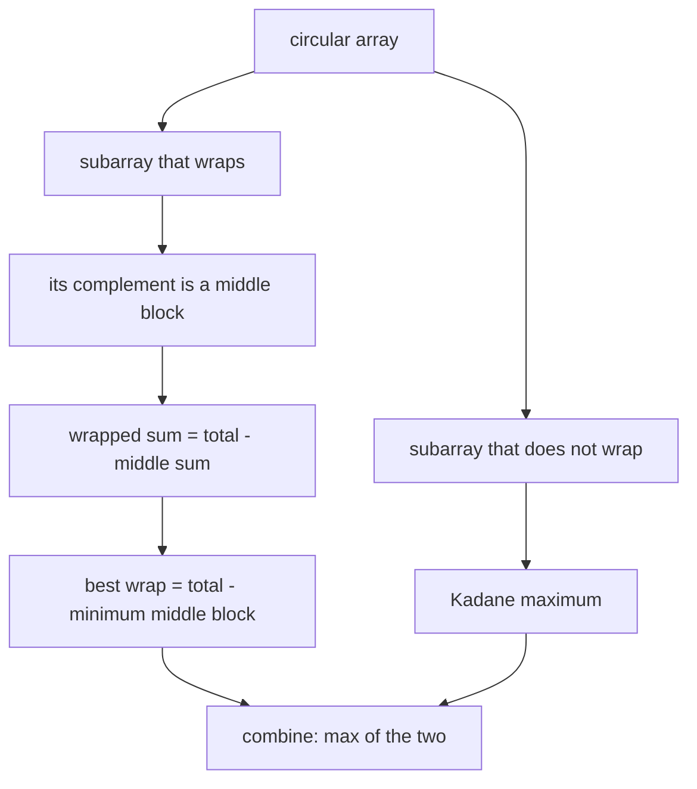
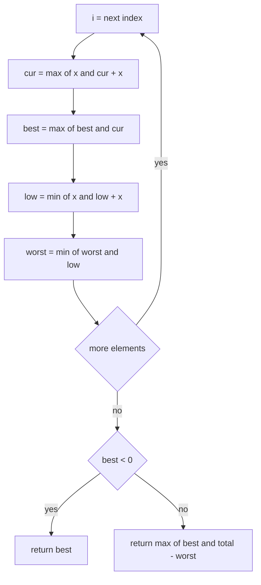
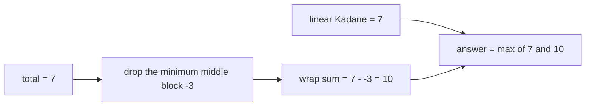

# 221 — Circular array maximum subarray (Kadane variant).

> **Tier:** Intermediate · **CTCI chapter:** Ch 8 — Recursion and Dynamic Programming
> **Task spec:** [221-circular-array-maximum-subarray-kadane-variant.md](../../../tasks/intermediate/221-circular-array-maximum-subarray-kadane-variant.md)
> **Solutions:** [Python](../../../solutions/python/intermediate/221-circular-array-maximum-subarray-kadane-variant/solution.py) ·
> [Java](../../../solutions/java/intermediate/221-circular-array-maximum-subarray-kadane-variant/Solution.java) ·
> [JavaScript](../../../solutions/javascript/intermediate/221-circular-array-maximum-subarray-kadane-variant/solution.js) ·
> [C#](../../../solutions/csharp/intermediate/221-circular-array-maximum-subarray-kadane-variant/Solution.cs)

## 1. Problem restatement

**Input:** a non-empty array of integers `nums`. Treat it as a circle: index `n - 1` is
adjacent to index `0`.

**Output:** the largest possible sum of a **non-empty contiguous** piece of the circle. A
piece may wrap past the end, so `[5, -3, 5]` can legitimately take the last element and the
first element together.

The spec is one line, so the contract comes from the assertions in the four solutions:

| Call | Result | Why |
| --- | --- | --- |
| `max_circular_subarray([5, -3, 5])` | `10` | wrap: `[5]` at the end plus `[5]` at the start |
| `max_circular_subarray([-3, -2, -3])` | `-2` | all negative: the best single element wins |
| `max_circular_subarray([1, -2, 3, -2])` | `3` | the linear subarray `[3]` beats wrapping |
| `max_circular_subarray([1, 2, 3])` | `6` | all positive: take everything linearly |
| `max_circular_subarray([8, -8, 9])` | `17` | wrap: `[9]` plus `[8]` |
| `max_circular_subarray([11, -1, 11])` | `22` | wrap skips the `-1` |
| `max_circular_subarray([5])` | `5` | single element |
| `max_circular_subarray([-5])` | `-5` | single negative element |
| `max_circular_subarray([0])` | `0` | single zero |
| `max_circular_subarray([])` | raises | "empty array has no subarray" |

All four languages raise on the empty input — Python `ValueError`, Java
`IllegalArgumentException`, JavaScript `Error`, C# `ArgumentException` — and each asserts
that the raise happens. Empty is the only rejected input; the array is never reordered or
modified.

## 2. Intuition

Enumerating every circular subarray directly is easy to write and costs `O(n^2)`: for every
start index, extend the window up to `n` elements, walking with `(start + length - 1) mod n`.

```text
procedure naive_circular(nums)
    best ← minus infinity
    for start ← 0 to n - 1 do
        total ← 0
        for length ← 1 to n do
            total ← total + nums[(start + length - 1) mod n]
            best ← max(best, total)
        end
    end
    return best
end
```

The key insight is that a circular subarray has only **two shapes**. Either it does not wrap
— a plain contiguous subarray of the linear array — or it wraps, and then its complement (the
elements it leaves out) is a contiguous block in the middle of the array. The wrapped sum is
therefore `total - (the sum of that middle block)`, and the best wrapped subarray drops the
**minimum-sum middle block**:

```text
best_wrap = total - (minimum subarray sum)
```

Both parts are Kadane's algorithm: one pass computes the maximum subarray sum, the same pass
computes the minimum subarray sum, and the answers are combined at the end.



One special case breaks the symmetry: if **every** element is negative, the minimum middle
block is the whole array, so `total - minimum = 0`, which would correspond to an empty
subarray. Empty is not a legal answer here, so the solutions detect `best < 0` and return the
Kadane maximum (the largest single element) instead.

## 3. Algorithm

1. If the array is empty, raise.
2. Seed four values from the first element: `best` and `cur` for the maximum Kadane scan,
   `worst` and `low` for the minimum Kadane scan. Both scans start at `nums[0]`, not at
   zero — a zero seed would answer `0` for an all-negative array, which is wrong.
3. Compute `total`, the sum of the whole array.
4. For each remaining element `x`:
   - `cur = max(x, cur + x)`, then `best = max(best, cur)` (extend or restart).
   - `low = min(x, low + x)`, then `worst = min(worst, low)`.
5. If `best < 0`, return `best` — the wrap candidate is illegal.
6. Otherwise return `max(best, total - worst)`.

```text
function max_circular_subarray(nums)
    if length(nums) = 0 then raise "empty array has no subarray" end
    best ← nums[0]
    cur ← nums[0]
    worst ← nums[0]
    low ← nums[0]
    total ← sum of nums
    for i ← 1 to length(nums) - 1 do
        cur ← max(nums[i], cur + nums[i])
        best ← max(best, cur)
        low ← min(nums[i], low + nums[i])
        worst ← min(worst, low)
    end
    if best < 0 then return best end
    return max(best, total - worst)
end
```

Both Kadane scans live in the same loop, so the array is read once. `cur` is the best sum of
a subarray ending at the current index, `low` the smallest sum of a subarray ending at the
current index, and `best` / `worst` are the running extrema over all such endings.



## 4. Worked example

Trace `max_circular_subarray([5, -3, 5])`. `total = 7`, and both Kadane scans start at the
first element, so `best = cur = worst = low = 5`.

| Step | `x` | `cur` | `best` | `low` | `worst` |
| --- | --- | --- | --- | --- | --- |
| start | — | 5 | 5 | 5 | 5 |
| 1 | -3 | `max(-3, 2) = 2` | `max(5, 2) = 5` | `min(-3, 2) = -3` | `min(5, -3) = -3` |
| 2 | 5 | `max(5, 7) = 7` | `max(5, 7) = 7` | `min(5, 2) = 2` | `min(-3, 2) = -3` |

Neither scan is negative at the end, so `best = 7 >= 0` and the answer is
`max(7, 7 - (-3)) = 10`. The two candidates are different subarrays of the circle:

- the linear candidate `[5, -3, 5]` with sum `7`;
- the wrapped candidate that drops the middle block `[-3]`, i.e. `[5]` after the end plus
  `[5]` at the start, with sum `7 - (-3) = 10`.



For an all-negative input the guard is what saves the answer. On `[-3, -2, -3]` the scans
end with `best = -2`, `total = -8`, `worst = -8`, so `total - worst = 0` — an empty
subarray. The guard returns `best = -2`, the asserted answer.

| Step | `x` | `cur` | `best` | `low` | `worst` |
| --- | --- | --- | --- | --- | --- |
| start | — | -3 | -3 | -3 | -3 |
| 1 | -2 | `max(-2, -5) = -2` | `max(-3, -2) = -2` | `min(-2, -5) = -5` | `min(-3, -5) = -5` |
| 2 | -3 | `max(-3, -5) = -3` | -2 | `min(-3, -8) = -8` | `min(-5, -8) = -8` |

## 5. Complexity

With `n = len(nums)`:

| Measure | Bound | Why it holds |
| --- | --- | --- |
| Time, best | O(n) | the loop always reads every element after the first; only the empty check is O(1) |
| Time, average | O(n) | two comparisons and two additions per element |
| Time, worst | O(n) | the two Kadane scans are fused into one pass; the guard is O(1) |
| Space | O(1) | four running values plus the array total, regardless of `n` |
| Time, naive enumeration | O(n^2) | every start is extended up to `n` times with modular indexing |
| Time, "duplicate the array" variant | O(n^2) | trying all windows of length at most `n` in a doubled array |

Two limits worth stating explicitly:

- `total` is the sum of the whole array; in Java, JavaScript and C# it is computed in `int`
  arithmetic, so a sum beyond `2^31 - 1` overflows. The assertions stay far below that.
- The minimum block is computed over *non-empty* subarrays, which is what makes
  `total - worst` the complement of a legal wrapped subarray rather than of the empty set.

## 6. Pitfalls and edge cases

- **Empty array.** Every solution raises, and the assertions check it. Returning `0` or
  `null` here is a bug, because no subarray exists.
- **All elements negative.** `total - worst` becomes `0`, which is not achievable. The
  `best < 0` guard is the only thing that keeps `[-3, -2, -3]` at `-2` rather than `0`. This
  is the single most common bug in circular Kadane implementations.
- **Single element.** The loops never run, so the answer is `nums[0]` through the guard —
  `[5] → 5`, `[-5] → -5`, `[0] → 0` are all asserted.
- **Seeding at zero.** Initialising `best = 0` or `worst = 0` instead of `nums[0]` breaks
  exactly the all-negative case, and also makes `worst` unable to represent a positive
  minimum block.
- **Zeros.** `[0]` answers `0` through the `best < 0` guard being false; a zero in the middle
  of a positive array is simply the cheapest block to drop when nothing is negative.
- **Wrapping is optional.** `[1, -2, 3, -2]` shows the linear answer (`3`) beating the wrap
  candidate (`0 - (-2) = 2`), which is why the final answer is a `max` and not a swap to the
  wrapped case.
- **The best case is not always "take everything".** With negative values present, the
  wrapped candidate deliberately leaves something out; with no negative value, the minimum
  block is a single positive element, so `total - worst < total` and the linear candidate
  wins. `[1, 2, 3] → 6` is asserted for that reason.
- **Duplicates and ties.** Nothing special happens; the answer is a value, not an index
  range, so ties do not need a tie-break rule.
- **Overflow of `total`.** Computing the total in a narrower type than the accumulated sums
  would silently change the wrap candidate. Python, JavaScript and C# sums are wide enough
  for the test data; Java's `int` is only safe because the assertions are small.
- **Mutation.** The solutions never sort or rotate the input, so the caller's array keeps its
  order and the wrap is handled by arithmetic, not by rearrangement.

## 7. Variants and follow-ups

- **Plain Kadane.** [212-find-subarray-with-maximum-sum-kadane-s-algorithm.md](../../../tasks/intermediate/212-find-subarray-with-maximum-sum-kadane-s-algorithm.md)
  is the non-circular core that this task reuses twice.
- **Products instead of sums.** [213-maximum-product-subarray.md](../../../tasks/intermediate/213-maximum-product-subarray.md)
  shows why "the same pass with a second accumulator" is a general technique: for products
  the second accumulator tracks the *most negative* prefix so sign flips are covered.
- **Two-sided runs.** [227-longest-bitonic-subarray.md](../../../tasks/intermediate/227-longest-bitonic-subarray.md)
  is the length analogue: one forward pass and one backward pass, combined per index.
- **Sum-equals-k subarrays.** [211-subarray-sum-equals-k-count-hashmap.md](../../../tasks/intermediate/211-subarray-sum-equals-k-count-hashmap.md)
  and [210-longest-subarray-with-sum-equal-to-k-with-negatives-using-hashma.md](../../../tasks/intermediate/210-longest-subarray-with-sum-equal-to-k-with-negatives-using-hashma.md)
  attack the same object — contiguous sums — with prefix sums instead of Kadane.
- The chapter walkthrough in [Recursion and Dynamic Programming](../../ctci/08-recursion-and-dp.md)
  treats Kadane as the canonical "one accumulator is enough" recurrence.

## 8. Check yourself

1. Why is `total - minimum_subarray` the right formula for a wrapped subarray?

<details><summary>Show answer</summary>

Because the complement of a wrapped subarray, viewed on the circle, is a contiguous block in
the middle of the array: start at the first kept element, walk forward while keeping, and
what you skip is one contiguous run. Its sum is `total - kept_sum`, so maximizing the kept
sum means minimizing the skipped block.

</details>

2. On `[-3, -2, -3]`, what would the formula alone return, and why is that rejected?

<details><summary>Show answer</summary>

`total = -8`, the minimum subarray is the whole array (`-8`), so `total - worst = 0`, which
would mean keeping nothing. The problem requires a non-empty subarray, so the `best < 0`
guard returns the Kadane maximum `-2` instead.

</details>

3. Why do the solutions seed `best`, `cur`, `worst` and `low` with `nums[0]` rather than `0`?

<details><summary>Show answer</summary>

`0` is not a valid value for a non-empty subarray when all elements are negative. Seeding
with `nums[0]` makes the very first element a candidate, and the `best < 0` test then
correctly detects the all-negative case; seeding with `0` would hide it.

</details>

4. Which candidate wins on `[11, -1, 11]`, and what does the answer mean geometrically?

<details><summary>Show answer</summary>

The wrapped candidate. `total = 21`, the minimum block is the single element `-1`, so the
wrap sum is `22`: the subarray that starts at the second `11`, wraps around the end, and
finishes at the first `11`, skipping the `-1` in between. The linear Kadane value is `21`.

</details>

5. What is the time/space trade-off against the naive modular enumeration?

<details><summary>Show answer</summary>

The naive version is `O(n^2)` time and `O(1)` space — it re-walks overlapping windows. The
Kadane variant is `O(n)` time and `O(1)` space, because both extrema it needs are single
running values. There is no extra array, no doubling, and no prefix-sum table.

</details>
