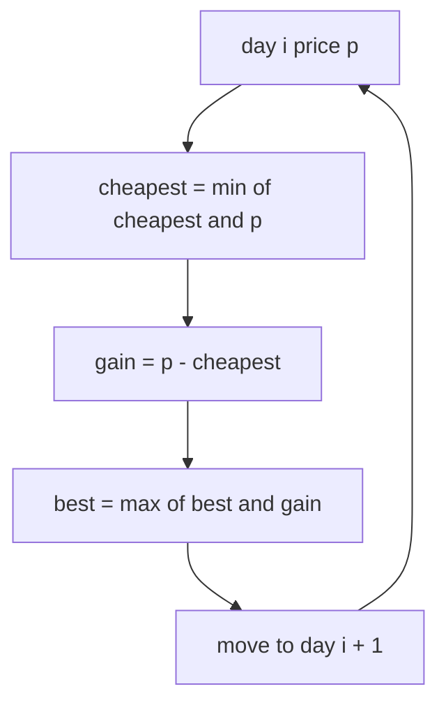
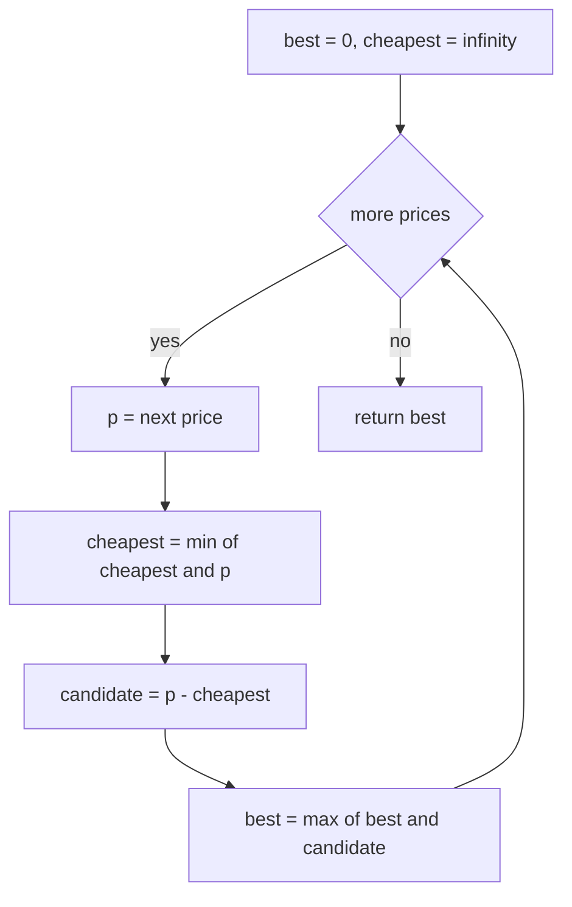
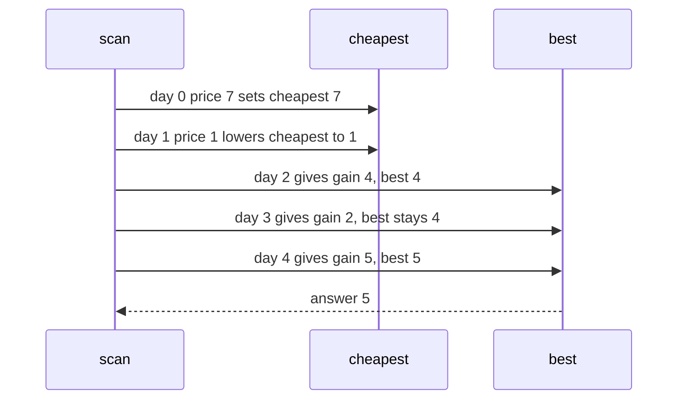

# 222 — Stock buy/sell single transaction max profit.

> **Tier:** Intermediate · **CTCI chapter:** Ch 8 — Recursion and Dynamic Programming
> **Task spec:** [222-stock-buy-sell-single-transaction-max-profit.md](../../../tasks/intermediate/222-stock-buy-sell-single-transaction-max-profit.md)
> **Solutions:** [Python](../../../solutions/python/intermediate/222-stock-buy-sell-single-transaction-max-profit/solution.py) ·
> [Java](../../../solutions/java/intermediate/222-stock-buy-sell-single-transaction-max-profit/Solution.java) ·
> [JavaScript](../../../solutions/javascript/intermediate/222-stock-buy-sell-single-transaction-max-profit/solution.js) ·
> [C#](../../../solutions/csharp/intermediate/222-stock-buy-sell-single-transaction-max-profit/Solution.cs)

## 1. Problem restatement

**Input:** an array `prices`, where `prices[i]` is the price of one share on day `i`. Days
are ordered and you may hold at most one share.

**Output:** the maximum profit from **at most one** buy followed later by one sell. Buying
and selling on the same day is worth nothing; refusing to trade is worth nothing; so the
answer is never negative. A shorter history than two days cannot contain a transaction, so
`[]` and single-day inputs answer `0`.

The spec is one line, so the contract comes from the assertions in the four solutions:

| Call | Result | Why |
| --- | --- | --- |
| `max_profit_single([7, 1, 5, 3, 6, 4])` | `5` | buy at 1 (day 1), sell at 6 (day 4) |
| `max_profit_single([7, 6, 4, 3, 1])` | `0` | the price only falls, so do not trade |
| `max_profit_single([1])` | `0` | one day, no sell possible |
| `max_profit_single([])` | `0` | no days at all |
| `max_profit_single([1, 2])` | `1` | one up step |
| `max_profit_single([2, 1])` | `0` | one down step |
| `max_profit_single([3, 3])` | `0` | flat: buy and sell at the same price |
| `max_profit_single([5, 4, 6, 2, 7])` | `5` | buy at 2 (day 3), sell at 7 (day 4) |

The Python docstring states the framing the tutorial follows: the scan tracks the cheapest
price so far and the best profit from selling today, which is "Kadane's idea applied to
daily changes". Empty and single-day inputs are *not* errors here — unlike the empty array
in [task 221](../../../tasks/intermediate/221-circular-array-maximum-subarray-kadane-variant.md),
doing nothing is a legal answer.

## 2. Intuition

The brute-force reading of the problem is a double loop: pick a buy day, then pick a sell
day after it, and keep the largest difference.

```text
procedure brute_force(prices)
    best ← 0
    for buy ← 0 to n - 1 do
        for sell ← buy + 1 to n - 1 do
            best ← max(best, prices[sell] - prices[buy])
        end
    end
    return best
end
```

That is `O(n^2)` and re-examines the same "what was the cheapest day before here?" question
for every sell day. The key insight removes the inner loop: when the scan reaches day `i`,
the best possible buy is simply the **minimum price seen so far**, `cheapest`, and every
question about earlier days collapses into that single number.

```text
best_profit_up_to(day i) = prices[i] - cheapest_before_or_at(day i)
```

So the algorithm keeps two values and updates them once per day:

- `cheapest` — the lowest price seen so far (the best day to have bought);
- `best` — the largest `p - cheapest` seen so far (the best sale so far).



The same recurrence has a second reading: the profit of a transaction is the sum of the daily
changes over its holding period, so the answer equals the maximum subarray sum of the
difference array `prices[i] - prices[i - 1]` — Kadane again — floored at zero, because a
negative maximum subarray would mean "trade at a loss", which the problem forbids.

## 3. Algorithm

1. Set `best = 0` and `cheapest = +infinity` (Java and C# use `Integer.MAX_VALUE` /
   `int.MaxValue`, Python `float("inf")`, JavaScript `Infinity`).
2. For each price `p` in `prices`:
   - `cheapest = min(cheapest, p)` — the current day is now an allowed buy day.
   - `best = max(best, p - cheapest)` — sell today, at the best buy seen up to today.
3. Return `best`.

```text
function max_profit_single(prices)
    best ← 0
    cheapest ← positive infinity
    for each p in prices do
        cheapest ← min(cheapest, p)
        best ← max(best, p - cheapest)
    end
    return best
end
```

Two invariants make it correct:

- `cheapest` is the minimum over days `0..i`, so `p - cheapest` is a legal transaction
  (buy at or before today, sell today) and is never negative.
- `best` is the maximum over all days `0..i` of the best sale finishing on that day, so
  after the loop it is the global optimum.



Note that `best` never drops below its initial `0`, which is how "do not trade" is
represented: the algorithm always has the option of reporting no gain.

## 4. Worked example

Trace `max_profit_single([7, 1, 5, 3, 6, 4])`:

| Day | `p` | `cheapest` after update | `p - cheapest` | `best` after update |
| --- | --- | --- | --- | --- |
| 0 | 7 | 7 | 0 | 0 |
| 1 | 1 | 1 | 0 | 0 |
| 2 | 5 | 1 | 4 | 4 |
| 3 | 3 | 1 | 2 | 4 |
| 4 | 6 | 1 | 5 | 5 |
| 5 | 4 | 1 | 3 | 5 |

The answer is `5`: buy on day 1 at price 1 and sell on day 4 at price 6. Day 2's sale gives
`4`, and day 3's gives `2` — both are superseded when day 4 sells the same cheap share for
more.



The decreasing case shows the "do not trade" path. On `[7, 6, 4, 3, 1]`, `cheapest` becomes
the current day every single time and `p - cheapest` is always `0`, so `best` stays `0` —
the asserted answer:

| Day | `p` | `cheapest` after update | `p - cheapest` | `best` after update |
| --- | --- | --- | --- | --- |
| 0 | 7 | 7 | 0 | 0 |
| 1 | 6 | 6 | 0 | 0 |
| 2 | 4 | 4 | 0 | 0 |
| 3 | 3 | 3 | 0 | 0 |
| 4 | 1 | 1 | 0 | 0 |

## 5. Complexity

With `n = len(prices)`:

| Measure | Bound | Why it holds |
| --- | --- | --- |
| Time, best | O(n) | the loop is entered once per day; `n < 2` finishes in O(1) but is not special-cased |
| Time, average | O(n) | one comparison for `cheapest` and one for `best` per day |
| Time, worst | O(n) | both updates are constant-time; no sorting or searching |
| Space | O(1) | two scalars, independent of the history length |
| Time, brute force | O(n^2) | every ordered (buy, sell) pair with `buy < sell` |
| Time, Kadane on differences | O(n) | the same single pass over `prices[i] - prices[i - 1]`, with a floor at 0 |

The two `O(n)` readings are not just asymptotically equal, they are the same computation:
`p_i - min(p_0..p_i)` telescopes the daily differences from the cheapest day to today.

## 6. Pitfalls and edge cases

- **Empty input.** `0`, not an error. The loop never runs and `best` keeps its initial value.
  All four solutions assert this row, and the C# and Java files use a zero-length array to
  do it.
- **Single day.** `0`, for the same reason: a buy without a later sell is not a transaction.
  `[1]` is asserted everywhere.
- **Monotone decreasing prices.** `cheapest` follows the price down and every candidate is
  `0`; the asserted `[7, 6, 4, 3, 1] → 0` covers it.
- **Flat prices.** `[3, 3] → 0`: buying and selling at the same price is legal but worthless.
- **Abstention must be representable.** Initialising `best` to `-infinity` would report a
  negative "profit" for a falling market. The solutions start at `0`, which encodes "you may
  always do nothing".
- **Order of the two updates.** `cheapest` is refreshed with the current day's price, so the
  pair (`cheapest`, `p`) always has the buy day at or before the sell day. Using a price from
  *after* the sell day would be a time-travel bug; reading `cheapest` before the update would
  be equivalent but is not what the files do.
- **The sentinel for `cheapest`.** It must be larger than every possible price
  (`int.MaxValue` / `Integer.MAX_VALUE` / `Infinity`). Note that Java's `Integer.MAX_VALUE`
  is also a legal array value in principle, which would make `p - cheapest` underflow; the
  assertions use small prices.
- **Overflow.** `p - cheapest` fits in the same type as the prices for the shipped data, but
  a price of `Integer.MIN_VALUE` would overflow the subtraction in Java and C#. Python's
  integers cannot overflow.
- **Duplicates.** Repeated prices create no ambiguity, because the answer is a value and not
  a pair of indices. `[5, 4, 6, 2, 7] → 5` is the asserted case where the cheapest day is
  late: the best trade is `2 → 7`, not the earlier `4 → 6`.
- **One share at a time.** The problem's constraint is implicit in the single-transaction
  restriction; the multiple-transaction sibling starts from a different premise (see below).

## 7. Variants and follow-ups

- **Unlimited transactions.** [223-stock-buy-sell-multiple-transactions-greedy.md](../../../tasks/intermediate/223-stock-buy-sell-multiple-transactions-greedy.md)
  sums every positive consecutive gain; with `k = 1` it would be wrong, and this task would
  be wrong if several trades were allowed.
- **Unlimited trades with a rest day.** [224-stock-with-cooldown-dp.md](../../../tasks/intermediate/224-stock-with-cooldown-dp.md)
  replaces the two scalars with a three-state machine.
- **Unlimited trades with a fee.** [225-stock-with-transaction-fee-dp.md](../../../tasks/intermediate/225-stock-with-transaction-fee-dp.md)
  keeps two scalars (`cash`, `hold`) but charges each sale; setting the fee to zero recovers
  the greedy answer of task 223.
- **Kadane itself.** [212-find-subarray-with-maximum-sum-kadane-s-algorithm.md](../../../tasks/intermediate/212-find-subarray-with-maximum-sum-kadane-s-algorithm.md)
  is the general version of the recurrence used here on the difference array.
- **The circular relative.** [221-circular-array-maximum-subarray-kadane-variant.md](../../../tasks/intermediate/221-circular-array-maximum-subarray-kadane-variant.md)
  runs two Kadane accumulators instead of one; the "cheapest so far" trick is the
  one-accumulator analogue.
- The chapter walkthrough in [Recursion and Dynamic Programming](../../ctci/08-recursion-and-dp.md)
  uses this task as the simplest example of a DP whose state is a single running extreme.

## 8. Check yourself

1. Why does the algorithm return `0` rather than a negative number for a falling market?

<details><summary>Show answer</summary>

Because not trading is allowed and yields `0`. `best` is initialised to `0` and only ever
rises, and on a falling market every candidate `p - cheapest` is exactly `0` because today's
price *is* the new cheapest. A `-infinity` initialisation would instead report the best
(non-positive) trade as if it were mandatory.

</details>

2. Why is `cheapest` updated before the candidate profit is computed?

<details><summary>Show answer</summary>

So that the pair used is always (a buy day at or before today, today as the sell day). The
update brings the current price into the running minimum — selling on the same day it becomes
the cheapest yields a candidate of `0`, which is harmless — and the buy day can never be
later than the sell day, which is exactly the problem's ordering constraint.

</details>

3. How does this relate to Kadane's algorithm?

<details><summary>Show answer</summary>

Take the difference array `d[i] = prices[i] - prices[i - 1]`. A trade from day `a` to day
`b` earns `d[a+1] + ... + d[b]`, so the best single trade is the maximum subarray sum of `d`.
Kadane computes that in one pass with a running maximum; the solution here computes the same
number with a running minimum because `prices[b] - min(prices[0..b])` is equal to it, then
floors the result at `0`, as the docstring notes.

</details>

4. What is the answer for `[5, 4, 6, 2, 7]`, and which two days produce it?

<details><summary>Show answer</summary>

`5`, from buying at price 2 on day 3 and selling at price 7 on day 4. The tempting earlier
pair `4 → 6` gives only `2`; the algorithm finds the later, cheaper buy because `cheapest`
keeps dropping.

</details>

5. Which of the four languages would need special care for a price near `Integer.MIN_VALUE`,
   and why?

<details><summary>Show answer</summary>

Java and C#, whose prices are 32-bit `int` values: `p - cheapest` with `p = Integer.MIN_VALUE`
would overflow. Python's integers are arbitrary precision and JavaScript's `Number` has a far
wider range than 32-bit, though its exactness limit is `2^53`. The shipped assertions use
small prices, so the issue is latent rather than triggered.

</details>
