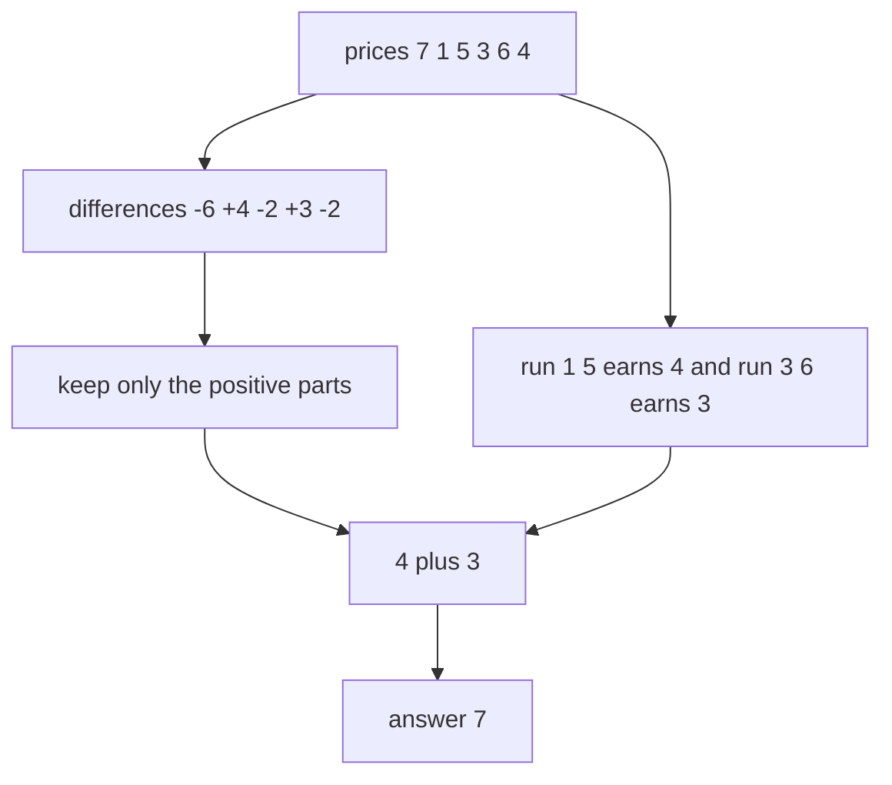
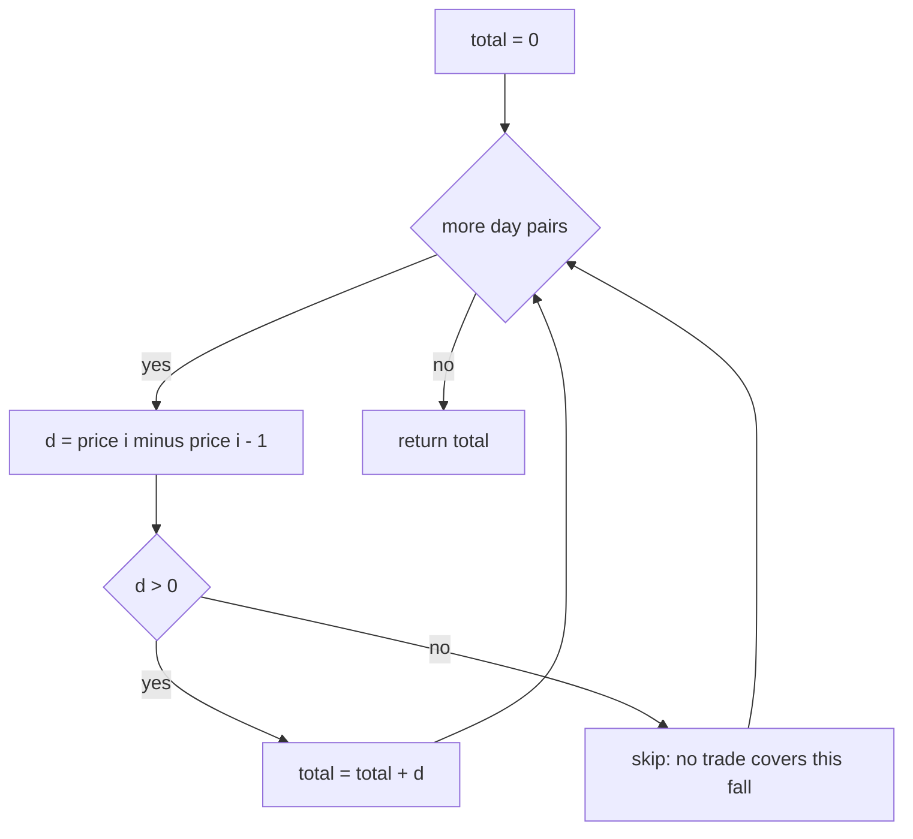
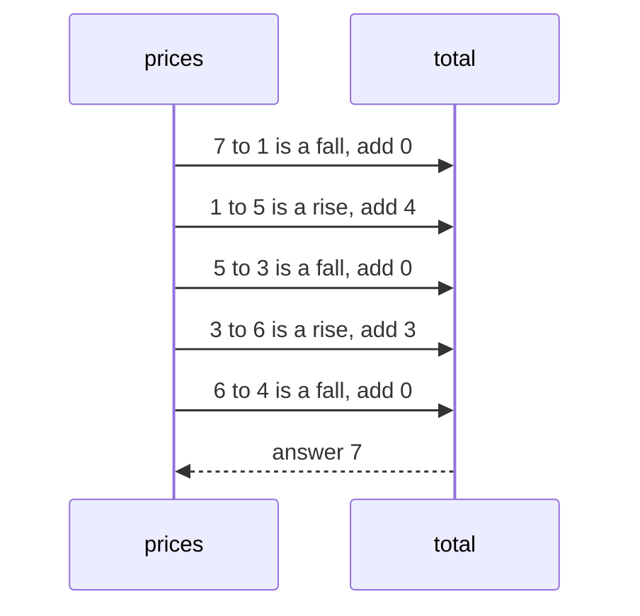

# 223 — Stock buy/sell multiple transactions (greedy).

> **Tier:** Intermediate · **CTCI chapter:** Ch 8 — Recursion and Dynamic Programming
> **Task spec:** [223-stock-buy-sell-multiple-transactions-greedy.md](../../../tasks/intermediate/223-stock-buy-sell-multiple-transactions-greedy.md)
> **Solutions:** [Python](../../../solutions/python/intermediate/223-stock-buy-sell-multiple-transactions-greedy/solution.py) ·
> [Java](../../../solutions/java/intermediate/223-stock-buy-sell-multiple-transactions-greedy/Solution.java) ·
> [JavaScript](../../../solutions/javascript/intermediate/223-stock-buy-sell-multiple-transactions-greedy/solution.js) ·
> [C#](../../../solutions/csharp/intermediate/223-stock-buy-sell-multiple-transactions-greedy/Solution.cs)

## 1. Problem restatement

**Input:** an array `prices`, one price per day.

**Output:** the maximum total profit from **unlimited** transactions, subject to the rule
that you must sell before you buy again. Buying and selling on the same day yields nothing,
and doing nothing yields `0`, so the answer is never negative.

The spec is one line, so the contract comes from the assertions in the four solutions:

| Call | Result | Why |
| --- | --- | --- |
| `max_profit_multiple([7, 1, 5, 3, 6, 4])` | `7` | `(5 - 1) + (6 - 3)` |
| `max_profit_multiple([7, 6, 4, 3, 1])` | `0` | monotone decreasing |
| `max_profit_multiple([1, 2, 3, 4, 5])` | `4` | one long rise, captured as a single trade |
| `max_profit_multiple([1, 3, 2, 8])` | `8` | `+2` then `+6` |
| `max_profit_multiple([])` | `0` | no days |
| `max_profit_multiple([5])` | `0` | one day |
| `max_profit_multiple([3, 3])` | `0` | flat |

The Python docstring states the invariant the whole task rests on: *"Every rise between
consecutive days can be captured by buying the day before and selling the day after (or
merging adjacent trades), so the optimum is simply the sum of all positive consecutive
gains."* The final clause is what the code computes, literally:

```text
total ← 0
for i ← 1 to n - 1 do
    if prices[i] > prices[i - 1] then total ← total + prices[i] - prices[i - 1] end
end
```

There is no DP table, no state machine, and no lookahead.

## 2. Intuition

The natural first attempt is to be clever: find the local minima and maxima, trade run by
run. That is what the greedy claim makes unnecessary, but it is worth seeing why the
sum-of-rises formula is *not* obviously correct.

A trade from day `a` to day `b` earns `prices[b] - prices[a]`, which is the sum of the daily
differences `prices[i] - prices[i - 1]` over `a < i <= b`. Total earnings are therefore the
sum of the differences covered by the chosen intervals, and that gives both bounds:

- **Upper bound.** Every difference inside a traded interval is at most its own positive
  part, and differences outside all intervals contribute nothing. So no legal set of trades
  can beat the sum of all positive differences. Nobody can do better than "collect every
  rise".
- **Achievability.** Take each maximal strictly increasing run and trade it end to end: the
  gain is `prices[end] - prices[start]`, which is exactly the sum of the positive differences
  inside that run. Equivalently, trade each individual rising step; the docstring notes that
  adjacent trades can be merged, which keeps every interval inside one run so the trades
  never overlap.

The insight is that the state you would track in a DP — "am I holding a share, and what is my
best cash so far?" — collapses here because there is no fee, no cooldown, and no limit on the
number of trades. Whenever the price goes up, holding was strictly better than not holding;
whenever it goes down, not holding was strictly better. The optimal decision at each day is
forced by the sign of one difference.



The two branches in that diagram are the two proofs above: one reads the answer off the
differences, the other reads it off the runs.

## 3. Algorithm

1. Let `total = 0`.
2. For `i` from `1` to `n - 1`:
   - If `prices[i] > prices[i - 1]`, add `prices[i] - prices[i - 1]` to `total`.
   - Otherwise add nothing.
3. Return `total`.

```text
function max_profit_multiple(prices)
    total ← 0
    for i ← 1 to length(prices) - 1 do
        if prices[i] > prices[i - 1] then
            total ← total + prices[i] - prices[i - 1]
        end
    end
    return total
end
```

Expressed as the state machine the DP would have used — `cash` is the best profit with no
share held, `hold` the best profit holding one — the same answer comes out:

```text
function max_profit_state_machine(prices)
    cash ← 0
    hold ← minus infinity
    for each p in prices do
        next_cash ← max(cash, hold + p)
        next_hold ← max(hold, cash - p)
        cash ← next_cash
        hold ← next_hold
    end
    return cash
end
```

That version needs both values as they were on the previous day, so it computes the two
successors before overwriting either of them. With no fee it returns exactly the same number
as the greedy sweep (task 225 asserts this for fee `0`), which is why the solution files do
not bother: the greedy sweep is one accumulator and one comparison.



## 4. Worked example

Trace `max_profit_multiple([7, 1, 5, 3, 6, 4])`:

| `i` | `prices[i - 1]` | `prices[i]` | difference | added? | `total` |
| --- | --- | --- | --- | --- | --- |
| 1 | 7 | 1 | -6 | no | 0 |
| 2 | 1 | 5 | +4 | yes | 4 |
| 3 | 5 | 3 | -2 | no | 4 |
| 4 | 3 | 6 | +3 | yes | 7 |
| 5 | 6 | 4 | -2 | no | 7 |

The answer is `7`, made of `(5 - 1) + (6 - 3)`. Note that the merged reading gives the same
number with two maximal increasing runs: days `1 → 2` (`1 → 5`, gain 4) and days `3 → 4`
(`3 → 6`, gain 3). The single-transaction sibling
[task 222](../../../tasks/intermediate/222-stock-buy-sell-single-transaction-max-profit.md)
answers `5` on this same array — the difference is a second trade.



The one-long-rise case `[1, 2, 3, 4, 5]` adds `1 + 1 + 1 + 1 = 4`, the asserted answer.
The formula "one trade from 1 to 5" gives the same `4`, and the merge argument is exactly why
choosing one trade instead of four is allowed.

## 5. Complexity

With `n = len(prices)`:

| Measure | Bound | Why it holds |
| --- | --- | --- |
| Time, best | O(n) | every adjacent pair is inspected once; `n < 2` finishes with the loop not running |
| Time, average | O(n) | one subtraction and one comparison per day |
| Time, worst | O(n) | no inner loop, no sorting, no searching |
| Space | O(1) | a single accumulator |
| Two-state DP for comparison | O(n) time, O(1) space | same bounds, more bookkeeping (two values plus two temporaries) |
| Searching for all local minima and maxima | O(n) time, O(1) space | correct but strictly more code for the same answer |

Unlike the subset-sum and TSP tasks in this chapter, "better asymptotics" is not on the
table here: `O(n)` is optimal, since every price may influence the answer.

## 6. Pitfalls and edge cases

- **Empty input and single day.** Both answer `0` and neither is an error; the loop simply
  does not execute. Asserted in all four solutions.
- **Flat or decreasing stretches.** They contribute nothing. `[7, 6, 4, 3, 1] → 0` and
  `[3, 3] → 0` are asserted; a naive "buy at the minimum, sell at the maximum" that ignores
  ordering can wrongly report a profit for the decreasing case.
- **Equal adjacent prices.** The comparison is strict (`>`), so a flat day adds `0`. Using
  `>=` would add `0` as well; using `abs` would be completely wrong.
- **One long rise.** `[1, 2, 3, 4, 5] → 4`, not `1` or `5` — the *sum* of the steps equals
  the single-trade gain, which is the whole point of the telescoping argument.
- **Overlapping-trade rule.** The greedy answer never needs two trades that overlap in time,
  because every chosen step lies inside a maximal increasing run and adjacent steps merge
  into one trade. That is why the "sell before buying again" rule does not change the value.
- **Do not use the single-transaction algorithm.** [Task 222](../../../tasks/intermediate/222-stock-buy-sell-single-transaction-max-profit.md)
  is the `k = 1` case and would report `5` instead of `7` on the first asserted input.
- **Overflow.** The accumulated total can exceed a single day's difference; Python's
  integers are unbounded, JavaScript's `Number` is exact to `2^53`, and Java/C# use `int`,
  which is enough for the test data but not for adversarial inputs.
- **Sentinel traps in the DP formulation.** If you write the two-state machine instead, the
  "hold" state must start at `-infinity` (or `Integer.MIN_VALUE`), and it must use
  *yesterday's* cash when buying. Getting that wrong silently allows same-day round trips.
- **Fees and cooldowns absent.** Both of those variants break the greedy step-sum: with a fee
  of `2`, `[1, 2]` is worth `0` rather than `1` (asserted in task 225); with a cooldown,
  `[1, 2, 3]` is worth `2` rather than `3` (asserted in task 224).

## 7. Variants and follow-ups

- **At most one trade.** [222-stock-buy-sell-single-transaction-max-profit.md](../../../tasks/intermediate/222-stock-buy-sell-single-transaction-max-profit.md)
  is the constrained version where the greedy sum is no longer optimal.
- **A rest day after each sale.** [224-stock-with-cooldown-dp.md](../../../tasks/intermediate/224-stock-with-cooldown-dp.md)
  needs a three-state machine because the greedy sweep would buy again immediately.
- **A fee on each sale.** [225-stock-with-transaction-fee-dp.md](../../../tasks/intermediate/225-stock-with-transaction-fee-dp.md)
  keeps two states; its assertions include the explicit cross-check that a zero fee
  reproduces this task's answer (`[1, 3, 2, 8, 4, 9]` gives `13` when the fee is `0`).
- **Collecting the runs.** [118-longest-increasing-subarray-contiguous.md](../../../tasks/beginner/118-longest-increasing-subarray-contiguous.md)
  works on the same maximal increasing runs but measures their length rather than their
  total gain.
- The chapter walkthrough in [Recursion and Dynamic Programming](../../ctci/08-recursion-and-dp.md)
  contrasts this greedy step-sum with the DP versions, which is the usual interview follow-up.

## 8. Check yourself

1. Why is the sum of all positive consecutive gains an upper bound on any legal set of
   trades?

<details><summary>Show answer</summary>

A trade from day `a` to day `b` earns the sum of the daily differences between `a` and `b`.
Every difference inside a traded interval is at most its own positive part, and differences
you never trade over contribute nothing. So any set of trades earns at most the sum of the
positive differences of the whole array.

</details>

2. Why is that bound achievable without violating "sell before you buy again"?

<details><summary>Show answer</summary>

Take each maximal strictly increasing run and trade it from its first day to its last. The
runs are disjoint and separated by falling (or flat) days, so the trades do not overlap, and
each trade's gain equals the sum of the positive differences inside its run. Adding up the
runs reproduces the whole sum.

</details>

3. What does `[1, 2, 3, 4, 5]` return, and how many trades does the algorithm effectively
   choose?

<details><summary>Show answer</summary>

`4`. The arithmetic adds four separate `+1` steps, but that is equivalent to one trade from
day 0 to day 4. The docstring's "or merging adjacent trades" is exactly this: the value is
what matters, not the number of transactions.

</details>

4. When does this greedy approach stop being correct?

<details><summary>Show answer</summary>

As soon as a transaction carries a fixed cost or a mandatory delay. With a fee, an individual
`+1` rise may no longer pay for a trade; with a cooldown, two adjacent rises cannot both be
harvested. Tasks 224 and 225 handle those cases with a state machine instead of a plain sum.

</details>

5. Why doesn't the problem need a DP at all?

<details><summary>Show answer</summary>

Because the optimal action on each day is determined locally by whether the price rose: if it
rose, holding a share through the step is strictly better; if it fell, holding is strictly
worse. There is no constraint (transaction limit, fee, cooldown) that could make "hold
through a rise" a bad idea, so no lookahead is needed.

</details>
