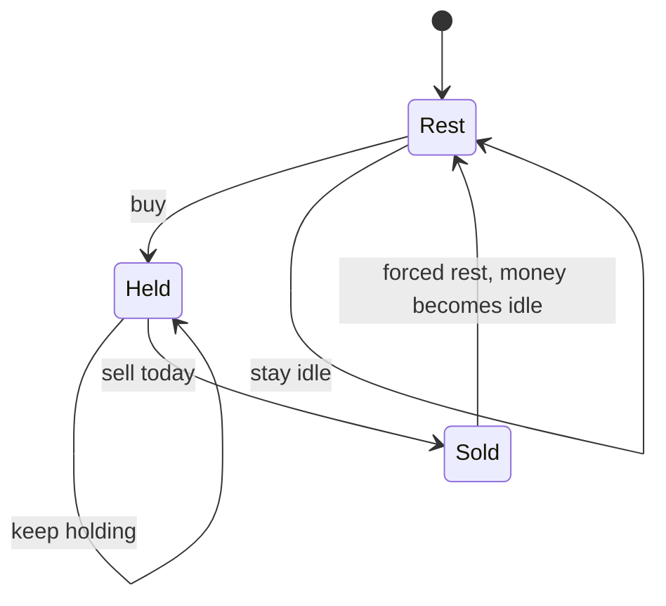
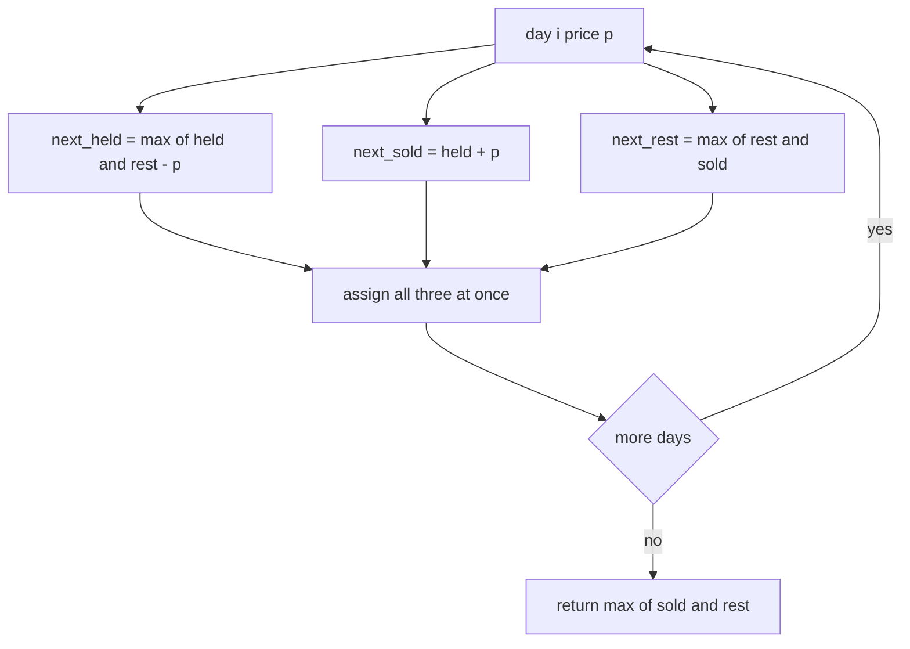
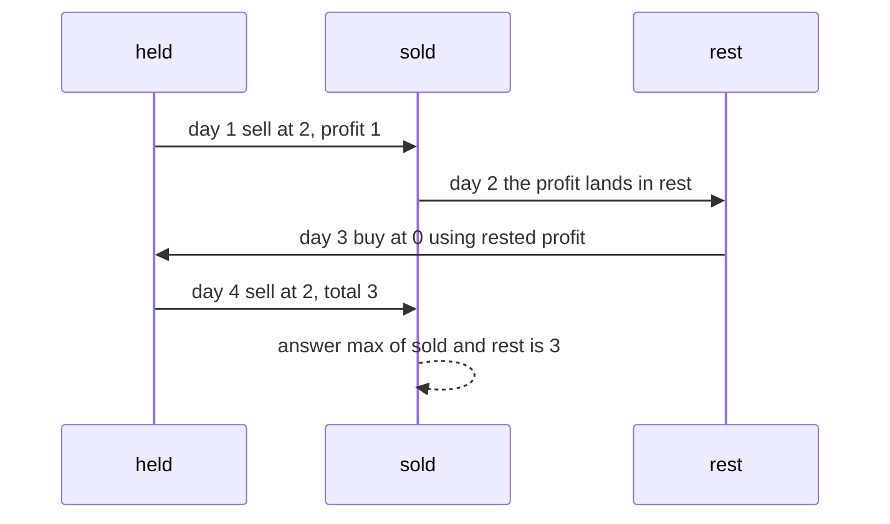

# 224 — Stock with cooldown (DP).

> **Tier:** Intermediate · **CTCI chapter:** Ch 8 — Recursion and Dynamic Programming
> **Task spec:** [224-stock-with-cooldown-dp.md](../../../tasks/intermediate/224-stock-with-cooldown-dp.md)
> **Solutions:** [Python](../../../solutions/python/intermediate/224-stock-with-cooldown-dp/solution.py) ·
> [Java](../../../solutions/java/intermediate/224-stock-with-cooldown-dp/Solution.java) ·
> [JavaScript](../../../solutions/javascript/intermediate/224-stock-with-cooldown-dp/solution.js) ·
> [C#](../../../solutions/csharp/intermediate/224-stock-with-cooldown-dp/Solution.cs)

## 1. Problem restatement

**Input:** an array `prices`, one price per day. Trading is unlimited, but **after selling on
a day you must skip the next day** before you may buy again.

**Output:** the maximum total profit under that rule. Doing nothing earns `0`, so the answer
is never negative; empty and single-day inputs answer `0`.

The spec is one line, so the contract comes from the assertions in the four solutions:

| Call | Result | Why |
| --- | --- | --- |
| `max_profit_cooldown([1, 2, 3, 0, 2])` | `3` | buy 1, sell 2, rest, buy 0, sell 2 |
| `max_profit_cooldown([1])` | `0` | one day |
| `max_profit_cooldown([])` | `0` | no days |
| `max_profit_cooldown([2, 1, 4])` | `3` | buy at 1, sell at 4 — a single trade |
| `max_profit_cooldown([6, 1, 3, 2, 4, 7])` | `6` | hold through, one sale at 7 |
| `max_profit_cooldown([1, 2])` | `1` | one rising step |
| `max_profit_cooldown([2, 2, 2])` | `0` | flat |

The Python docstring names the three states and the transitions the tutorial uses below:
*"held (owning a share), sold (sold today, tomorrow is forced rest), rest (idle, including a
finished cooldown)"*, with `held' = max(held, rest - price)`, `sold' = held + price`,
`rest' = max(rest, sold)` and the answer `max(sold, rest)` after the last day.

Note what the cooldown does *not* do: it does not prevent two sales from being two days
apart, and it does not apply after a *buy*. Only a sale triggers the rest day.

## 2. Intuition

The greedy solution of [task 223](../../../tasks/intermediate/223-stock-buy-sell-multiple-transactions-greedy.md)
sums every positive daily gain, which implicitly assumes you can buy again the moment you
sell. With a forced rest day that is false: on `[1, 2, 3, 0, 2]` the greedy sum is `4`
(`+1`, `+1`, `-3`, `+2`), but harvesting both rises `1 → 2` and `2 → 3` would require buying
on day 2 immediately after selling on day 1. The asserted answer is `3`, from two trades
spaced far enough apart.

What the cooldown really changes is the *state* you are in. On each day exactly one of three
things is true, and the best profit depends on which:

- **held** — you own a share, so today you may sell (or keep holding).
- **sold** — you sold today, so tomorrow is forced rest: on the next day you cannot buy.
- **rest** — you are idle and allowed to buy, either because you never traded or because a
  finished cooldown left you free.

The key insight is that a one-day delay is expressible by *where the money may flow*. Buying
draws on `rest` (not on `sold`), and `sold` flows into `rest` only on the following day. That
single restriction encodes the cooldown without any extra day counter.



The three states are enough because they are exhaustive: you cannot be both holding and
resting, and `sold` exists purely to delay the money by one day.

## 3. Algorithm

1. If the array is empty, return `0`.
2. Seed day 0: `held = -prices[0]` (buy on day 0), `sold = -infinity` (nothing sold yet),
   `rest = 0` (idle).
3. For each later price `p`, compute the three successors **simultaneously** from the
   previous day's values:
   - `next_held = max(held, rest - p)` — keep holding, or buy today with idle money;
   - `next_sold = held + p` — sell today the share held yesterday;
   - `next_rest = max(rest, sold)` — stay idle, or complete the rest triggered by a sale.
4. Assign all three, then continue with the next day.
5. Return `max(sold, rest)` — the last day may end either sold or idle.

```text
function max_profit_cooldown(prices)
    if length(prices) = 0 then return 0 end
    held ← minus prices[0]
    sold ← minus infinity
    rest ← 0
    for i ← 1 to length(prices) - 1 do
        p ← prices[i]
        next_held ← max(held, rest - p)
        next_sold ← held + p
        next_rest ← max(rest, sold)
        held ← next_held
        sold ← next_sold
        rest ← next_rest
    end
    return max(sold, rest)
end
```

The Python solution expresses the same three updates as one tuple assignment
(`held, sold, rest = max(held, rest - p), held + p, max(rest, sold)`); Java, JavaScript and
C# compute `nextHeld`, `nextSold` and `nextRest` into temporaries first. Both spellings mean
"all three successors use yesterday's values", which is the part that matters.

Why the cooldown emerges from these lines: on the day after a sale, `held' = max(held,
rest - p)` uses `rest` as it was on the sale day, which does **not** yet contain that sale's
proceeds — so buying with the new profit is impossible. One day later, `rest' = max(rest,
sold)` has absorbed the sale, and the money becomes usable.



## 4. Worked example

Trace `max_profit_cooldown([1, 2, 3, 0, 2])`, the first asserted case. Day 0 seeds
`held = -1`, `sold = -infinity`, `rest = 0`.

| Day | `p` | `held` (after) | `sold` (after) | `rest` (after) | reading |
| --- | --- | --- | --- | --- | --- |
| 0 | 1 | -1 | -infinity | 0 | bought at 1, or idle |
| 1 | 2 | `max(-1, 0 - 2) = -1` | `-1 + 2 = 1` | `max(0, -infinity) = 0` | sold at 2 for a profit of 1 |
| 2 | 3 | `max(-1, 0 - 3) = -1` | `-1 + 3 = 2` | `max(0, 1) = 1` | held through; day 1's profit arrives in `rest` |
| 3 | 0 | `max(-1, 1 - 0) = 1` | `-1 + 0 = -1` | `max(1, 2) = 2` | bought at 0 with the rested profit of 1 |
| 4 | 2 | `max(1, 2 - 2) = 1` | `1 + 2 = 3` | `max(2, -1) = 2` | sold at 2 for a total of 3 |

The final answer is `max(sold, rest) = max(3, 2) = 3`, which matches the labelled assertion
"buy 1/sell 2, rest, buy 0/sell 2": profit `1` on day 1, a forced idle day 2, then profit `2`
on day 4.

The important row is day 3. Buying is only reachable from `rest`, and the day-2 `rest` value
is `1` — the profit banked on day 1, released only after the sale day had passed through the
`sold` state. At day 3 `held = rest - p = 1 - 0 = 1`, meaning "one unit banked, holding a
share that cost 0"; selling at `2` on day 4 adds `2` for a total of `3`. Had the transition
allowed buying from `sold`, day 2 would already have offered `sold - p = 1 - 3`, and the
cooldown would be gone.



`[6, 1, 3, 2, 4, 7] → 6` is the case where the cooldown never bites. The scan keeps
`held = -1` from day 1 onwards (the cheapest purchase), and a single sale at `7` on the last
day yields `-1 + 7 = 6`; `rest` never exceeds `3`, so the answer is `6`.

## 5. Complexity

With `n = len(prices)`:

| Measure | Bound | Why it holds |
| --- | --- | --- |
| Time, best | O(n) | one triple of constant-time updates per day; empty input is O(1) |
| Time, average | O(n) | three `max`/addition operations per day, no inner loop |
| Time, worst | O(n) | the state count is fixed at three, independent of `n` |
| Space | O(1) | three scalars; the day dimension is discarded because tomorrow only needs yesterday |
| Full DP table for comparison | O(n) time, O(n) space | the same recurrence kept as `dp[day][state]`; the rolling version is the shipped one |
| Brute force over trade sets | exponential | enumerating all legal trade sequences is far worse and needs memoisation to be tractable |

The `O(1)` space is not an optimisation trick but a property of the recurrence: each
successor uses only the previous day's three values, so the table can be rolled into three
variables. There is no look-ahead and no dependency on earlier days.

## 6. Pitfalls and edge cases

- **Empty and single day.** Both answer `0`, asserted in the files. The empty check happens
  before `prices[0]` is read, which is what keeps the seeding line safe.
- **Simultaneous update.** Computing `held` first and then using the *new* `held` for
  `next_sold` would allow selling a share bought the same day, and would generally inflate
  the answer. Every solution uses temporaries or a tuple assignment for exactly this reason.
- **`sold` starts at `-infinity`.** The sentinel means "no sale has happened yet"; with `0`
  you would silently claim a completed sale on every day, and `rest` would absorb a profit
  that was never earned. Java and C# use `Integer.MIN_VALUE` / `int.MinValue`, Python
  `float("-inf")`, JavaScript `-Infinity`.
- **The answer is `max(sold, rest)`, not `sold`.** The final day may be a rest day, or you may
  have sold earlier and stayed idle: `[6, 1, 3, 2, 4, 7]` ends with `sold = 6` and
  `rest = 3`, but a shorter array like `[1, 2]` ends with `sold = 1`, `rest = 0`.
- **Buying must draw on `rest`, not on `sold`.** That single choice is the whole cooldown.
  If `next_held` used `sold - p` as well, the rest day would vanish and `[1, 2, 3, 0, 2]`
  would return `4` — the unconstrained greedy total of task 223 — instead of the asserted
  `3`.
- **Flat prices.** `[2, 2, 2] → 0`: selling at the same price as the purchase earns nothing,
  and the cooldown would only make things worse.
- **Cooldown applies only after a sale.** A sequence of buys is impossible anyway (you hold
  one share), and buying does not force any rest. `[2, 1, 4] → 3` shows a single trade with
  no cooldown involved.
- **One share at a time.** `held` is a profit value, not a count, so the model cannot
  represent holding two shares; every solution inherits that constraint from the problem.
- **Sentinel arithmetic.** `held + p` where `held` is `-prices[0]` is always finite, so the
  sentinel never propagates; but using `Integer.MIN_VALUE` for `held` (rather than `sold`)
  would overflow in Java and C#.
- **Overflow of the profits.** Java, JavaScript and C# accumulate in 32-bit `int`/`Number`
  values; realistic test data is small, but a long run of large gains could overflow the
  `int` versions.

## 7. Variants and follow-ups

- **No cooldown.** [223-stock-buy-sell-multiple-transactions-greedy.md](../../../tasks/intermediate/223-stock-buy-sell-multiple-transactions-greedy.md)
  is the same problem with the rest rule removed, where the answer collapses to the sum of
  positive daily gains — `4` instead of `3` on this task's first asserted input.
- **A fee instead of a delay.** [225-stock-with-transaction-fee-dp.md](../../../tasks/intermediate/225-stock-with-transaction-fee-dp.md)
  keeps two states (`cash`, `hold`) and subtracts a constant on each sale; the two tasks are
  the two natural perturbations of the unlimited-trades problem.
- **A single trade.** [222-stock-buy-sell-single-transaction-max-profit.md](../../../tasks/intermediate/222-stock-buy-sell-single-transaction-max-profit.md)
  is the `k = 1` variant, where the state machine is unnecessary.
- **State machines in general.** The three-state formulation is the same technique used for
  other "you may not do X twice in a row" problems, for instance the alternating-run tasks
  [229-longest-alternating-subsequence.md](../../../tasks/intermediate/229-longest-alternating-subsequence.md)
  and [227-longest-bitonic-subarray.md](../../../tasks/intermediate/227-longest-bitonic-subarray.md),
  both of which track a direction instead of a position.
- The chapter walkthrough in [Recursion and Dynamic Programming](../../ctci/08-recursion-and-dp.md)
  presents this as the chapter's example of a DP whose state is small but not one-dimensional.

## 8. Check yourself

1. Which of the three transitions is responsible for the cooldown?

<details><summary>Show answer</summary>

`next_held = max(held, rest - p)`. Buying draws only on `rest`, and `sold` reaches `rest`
one day later via `next_rest = max(rest, sold)`. So the proceeds of a sale cannot be used to
buy on the very next day — that is the forced rest, expressed as a missing transition rather
than as an extra state.

</details>

2. Why must the three updates be computed simultaneously?

<details><summary>Show answer</summary>

Because `next_sold` depends on yesterday's `held` and `next_held` depends on yesterday's
`rest`: if you overwrite `held` first, the sale would use a share bought today, and the
cooldown would be bypassed. Java, JavaScript and C# use temporaries; Python's tuple
assignment evaluates the whole right-hand side against the old values.

</details>

3. What does `sold = -infinity` protect against?

<details><summary>Show answer</summary>

It marks "no sale has happened yet". Without it (for example with `0`), `rest' =
max(rest, sold)` would treat a phantom sale as banked profit, and the answer could include
money that was never earned. It also keeps the first day's semantics clean: you have either
bought today or you are idle, never sold.

</details>

4. Why is the answer `max(sold, rest)` rather than `sold`?

<details><summary>Show answer</summary>

Because the best sequence may end in either state: on the final day you may have sold (so
profit lives in `sold`), or you may be idle after an earlier sale or after simply never
trading (so profit lives in `rest`). Taking the maximum of the two legal final states is the
standard way to finish a state-machine DP.

</details>

5. Give an array where the greedy sum of positive gains and this task's answer disagree, and
   explain the difference.

<details><summary>Show answer</summary>

`[1, 2, 3, 0, 2]` is the first asserted input. Greedy adds `+1`, `+1`, `+2` for `4`, because
it harvests the rise `1 → 2` and then buys again immediately to catch `2 → 3`. The cooldown
forbids that second purchase, so the best legal plan is `1 → 2` (profit 1), rest, then `0 → 2`
(profit 2), giving the asserted `3`. On `[1, 2, 3]` the two answers happen to coincide at `2`,
which is why the solutions test an array where they do not.

</details>

6. What is the difference between this state machine and the two-state machine used for
   transaction fees?

<details><summary>Show answer</summary>

The fee variant needs only "holding or not holding" (`hold`, `cash`) because a fee is a
constant charge applied at sale time. Here the cooldown needs to know *when* the last sale
happened, which is why the state count goes from two to three: `sold` exists solely to delay
the money by one day before it becomes `rest`.

</details>
