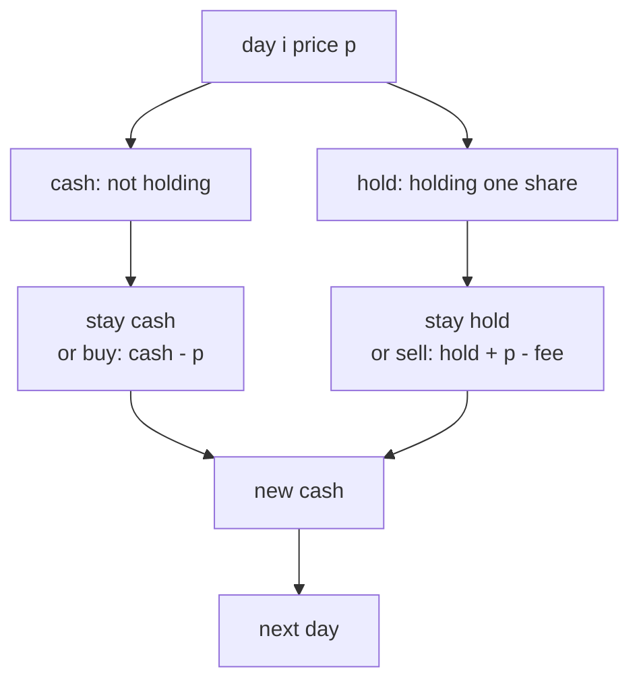
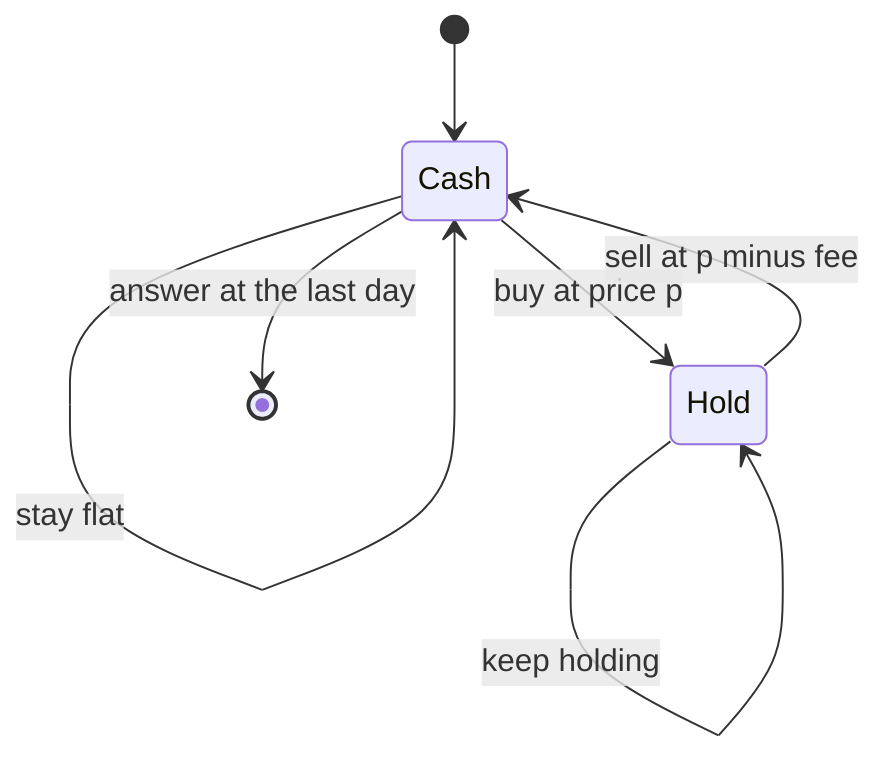
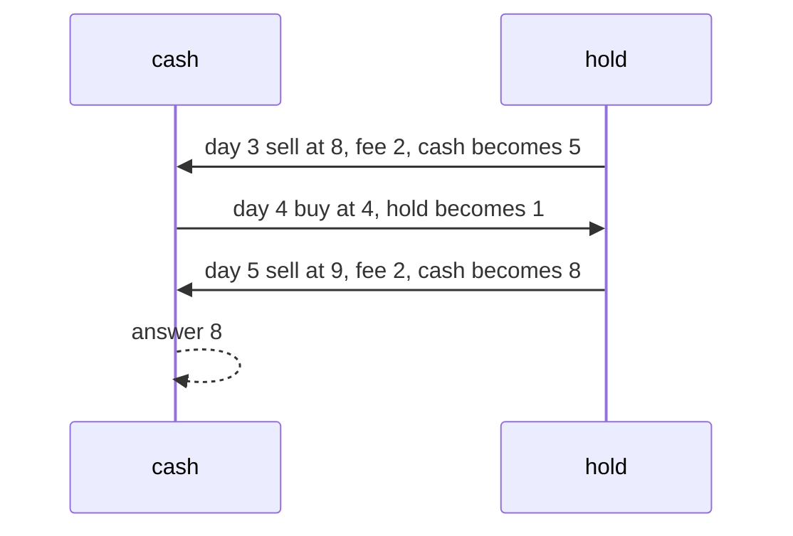

# 225 — Stock with transaction fee (DP).

> **Tier:** Intermediate · **CTCI chapter:** Ch 8 — Recursion and Dynamic Programming
> **Task spec:** [225-stock-with-transaction-fee-dp.md](../../../tasks/intermediate/225-stock-with-transaction-fee-dp.md)
> **Solutions:** [Python](../../../solutions/python/intermediate/225-stock-with-transaction-fee-dp/solution.py) ·
> [Java](../../../solutions/java/intermediate/225-stock-with-transaction-fee-dp/Solution.java) ·
> [JavaScript](../../../solutions/javascript/intermediate/225-stock-with-transaction-fee-dp/solution.js) ·
> [C#](../../../solutions/csharp/intermediate/225-stock-with-transaction-fee-dp/Solution.cs)

## 1. Problem restatement

**Input:** an array `prices` (one price per day) and a non-negative integer `fee` charged on
every sale. Trading is unlimited, and each trade must be closed before the next one opens.

**Output:** the maximum total profit after paying the fees. Doing nothing earns `0`, so the
answer is never negative; empty and single-day inputs answer `0`. A negative fee is rejected —
Python and C# raise, Java throws `IllegalArgumentException`, JavaScript throws an `Error` —
and all four assert that behaviour.

The spec is one line, so the contract comes from the assertions in the four solutions:

| Call | Result | Why |
| --- | --- | --- |
| `max_profit_fee([1, 3, 2, 8, 4, 9], 2)` | `8` | `(8 - 1 - 2) + (9 - 4 - 2)` |
| `max_profit_fee([1, 3, 2, 8, 4, 9], 0)` | `13` | with no fee this equals the greedy answer of task 223 |
| `max_profit_fee([1, 2], 5)` | `0` | the fee eats the gain |
| `max_profit_fee([1, 2], 0)` | `1` | one rising step, no fee |
| `max_profit_fee([1, 4], 1)` | `2` | the sale nets `4 - 1 - 1` |
| `max_profit_fee([], 2)` | `0` | no days |
| `max_profit_fee([5], 1)` | `0` | one day |
| `max_profit_fee([5], 0)` | `0` | one day, even for free |
| `max_profit_fee([1, 2], -1)` | raises | "fee must be non-negative" |

The Python docstring gives the recurrence: *"Two states: cash (not holding) and hold
(holding). Transitions: `cash' = max(cash, hold + price - fee)`, `hold' = max(hold, cash -
price)`. Answer is cash after the last day."*

## 2. Intuition

Without a fee the problem collapses to the greedy sum of positive daily gains
([task 223](../../../tasks/intermediate/223-stock-buy-sell-multiple-transactions-greedy.md)),
because buying after every rise and selling before every fall is free. A fee breaks that: a
`+1` rise is no longer worth harvesting if the sale costs `5`. The greedy sweep cannot express
"this rise is too small to trade", so it needs to be replaced by something that can *decline*
a trade.

The right amount of state turns out to be one bit: at the start of each day you either hold a
share or you do not.

- **cash** — the best profit achievable so far when you hold no share;
- **hold** — the best profit achievable so far when you do hold a share (so the purchase price
  is already subtracted).

Each day offers two decisions, and the key insight is that both are *comparisons against
doing nothing*, which is why abstention needs no special case:

- if you are in `hold`, you may sell today: `hold + price - fee` (and the fee is what makes
  the gain potentially negative, so `cash` keeps the better of the two options);
- if you are in `cash`, you may buy today: `cash - price`;
- otherwise you simply stay where you are.



The fee lives on the sale edge, which is a modelling choice rather than a mathematical one:
charging it on the buy instead gives the same optimum, but charging it on **both** edges
charges twice as much, which is where "per transaction" implementations usually go wrong.

## 3. Algorithm

1. If `fee < 0`, raise.
2. If the array is empty, return `0`.
3. Seed day 0: `cash = 0` (nothing held, nothing earned) and `hold = -prices[0]` (buy on
   day 0).
4. For each later price `p`, compute both successors **simultaneously** from the previous
   day's values:
   - `next_hold = max(hold, cash - p)` — keep the share, or buy one today;
   - `next_cash = max(cash, hold + p - fee)` — stay flat, or sell today's share and pay the
     fee.
5. Assign both, then continue.
6. Return `cash` — ending flat is always at least as good as ending with an unsold share.

```text
function max_profit_fee(prices, fee)
    if fee < 0 then raise "fee must be non-negative" end
    if length(prices) = 0 then return 0 end
    cash ← 0
    hold ← minus prices[0]
    for i ← 1 to length(prices) - 1 do
        p ← prices[i]
        next_hold ← max(hold, cash - p)
        next_cash ← max(cash, hold + p - fee)
        hold ← next_hold
        cash ← next_cash
    end
    return cash
end
```

Both updates read the *previous* day's two values, so the temporaries (or, in Python, the
tuple assignment `hold, cash = max(hold, cash - p), max(cash, hold + p - fee)`) are
mandatory. Using the freshly written `hold` inside the `cash` update would let a share be
bought and sold on the same day at the same price, which is harmless for the answer but wrong
as a model.



## 4. Worked example

Trace `max_profit_fee([1, 3, 2, 8, 4, 9], 2)`. Day 0 seeds `cash = 0`, `hold = -1`.

| Day | `p` | `hold` (after) | `cash` (after) | reading |
| --- | --- | --- | --- | --- |
| 0 | 1 | -1 | 0 | buy at 1, or stay flat |
| 1 | 3 | `max(-1, 0 - 3) = -1` | `max(0, -1 + 3 - 2) = 0` | the sale would net `0`, so stay flat |
| 2 | 2 | `max(-1, -2) = -1` | `max(0, -1) = 0` | still not worth selling |
| 3 | 8 | `max(-1, 0 - 8) = -1` | `max(0, -1 + 8 - 2) = 5` | sell the 1-share at 8, netting 5 |
| 4 | 4 | `max(-1, 5 - 4) = 1` | `max(5, -1 + 4 - 2) = 5` | buy at 4 using the 5 banked |
| 5 | 9 | `max(1, 5 - 9) = 1` | `max(5, 1 + 9 - 2) = 8` | sell at 9, netting `1 + 7` = 8 total |

The answer is `cash = 8`, matching the asserted `(8 - 1 - 2) + (9 - 4 - 2) = 5 + 3`.

Two details are worth reading off the table:

- Day 1 and day 2 are the fee doing its job: the share bought at 1 is worth `3` on day 1,
  but `3 - 1 - 2 = 0`, so selling gains nothing and `cash` stays `0`. The greedy sweep of
  task 223 would have banked `+2` there and `+6` and `+5` afterwards by harvesting every
  rise.
- Day 4 shows `hold = 1`, i.e. "5 banked, minus 4 paid for the new share". The purchase is
  funded by the *previous* sale's cash, which is exactly what the simultaneous update is for.



Setting the fee to `0` turns the same table into the greedy answer: the asserted
`max_profit_fee([1, 3, 2, 8, 4, 9], 0) == 13` is the sum of the positive daily gains
`2 + 6 + 5`, which is precisely what task 223 computes.

## 5. Complexity

With `n = len(prices)`:

| Measure | Bound | Why it holds |
| --- | --- | --- |
| Time, best | O(n) | a negative fee fails in O(1); otherwise every day does constant work |
| Time, average | O(n) | two `max` operations and two additions per day |
| Time, worst | O(n) | two states, no inner loop and no dependence on `fee` |
| Space | O(1) | two scalars; the day dimension is discarded because today only needs yesterday |
| Full DP for comparison | O(n · k) time, O(n · k) space | with a transaction *limit* `k` you would need a table over days and trades; here `k` is unbounded, which is what lets the table collapse to two numbers |
| Greedy (task 223) | O(n) time, O(1) space | correct only when `fee = 0` |

The fee itself never appears in a loop bound: it only changes the arithmetic of the sale
transition, so a large fee costs no more time than a zero fee.

## 6. Pitfalls and edge cases

- **Negative fee.** Rejected explicitly before any other work. Paying a negative fee would be
  an infinite money machine (buy and sell repeatedly for a rebate), so the guard is part of
  the contract, and all four solutions assert the raise.
- **Empty input.** `0`, checked *after* the fee guard; the guard order is visible in the code
  and matters if a test calls the function with an empty array and a bad fee.
- **Single day.** `0`: you may buy, but there is no day left to sell, so `cash` stays at its
  initial `0`. Asserted for both `fee = 1` and `fee = 0` with the array `[5]`.
- **Fee larger than the gain.** `[1, 2]` with fee `5` gives `0`: the sale candidate is
  `-1 + 2 - 5 = -4`, and `cash` keeps the better option of not selling. This is the case the
  greedy sweep cannot express.
- **The fee is charged once per sale.** `[1, 4]` with fee `1` is `2`, not `1` or `3`. If a port
  subtracts the fee on the buy *and* on the sell, every round trip is charged twice and the
  answers shrink accordingly.
- **Simultaneous update.** `next_cash` uses the old `hold` and `next_hold` uses the old
  `cash`. Java, JavaScript and C# use temporaries; Python uses a tuple assignment. Sequentially
  overwriting `hold` first would make same-day buy/sell cycles representable.
- **Seeding `hold`.** Day 0 is the cheapest possible starting point: `hold = -prices[0]`.
  Seeding it with `0` would mean "holding a free share", which silently adds `prices[i]` to
  every sale.
- **Answer is `cash`, not `max(cash, hold)`.** Ending the horizon while holding a share is
  never better than having sold it at the same final price (you would pay the fee, which only
  makes holding better). The solutions return `cash`, and the assertions agree.
- **Zero fee degeneracy.** With `fee = 0` this DP is exactly the state machine that task 223's
  greedy sweep replaces, and the solutions assert the equality explicitly, which is a useful
  cross-check that both implementations model the same problem.
- **Flat and falling markets.** Every sale candidate is non-positive, `cash` stays `0`, and
  the answer is `0`.
- **Overflow.** `hold + p - fee` is computed in `int` in Java, JavaScript and C#; the shipped
  prices are small, but a long sequence of large gains could overflow the `int` versions.

## 7. Variants and follow-ups

- **No fee.** [223-stock-buy-sell-multiple-transactions-greedy.md](../../../tasks/intermediate/223-stock-buy-sell-multiple-transactions-greedy.md)
  is the `fee = 0` special case, and this task's assertions pin the equality.
- **A rest day instead of a fee.** [224-stock-with-cooldown-dp.md](../../../tasks/intermediate/224-stock-with-cooldown-dp.md)
  needs a third state because the constraint is about *when* you may buy rather than how much
  a sale costs.
- **A single transaction.** [222-stock-buy-sell-single-transaction-max-profit.md](../../../tasks/intermediate/222-stock-buy-sell-single-transaction-max-profit.md)
  is the `k = 1` bound, where one running minimum replaces the whole state machine.
- **The same two-state shape elsewhere.** [211-subarray-sum-equals-k-count-hashmap.md](../../../tasks/intermediate/211-subarray-sum-equals-k-count-hashmap.md)
  and [210-longest-subarray-with-sum-equal-to-k-with-negatives-using-hashma.md](../../../tasks/intermediate/210-longest-subarray-with-sum-equal-to-k-with-negatives-using-hashma.md)
  keep "two running quantities and take the better" as a general pattern for sliding
  quantities.
- The chapter walkthrough in [Recursion and Dynamic Programming](../../ctci/08-recursion-and-dp.md)
  develops the "collapsing DP table" idea that turns a two-dimensional table here into two
  variables.

## 8. Check yourself

1. Why is the fee subtracted on the sale rather than on the buy?

<details><summary>Show answer</summary>

Either choice models the same optimum, but it must appear exactly once per round trip. The
solutions attach it to the sale (`hold + p - fee`), so `[1, 4]` with fee `1` gives `2` —
matching the assertion. Charging it on both edges would double every transaction cost.

</details>

2. What does `hold` mean numerically?

<details><summary>Show answer</summary>

It is the best profit so far *assuming a share is currently held*, with the purchase price
already deducted. On day 4 of the trace, `hold = 1` means "5 banked from the sale on day 3,
minus the 4 paid for the share bought today".

</details>

3. Why is the answer `cash` rather than `max(cash, hold)`?

<details><summary>Show answer</summary>

Because a share still held on the last day can always be sold at the same price and pay the
fee — which yields no more than simply not holding it, since fees are non-negative. So
`cash >= hold` at the end of the horizon, and the solutions return `cash`.

</details>

4. What goes wrong with `max_profit_fee([1, 2], 5)`, and why is `0` the right answer?

<details><summary>Show answer</summary>

The only possible trade nets `-1 + 2 - 5 = -4`. Since doing nothing is allowed, the optimal
choice is to abstain, so the answer is `0`. `cash` starts at `0` and takes `max(cash, ...)`,
which is exactly the mechanism that permits abstention without a separate branch.

</details>

5. Which assertion proves that this DP agrees with the no-fee greedy algorithm?

<details><summary>Show answer</summary>

`max_profit_fee([1, 3, 2, 8, 4, 9], 0) == 13`. With a zero fee the two-state machine must
reduce to the greedy sweep of task 223, whose value on the same array is the sum of the
positive daily gains `2 + 6 + 5 = 13`.

</details>
