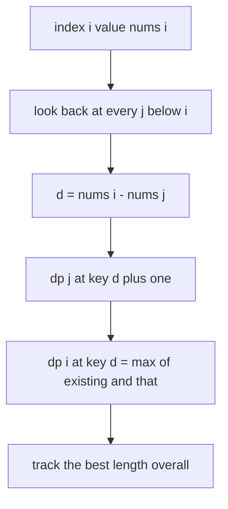
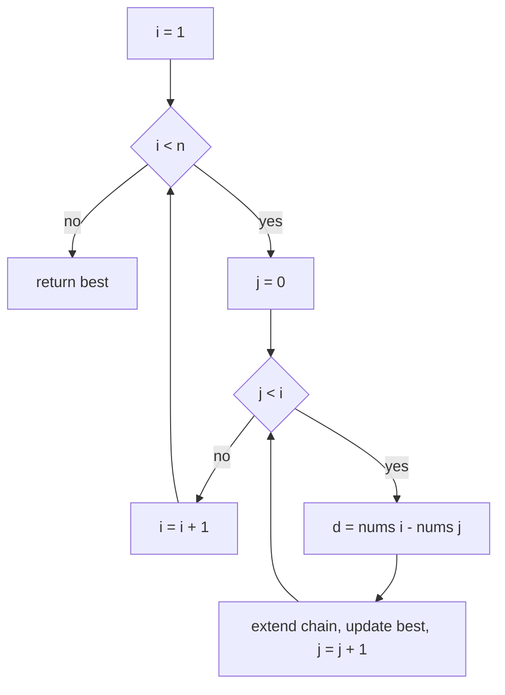
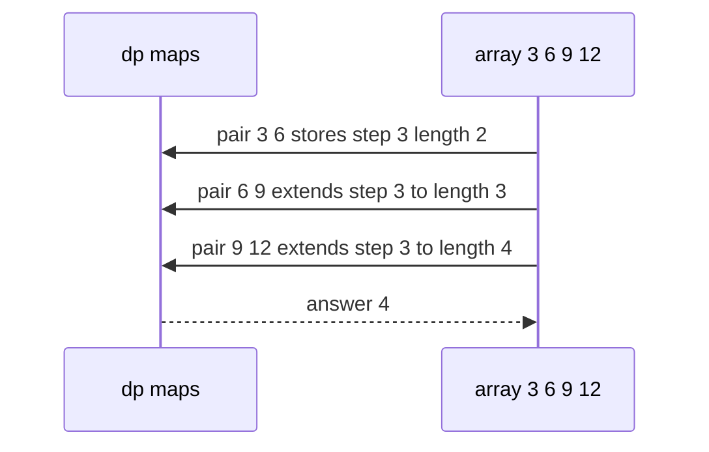

# 226 — Longest arithmetic progression subsequence (DP).

> **Tier:** Intermediate · **CTCI chapter:** Ch 8 — Recursion and Dynamic Programming
> **Task spec:** [226-longest-arithmetic-progression-subsequence-dp.md](../../../tasks/intermediate/226-longest-arithmetic-progression-subsequence-dp.md)
> **Solutions:** [Python](../../../solutions/python/intermediate/226-longest-arithmetic-progression-subsequence-dp/solution.py) ·
> [Java](../../../solutions/java/intermediate/226-longest-arithmetic-progression-subsequence-dp/Solution.java) ·
> [JavaScript](../../../solutions/javascript/intermediate/226-longest-arithmetic-progression-subsequence-dp/solution.js) ·
> [C#](../../../solutions/csharp/intermediate/226-longest-arithmetic-progression-subsequence-dp/Solution.cs)

## 1. Problem restatement

**Input:** an array of integers `nums`.

**Output:** the length of the longest **arithmetic subsequence** — a sequence of elements
taken in index order (not necessarily adjacent) whose consecutive differences are all equal.
The empty input has no subsequence at all, so it answers `0`; a single element answers `1`;
any two elements always form an AP of length `2`.

The spec is one line, so the contract comes from the assertions in the four solutions:

| Call | Result | Why |
| --- | --- | --- |
| `longest_arithmetic_subsequence([3, 6, 9, 12])` | `4` | the whole array, step `3` |
| `longest_arithmetic_subsequence([9, 4, 7, 2, 10])` | `3` | `4, 7, 10` (step `3`) |
| `longest_arithmetic_subsequence([1, 2])` | `2` | any pair |
| `longest_arithmetic_subsequence([4])` | `1` | one element |
| `longest_arithmetic_subsequence([])` | `0` | nothing to pick |
| `longest_arithmetic_subsequence([1, 1, 1])` | `3` | difference `0` is allowed |
| `longest_arithmetic_subsequence([2, 4, 6, 8, 10])` | `5` | step `2` throughout |
| `longest_arithmetic_subsequence([1, 5, 9, 13, 2, 6, 10, 14])` | `4` | two interleaved APs, not `8` |
| `longest_arithmetic_subsequence([5, 5, 3, 1])` | `3` | `5, 3, 1`, step `-2` |

The Python docstring fixes three conventions the assertions rely on: the subsequence is *not*
contiguous, **difference 0 is allowed** (equal values form an AP), and the bound is `O(n^2)`
time with `O(n^2)` space.

## 2. Intuition

"Matching consecutive differences" tempts a local scan: walk the array, compare
`nums[i] - nums[i - 1]` with the previous difference, and count. That computes the longest
arithmetic *subarray* and fails immediately on `[1, 5, 9, 13, 2, 6, 10, 14]`, where the
adjacent differences are `+4, +4, +4, -11, +4, +4, +4` — the answer is `4`, not `7`, and the
elements `1, 5, 9, 13` are not adjacent to each other in the pattern that matters.

The subset-style enumeration is also wrong here: the number of subsequences is exponential,
and the property being tested (all differences equal) depends on the whole chain, so no
pruning helps.

The key insight is to index the DP by the one thing that turns a "next element" into an
extension of an existing chain: **the common difference**. Define

```text
dp[i][d] = the longest arithmetic subsequence ending at index i whose step is d
```

Then for every earlier index `j`, the difference `d = nums[i] - nums[j]` relates the two
states directly:

```text
dp[i][d] = max(dp[i][d], dp[j][d] + 1)
```

Two elements with no predecessor still form a length-2 chain, so the recurrence starts from
`dp[j][d] = 1` when the difference has not been seen at `j` — the pair (`nums[j]`, `nums[i]`)
is itself a length-2 AP.



Because the state is keyed by the *difference* rather than by an index, the table is a list of
maps: `dp[i]` holds one entry per step that has been seen ending at `i`, and only the steps
that actually occur are stored.

## 3. Algorithm

1. If the array is empty, return `0`.
2. Create `dp` as `n` empty maps, one per index.
3. Set `best = 1` (a single element is a valid AP).
4. For `i` from `1` to `n - 1`:
   - For `j` from `0` to `i - 1`:
     - `d = nums[i] - nums[j]`;
     - `length = (dp[j][d] if present else 1) + 1`;
     - if `length > dp[i][d]` (or the key is absent), store it;
     - `best = max(best, length)`.
5. Return `best`.

```text
function longest_arithmetic_subsequence(nums)
    if length(nums) = 0 then return 0 end
    dp ← list of length(nums) empty maps
    best ← 1
    for i ← 1 to length(nums) - 1 do
        for j ← 0 to i - 1 do
            d ← nums[i] - nums[j]
            previous ← dp[j][d] if the key exists else 1
            length ← previous + 1
            if the key d is absent in dp[i] or length > dp[i][d] then
                dp[i][d] ← length
            end
            best ← max(best, length)
        end
    end
    return best
end
```

Two details carry the whole algorithm:

- the default `1` for `dp[j][d]` is the "no predecessor" case — it makes every ordered pair a
  candidate chain of length 2;
- `best` is updated inside the inner loop rather than at the end, because the longest chain
  may finish at any index.



The memory layout matters for the cost: `dp` is `n` maps whose combined size is at most
`n(n - 1) / 2` entries, one per ordered pair, which is where the `O(n^2)` space bound comes
from. A dense alternative — an array indexed by `d` — is only possible when the value range
is small enough to shift into non-negative indices, which is why every solution uses a map.

## 4. Worked example

Trace `longest_arithmetic_subsequence([3, 6, 9, 12])`, the fully asserted case. `best` starts
at `1`.

| `i` (value) | `j` (value) | `d` | `dp[j][d]` | `length` | `dp[i][d]` stored | `best` |
| --- | --- | --- | --- | --- | --- | --- |
| 1 (6) | 0 (3) | 3 | absent → 1 | 2 | `dp[1][3] = 2` | 2 |
| 2 (9) | 0 (3) | 6 | absent → 1 | 2 | `dp[2][6] = 2` | 2 |
| 2 (9) | 1 (6) | 3 | `dp[1][3] = 2` | 3 | `dp[2][3] = 3` | 3 |
| 3 (12) | 0 (3) | 9 | absent → 1 | 2 | `dp[3][9] = 2` | 3 |
| 3 (12) | 1 (6) | 6 | `dp[1][6]` absent → 1 | 2 | `dp[3][6] = 2` | 3 |
| 3 (12) | 2 (9) | 3 | `dp[2][3] = 3` | 4 | `dp[3][3] = 4` | 4 |

The last row is the whole point: the chain `3, 6, 9` already ends at index 2 with step `3`,
so extending it by `12` costs one lookup and yields `4`.



Two more traces show the conventions the map key must support:

- `[1, 1, 1]` uses `d = 0`. `dp[1][0]` becomes `2` from the pair `(1, 1)`, and `dp[2][0]`
  reads it and becomes `3` — the asserted answer. A guard such as "skip if `d = 0`" would
  return `2`.
- `[5, 5, 3, 1]` uses a **negative** step. The chain is `5, 3, 1` with `d = -2`: `dp[2][-2]`
  becomes `2` from the pair `(5, 3)` at indices `1, 2`, then `dp[3][-2]` reads it and becomes
  `3`, which is asserted. Keys therefore must never be coerced to non-negative values, which
  is another reason the solutions use hash maps rather than arrays.

And the interleaving case `[1, 5, 9, 13, 2, 6, 10, 14]` asserts `4`: the array contains two
APs of step `4` (`1, 5, 9, 13` and `2, 6, 10, 14`), and a chain may not mix them, because the
indices of the first four are `0, 1, 2, 3` and the pattern that would join them
(`1, 5, 9, 13, 14` has a final difference of `1`) is not arithmetic.

## 5. Complexity

With `n = len(nums)`:

| Measure | Bound | Why it holds |
| --- | --- | --- |
| Time, best | O(n^2) | the double loop always runs `n(n - 1) / 2` iterations; only `n = 0` is faster |
| Time, average | O(n^2) | each iteration does one subtraction and one map lookup/store |
| Time, worst | O(n^2) | map operations on integer keys are expected `O(1)`; no sorting or searching |
| Space | O(n^2) | `n` maps holding at most one entry per ordered pair |
| Naive subsequence enumeration | O(2^n · n) | every index subset would have to be checked for constant differences |
| Contiguous-only approach | O(n) | but it solves a different problem: it misses `[1, 5, 9, 13, 2, 6, 10, 14]` |

The `O(n^2)` space is the price of keying by difference. For the input sizes this task is
written for (`n` in the low thousands) that is around ten million map entries in the worst
case, which is why the hash-map form — storing only the differences that occur — is the
shipped one.

## 6. Pitfalls and edge cases

- **Empty input.** `0`, asserted. Nothing can be selected, and returning `1` would be wrong.
- **Single element.** `1`, asserted. No pair exists, so the initial `best = 1` is the answer.
- **Two elements.** `2`, asserted with `[1, 2]`. The default `dp[j][d] = 1` is what produces
  it; seeding with `0` instead would report `1`.
- **Equal values (`d = 0`).** Explicitly allowed: `[1, 1, 1] → 3`. The Python docstring says
  so in the same sentence as the "not necessarily contiguous" convention.
- **Negative differences.** `[5, 5, 3, 1] → 3` needs the key `-2`. Any port that indexes a
  plain array by the difference must offset it; the solutions avoid the issue with maps.
- **Not a subarray.** `[9, 4, 7, 2, 10] → 3` picks indices `1, 2, 4`; the algorithm never
  requires contiguity, and a solution that compares adjacent differences would report `2`.
- **Interleaved progressions.** `[1, 5, 9, 13, 2, 6, 10, 14] → 4`, not `8`: chains cannot
  switch steps mid-way, so the answer is the best single-step chain.
- **Duplicate differences at the same index.** `dp[i]` keeps the *maximum* length per step,
  so a tie never overwrites a longer chain with a shorter one. Comparing the new length
  before storing is what enforces that.
- **Updating `best` in the wrong place.** The maximum can end at any index and with any step;
  computing `best` only after the loops (for example as `max(dp[i][d])` at the end of each
  `i`) is equivalent only if it is done for the finished row.
- **Memory growth.** `n` maps with up to `n - 1` entries each is `O(n^2)`; for large `n` this
  dominates running time in practice.
- **Overflow of the difference.** `nums[i] - nums[j]` is computed in the same type as the
  values; with `int` extremes in Java and C# the subtraction can overflow. Python's integers
  cannot.

## 7. Variants and follow-ups

- **Longest increasing subsequence.** [119-longest-increasing-subsequence-naive-dp-o-n-2.md](../../../tasks/beginner/119-longest-increasing-subsequence-naive-dp-o-n-2.md)
  is the same "extend a chain" DP keyed by position instead of by step, and the `O(n^2)`
  version has the identical double loop.
- **Longest common subsequence.** [121-longest-common-subsequence-lcs-dp.md](../../../tasks/beginner/121-longest-common-subsequence-lcs-dp.md)
  shows a table-shaped DP for a different subsequence property; comparing the two is a good
  way to see when a map-per-index is the right layout.
- **Maximum sum increasing subsequence.** [228-maximum-sum-increasing-subsequence.md](../../../tasks/intermediate/228-maximum-sum-increasing-subsequence.md)
  is this DP with the objective changed from length to sum, and it needs no difference key.
- **Longest alternating subsequence.** [229-longest-alternating-subsequence.md](../../../tasks/intermediate/229-longest-alternating-subsequence.md)
  relaxes "constant difference" to "alternating sign" and drops to `O(n)` with `O(1)` space —
  a useful contrast: the harder the structural constraint, the bigger the state.
- **The contiguous cousin.** [118-longest-increasing-subarray-contiguous.md](../../../tasks/beginner/118-longest-increasing-subarray-contiguous.md)
  is what a single-pass scan with a running difference *does* compute.
- The chapter walkthrough in [Recursion and Dynamic Programming](../../ctci/08-recursion-and-dp.md)
  places this task with the two-dimensional DPs whose second dimension is a value, not an
  index.

## 8. Check yourself

1. Why is the DP keyed by the common difference rather than by the previous index?

<details><summary>Show answer</summary>

Because extending a chain depends only on the step: `nums[i]` continues a chain ending at `j`
exactly when `nums[i] - nums[j]` equals that chain's step. Keying by the previous index would
need the whole visited subsequence to know the step; keying by the step makes the extension a
single lookup `dp[j][d]`.

</details>

2. Where does the length-2 base case come from?

<details><summary>Show answer</summary>

From the default value `1` used when `dp[j][d]` has no entry: the pair (`nums[j]`, `nums[i]`)
is itself an arithmetic subsequence of length 2 for every `j < i`. Then
`length = 1 + 1 = 2` is stored, and every later extension builds on it.

</details>

3. What does `[1, 1, 1]` test, and what would break it?

<details><summary>Show answer</summary>

It tests that a difference of `0` is a legal step: `dp[1][0] = 2`, then `dp[2][0] = 3`. A guard
that skips zero differences — a common reflex from "progressions must have a nonzero step" —
would return `2` instead of the asserted `3`.

</details>

4. Why does `[1, 5, 9, 13, 2, 6, 10, 14]` return `4` rather than `8`?

<details><summary>Show answer</summary>

Because the eight elements form two separate APs of step `4`, and a subsequence must keep one
constant difference throughout: `1, 5, 9, 13` or `2, 6, 10, 14`. Any attempt to include all
eight in index order would need the difference to change at the junction, which is not
arithmetic.

</details>

5. What is the cost of the extra state, and when would you avoid it?

<details><summary>Show answer</summary>

The difference dimension turns an `O(n)` contiguous scan into an `O(n^2)`-time,
`O(n^2)`-space table. You would avoid it when the problem only asks for contiguous runs
(task 118), when the objective changes to something that needs no step key (task 228), or when
the structural constraint is weaker and a two-state scan suffices (task 229).

</details>
