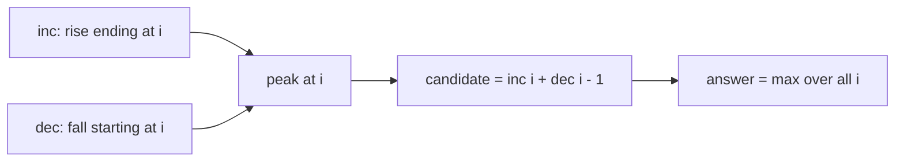
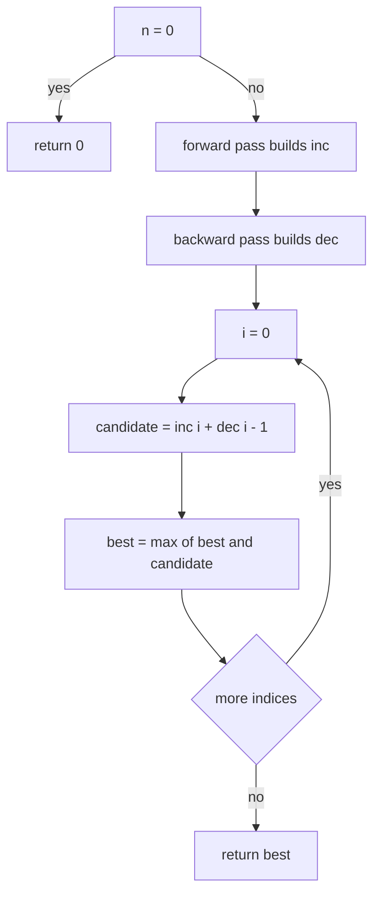
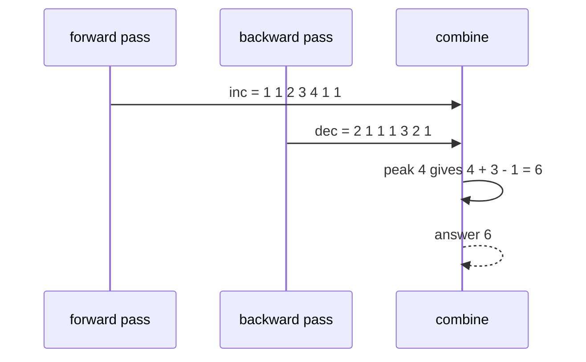

# 227 — Longest bitonic subarray.

> **Tier:** Intermediate · **CTCI chapter:** Ch 8 — Recursion and Dynamic Programming
> **Task spec:** [227-longest-bitonic-subarray.md](../../../tasks/intermediate/227-longest-bitonic-subarray.md)
> **Solutions:** [Python](../../../solutions/python/intermediate/227-longest-bitonic-subarray/solution.py) ·
> [Java](../../../solutions/java/intermediate/227-longest-bitonic-subarray/Solution.java) ·
> [JavaScript](../../../solutions/javascript/intermediate/227-longest-bitonic-subarray/solution.js) ·
> [C#](../../../solutions/csharp/intermediate/227-longest-bitonic-subarray/Solution.cs)

## 1. Problem restatement

**Input:** an array of integers `nums`.

**Output:** the length of the longest **contiguous** subarray that first strictly increases
and then strictly decreases. Degenerate shapes count in full: a purely increasing run and a
purely decreasing run are both bitonic, and a single element is both. The empty input answers
`0`.

The Python docstring states the two conventions the assertions depend on: *"a purely
increasing or purely decreasing run counts in full (degenerate bitonic), and equal neighbours
break strictness."*

| Call | Result | Why |
| --- | --- | --- |
| `longest_bitonic_subarray([2, 1, 4, 5, 6, 3, 2])` | `6` | `[1, 4, 5, 6, 3, 2]` |
| `longest_bitonic_subarray([1, 5, 1])` | `3` | a single peak |
| `longest_bitonic_subarray([1, 2, 3, 4])` | `4` | monotone up, degenerate |
| `longest_bitonic_subarray([4, 3, 2, 1])` | `4` | monotone down, degenerate |
| `longest_bitonic_subarray([7])` | `1` | one element |
| `longest_bitonic_subarray([])` | `0` | no elements |
| `longest_bitonic_subarray([1, 1])` | `1` | equal neighbours are not an increase |
| `longest_bitonic_subarray([12, 4, 78, 90, 45, 23, 100])` | `5` | `[4, 78, 90, 45, 23]` |

Note the last row: the largest value in the array (`100`) is not part of the answer at all,
because it sits at the very end where a down-slope cannot follow.

## 2. Intuition

The naive approach tries every candidate peak and expands outward, which is `O(n^2)`: for each
index walk left while the values are rising and right while they are falling.

```text
function brute_force(nums)
    best ← 0
    for peak ← 0 to n - 1 do
        left ← peak - 1
        while left >= 0 and nums[left] < nums[left + 1] do
            left ← left - 1
        end
        right ← peak + 1
        while right < n and nums[right] < nums[right - 1] do
            right ← right + 1
        end
        best ← max(best, right - left - 1)
    end
    return best
end
```

Both expanders use strict comparisons, so equal neighbours stop the walk on both sides, and
the width `right - left - 1` counts the peak exactly once.

The waste is the same as in the circular-Kadane task: neighbouring peaks re-walk the same
mountainside. The key insight is that each index needs only two numbers, and both are
*reusable neighbours*:

- `inc[i]` — the length of the strictly increasing run that **ends** at `i`;
- `dec[i]` — the length of the strictly decreasing run that **starts** at `i`.

Both satisfy a one-line recurrence along the array, so each is computed in a single pass. Then
the longest bitonic subarray peaking at `i` is `inc[i] + dec[i] - 1`: the rising part, the
falling part, and the peak counted once because it appears in both.



The `- 1` is the only fiddly part of the formula, and it is exactly the double count of the
peak element. For `i = 4` in the first asserted array the two counts are `4` and `3`, and
`4 + 3 - 1 = 6`.

## 3. Algorithm

1. If the array is empty, return `0`.
2. Forward pass: `inc[0] = 1`; for `i` from `1` to `n - 1`, set `inc[i] = inc[i - 1] + 1` when
   `nums[i] > nums[i - 1]`, otherwise `inc[i] = 1`.
3. Backward pass: `dec[n - 1] = 1`; for `i` from `n - 2` down to `0`, set
   `dec[i] = dec[i + 1] + 1` when `nums[i] > nums[i + 1]`, otherwise `dec[i] = 1`.
4. Return the maximum of `inc[i] + dec[i] - 1` over all `i`.

```text
function longest_bitonic_subarray(nums)
    n ← length(nums)
    if n = 0 then return 0 end
    inc ← array of n ones
    for i ← 1 to n - 1 do
        if nums[i] > nums[i - 1] then inc[i] ← inc[i - 1] + 1 end
    end
    dec ← array of n ones
    for i ← n - 2 down to 0 do
        if nums[i] > nums[i + 1] then dec[i] ← dec[i + 1] + 1 end
    end
    best ← 0
    for i ← 0 to n - 1 do
        best ← max(best, inc[i] + dec[i] - 1)
    end
    return best
end
```

The comparisons are strict in both passes, which is what makes equal neighbours reset a run:

- the forward pass extends only when `nums[i] > nums[i - 1]`;
- the backward pass extends only when `nums[i] > nums[i + 1]`, i.e. the values fall as you
  move right.



Both passes are needed because the two directions cannot share a single accumulator: `inc` is
built left-to-right and `dec` right-to-left, and the final scan combines them at each possible
peak.

## 4. Worked example

Trace `longest_bitonic_subarray([2, 1, 4, 5, 6, 3, 2])`. Both arrays start as all ones and are
then filled by their pass:

| `i` | `nums[i]` | `inc[i]` | why | `dec[i]` | why | `inc + dec - 1` |
| --- | --- | --- | --- | --- | --- | --- |
| 0 | 2 | 1 | start | 2 | `2 > 1`, so `dec[1] + 1` | 2 |
| 1 | 1 | 1 | `1 > 2` is false | 1 | `1 > 4` is false | 1 |
| 2 | 4 | 2 | `4 > 1`, so `inc[1] + 1` | 1 | `4 > 5` is false | 2 |
| 3 | 5 | 3 | `5 > 4` | 1 | `5 > 6` is false | 3 |
| 4 | 6 | 4 | `6 > 5` | 3 | `6 > 3`, then `3 > 2` | **6** |
| 5 | 3 | 1 | `3 > 6` false | 2 | `3 > 2` | 2 |
| 6 | 2 | 1 | `2 > 3` false | 1 | start | 1 |

The winner is index 4 with `4 + 3 - 1 = 6`, and the subarray is indices `1..6`:
`[1, 4, 5, 6, 3, 2]` — rise `1, 4, 5, 6`, peak `6`, fall `3, 2`. The asserted answer is `6`.



The second asserted case shows why the peak does not have to be the maximum of the whole
array. On `[12, 4, 78, 90, 45, 23, 100]`:

| `i` | `nums[i]` | `inc[i]` | `dec[i]` | `inc + dec - 1` |
| --- | --- | --- | --- | --- |
| 0 | 12 | 1 | 2 | 2 |
| 1 | 4 | 1 | 1 | 1 |
| 2 | 78 | 2 | 1 | 2 |
| 3 | 90 | 3 | 3 | **5** |
| 4 | 45 | 1 | 2 | 2 |
| 5 | 23 | 1 | 1 | 1 |
| 6 | 100 | 2 | 1 | 2 |

The answer is `5`, the subarray `[4, 78, 90, 45, 23]`. The array's maximum value (`100`, at
index 6) only reaches `2`, because a peak needs a falling side, and the array ends there.

The equal-neighbour rule shows up in `[1, 1]`: the forward pass sees `1 > 1` as false, so
`inc = [1, 1]`; the backward pass sees `1 > 1` as false, so `dec = [1, 1]`; every candidate is
`1 + 1 - 1 = 1`, the asserted answer. A non-strict comparison would have reported `2`.

## 5. Complexity

With `n = len(nums)`:

| Measure | Bound | Why it holds |
| --- | --- | --- |
| Time, best | O(n) | all three loops always run; only `n = 0` returns in O(1) |
| Time, average | O(n) | two comparisons per element in the passes plus one addition in the combine |
| Time, worst | O(n) | three linear scans, no nested loops |
| Space | O(n) | the `inc` and `dec` arrays, both of length `n` |
| Brute force for comparison | O(n^2) | every peak expands left and right, re-walking shared mountainsides |
| Kadane-like one-pass variant | O(n) time, O(1) space | possible by tracking the current direction and run length, at the cost of handling the peak reset by hand |

The `O(n)` space is for clarity rather than necessity: `dec` must be built in reverse, so the
combine step needs one of the two arrays materialised. A one-pass state machine that tracks the
current direction and the length of the run before the last turnaround reaches `O(1)` space,
but it has to reproduce the same strictness rules by hand, which is where such versions
usually break on equal neighbours.

## 6. Pitfalls and edge cases

- **Empty array.** `0`, asserted. No subarray exists, and returning `1` would claim an element
  that is not there.
- **Single element.** `1`, asserted. Both arrays hold `1` at index 0 and the candidate is
  `1 + 1 - 1 = 1`.
- **Equal neighbours.** `[1, 1] → 1`, asserted. Strictness is what makes this fail: `>=` in
  either pass would report `2`. All-equal arrays behave the same way — the answer stays `1`.
- **Monotone inputs.** `[1, 2, 3, 4] → 4` and `[4, 3, 2, 1] → 4`, both asserted: a run with no
  peak at all is still bitonic, and the formula handles it because one of `inc` / `dec` equals
  `1` at the endpoint that serves as the peak.
- **The peak counted twice.** Forgetting the `- 1` inflates every answer that has a real peak
  and leaves the degenerate cases off by one as well.
- **The peak is not necessarily the global maximum.** `[12, 4, 78, 90, 45, 23, 100] → 5`
  is asserted precisely to block the "find the max, expand" shortcut, which would want to
  include `100` at the end.
- **Contiguity.** This is a *subarray* problem; `[2, 1, 4, 5, 6, 3, 2] → 6` uses indices
  `1..6`. A subsequence version (allowing skips) is a different, harder problem, and the file
  names in this repository distinguish them.
- **No wrap-around.** Unlike [task 221](../../../tasks/intermediate/221-circular-array-maximum-subarray-kadane-variant.md),
  the array is linear: a rise at the end cannot continue into a fall at the beginning.
- **Memory for large inputs.** Two extra arrays of `n` values; the runtime is linear either
  way, but the constant factor is two arrays rather than O(1) scalars.
- **Overflow is not a factor.** The comparisons are on the values and the arithmetic is on
  lengths, which are at most `n`. The one exception is `inc[i - 1] + 1` for absurdly long
  arrays, which stays far inside `int`.

## 7. Variants and follow-ups

- **Circular sums.** [221-circular-array-maximum-subarray-kadane-variant.md](../../../tasks/intermediate/221-circular-array-maximum-subarray-kadane-variant.md)
  uses the same "two accumulators, combine per index" shape, but the accumulators are
  extrema of sums rather than lengths of runs.
- **Monotone runs only.** [118-longest-increasing-subarray-contiguous.md](../../../tasks/beginner/118-longest-increasing-subarray-contiguous.md)
  is the one-sided version: it is exactly the forward pass here, without the falling half.
- **Alternating runs.** [229-longest-alternating-subsequence.md](../../../tasks/intermediate/229-longest-alternating-subsequence.md)
  keeps switching direction instead of switching once, which collapses the state to two
  counters.
- **Searching a bitonic array.** [491-implement-search-in-bitonic-array.md](../../../tasks/advanced/491-implement-search-in-bitonic-array.md)
  exploits the same shape from the other direction: knowing a peak exists is what makes
  binary search possible.
- **Longest arithmetic progression.** [226-longest-arithmetic-progression-subsequence-dp.md](../../../tasks/intermediate/226-longest-arithmetic-progression-subsequence-dp.md)
  is the structural-constraint cousin: constant differences instead of one direction change.
- The chapter walkthrough in [Recursion and Dynamic Programming](../../ctci/08-recursion-and-dp.md)
  groups this with the "two linear passes combined by a rule" family of DPs.

## 8. Check yourself

1. Why is the candidate at index `i` equal to `inc[i] + dec[i] - 1`?

<details><summary>Show answer</summary>

`inc[i]` counts the rising part including `i`, and `dec[i]` counts the falling part including
`i`. Concatenated, the subarray has `inc[i] + dec[i]` elements counted with the peak in both
parts, so subtracting one gives the true length.

</details>

2. What does `[1, 1]` return, and which comparison decides it?

<details><summary>Show answer</summary>

`1`. The forward pass tests `nums[1] > nums[0]`, which is false for equal values, so `inc[1]`
stays `1`; the backward pass tests `nums[0] > nums[1]`, also false, so `dec[0]` stays `1`. The
best candidate is `1`. Using `>=` in either pass would answer `2`.

</details>

3. Why is a peak's height irrelevant?

<details><summary>Show answer</summary>

Because the objective is a count of elements, not a sum or a value. On
`[12, 4, 78, 90, 45, 23, 100]` the tallest value `100` contributes only `2`, while the smaller
peak `90` anchors the length-`5` answer.

</details>

4. Why can't one pass compute both arrays?

<details><summary>Show answer</summary>

`inc[i]` depends on `i - 1` and `dec[i]` depends on `i + 1`, so they are built in opposite
directions. A single pass left to right can only finish `inc`; `dec` needs the backward scan,
or a much more careful state machine that tracks the current direction and remembers the run
length before the last turnaround.

</details>

5. What changes if the problem asks for the longest bitonic *subsequence* instead?

<details><summary>Show answer</summary>

Contiguity disappears, so the runs may skip elements: the answer becomes the best
`increasing_subsequence_ending_at(i) + decreasing_subsequence_starting_at(i) - 1`, computed
with the `O(n^2)` chain DP of task 119 in both directions. The `- 1` for the shared peak
stays, and the equal-neighbour strictness question has to be answered again for the new
definition.

</details>
