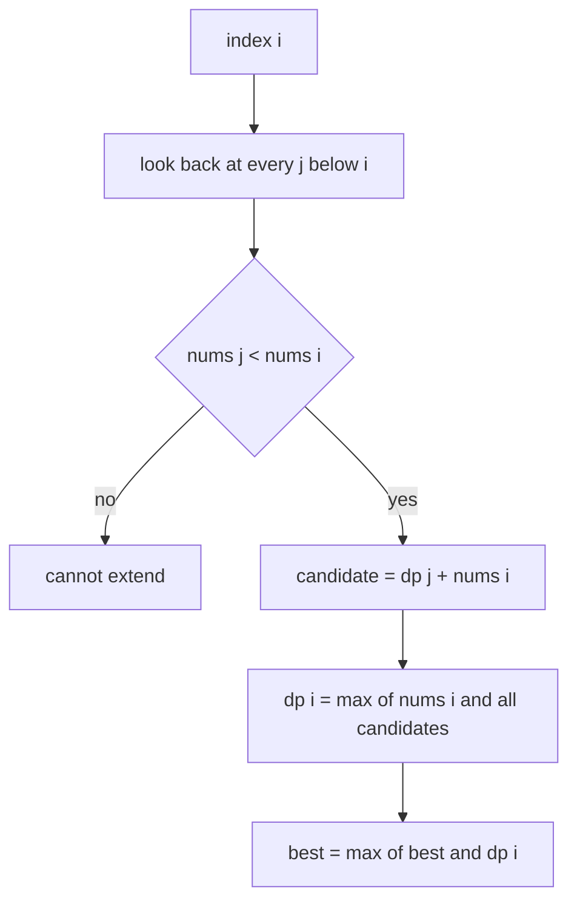
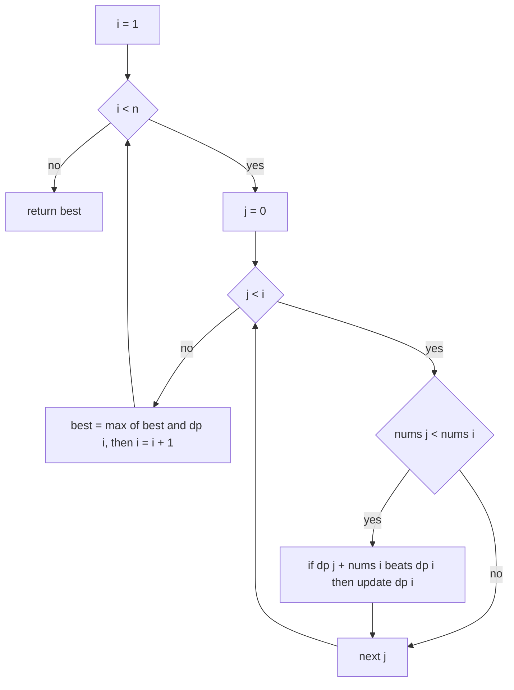
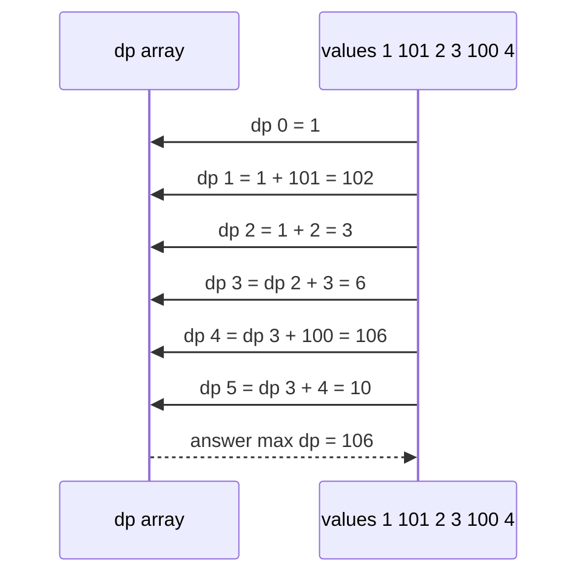

# 228 — Maximum sum increasing subsequence.

> **Tier:** Intermediate · **CTCI chapter:** Ch 8 — Recursion and Dynamic Programming
> **Task spec:** [228-maximum-sum-increasing-subsequence.md](../../../tasks/intermediate/228-maximum-sum-increasing-subsequence.md)
> **Solutions:** [Python](../../../solutions/python/intermediate/228-maximum-sum-increasing-subsequence/solution.py) ·
> [Java](../../../solutions/java/intermediate/228-maximum-sum-increasing-subsequence/Solution.java) ·
> [JavaScript](../../../solutions/javascript/intermediate/228-maximum-sum-increasing-subsequence/solution.js) ·
> [C#](../../../solutions/csharp/intermediate/228-maximum-sum-increasing-subsequence/Solution.cs)

## 1. Problem restatement

**Input:** an array of integers `nums`, possibly containing negative values.

**Output:** the largest possible **sum** of a strictly increasing subsequence. The
subsequence keeps index order and may skip elements; "subsequence" here means "pick a
sub-increasing chain of indices", so contiguity is not required. The empty input answers `0`.

The Python docstring fixes the convention that decides the negative cases:
*"`dp[i] = nums[i]` plus the best `dp[j]` among `j < i` with `nums[j] < nums[i]`; starting
fresh (0) is always allowed, so a lone negative element still beats extending below it."*

| Call | Result | Why |
| --- | --- | --- |
| `max_sum_increasing_subsequence([1, 101, 2, 3, 100, 4])` | `106` | `1 + 2 + 3 + 100` |
| `max_sum_increasing_subsequence([10, 1])` | `10` | decreasing pair: the single `10` wins |
| `max_sum_increasing_subsequence([5, 4, 3, 2, 1])` | `5` | all falling: the largest element |
| `max_sum_increasing_subsequence([1, 2, 3, 4])` | `10` | the whole array |
| `max_sum_increasing_subsequence([7])` | `7` | one element |
| `max_sum_increasing_subsequence([])` | `0` | nothing to pick |
| `max_sum_increasing_subsequence([3, 3])` | `3` | equal values are not increasing |
| `max_sum_increasing_subsequence([-2, -1, -3])` | `-1` | all negative: the best single element |

The last row is the one that separates this task from its all-positive cousins: with negatives
present, "more elements" is not automatically better, and a chain may have to be a single
element.

## 2. Intuition

Enumerating subsequences is exponential, and unlike some subset problems there is no
target value to index a table by — the objective is a sum of values, not a count of ways. What
*is* indexable is the chain structure: a subsequence is increasing, so its last element
determines which earlier elements may precede it.

That gives the state directly:

```text
dp[i] = the maximum sum of a strictly increasing subsequence that ends exactly at index i
```

The recurrence mirrors the longest-increasing-subsequence DP, with `+ nums[i]` instead of
`+ 1`:

```text
dp[i] = max(nums[i], the largest dp[j] + nums[i] over all j below i with nums[j] < nums[i])
```

Concretely, for each earlier index `j` whose value is smaller, extending `dp[j]` by `nums[i]`
is a candidate; and starting a fresh chain at `i` is always a candidate by itself. The solution
files express this by initialising `dp[i] = nums[i]` and then only improving it:

```text
if nums[j] < nums[i] and dp[j] + nums[i] > dp[i] then dp[i] ← dp[j] + nums[i] end
```

The key insight is the initialisation: `dp[i]` starts at `nums[i]`, not at `0` or
`-infinity`, because a single element is always a legal subsequence. That is what lets
`[-2, -1, -3]` answer `-1` — the chain `[-1]` — instead of `-3` or `0`.



Because `dp[i]` includes `nums[i]`, the answer is the maximum over all `i` of `dp[i]`, not
`dp[n - 1]`: the best chain can end anywhere.

## 3. Algorithm

1. If the array is empty, return `0`.
2. Initialise `dp` as a copy of `nums`, and set `best = dp[0]`.
3. For `i` from `1` to `n - 1`:
   - For `j` from `0` to `i - 1`:
     - If `nums[j] < nums[i]` and `dp[j] + nums[i] > dp[i]`, then `dp[i] = dp[j] + nums[i]`.
   - `best = max(best, dp[i])`.
4. Return `best`.

```text
function max_sum_increasing_subsequence(nums)
    if length(nums) = 0 then return 0 end
    dp ← copy of nums
    best ← dp[0]
    for i ← 1 to length(nums) - 1 do
        for j ← 0 to i - 1 do
            if nums[j] < nums[i] and dp[j] + nums[i] > dp[i] then
                dp[i] ← dp[j] + nums[i]
            end
        end
        best ← max(best, dp[i])
    end
    return best
end
```

The two comparisons in the inner loop enforce the two requirements:

- `nums[j] < nums[i]` — strict increase, so `[3, 3]` cannot chain two equal values;
- `dp[j] + nums[i] > dp[i]` — keep the best chain, not the most recent one.



The initialisation is not a detail that can be dropped: `dp` seeded with zeros would answer
`0` for an all-negative array (wrong, the answer is the largest element) and would also lose
the "start fresh at `i`" option for positive arrays whenever all predecessors are larger.

## 4. Worked example

Trace `max_sum_increasing_subsequence([1, 101, 2, 3, 100, 4])`, the first asserted case.
`dp` starts as a copy of the array, and `best = 1`.

| `i` | `nums[i]` | `j` values that extend | candidate sums | `dp[i]` after | `best` |
| --- | --- | --- | --- | --- | --- |
| 1 | 101 | `j = 0` (1 < 101) | `1 + 101 = 102` | 102 | 102 |
| 2 | 2 | `j = 0` (1 < 2) | `1 + 2 = 3` | 3 | 102 |
| 3 | 3 | `j = 0`, `j = 2` (1, 2 < 3) | `1 + 3 = 4`, then `3 + 3 = 6` | 6 | 102 |
| 4 | 100 | `j = 0`, `j = 2`, `j = 3` | `101`, `103`, then `6 + 100 = 106` | 106 | 106 |
| 5 | 4 | `j = 0`, `j = 2`, `j = 3` | `5`, `7`, then `6 + 4 = 10` | 10 | 106 |

The winner is `dp[4] = 106`, the chain `1 + 2 + 3 + 100` (indices `0, 2, 3, 4`). Two rows of
the table are worth reading closely:

- Row `i = 1` shows the greedy trap: `101` alone beats `1 + 101`, but the chain through `101`
  ends there, because nothing to its right is larger. The DP keeps both possibilities, and the
  later rows overtake `102` only because extending the *cheap* prefix `1, 2, 3` pays off.
- Row `i = 4` revisits the same `j` set three times, and each revisit improves `dp[4]`:
  `101`, then `103`, then `106`. The `>` comparison is what makes each improvement stick.



The negative case exercises the initialisation instead:

| `i` | `nums[i]` | extendable `j` | candidate | `dp[i]` | `best` |
| --- | --- | --- | --- | --- | --- |
| 0 | -2 | — | — | -2 | -2 |
| 1 | -1 | `j = 0` (-2 < -1) | `-2 + -1 = -3`, worse than `-1` | -1 | -1 |
| 2 | -3 | none (-2, -1 are both greater) | — | -3 | -1 |

The answer is `-1`, the asserted value. Extending `-2` by `-1` would *lower* the sum, which is
why the comparison against the initialised `dp[i] = nums[i]` matters.

## 5. Complexity

With `n = len(nums)`:

| Measure | Bound | Why it holds |
| --- | --- | --- |
| Time, best | O(n^2) | the double loop always runs `n(n - 1) / 2` iterations; only `n = 0` is faster |
| Time, average | O(n^2) | each iteration does one comparison of values and one comparison of sums |
| Time, worst | O(n^2) | no ordering shortcut: the objective depends on values, not just on indices |
| Space | O(n) | one `dp` array; the inner loop only reads earlier entries |
| Longest increasing subsequence (length) for comparison | O(n log n) | patience sorting works for lengths, but has no analogue for sums |
| Enumerating subsequences | O(2^n · n) | every index subset, checked for monotonicity and summed |

The `O(n log n)` LIS trick fails here for a concrete reason: the patience-sorting structure
keeps the *smallest tail value* per length, and a chain's sum cannot be recovered from that
tail — two chains of the same length can have wildly different sums, and the larger sum is the
one worth keeping. There is no exchange argument that makes one of them dominant, so every
predecessor must be examined.

## 6. Pitfalls and edge cases

- **Empty array.** `0`, asserted, although `dp[0]` is never read because the guard comes
  first.
- **Single element.** Returns that element — `[7] → 7` is asserted. A chain of one element is
  always legal, including when the element is negative.
- **All-negative arrays.** `[-2, -1, -3] → -1`: the answer is the largest single element,
  because concatenating negatives only shrinks the sum. Seeding `dp` with zeros would answer
  `0`, which corresponds to an empty subsequence and is not a legal answer for a non-empty
  input.
- **Strictness.** `[3, 3] → 3` (not `6`): equal values cannot chain. The test is
  `nums[j] < nums[i]`, so a port that uses `<=` breaks this row.
- **Decreasing arrays.** `[5, 4, 3, 2, 1] → 5`. No pair extends, so every `dp[i]` keeps its
  initialised value and `best` is the maximum element.
- **Whole array increasing.** `[1, 2, 3, 4] → 10`, the total sum.
- **The best chain need not end at the last index.** `[1, 101, 2, 3, 100, 4]` ends with `4`
  and `dp[5] = 10`; the answer `106` lives in `dp[4]`, which is why `best` is updated inside
  the outer loop rather than read from `dp[n - 1]`.
- **Not a subarray.** The chain `1, 2, 3, 100` skips `101` and `4`; contiguity is not
  required and the DP never checks adjacency.
- **Not the length objective.** Maximising the *length* gives a different answer on the same
  array (`101` and `100` are two-element chains), which is why the comparison is
  `dp[j] + nums[i] > dp[i]` rather than `dp[j] + 1 > dp[i]`.
- **Overflow.** Sums can exceed `int`: a chain over large values in Java, JavaScript or C#
  overflows silently, while Python's integers cannot. The shipped assertions stay small.
- **Reconstruction.** The DP keeps no predecessor pointers, so it answers the sum but cannot
  print the chain. [Task 291](../../../tasks/intermediate/291-partition-equal-subset-dp-with-reconstructing-sets.md)
  shows the parent-pointer pattern for the reconstructing variants.

## 7. Variants and follow-ups

- **Longest increasing subsequence.** [119-longest-increasing-subsequence-naive-dp-o-n-2.md](../../../tasks/beginner/119-longest-increasing-subsequence-naive-dp-o-n-2.md)
  is the same double loop with `+ 1` instead of `+ nums[i]`, and it is the fastest way to see
  what the sum objective changes.
- **Longest common subsequence.** [121-longest-common-subsequence-lcs-dp.md](../../../tasks/beginner/121-longest-common-subsequence-lcs-dp.md)
  is the two-sequence cousin; there the table is over both indices rather than over pairs of
  one index.
- **Constant differences.** [226-longest-arithmetic-progression-subsequence-dp.md](../../../tasks/intermediate/226-longest-arithmetic-progression-subsequence-dp.md)
  keys its DP by the step instead of by the predecessor index.
- **Alternating instead of increasing.** [229-longest-alternating-subsequence.md](../../../tasks/intermediate/229-longest-alternating-subsequence.md)
  relaxes the monotonicity requirement completely and collapses to two counters.
- **Bitonic shapes.** [227-longest-bitonic-subarray.md](../../../tasks/intermediate/227-longest-bitonic-subarray.md)
  is the contiguous analogue with a single direction change.
- The chapter walkthrough in [Recursion and Dynamic Programming](../../ctci/08-recursion-and-dp.md)
  uses this task to show how a one-dimensional DP is initialised from the input itself rather
  than from a sentinel.

## 8. Check yourself

1. Why does `dp` start as a copy of `nums` instead of a row of zeros?

<details><summary>Show answer</summary>

Because a single element is a legal increasing subsequence, so its own value is a valid
starting candidate for `dp[i]`. With zeros, an all-negative array would answer `0`, which
would mean selecting nothing; the asserted answer for `[-2, -1, -3]` is `-1`, the best single
element.

</details>

2. What does `[3, 3]` return, and which comparison decides it?

<details><summary>Show answer</summary>

`3`. The inner test `nums[j] < nums[i]` is false for equal values, so no extension happens and
both entries keep their initialised values. Using `<=` would chain the two equal values and
answer `6`.

</details>

3. Why isn't the answer simply `dp[n - 1]`?

<details><summary>Show answer</summary>

Because the best chain may end anywhere. In `[1, 101, 2, 3, 100, 4]` the last element `4`
gives `dp[5] = 10`, while the answer `106` is `dp[4]`. The solution therefore tracks `best`
across all indices.

</details>

4. Why can't the `O(n log n)` patience-sorting trick be adapted to sums?

<details><summary>Show answer</summary>

Patience sorting keeps one representative per length — the smallest tail value — because for
the *length* objective a smaller tail is always at least as good. For the sum objective, a
chain's tail says nothing about its total, and longer is not always better, so no
single representative per length dominates the others and all predecessors must be compared.

</details>

5. On `[1, 101, 2, 3, 100, 4]`, why does the chain through `101` lose even though `101` is much
   larger than the alternatives?

<details><summary>Show answer</summary>

Because a chain must keep increasing: `101` can only be followed by a larger value, and
nothing to its right is larger. Its chain is stuck at `1 + 101 = 102`, whereas the cheaper
prefix `1, 2, 3` can still be extended by `100` for `106`. The DP compares sums at every index
rather than committing to the locally largest element.

</details>
